## 들어가며

오늘 백엔드 저장소에 처음으로 `Co-Authored-By: Claude`가 붙은 커밋을 올렸습니다. 그 전까지 이 저장소는 11개월 동안 저 혼자 133개 커밋을 쌓은 곳이었고, PR은 한 번도 없었습니다.

이 글은 "AI 네이티브 개발" 시리즈의 첫 글입니다. 앞으로 하네스를 어떻게 세웠는지, 에이전트가 무슨 사고를 쳤는지, 제품 안에 AI를 어떻게 넣었다 뺐는지를 날짜 순으로 적을 생각이라, 첫 글은 **도구가 어떻게 바뀌어 왔는지**와 **오늘 무엇을 시작했는지**를 남겨 둡니다.

## 1. 도구의 변화, 4년 🕰️

{: width="1100" height="560" }

제 관점에서 AI 코딩 도구는 네 단계를 지나왔습니다. 날짜는 공식 발표 기준입니다.

| 시기 | 모양 | 대표 도구 | 개발자가 하는 일 |
|---|---|---|---|
| 2021-06 ~ | **자동완성** | GitHub Copilot (프리뷰 2021-06, GA 2022-06) | 한 줄, 한 함수 단위로 제안을 받아들이거나 거부 |
| 2022-11 ~ | **채팅** | ChatGPT (2022-11-30) | 코드를 복사해 붙여 넣고 답을 다시 붙여 넣기 |
| 2023 ~ | **에디터 안의 에이전트** | Cursor (2023), Copilot agent mode (2025-04) | 파일 여러 개를 함께 고치지만 실행은 사람이 |
| 2025-02 ~ | **터미널 에이전트** | Claude Code (프리뷰 2025-02-24, GA 2025-05-22), Codex CLI (2025-04-16) | 빌드·테스트·커밋까지 에이전트가 실행, 사람은 지시와 검토 |

네 번째 단계가 앞의 셋과 다른 점은 **에이전트가 셸을 쥔다**는 것입니다. 자동완성은 타이핑을 줄이고, 채팅은 생각을 정리하게 하고, 에디터 에이전트는 편집을 대신하지만, 터미널 에이전트는 `./gradlew test`를 돌리고 결과를 읽고 다시 고칩니다. 그래서 이때부터 "어디까지 시킬 것인가"가 도구 문제가 아니라 **권한과 게이트의 문제**가 됩니다. 2024년 11월에 공개된 MCP가 도구 연결의 표준이 됐고, 2025년에는 `AGENTS.md`라는 지침 파일 규약이 여러 에이전트에 공통으로 자리 잡았습니다. 2025년 12월에는 이 둘이 리눅스 재단 산하 Agentic AI Foundation에 기부됐습니다.

저도 이 순서를 따라왔습니다. 자동완성을 켜 두고 채팅창에 붙여 넣는 식으로 일하다가, 올해 3월에 처음 터미널 에이전트를 설치했습니다.

## 2. 도입 전: 혼자, 133개 커밋, PR 0개 📉

| 기간 | 월 커밋 | 비고 |
|---|---|---|
| 2025-05 ~ 2025-09 | 3 · 17 · 22 · 12 · 8 | 기준 정보, 주문·판매, 재고, PDF·Excel 출력 |
| 2025-10 ~ 2026-02 | 0 · 15 · 10 · 0 · 1 | 두 달은 0, 2월은 "add a lot of different things" 한 커밋 |
| 2026-03 | 38 | 그중 16개가 CI 시행착오 ("test new ci flow" 네 번, "swagger ui access" 네 번) |

{: width="1100" height="520" }

숫자보다 모양이 문제였습니다. 커밋 제목은 전부 `[FEAT] add ...` 식의 짧은 영어였고, 브랜치에 바로 푸시했고, CI는 배포 파이프라인뿐이라 PR을 막는 검사가 없었습니다. 첫 커밋에서 10%로 잡았던 커버리지 게이트는 3월에 1%로 내렸습니다. 사실상 포기한 숫자입니다. 테스트는 있었지만 4월 초에는 일부가 컴파일조차 되지 않았습니다.

### 3월의 실패: 설정 파일만으로는 아무것도 바뀌지 않는다

3월 11일에 에이전트를 처음 설치하고 설정을 **손으로** 썼습니다. 65줄짜리 지침 파일에 모듈 구조와 빌드 명령과 컨벤션을 적고, 권한은 `./gradlew`와 읽기 전용 git만 허용했습니다.

```json
{
  "permissions": {
    "allow": ["Bash(./gradlew *)", "Bash(git log *)", "Bash(git diff *)", "Bash(git status *)", "Bash(git branch *)"],
    "deny":  ["Read(.env/**)", "Write(.env/**)", "Bash(rm -rf *)", "Bash(curl * | bash)", "Bash(wget * | bash)"]
  }
}
```

그 뒤 3월의 37개 커밋은 전부 **제가 손으로** 만들었습니다. 커밋 제목도 그대로였고, PR도 없었고, 훅도 메모리도 없었습니다. 에이전트는 있었지만 흐름은 바뀌지 않았습니다. 돌이켜 보면 당연합니다. 설정 파일은 에이전트에게 저장소를 설명할 뿐, **일하는 순서**를 바꾸지는 않습니다. 커밋을 누가 어떻게 쓰고, 푸시 전에 무엇을 검사하고, 결정을 어디에 적어 두는지가 정해져 있지 않으면 에이전트는 그저 똑똑한 자동완성입니다.

## 3. 오늘: 첫 커밋은 기능이 아니었다 🔧

오늘 아침 "claude code 사용 전 마지막 수정"이라는 커밋으로 3월 설정을 지우고 손으로 고치던 것들을 정리했습니다. 그리고 에이전트에게 시킨 첫 일은 **테스트 인프라를 돌아가게 만드는 것**이었습니다.

```text
[FIX] 테스트 인프라 수정 및 Claude Code 하네스 설정

- Jacoco 설정을 lazy configuration으로 변경 (JDK 24 호환)
- gradle.properties에 JDK 21 경로 지정 (Gradle 8.13 호환)
- .env/env-test 자동 로딩 설정 추가 (test 태스크)
- schema.sql 오타 수정 (qutoation → quotation)
- schema.sql FK 참조 수정 (quotation_item.item_id → item)
- QuotationEntity memo nullable 불일치 수정
- BusinessServiceTest assertion 필드 수 불일치 수정
- Claude Code 하네스 구성 (claude-code-starter v1.5.3 기반)

Co-Authored-By: Claude Opus 4.6 (1M context)
```

41개 파일, 6,008줄. 스키마 오타, FK 참조 오류, nullable 불일치, 깨진 단언. 혼자 쌓은 11개월 동안 테스트가 조용히 썩어 있었다는 증거이기도 합니다. 에이전트가 처음 한 일이 "내 테스트가 왜 안 도는지"를 전부 찾아낸 것이라서, 이날 저녁에는 도입 이유를 따로 적을 필요가 없었습니다.

하네스는 제가 따로 만들어 둔 공개 스타터 저장소에서 가져왔습니다. 3월과 다른 점은 설정 파일이 아니라 **흐름**이 들어왔다는 것입니다.

{: width="1100" height="600" }

```json
"hooks": {
  "PreToolUse":  [{ "matcher": "Bash", "hooks": [{ "command": "bash .claude/hooks/pre-push.sh" }] }],
  "PostToolUse": [{ "matcher": "Edit|Write|MultiEdit",
                    "hooks": [{ "command": "if [[ \"$FILE\" == *.kt ]]; then ./gradlew ktlintCheck --daemon -q | tail -20; fi" }] }],
  "Stop":        [{ "hooks": [{ "command": "./gradlew test jacocoTestReport --daemon -q | tail -30" }] }]
}
```

- 편집할 때마다 ktlint가 돌고, 한 턴이 끝날 때마다 전체 테스트와 커버리지가 돌고, 푸시 전에는 라인 커버리지 90% 미만이면 막는 훅이 붙었습니다.
- `/commit`이 Conventional Commits 형식으로 메시지를 쓰고, `/pr`이 PR을 만듭니다. 같은 날 두 번째 커밋부터 제목이 `fix(business): 판매 생성 시 납품 정보 누락 …`으로 바뀌었습니다.
- PR을 막는 CI(`pr-ci.yml`)가 처음 생겼고, 오늘 저녁 **PR #1**이 머지됐습니다. 이 저장소의 첫 PR입니다.
- `memory/MEMORY.md`가 생겼습니다. "기술 결정, 교훈, 반복되는 패턴을 여기에 누적하세요"라는 템플릿 한 줄과 오늘의 첫 항목.

흐름이 들어오자 **직접 푸시가 사라졌습니다.** 이날 이후 저장소의 모든 변경은 PR 스쿼시 커밋입니다.

## 4. 바로 보이는 것 📈

이 글은 도입 당일에 쓰는 글이라 "얼마나 빨라졌나"를 말할 숫자는 없습니다. 대신 **형태**가 바뀐 것은 바로 보입니다.

| | 3월 | 4월 16일 이후 |
|---|---|---|
| 커밋 제목 | `[FEAT] ...` 영어 한 줄 | `type(scope): 한국어 요약` + 본문에 변경 목록 |
| 푸시 | 브랜치에 직접 | PR → CI → 스쿼시 머지 |
| 푸시 전 검사 | 없음 | 테스트 + 커버리지 90% 훅 |
| 커버리지 게이트 | CI 1% | 훅 90% (CI는 아직 1%) |
| 결정 기록 | 없음 | `memory/MEMORY.md` |

커버리지 90% 게이트는 바로 다음 날부터 저를 몰아붙일 것입니다. 모듈별 현재 커버리지가 5.9%, 27.8%, 59.4%, 65.3%, 78.9%라서, 푸시를 하려면 테스트를 먼저 채워야 합니다. 그 사흘의 기록은 따로 적겠습니다.

한 가지 미리 적어 둡니다. 생산성을 커밋 수나 PR 수로 재는 건 산출량이지 가치가 아닙니다. 이 시리즈에서 숫자를 쓸 때는 그 한계도 같이 쓰겠습니다. 오늘의 숫자는 하나면 충분합니다. **11개월 동안 0개였던 PR이 오늘 1개가 됐다.**

## 마무리

- 자동완성 → 채팅 → 에디터 에이전트 → 터미널 에이전트. 네 번째가 다른 점은 에이전트가 셸을 쥔다는 것이고, 그때부터 문제는 도구가 아니라 **권한과 게이트**다.
- 설정 파일만 쓴 3월은 아무것도 바꾸지 못했다. 바뀐 것은 훅, 커밋 규약, PR 흐름, 메모리가 **한 묶음**으로 들어온 오늘이다.
- 에이전트의 첫 일은 기능이 아니라 깨진 테스트 인프라였다. 혼자 쌓은 저장소의 상태를 가장 먼저 드러낸 것이 그 커밋이다.
- 도입 이유는 적어 두지 않았다. 적을 필요가 없었기 때문인데, 다음 글부터는 결정을 적는 습관을 들이기로 했다.

> 참고
> - [GitHub Copilot technical preview (2021-06)](https://github.blog/news-insights/product-news/introducing-github-copilot-ai-pair-programmer/) · [GA (2022-06)](https://github.blog/news-insights/product-news/github-copilot-is-generally-available-to-all-developers/)
> - [Introducing ChatGPT (2022-11-30)](https://openai.com/index/chatgpt/)
> - [Model Context Protocol (2024-11-25)](https://www.anthropic.com/news/model-context-protocol)
> - [Claude Code research preview (2025-02-24)](https://www.anthropic.com/news/claude-3-7-sonnet) · [GA (2025-05-22)](https://www.anthropic.com/news/claude-4)
> - [OpenAI Codex CLI (2025-04-16)](https://openai.com/index/introducing-o3-and-o4-mini/)
> - [GitHub Copilot agent mode (2025-04)](https://github.blog/news-insights/product-news/github-copilot-agent-mode-activated/)
> - [Agentic AI Foundation (2025-12-09)](https://openai.com/index/agentic-ai-foundation/) · [AGENTS.md](https://agents.md)
> - [Conventional Commits](https://www.conventionalcommits.org/en/v1.0.0/)
{: .prompt-info }
