## 들어가며

3주 전 에이전트를 들인 뒤로 백엔드 저장소와 프론트엔드 저장소는 각자 하네스를 갖고 있었습니다. 같은 스타터에서 나온 `.claude/`, `CLAUDE.md`, `memory/MEMORY.md`가 두 벌. 어제와 오늘 이틀 동안 두 저장소에 PR 30개가 들어갔는데, 그중 셋이 "백엔드 API 스펙 정렬"이었습니다. 한쪽에서 DTO를 바꾸면 다른 쪽 타입이 어긋나고, 그걸 맞추는 PR을 또 만드는 식이었습니다.

오늘 두 저장소를 하나로 합쳤습니다. 백엔드 이력은 `git-filter-repo`로 `backend/` 아래에 그대로 가져왔습니다. 이 글은 합치는 김에 **에이전트에게 저장소를 어떻게 가르칠지**를 한 번에 정리한 기록입니다. 에이전트가 읽는 것(지침, 기억, 패턴), 에이전트가 따르는 절차(스킬), 에이전트를 막는 것(훅, CI) 세 층으로 나눴습니다.

## 1. 죽은 설정 두 벌 💀

{: width="1100" height="560" }

합치고 나서 처음 확인한 사실이 둘입니다. Claude Code는 **루트의 `settings.json` 하나만** 읽습니다. `backend/.claude/`와 `frontend/.claude/`의 훅은 둘 다 돌지 않는 죽은 설정이었습니다. GitHub도 **루트의 `.github/`만** 인식합니다. 하위 폴더의 워크플로 7개는 한 번도 트리거되지 않았습니다.

그래서 전부 루트로 올렸습니다. 중복된 스타터 파일 8,049줄을 지우고, 루트 `.claude/`에 에이전트 12개, 커맨드 15개, 훅 4개, 패턴 문서 9개를 두고, 워크플로 7개를 루트로 옮기며 `paths-filter`로 바뀐 스택만 돌게 했습니다.

스택이 둘이니 훅과 커맨드가 "지금 어느 스택인가"를 알아야 합니다. 그 답은 파일 하나에 둡니다.

```json
// .claude/stacks.json — 단일 진실의 원천
{ "mode": "monorepo",
  "stacks": [ { "role": "backend",  "type": "kotlin-multi", "path": "backend" },
              { "role": "frontend", "type": "nextjs",       "path": "frontend" } ] }
```

`/new`, `/plan`, `/test`와 모든 훅이 이 파일을 읽어 분기합니다. 린트 훅은 편집된 파일의 경로로 스택을 찾아 그 디렉터리에서 ktlint나 eslint를 돌리고, 턴이 끝날 때 도는 테스트 훅은 스택 목록을 순회합니다.

## 2. 지침은 세 겹, 합쳐서 300줄 📚

Claude Code는 편집 중인 파일의 **상위 디렉터리 `CLAUDE.md`를 누적해서** 읽습니다. 그래서 지침을 세 겹으로 나눴습니다. 루트 76줄은 색인이고, `backend/CLAUDE.md` 275줄과 `frontend/CLAUDE.md` 73줄이 스택별 규칙입니다. 백엔드 파일을 고칠 때 에이전트의 컨텍스트에는 루트와 백엔드 둘만 들어갑니다.

```markdown
# Core — Monorepo
여러 스택 공존 모노레포. Claude Code 는 편집 중인 파일의 상위 디렉토리 CLAUDE.md 를 누적 로드.

| 역할 | 경로 | 스택 | 세부 규칙 |
| backend | backend | kotlin-multi | backend/CLAUDE.md |
| frontend | frontend | nextjs | frontend/CLAUDE.md |

## 기획 → 구현 워크플로
/start <기능명> → worktree 생성 → docs/specs/<name>.md (PRD) → 역할별 프롬프트 → generator agent 병렬 실행 → /review → /pr

## 주의사항
- 스택 경계 유지 — backend ↛ frontend 직접 참조. API 계약으로만 연결
- PR 스코프 — 가능하면 PR 당 1개 스택

> CLAUDE.md ≤ 300줄 캡 — 루트 인덱스와 모든 역할별 sub-CLAUDE.md 포함.
```

스택 규칙은 **MUST와 NEVER를 코드 쌍으로** 씁니다. 문장보다 예시가 잘 먹힙니다.

```markdown
## 반드시 지켜야 할 규칙 (MUST)
// 생성자 주입만 허용
@Service class UserService(private val userRepository: UserRepository)
// 절대 금지 — 필드 주입
@Autowired lateinit var userRepository: UserRepository

## 절대 하면 안 되는 것 (NEVER)
- N+1 쿼리를 유발하는 즉시 로딩(FetchType.EAGER) 추가
- SpringDoc 어노테이션 없이 새 Controller 엔드포인트 추가
- QueryDSL 없이 @Query JPQL 또는 Native Query 로 동적 쿼리 작성
- `{domain}-api` 가 다른 도메인의 `-domain` 직접 import 금지 — core 를 통해 공유
```

300줄 상한은 스스로 정한 것입니다. 지침이 길어지면 에이전트가 앞부분만 읽는다는 느낌이 있어서, 세부는 `.claude/skills/kotlin-patterns.md` 같은 패턴 문서로 빼고 `CLAUDE.md`에는 한 줄 색인만 둡니다. 다만 세 파일의 합이 424줄이라 "합쳐서 300"은 이미 못 지키고 있습니다.

## 3. 읽는 것, 따르는 것, 막는 것 🧱

{: width="1100" height="620" }

| 층 | 무엇 | 언제 |
|---|---|---|
| 읽는 것 | `CLAUDE.md` 3겹, `.claude/skills/*.md` 패턴 문서, `memory/MEMORY.md`, `docs/specs/*` | 세션 시작과 파일 편집 시 자동, 스펙은 `/start`가 |
| 따르는 것 | `/start /plan /new /test /review /commit /pr /merge /memory /rule` | 사람이 부를 때 |
| 막는 것 | 훅 4개, CI 워크플로 10개 | 도구 호출 전후, 턴 종료, PR |

훅 배선은 이렇습니다.

```json
"hooks": {
  "SessionStart": [{ "hooks": [{ "command": "bash .claude/hooks/session-start.sh" }] }],
  "PreToolUse":   [{ "matcher": "Bash", "hooks": [{ "command": "bash .claude/hooks/safety-guard.sh" }] },
                   { "matcher": "Bash", "hooks": [{ "command": "bash .claude/hooks/pre-push.sh" }] }],
  "PostToolUse":  [{ "matcher": "Edit|Write|MultiEdit", "hooks": [{ "command": "bash .claude/hooks/post-edit-lint.sh" }] }],
  "Stop":         [{ "hooks": [{ "command": "jq -c '.stacks[]' .claude/stacks.json | while read s; do ... ./gradlew test / npx jest ...; done" }] }]
}
```

`safety-guard.sh`는 `rm -rf /`, `DROP TABLE`, 보호 브랜치에서의 force push·`reset --hard`·`--amend`를 `exit 2`로 막습니다. Claude Code 훅에서 도구 호출을 막는 종료 코드는 2입니다.

```bash
case "$CMD" in
  *"rm -rf /"*|*"rm -rf ~"*)                       echo "[SafetyGuard] 차단: rm -rf 루트/홈" >&2; exit 2 ;;
  *"DROP TABLE"*|*"TRUNCATE "*|*"DROP DATABASE"*)   echo "[SafetyGuard] 차단: 파괴적 SQL" >&2; exit 2 ;;
esac
case "$(git branch --show-current)" in
  main|master|production|release/*)
    case "$CMD" in *"git push --force"*|*"git push -f"*) echo "[SafetyGuard] 차단: 보호 브랜치 force push" >&2; exit 2 ;; esac ;;
esac
```

`pre-push.sh`는 `git push`를 감지하면 스택별로 테스트를 돌리고 라인 커버리지 90% 미만이면 막습니다. 오늘 하나를 더 넣었습니다. **main에 직접 푸시 차단.** 비공개 저장소의 무료 플랜이라 GitHub 브랜치 보호 API가 403을 돌려줘서, 로컬 훅으로 대신합니다. 의도적 우회는 `git push --no-verify`로 열어 두고, 메모리에 "GitHub Pro로 올리면 다시 시도"라고 적었습니다.

`/pr`에는 보안 리뷰 게이트가 들어 있습니다. `--skip-security`가 없으면 `security-reviewer` 에이전트가 diff를 보고 PASS·REVIEW·BLOCK을 돌려주고, BLOCK이면 PR을 만들지 않습니다.

솔직한 한계도 적습니다. 훅은 **Claude의 도구 호출만** 봅니다. 터미널에서 직접 `git push`하면 90% 게이트를 거치지 않고, CI의 커버리지 임계값은 아직 1%입니다. 게이트가 "있다"와 "어디서나 돈다"는 다릅니다.

## 4. 기억: memory/MEMORY.md 🧠

에이전트가 세션을 넘어 기억하는 곳은 파일 하나입니다. 규칙은 `CLAUDE.md`에, 맥락과 "왜"는 `memory/MEMORY.md`에. 형식은 날짜별 항목이고, `/memory add`로 추가하거나 특정 상황에서 에이전트가 스스로 적습니다.

```markdown
## 자동 기록 트리거 (사용자 요청 없이 자동 추가)
| /plan 승인 후 구현 시작 | 구현할 기능, 선택한 설계 방식, 이유 |
| /rule 로 새 규칙 추가   | 어떤 실수였는지, 추가된 규칙 요약 |
| 복잡한 버그 해결        | 원인, 해결 방법, 재발 방지 포인트 |
| 외부 라이브러리/API 도입 | 선택 이유, 대안으로 고려했던 것 |
```

오늘 적은 항목은 넷입니다. API 계약 자동화 도입, 브랜치 보호 미적용과 대체책, 백엔드·프론트엔드 통합 버전, 그리고 secrets 정리. 항목마다 **Why**와 **How to apply**를 붙입니다. 다음 세션의 에이전트가 "왜 이렇게 돼 있지"를 묻지 않게 하기 위해서입니다.

```markdown
## 2026-05-07: 통합 버전 (backend + frontend)    **카테고리:** 결정
release-please 를 단일 root 패키지로 설정 → backend 와 frontend 가 한 버전 공유.
**Why:** 모노레포 단일 릴리즈 라인. 별도 버전 관리는 PR 분리·복잡도 증가만 유발하고 실익 없음.
**How to apply:** extra-files 로 backend/build.gradle + frontend/package.json 동시 bump.
```

## 5. 합친 진짜 이유: API 계약 한 소스 🔗

{: width="1100" height="560" }

저장소를 합친 본질적 이유는 하네스가 아니라 **타입 드리프트**였습니다. 백엔드 Kotlin DTO와 프론트엔드 TypeScript 타입이 사람 손으로 맞춰지고 있었고, 에이전트가 PR을 많이 낼수록 더 자주 어긋났습니다.

오늘 넣은 흐름은 이렇습니다.

1. 백엔드: springdoc 플러그인이 H2 프로파일로 앱을 띄워 모듈 4개의 OpenAPI JSON을 `backend/openapi/`에 생성한다.
2. 프론트엔드: `openapi-typescript`가 그 JSON에서 `frontend/types/api/*.gen.ts`를 생성한다.
3. CI(`api-contract.yml`): PR마다 양쪽을 다시 생성해 커밋된 산출물과 `git diff --exit-code`로 비교한다. 한쪽만 커밋된 PR은 실패한다.

루트 `CLAUDE.md`에도 "백엔드 컨트롤러·DTO 수정 시 양쪽 재생성 필수"를 적었습니다. 에이전트가 컨트롤러를 고치면 타입 재생성까지가 한 작업입니다.

하루 만에 비용이 드러났습니다. springdoc 출력이 **비결정적**이었습니다. 같은 코드에서 description 순서와 JSON 키 순서가 바뀌어 CI가 거짓 diff를 냈고, 내일 정규화 스크립트(description 합치기, 키 정렬)를 넣어야 합니다.

## 6. 한 벌로 만들며 정한 것들 📝

- **통합 버전.** release-please를 루트 단일 패키지로 두어 백엔드와 프론트엔드가 한 버전을 씁니다. 코드 변경이 없는 쪽도 같은 버전으로 재빌드되는데, 의도한 동작입니다.
- **PR 템플릿.** 스택 체크박스, 커버리지 90% 확인, 계약 재생성 명령이 들어 있어 에이전트의 PR이 스스로를 설명하게 합니다. CODEOWNERS도 함께.
- **스타터 업그레이드의 비용.** 하네스를 스타터 저장소에서 가져오는 구조라, 업그레이드가 `stacks.json`과 훅을 덮어쓸 수 있습니다. 프로젝트 고유 설정을 스타터가 관리하는 경로 밖으로 빼야 한다는 숙제가 생겼습니다.

## 마무리

- 하위 폴더의 `.claude/`와 `.github/`는 **읽히지 않는다.** 모노레포의 하네스는 루트 하나, 스택 분기는 `stacks.json` 하나.
- 지침은 상위 디렉터리 누적 로딩에 맞춰 세 겹으로, 규칙은 MUST/NEVER 코드 쌍으로, 세부는 패턴 문서로 빼고 300줄 상한을 둔다.
- 읽는 것(지침·기억·스펙), 따르는 것(스킬), 막는 것(훅·CI)을 **다른 층**으로 둔다. 막는 것은 `exit 2`다.
- 기억은 규칙과 분리한다. `CLAUDE.md`는 "앞으로 어떻게", `memory/`는 "왜 그렇게".
- 합친 진짜 이유는 API 계약 한 소스였고, 넣자마자 비결정성이라는 비용을 냈다.

## 추기 (2026-05-31)

5월 한 달의 결과입니다. 커밋 209개, PR 186개, 그중 168개 커밋에 `Co-Authored-By: Claude`. 5월 11일 첫 스펙 우선 기능(PRD 243줄 + 역할별 프롬프트 2개 + 구현 58개 파일)이 `/start` 흐름으로 들어갔는데, 그 PR의 세 번째 커밋은 에이전트가 OpenAPI를 한 모듈만 재생성하고 정규화를 건너뛰어 CI가 실패한 걸 고친 것이었습니다. 5월 14일에는 에이전트가 남긴 `// ADDED`, `// MODIFIED` 마커 1,616개를 두 PR로 걷어내고, 루트 `CLAUDE.md` **맨 위**에 첫 "절대 금지" 규칙을 올렸습니다. 마커 몇 개가 JSX 안에 들어가 화면에 그대로 보였기 때문입니다. 스펙 우선 흐름을 탄 기능은 5월에 둘뿐이었고, 나머지 160개 PR은 스펙 없는 작은 수정이었습니다. 메모리는 여전히 파일 하나, 항목 9개, 176줄입니다.

> 참고
> - [Claude Code: Memory and CLAUDE.md](https://code.claude.com/docs/en/memory)
> - [Claude Code: Hooks reference](https://code.claude.com/docs/en/hooks)
> - [Claude Code: Settings and permissions](https://code.claude.com/docs/en/settings)
> - [Claude Code: Subagents](https://code.claude.com/docs/en/sub-agents)
> - [GitHub Actions `paths` filters](https://docs.github.com/en/actions/writing-workflows/workflow-syntax-for-github-actions#onpushpull_requestpull_requestpaths)
> - [release-please](https://github.com/googleapis/release-please)
> - [springdoc-openapi Gradle plugin](https://github.com/springdoc/springdoc-openapi-gradle-plugin) · [openapi-typescript](https://openapi-ts.dev/)
> - [git-filter-repo](https://github.com/newren/git-filter-repo)
{: .prompt-info }
