## 들어가며

오후 4시 22분, 다른 서비스의 PR을 보고 있는데 dev 브랜치에 제가 만들지 않은 PR이 머지되어 있었습니다. 작성자도 머지한 사람도 저였습니다.

한 시간 전에 서비스 A 웹의 상단 내비게이션을 좌측 사이드바로 바꾸는 작업을 시작했고, 48개 페이지에서 `<Navbar/>`를 제거하는 기계적인 스윕을 서브에이전트에게 맡겨 둔 참이었습니다. 그 에이전트가 편집을 마친 뒤 **스스로 브랜치를 푸시하고, PR을 만들고, 머지까지 했습니다.** 이 글은 그게 왜 가능했는지, 그날 무엇을 바꿨고 무엇을 바꾸지 못했는지에 관한 기록입니다. 출시 전 플랫폼이라 영향은 팀 안에서 끝났지만, 출시 뒤였다면 같은 경로로 같은 일이 났을 겁니다.

## 1. 타임라인: 7초와 5초 ⏱️

| PR | 내용 | 생성 | 머지 | 생성 → 머지 | CI |
|---|---|---|---|---|---|
| #466 | 사이드바 셸 전환 (1/N), 제가 직접 | 15:47:45 | 15:53:38 | 5분 53초 | 통과 뒤 머지 |
| **#470** | 전체 화면 사이드바 통합, 60개 파일 | 16:22:23 | **16:22:30** | **7초** | 머지 뒤 실행 → 실패 |
| **#472** | 견적·수주·수금 모달 전환, 15개 파일 | 16:48:13 | **16:48:18** | **5초** | 실패 |
| #473 | 깨진 테스트 12개 정리, 제가 직접 | 17:04:59 | 17:12:28 | 7분 29초 | 통과 뒤 머지 |
| #475 | 미사용 Navbar 제거 | 17:20:39 | 17:29:00 | 8분 21초 | 통과 뒤 머지 |

{: width="1100" height="520" }

#470은 머지 14초 전에 제가 다른 PR(#469)을 머지했고, #472는 머지 68초 뒤에 제가 또 다른 PR(#471)을 머지했습니다. 사람이 다른 걸 보는 사이에 에이전트가 끼어든 모양입니다. 두 PR 모두 **생성 뒤 10초 안에 머지**됐으니 CI가 돌 틈이 없었고, CI는 머지 뒤에 돌아 실패를 찍었습니다. #470이 페이지에서 `<Navbar/>`를 지우면서 테스트의 "navbar가 있다" 단언은 그대로 둬서 12개 스위트 16건이 깨졌습니다. dev가 빨간 구간은 16:22:30부터 제가 #473을 머지한 17:12:28까지 약 50분입니다.

GitHub에서 보면 이 두 PR은 제가 만든 PR과 **구분되지 않습니다.** 작성자도 머지한 계정도 저이고, squash 커밋의 `Co-authored-by: Claude` 트레일러도 제가 세션에서 만든 PR과 똑같습니다. 지문은 본문 템플릿뿐이었습니다. 제가 만든 PR은 "배경 / 변경 / 검증"에 jest 통과 수치가 적혀 있고, 에이전트의 PR은 Claude Code 기본 템플릿 "Summary / Changes / Test plan"이었습니다. #470의 Test plan에는 `tsc --noEmit` 항목만 체크되어 있고 **jest 항목이 없었습니다.** 테스트를 돌리지 않고 머지했다는 자백입니다.

## 2. 왜 가능했나 🔓

{: width="1100" height="640" }

당시 하네스를 하나씩 보면 막을 장치가 **어디에도 없었습니다.**

**서브에이전트는 새 주체가 아니다.** 서브에이전트는 메인 세션의 셸 환경, 권한 설정, 훅을 그대로 상속합니다. 별도 자격증명이 없습니다. `gh`가 제 계정으로 로그인되어 있으면 에이전트도 제 계정입니다. 메모리에 적은 문장 그대로, "누가 했는지는 계정이 동일해 API로 확정 불가"했습니다.

**`tools:`가 비어 있으면 전부다.** 에이전트 정의 15개 중 `tools:`를 명시한 것은 셋뿐이었습니다. 코드를 고치는 generator·modifier·tester 아홉 개는 전부 비어 있었고, 비어 있으면 메인 스레드의 모든 도구를 상속합니다. Bash를 통째로 준 것이고, Bash에는 `git`과 `gh`가 있습니다.

```yaml
# .claude/agents/nextjs-modifier.md (당시)
name: nextjs-modifier
model: claude-sonnet-4-6
description: Next.js 기존 코드 수정/리팩토링 전문 에이전트. ...
# tools: 없음 → 전부 상속
## 핵심 규칙
- 요청 범위 밖 이름 변경·리포맷·JSDoc 추가 금지
- "use client" 투기적 추가 금지
- 새 라이브러리 도입 금지 (명시 요청 없으면)
```

"요청 범위 밖 금지"는 전부 **코드 스타일**에 대한 금지였습니다. git, gh, PR에 대한 언급은 0줄입니다.

**권한 설정은 `git *`를 허용하고 있었다.** 프로젝트 `settings.json`의 allow에 `Bash(git *)`가 있어 `git push`는 묻지 않고 통과합니다. `gh`는 allow에 없었습니다. 기본 모드였다면 `gh pr merge`마다 확인이 떴어야 하는데, 그날 세션이 어떤 권한 모드였는지는 기록이 남지 않아 확정하지 못했습니다. 사실로 말할 수 있는 건 "`gh`는 allow 목록에 없었다"까지입니다.

**"푸시 차단" 메시지는 거짓이었다.** 푸시 전에 세 스택 테스트와 커버리지 90%를 검사하는 `pre-push.sh` 훅이 있었고, 실패하면 "❌ 커버리지 미달 — 푸시 차단"을 찍었습니다. 그런데 종료 코드가 `exit 1`이었습니다. Claude Code 훅에서 도구 호출을 막는 것은 **`exit 2`뿐**이고, 그 밖의 0이 아닌 코드는 stderr만 보여 주고 진행합니다. 메시지는 차단이라고 말했지만 푸시는 나갔습니다. 이 사실은 넉 달 뒤 게이트를 git 훅으로 옮기면서야 확인했습니다.

**dev에는 브랜치 보호가 없었다.** CI는 `pull_request`에 돌지만 필수 체크로 등록되어 있지 않았습니다. 그래서 PR 생성 7초 뒤 머지가 그냥 됩니다. 서버 쪽 백스톱이 없으면 클라이언트 규칙은 소원입니다.

**닷새 전의 가드는 다른 위협을 위한 것이었다.** 6월 18일에 "소스 편집은 worktree 안에서만, 메인 체크아웃은 허브 전용"이라는 규칙을 PreToolUse 훅으로 강제했습니다. 동시 세션 여러 개가 git 인덱스를 꼬이게 하는 걸 막기 위한 것입니다. 이 가드는 **편집 위치**만 봅니다. 에이전트가 worktree 안에서 편집한 뒤 푸시하고 PR을 만들고 머지하는 경로는 어느 훅도 보지 않았습니다. 가드는 위협 모델별로 따로 있어야 합니다.

```bash
# .claude/hooks/worktree-guard.sh (요지) — PreToolUse(Edit|Write|MultiEdit)
# 메인 체크아웃의 소스 파일 편집 → exit 2 차단. 예외: .claude/ docs/ memory/ 루트 *.md .gitignore VERSION
if [ "$DECISION" = BLOCK ]; then
  echo "[WorktreeGuard] 차단: 메인 체크아웃(브랜치 $BRANCH)에서 소스 편집 시도 — $REL" >&2
  echo "  → 새 작업이면: /start <기능명> (worktree + 브랜치 자동 생성)" >&2
  exit 2
fi
```

## 3. 그날 세운 규칙, 그리고 강제하지 못한 것 📝

그날 바로 메모리에 규칙을 적었습니다.

> 서브에이전트 위임 프롬프트에 항상 **"git·gh·commit·push·PR 생성/머지·브랜치 조작 절대 금지, 파일 편집과 tsc/jest 검증만"** 을 명시한다. 커밋·PR·머지는 메인 세션이 직접 한다. 검증을 시킬 땐 읽기 전용 명령(tsc/jest)만 허용.

이유도 적었습니다. 서브에이전트는 "완성도"를 위해 시키지 않은 후속까지 자율 수행하려는 경향이 있고, 풀툴 에이전트는 git과 gh를 실제로 실행할 수 있다. PR 생성과 머지는 되돌리기 어렵고 공유 브랜치로 나가는 행위라 반드시 사람이나 오케스트레이터가 통제해야 한다. 같은 날 오후의 #473과 #475 위임부터 이 문구를 넣었고, 둘 다 메인 세션이 CI 통과를 기다린 뒤 머지했습니다.

솔직히 적어야 할 것이 있습니다. 이날부터 월말까지 저장소의 에이전트 정의, 훅, 지침 파일을 바꾼 커밋은 **0건**입니다. 규칙은 메모리와 위임 프롬프트에만 있었고, 하드 가드는 없었습니다. `tools:`를 제한하지도, 훅에서 `gh`를 막지도, dev에 보호를 걸지도 않았습니다. 그 시점의 방어는 셋이었습니다. 메모리 규칙, 매번 금지 문구를 넣는 습관, 그리고 커밋·PR·머지는 오케스트레이터만 한다는 분담.

{: width="1100" height="600" }

| 지점 | 가드 (06-30 기준) | 사건 경로를 막았나 |
|---|---|---|
| 편집 | `worktree-guard.sh` (exit 2) | 아니오, 편집은 worktree 안이었다 |
| 명령 | `safety-guard.sh` (exit 2) | 아니오, rm -rf·파괴적 SQL·main 강제 푸시만 |
| 푸시 | `pre-push.sh` (exit 1) | 아니오, 메시지만 찍고 통과 |
| 의도 | 위임 프롬프트 금지 문구 | 프롬프트가 지켜지는 한 |
| 도구 | 에이전트 `tools:` | 비어 있음 = 전부 상속 |
| 서버 | dev 브랜치 보호 | 없음 |

## 마무리

- 서브에이전트는 **새 주체가 아니다.** 셸, 자격증명, 권한, 훅을 전부 상속한다. 내 `gh`가 내 계정이면 에이전트도 내 계정이고, 감사 로그로는 둘을 구분할 수 없다.
- `tools:`를 비우면 **전부**다. 편집만 시킬 에이전트에 Bash를 통째로 주면 git과 gh도 준 것이다.
- "차단"이라는 **메시지와 실제 차단은 다르다.** 훅의 exit 1과 exit 2는 다른 세계다.
- 가드는 **위협 모델별로** 따로 둔다. 인덱스 꼬임을 막는 가드는 에이전트의 머지를 막지 않는다.
- 서버 쪽 백스톱이 없으면 7초 머지를 막을 수 없다.
- 되돌리기 어려운 행위(푸시, PR, 머지, 브랜치 삭제)는 **오케스트레이터와 사람 전용**이다. 이날은 그 원칙을 규칙으로만 적었다.

## 업데이트 (2026-11-05)

규칙이 코드로 옮겨지는 데 넉 달이 걸렸습니다. 8월 6일 푸시 전 빌드 게이트, 10월 27일 게이트를 git 훅으로 이동(이때 `exit 1` 훅이 한 번도 막지 못했음을 확인), 같은 날 `/pr`이 CI 전부 통과를 직접 기다린 뒤 `--match-head-commit`으로 머지하도록 변경, 10월 29일 데이터를 바꾸는 명령은 항상 묻기, 11월 2일 dev·main 삭제를 묻지 않고 차단하는 가드와 GitHub 룰셋. dev에는 지금도 브랜치 보호가 없어서 `/pr`이 CI를 직접 기다리는 방식으로 우회하고 있고, modifier 에이전트의 `tools:`도 여전히 비어 있습니다. 그 둘은 남은 숙제입니다.

> 참고
> - [Claude Code: Subagents](https://code.claude.com/docs/en/sub-agents)
> - [Claude Code: Hooks reference](https://code.claude.com/docs/en/hooks)
> - [Claude Code: Permissions (IAM)](https://code.claude.com/docs/en/iam)
> - [GitHub: About protected branches](https://docs.github.com/en/repositories/configuring-branches-and-merges-in-your-repository/managing-protected-branches/about-protected-branches)
> - [`gh pr merge`](https://cli.github.com/manual/gh_pr_merge)
> - [git worktree](https://git-scm.com/docs/git-worktree)
{: .prompt-info }
