## 들어가며

반년 동안 이 저장소의 하네스는 "Claude Code 설정"이었습니다. 지침은 `CLAUDE.md`, 게이트는 `.claude/hooks/`, 스킬은 `.claude/commands/`. Codex를 같이 쓰기 시작하면서 세 가지가 걸렸습니다. Codex는 그 지침을 읽지 않고, Codex나 터미널에서 한 작업은 어떤 게이트도 거치지 않으며, 같은 규칙을 두 벌 유지하면 반드시 어긋납니다.

원하는 상태는 세 문장이었습니다. **중복 파일 없이 통합한다. 한쪽 구독이 끊기거나 한도가 차도 다른 쪽 하나로 전부 돈다. 서브에이전트 모델은 판정 모델이 고른다.** 오늘 PR 다섯 개로 그 상태를 만들었습니다.

{: width="1100" height="620" }

| 시각 (UTC) | PR | 무엇 |
|---|---|---|
| 10-21 | #1950 | `CLAUDE.md` → `AGENTS.md` (루트 + 스택 5개 + 템플릿 4개) |
| 10-27 04:11 | #2012 | 빌드·커버리지·허브 커밋 게이트를 git 훅으로 |
| 05:17 | #2015 | 스킬·커맨드를 `.agents/skills/` 하나로 |
| 07:32 | #2022 | `/pr`에 교차 리뷰, 반대편 모델이 없으면 exit 3 |
| 07:45 | #2023 | Codex 이식: 훅 어댑터, 생성된 서브에이전트 TOML, `/handoff` |
| 07:58 | #2025 | 판정 모델(Jev)이 서브에이전트 모델을 고르는 라우터, 기록 모드 |

## 1. 지침 파일 하나: AGENTS.md 📄

Claude Code 2.1.277부터 `AGENTS.md`를 직접 읽습니다. Codex도 같은 파일을 읽으니 지침을 한 벌로 둘 수 있습니다. 다만 조건이 있습니다. 작업 디렉터리나 그 상위에 `CLAUDE.md`가 하나라도 있으면 Claude Code는 **AGENTS.md를 전부 무시합니다.** 그래서 `git mv`로 이름을 바꾸고, 루트 파일 머리에 경고를 박았습니다.

> **지침 파일은 `AGENTS.md` 하나다.** Claude Code(≥ 2.1.277)·Codex 등 다른 코딩 에이전트가 같은 파일을 읽는다. **`CLAUDE.md`·`.claude/CLAUDE.md`·`CLAUDE.local.md`를 다시 만들지 마라.** 작업 디렉토리나 상위에 하나라도 있으면 Claude Code 기본 설정은 AGENTS.md를 전부 무시한다. 하위 디렉토리 AGENTS.md는 그 아래 파일을 읽을 때 로드된다.

내용은 유사도 94%의 이름 바꾸기였고, 바뀐 것은 경로 문자열과 이 문단뿐입니다. 스펙과 메모리에 남은 옛 표기는 역사라 그대로 두었습니다. 파일은 여섯 개입니다. 루트 217줄, 백엔드 276줄, 프론트엔드 70줄, 앱 88줄, 서비스별 둘. 파일당 300줄 상한을 린트 훅이 지키는데, 백엔드가 276줄로 상한에 가장 가깝습니다. 넘치면 세부를 `.agents/skills/<주제>/SKILL.md`나 `docs/`로 빼고 한 줄 색인만 남기라는 경고가 뜹니다.

## 2. 게이트는 git 훅에: 한 번도 막지 못하고 있던 훅 🚧

빌드 게이트와 커버리지 게이트는 Claude의 `PreToolUse` 훅에 걸려 있었습니다. Claude가 `git push`를 실행하려는 순간 `pre-push.sh`가 돌아 바뀐 스택을 빌드하고 테스트하고 라인 커버리지 90% 미만이면 막는 구조입니다. 문제는 그 훅이 **Claude의 도구 호출만** 본다는 점입니다. Codex가 푸시하든 사람이 터미널에서 푸시하든 아무것도 거치지 않았습니다.

옮기면서 두 가지를 발견했습니다. 첫째, Claude 훅의 `pre-push.sh`는 실패 시 `exit 1`을 돌려주고 있었습니다. Claude Code 훅에서 도구 호출을 막는 것은 **`exit 2`뿐**입니다. 즉 이 게이트는 그동안 경고만 찍고 **한 번도 푸시를 막지 못하고 있었습니다.** 둘째, 옮긴 git 훅을 활성화하려고 `core.hooksPath`를 보니 예전에 쓰던 다른 저장소의 경로를 가리키고 있었습니다. 저장소의 git 훅도 **한 번도 돌지 않고 있었습니다.**

```bash
# .githooks/pre-push (15줄)
cd "$(git rev-parse --show-toplevel)"
unset $(git rev-parse --local-env-vars)     # GIT_DIR 누수 방지 — 아래 참고
exec bash .claude/hooks/pre-push.sh --git-hook
```

```bash
# .githooks/pre-commit (51줄, 요지)
# ① .claude/agents 나 .codex/agents 가 스테이징되면 생성물이 원본과 어긋나지 않는지 검사
# ② 메인 체크아웃(허브)에서는 소스 파일 커밋을 막는다 — 판정은 worktree-guard.sh 를 그대로 쓴다
for f in $(git diff --cached --name-only); do
  echo "{\"tool_input\":{\"file_path\":\"$f\"}}" | bash .claude/hooks/worktree-guard.sh || BLOCKED+=("$f")
done
```

`pre-commit`이 `worktree-guard.sh`를 그대로 부르는 이유는 **판정 규칙을 한 곳에 두기 위해서**입니다. 메인 체크아웃은 허브 전용이고 소스 편집은 worktree 안에서만 한다는 규칙을, Claude는 편집 시점(PreToolUse)에 막고, Codex와 터미널은 커밋 시점(pre-commit)에 막습니다. 예외 목록은 한 파일입니다.

게이트가 진짜로 막기 시작하자 부작용이 바로 나왔습니다. 매 푸시마다 세 스택 전체 테스트를 도는 건 과했고, 바뀐 스택만 도는 것으로 범위를 좁혔습니다. 그래도 백엔드 게이트는 평균 6분, 길면 27분이었습니다.

두 가지 함정이 더 있었습니다. git은 훅에 `GIT_DIR`을 환경 변수로 넘기는데, 그 상태로 Flutter를 부르면 Flutter가 SDK 대신 이 저장소를 보고 버전을 `0.0.0-unknown`으로 읽어 `pub get`이 실패합니다. `unset $(git rev-parse --local-env-vars)`가 그래서 있습니다. 그리고 git은 `pre-push`를 돌리기 **전에** 원격에 접속해 두기 때문에 10분짜리 게이트가 끝나면 SSH가 이미 끊겨 `exit 141`이 납니다. 통과한 커밋을 파일에 적어 두고 다시 푸시하면 게이트를 건너뛰게 했습니다.

## 3. 스킬 폴더 하나: `.agents/skills/` 🧰

커맨드 17개(`.claude/commands/*.md`)와 패턴 문서 13개가 `.agents/skills/<이름>/SKILL.md`로 모였습니다. Codex가 직접 읽는 폴더이고, Claude 쪽 `.claude/skills`는 그곳을 가리키는 심볼릭 링크입니다. 옮긴 뒤 `claude -p`와 `codex exec` 양쪽에서 32개 스킬이 모두 보이는지 확인했습니다. Claude의 `/start`가 Codex에서는 `$start`입니다.

한 가지를 조심했습니다. 커맨드가 스킬이 되면 **모델이 스스로 부를 수 있습니다.** 커밋, PR, 머지, 릴리스, 시작, 규칙 등록, 초기화, 스타터, 업그레이드처럼 부수 효과가 있는 아홉 개에는 `disable-model-invocation: true`를 달아 사람이 부를 때만 돌게 했습니다.

## 4. 반대편이 리뷰한다: 교차 리뷰와 exit 3 🔍

`/pr`에 단계를 하나 넣었습니다. **지금 작업 중인 도구의 반대편 모델이 리뷰합니다.** Claude에서 작업했으면 Codex가, Codex에서 작업했으면 Claude가. 이유는 스킬 문서에 한 줄로 적혀 있습니다. "같은 모델은 자기 실수를 잘 못 본다."

{: width="1100" height="600" }

```bash
# scripts/cross-review.sh (요지)
# 종료 코드: 0 리뷰 완료(마지막 줄 VERDICT: PASS|REVIEW|BLOCK) · 3 리뷰어를 쓸 수 없음 → 자체 리뷰로 · 1 그 밖의 오류
if   [ -n "$CLAUDECODE" ];      then REVIEWER=codex       # 지금 Claude 안 → Codex 가 본다
elif [ -n "$CODEX_THREAD_ID" ]; then REVIEWER=claude
fi
# 마이그레이션·인증·권한·결제·보안·훅을 건드리면 깊게
grep -qiE 'db/migration|auth[/._-]|security|permission|payment|billing|^\.githooks/|^\.claude/hooks/' <<<"$CHANGED" && DEPTH=high || DEPTH=medium

case "$REVIEWER" in
  codex)  command -v codex >/dev/null || exit 3
          timeout 900 codex review -c sandbox_mode=read-only -c model_reasoning_effort="$DEPTH" "$PROMPT" ;;
  claude) command -v claude >/dev/null || exit 3
          [ "$DEPTH" = high ] && MODEL=opus || MODEL=sonnet
          git diff "origin/$BASE"...HEAD > "$DIFF_FILE"                       # 셸은 주지 않는다. diff 는 파일로
          timeout 900 env -u CLAUDECODE claude -p "$PROMPT" --model "$MODEL" --tools "Read,Grep,Glob" ;;
esac
# 비정상 종료 · 빈 출력 · 한도/로그인 문구 → exit 3
```

리뷰어에게 주는 프롬프트는 "실제 결함만: 버그·회귀·보안·데이터 손실·규칙 위반. 칭찬·요약·스타일 취향은 쓰지 않는다. 항목마다 심각도와 파일:줄. 확신 없으면 '확인 필요'. 파일을 고치지 마라"입니다. 마지막 줄은 반드시 `VERDICT:`로 끝나고, Critical이면 BLOCK, High면 REVIEW입니다.

exit 3이 핵심입니다. 반대편이 미설치이거나 한도를 넘겼거나 구독이 끊겼으면 **막지 않습니다.** 지금 도구의 리뷰어로 대신하고 PR 본문에 "교차 리뷰 불가 → 자체 리뷰"라고 적습니다. 한쪽만으로도 전부 돌아야 한다는 요구가 여기서 지켜집니다.

이 PR 자체가 이 스크립트로 리뷰됐습니다. Codex 한 번, Claude 두 번. 리뷰에서 고친 것은 VERDICT 문자열과 무관하게 실패를 감지할 것, 옵션 값이 빠졌을 때의 무한 루프, Claude 리뷰어에게서 셸을 뺄 것(`git diff --output=`으로 파일을 쓸 수 있었습니다), 답변 본문의 "security" 같은 단어가 오탐을 내던 것이었습니다.

## 5. Codex 이식: 손으로 두 벌 고치는 파일은 없다 🔁

Codex의 훅은 Claude와 거의 같습니다. 이벤트 이름, stdin JSON, `exit 2` 차단. 다른 점은 둘뿐입니다. 파일 편집이 `Edit`/`Write`가 아니라 `apply_patch` 하나이고, 대상 경로가 `tool_input.file_path`가 아니라 패치 본문의 `*** Update File: <경로>` 줄에 있다는 것. 그래서 어댑터 88줄이 그 차이만 메우고, 판정은 기존 Claude 훅 스크립트에 그대로 맡깁니다.

```json
// .codex/hooks.json (요지)
"SessionStart": [ "codex-adapter.sh session-start" ],
"PreToolUse":  [ { "matcher": "Bash",        "command": "safety-guard.sh" },
                 { "matcher": "apply_patch", "command": "codex-adapter.sh pre-edit" } ],   // → worktree-guard.sh
"PostToolUse": [ { "matcher": "apply_patch", "command": "codex-adapter.sh post-edit" } ]   // → post-edit-lint.sh
```

서브에이전트 정의 15개(`.claude/agents/*.md`)는 Codex용 TOML로 **생성**합니다. 생성물 머리에는 "자동 생성 — 고치지 마라"가 적혀 있고, 원본과 어긋난 채 커밋하려 하면 `pre-commit`이 막습니다. 모델은 별칭 사다리(`opus → sol`, `sonnet → terra`, `haiku → luna`)로 같은 등급의 Codex 계열을 고릅니다. 도구를 바꿀 때는 `/handoff`가 인계 메모를 남기고, 다음 세션의 SessionStart가 Claude든 Codex든 그걸 보여 줍니다.

같은 날 바로 걸린 것이 있습니다. Codex는 훅의 stdout이 `[`나 `{`로 시작하면 JSON으로 파싱하고, 아니면 "invalid JSON output"으로 버립니다. SessionStart가 넣어 주던 컨텍스트가 통째로 사라지고 있었고, `hookSpecificOutput.additionalContext` JSON으로 감싸서 고쳤습니다. 이 문제를 잡은 것도 교차 리뷰였습니다. Codex 리뷰어가 "PostToolUse의 일반 stdout은 Codex가 버린다"를 지적했습니다.

분담 규칙은 AGENTS.md에 적었습니다. **구현은 Claude**(편집 시점 가드와 스택별 서브에이전트가 Claude 쪽에 있어서), **리뷰는 반대편**, 한 worktree에 에이전트 하나, Gradle은 동시에 하나만(데몬 교착), 맨 `git stash` 금지(worktree가 stash를 공유함), 리뷰는 참고용이라 코드로 확인하고 맞는 것만 고친다.

## 6. 모델은 판정 모델이 고른다, 일단은 기록만 📊

마지막 PR은 서브에이전트를 띄울 때 TypeSafe의 Jev에게 두 가지를 묻는 훅입니다. **난이도**(0 기계적 이름 바꾸기 ~ 3 설계 판단·원인 모를 버그·보안 감사)와 **위험**(인증·권한·마이그레이션·결제·비밀값·배포 권한을 건드리는가). 코드가 그 답을 등급으로 바꿉니다.

| 조건 | 등급 → 모델 |
|---|---|
| 위험 ≥ 0.5 | high → opus |
| 난이도 ≥ 2 | high → opus |
| 난이도 ≤ 0.7 이고 위험 < 0.2 | low → haiku |
| 그 외 | mid → sonnet |
| 난이도 확신 < 0.4, 키 없음, 4초 초과 | 원래 모델 유지 |

리뷰어·보안 리뷰어·플래너·API 설계자는 `sonnet` 아래로 내려가지 않습니다. 훅은 `updatedInput.model`만 돌려주고 `permissionDecision`은 돌려주지 않습니다. 리뷰에서 잡힌 것인데, `allow`를 넣으면 **실행 승인까지 건너뛰어** 버립니다.

기본 모드는 `log`입니다. 결정을 jsonl에 적기만 하고 아무것도 바꾸지 않습니다. 1~2주 기록을 보고 `apply`로 바꿀 계획이고, 이 글 시점에 라우터는 모델을 한 번도 바꾸지 않았습니다. "라우팅한다"가 아니라 "관찰한다"가 정확합니다.

## 마무리

- **지침 한 벌.** `AGENTS.md`로 바꾸되 `CLAUDE.md`가 하나라도 남으면 무시된다는 조건을 파일 머리에 적어 둔다.
- **게이트는 git 훅에.** 에이전트 훅은 그 에이전트의 도구 호출만 본다. 옮기면서 `exit 1`이라 한 번도 막지 못했던 훅과, 엉뚱한 경로를 보고 있던 `core.hooksPath`를 발견했다. 게이트가 "있다"와 "돈다"는 다르다.
- **스킬 폴더 하나.** 부수 효과 있는 스킬은 모델이 스스로 못 부르게 한다.
- **반대편이 리뷰한다.** 못 쓰면 exit 3으로 자체 리뷰. 한쪽만으로도 전부 돈다.
- **두 벌 고치는 파일은 없다.** Codex 쪽은 어댑터이거나 생성물이고, 어긋나면 pre-commit이 막는다.
- **모델 라우터는 일단 기록만.** 숫자를 보기 전에 켜지 않는다.

## 업데이트 (2026-10-29)

이틀 뒤 Claude와 Codex가 갑자기 권한을 자주 묻기 시작했습니다. 원인은 둘이었습니다. Claude는 사용자 설정의 `autoMode.environment`가 다른 저장소에서 돌린 설정 명령 때문에 "작업 중인 저장소를 신뢰한다"는 기본값 없이 덮어써져 있었고, 이 값은 프로젝트 설정 파일로는 고칠 수 없었습니다. Codex는 `workspace-write` 샌드박스에 네트워크가 꺼져 있어 fetch와 `gh`마다 승격을 물었고, `.codex/config.toml`과 접두 규칙 9개로 풀었습니다.

허용을 넓히면서 선을 하나 그었습니다. **데이터를 지우거나 바꾸는 명령**(DB 쓰기, `flyway clean`, 도커 볼륨, S3 삭제, 원격 DELETE/PUT/PATCH, ssh, force push)은 반드시 묻습니다. Claude에는 `permissionDecision: "ask"`를 돌려주고, Codex는 PreToolUse에서 `ask`를 지원하지 않아 차단한 뒤 사람에게 넘깁니다. 같은 날 메모리도 저장소 `memory/`를 원본으로 삼아 Claude와 Codex가 함께 읽고 쓰게 바꿨습니다.

> 참고
> - [Claude Code: Memory and AGENTS.md](https://code.claude.com/docs/en/memory)
> - [Claude Code: Hooks reference](https://code.claude.com/docs/en/hooks)
> - [Claude Code: Skills](https://code.claude.com/docs/en/skills)
> - [Claude Code: Settings](https://code.claude.com/docs/en/settings)
> - [AGENTS.md](https://agents.md)
> - [OpenAI Codex: AGENTS.md](https://learn.chatgpt.com/docs/agent-configuration/agents-md)
> - [OpenAI Codex: Hooks](https://learn.chatgpt.com/docs/hooks)
{: .prompt-info }
