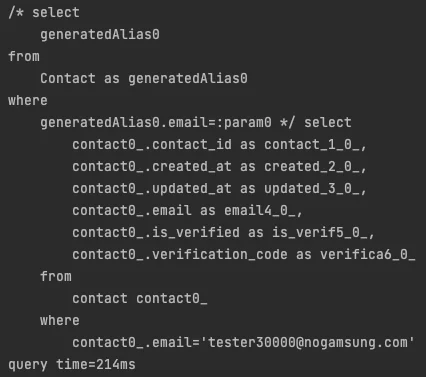
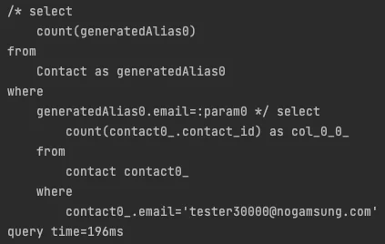
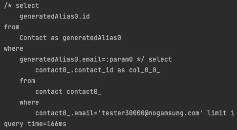

## 들어가며

대부분의 서비스는 가입할 때 아이디나 이메일이 이미 있는지 검사합니다. 저도 그 검사를 별생각 없이 `findByEmail`로 짜 왔습니다. 결과가 `Optional`이니 `isPresent()`만 보면 된다고 생각했습니다.

그런데 중복 검사에 필요한 답은 "있다/없다" 하나뿐입니다. 그 답 하나를 얻으려고 행 전체를 가져올 필요가 있을까요? Spring Data JPA가 제공하는 세 가지 쿼리 메서드, `findBy`·`countBy`·`existsBy`를 같은 조건에서 돌려 보고 실제로 나가는 SQL을 비교했습니다.

## 1. 실험 조건 🧪

이메일을 가진 `Contact` 엔티티에서 중복을 검사하는 상황입니다. `email` 컬럼에는 유니크 제약이 걸려 있습니다.

```java
@Getter
@Entity
@NoArgsConstructor(access = AccessLevel.PROTECTED)
public class Contact extends BaseEntity {
    // ...
    @Column(nullable = false, unique = true)
    private String email;
    // ...
}
```

테스트 전에 `tester1@nogamsung.com`부터 `tester50000@nogamsung.com`까지 5만 건을 넣어 두고, 세 메서드 모두 `tester30000@nogamsung.com`을 조회했습니다.

{: width="1100" height="520" }

## 2. findBy: 행 전체를 가져온다 📦

```java
public interface ContactRepository extends JpaRepository<Contact, Long> {
    Optional<Contact> findByEmail(String email);
}
```

```java
@Test
void findByEmail() {
    // given
    String email = "tester30000@nogamsung.com";

    // when
    Optional<Contact> result = contactRepository.findByEmail(email);

    // then
    assertThat(result).isPresent();
}
```

로그를 보면 `contact` 테이블의 컬럼 6개를 전부 `SELECT`합니다. 중복 검사에는 하나도 쓰지 않는 `verification_code`, `created_at` 같은 값까지 네트워크로 받아 엔티티로 매핑하고, 영속성 컨텍스트에도 올립니다.

{: width="426" height="377" }

결과는 **214ms**였습니다.

## 3. countBy: 개수를 센다 🔢

```java
public interface ContactRepository extends JpaRepository<Contact, Long> {
    int countByEmail(String email);
}
```

```java
@Test
void countByEmail() {
    // given
    String email = "tester30000@nogamsung.com";

    // when
    int result = contactRepository.countByEmail(email);

    // then
    assertThat(result).isEqualTo(1);
}
```

`count(contact_id)` 하나만 가져오니 전송량은 줄었습니다. 하지만 `count`는 "조건에 맞는 행이 **몇 개인지**"를 묻는 쿼리라서, 원칙적으로 일치하는 행을 끝까지 세야 합니다. 이 예제는 유니크 제약 덕분에 일치하는 행이 최대 1건이라 손해가 작지만, 유니크가 아닌 컬럼이었다면 일치하는 행을 전부 세고 나서야 답이 나옵니다. 중복 검사에는 필요 없는 정보입니다.

{: width="423" height="268" }

결과는 **196ms**였습니다.

## 4. existsBy: 하나 찾으면 멈춘다 ✅

```java
public interface ContactRepository extends JpaRepository<Contact, Long> {
    boolean existsByEmail(String email);
}
```

```java
@Test
void existsByEmail() {
    // given
    String email = "tester30000@nogamsung.com";

    // when
    boolean result = contactRepository.existsByEmail(email);

    // then
    assertThat(result).isTrue();
}
```

Spring Data JPA는 `existsBy`를 `contact_id` 하나만 고르고 끝에 `limit 1`을 붙인 쿼리로 바꿉니다. 첫 행을 찾는 순간 멈추고, Java에는 `boolean` 하나만 돌아옵니다. 질문과 답의 모양이 정확히 맞습니다.

{: width="485" height="266" }

결과는 **166ms**였습니다.

## 5. 결과 비교 📊

| | findBy | countBy | existsBy |
|---|---|---|---|
| SELECT 대상 | 컬럼 6개 전부 | `count(contact_id)` | `contact_id` + `limit 1` |
| 반환 타입 | `Optional<Contact>` | `int` | `boolean` |
| 멈추는 시점 | 일치하는 행을 모두 가져온 뒤 | 일치하는 행을 모두 센 뒤 | 첫 행을 찾았을 때 |
| query time | 214ms | 196ms | **166ms** |

`existsBy`는 `findBy`보다 쿼리 시간이 약 22% 짧았습니다. 다만 각 메서드를 한 번씩 실행한 측정이라, 숫자 자체보다 **쿼리가 무엇을 묻고 무엇을 돌려받는지**의 차이를 보는 게 맞습니다. 그 차이는 데이터가 늘거나 컬럼이 많아질수록, 또 유니크가 아닌 컬럼을 검사할수록 커집니다.

> 질문이 "있나?"라면 쿼리도 "있나?"만 묻게 한다. 행을 가져오거나 개수를 세는 건 다른 질문이다.
{: .prompt-tip }

## 마무리

- `findBy`로 중복을 검사하면 쓰지 않을 컬럼까지 전송하고 엔티티로 매핑한다.
- `countBy`는 개수를 묻는 쿼리라 일치하는 행을 끝까지 센다. 유니크 컬럼에서는 차이가 작지만 비유니크 컬럼에서는 손해가 커진다.
- `existsBy`는 식별자 하나에 `limit 1`을 붙여 첫 행에서 멈추고 `boolean`만 돌려준다. 중복 검사에는 이것이 맞다.
- 성능 비교는 수치보다 실제로 나가는 SQL을 먼저 본다.

> 참고
> - [Spring Data JPA Reference: Query Methods](https://docs.spring.io/spring-data/jpa/reference/jpa/query-methods.html)
> - [Spring Data JPA Reference: Supported query method subject keywords](https://docs.spring.io/spring-data/jpa/reference/repositories/query-keywords-reference.html)
{: .prompt-info }
