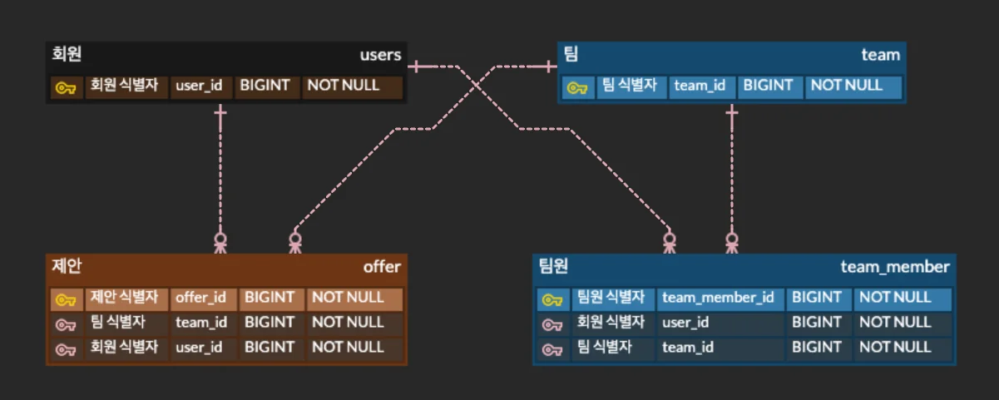
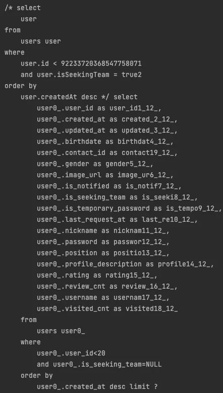
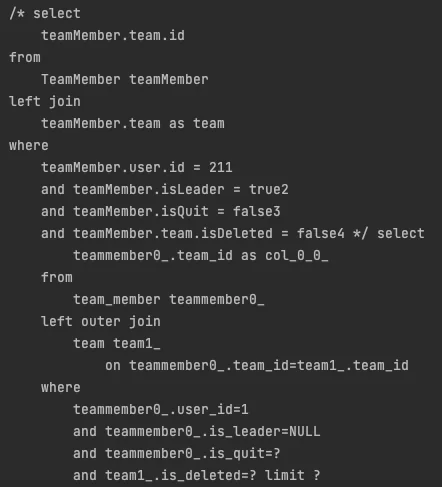
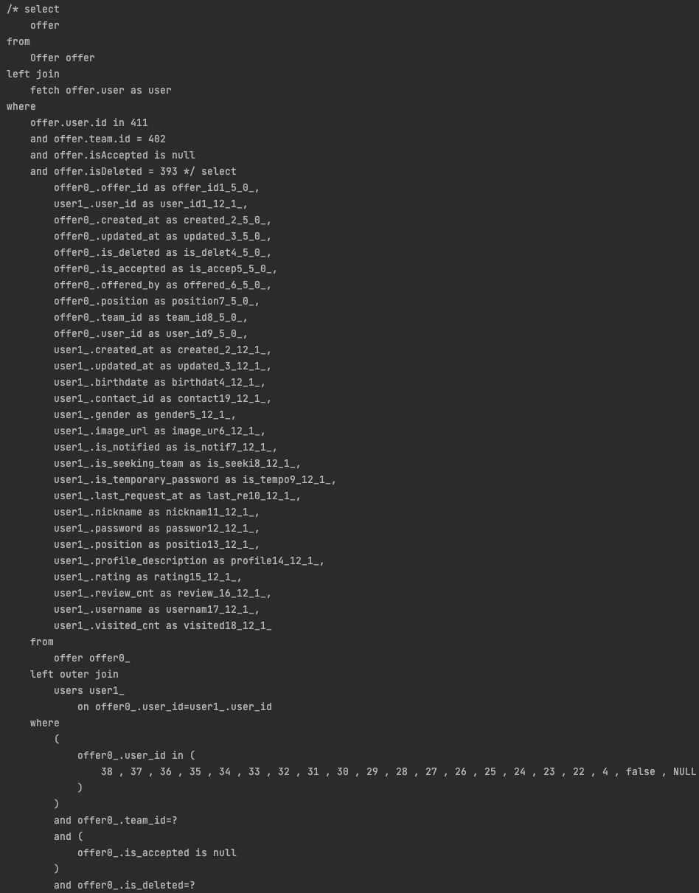

## 들어가며

사이드 프로젝트 '가보자IT'는 사이드 프로젝트를 함께할 팀원이나 팀을 찾는 서비스입니다. 팀 리더는 팀을 찾고 있는 회원 목록을 보고, 마음에 드는 회원에게 합류를 **제안**할 수 있습니다.

이 목록 API에서 N+1 문제가 있었습니다. 회원 20명을 보여 주려고 쿼리가 22번 나가고 있었습니다. 이번 글은 그 반복 조회를 IN 절 한 번으로 묶은 이야기입니다.

## 1. N+1과 이 API의 구조 🧩

**N+1**은 엔티티 목록을 한 번 조회(1)한 뒤, 각 엔티티의 연관 데이터를 가져오느라 목록 크기(N)만큼 쿼리가 더 나가는 현상입니다. 목록이 20건이면 쿼리는 21번, 100건이면 101번이 됩니다.

이 API에 관련된 테이블은 넷입니다. 회원(`users`)과 팀(`team`)이 있고, 둘은 팀원(`team_member`)으로 이어집니다. 제안(`offer`)은 어떤 팀이 어떤 회원에게 보낸 것인지를 `team_id`와 `user_id`로 가집니다.

{: width="1201" height="481" }

## 2. 개선 전: 회원마다 제안을 조회했다 🐢

기존 로직은 `JpaRepository` 메서드로 하나씩 조회하는 형태였습니다.

1. 포지션으로 필터해서 회원을 페이징 조회한다. (쿼리 1번)
2. 조회하는 사람이 리더로 있는 팀을 조회한다. (쿼리 1번)
3. 팀 리더라면 1단계에서 조회한 회원마다 반복문을 돌며 현재 제안이 있는지 조회한다. (쿼리 N번)
4. 팀 리더가 아니라면 1단계에서 조회한 회원들을 그대로 반환한다.

팀 리더가 페이지 크기 20으로 조회하면 `1 + 1 + 20`, 총 **22번**의 쿼리가 나갑니다. 응답 시간은 **0.337초**였습니다.

{: width="1100" height="470" }

## 3. 개선 후: 제안을 IN 절 한 번으로 🛠️

반복문 안에서 회원마다 나가던 3단계를, 회원 식별자 목록을 받아 IN 절 한 번으로 조회하도록 Querydsl로 바꿨습니다.

```java
public List<Offer> findAllByUserIds(List<Long> userIds, long offerorUserId) {
    Long teamId = queryFactory
            .select(teamMember.team.id)
            .from(teamMember)
            .leftJoin(teamMember.team, team)
            .where(
                    teamMember.user.id.eq(offerorUserId),
                    teamMember.isLeader.isTrue(),
                    teamMember.isQuit.isFalse(),
                    teamMember.team.isDeleted.isFalse()
            ).fetchFirst();

    if (teamId == null) return List.of();

    return queryFactory
            .select(offer)
            .from(offer)
            .where(
                    offer.user.id.in(userIds),
                    offer.team.id.eq(teamId),
                    offer.isAccepted.isNull(),
                    offer.isDeleted.isFalse()
            ).fetch();
}
```

먼저 조회하는 사람이 리더로 있는 팀을 찾고, 없으면 빈 목록을 돌려줍니다. 리더가 아닌 경우를 별도 분기 없이 같은 흐름에서 처리할 수 있습니다. 팀이 있으면 `offer.user.id.in(userIds)`로 페이지에 있는 회원들의 제안을 한 번에 가져옵니다.

서비스에서는 가져온 제안을 회원 식별자로 묶어 `Map`을 만들고, 회원마다 꺼내 붙입니다.

```java
public Page<ProfileOfferResponse> findPageUser(String username, Position position, long pageFrom, int pageSize) {
    User user = findUser(username);

    Page<User> users = userRepository.findPage(position, pageFrom, pageSize);

    List<Offer> offers = offerRepository.findAllByUserIds(users.stream()
                    .map(User::getId)
                    .collect(Collectors.toList()),
            user.getId());

    Map<Long, List<Offer>> oMap = offers.stream()
            .collect(Collectors.groupingBy(o -> o.getUser().getId()));
    List<ProfileOfferResponse> responses = users.stream()
            .map(u -> new ProfileOfferResponse(u, oMap.getOrDefault(u.getId(), Collections.emptyList())))
            .collect(Collectors.toList());

    return new PageImpl<>(responses, Pageable.ofSize(pageSize), users.getTotalElements());
}
```

{: width="1100" height="470" }

제안이 없는 회원은 `Map`에 키가 없으니 `getOrDefault`로 빈 목록을 붙입니다. 회원 수가 늘어도 다시 조회하는 일은 없습니다.

## 4. 쿼리 로그로 확인하기 🪵

개선 후에 나가는 쿼리는 세 번입니다.

**① 회원 페이징 쿼리.** 팀을 찾고 있는 회원을 커서 기반으로 가져옵니다. 이 쿼리는 [Querydsl 동적 쿼리]()로 만든 것입니다.

{: width="442" height="776" }

**② 리더인 팀 조회 쿼리.** 조회하는 사람이 리더로 있고, 팀을 나가지 않았고, 삭제되지 않은 팀의 식별자를 하나 가져옵니다.

{: width="442" height="487" }

**③ 제안 IN 절 쿼리.** 페이지에 있는 회원들의 식별자를 IN 절에 넣어 제안을 한 번에 가져옵니다.

{: width="948" height="1211" }

응답 시간은 **0.039초**였습니다.

## 5. 결과 📊

| | 개선 전 | 개선 후 |
|---|---|---|
| 쿼리 수 (회원 20명, 팀 리더) | 22번 (`2 + N`) | 3번 |
| 응답 시간 | 0.337초 | 0.039초 (약 8.6배 빠름) |

같은 환경에서 회원 20명을 조회할 때 응답 시간이 0.337초에서 0.039초로, 약 8.6배 빨라졌습니다. 더 중요한 건 쿼리 수가 더 이상 페이지 크기에 비례하지 않는다는 점입니다.

> 반복문 안에 쿼리가 있으면 N+1이다. 식별자를 먼저 모으고, IN 절 한 번으로 가져와서, `Map`으로 다시 붙인다.
{: .prompt-tip }

## 마무리

- N+1은 목록 크기만큼 쿼리가 늘어나는 구조의 문제다. 페이지 크기가 커질수록 그대로 비싸진다.
- 연관 데이터는 식별자 목록으로 IN 절 한 번에 가져오고, `groupingBy`로 묶어 메모리에서 다시 붙인다.
- 연관 데이터가 없는 엔티티는 `getOrDefault`로 빈 목록을 준다. 다시 조회하지 않는다.
- 리더가 아닌 경우처럼 조회할 필요가 없는 경우는 빈 목록을 바로 돌려줘 쿼리를 아낀다.

이후 성능 테스트에서 IN 절로도 잡히지 않는 N+1을 하나 더 만났습니다. 그 이야기는 [IN 절로도 안 잡히던 N+1, @OneToOne 지연 로딩이 프록시를 못 만들 때]()에 이어서 적었습니다.

> 참고
> - [Querydsl Reference Guide](https://querydsl.com/static/querydsl/latest/reference/html/)
> - [조건마다 메서드를 늘리지 않기, Querydsl로 커서 페이지네이션 동적 쿼리 만들기]()
> - [IN 절로도 안 잡히던 N+1, @OneToOne 지연 로딩이 프록시를 못 만들 때]()
{: .prompt-info }
