## 들어가며

'가보자IT'에는 팀을 찾는 회원 목록이 있습니다. 처음에는 전체 목록만 있었는데, 곧 "백엔드 개발자만 보기" 같은 포지션 필터가 붙었습니다. 필터가 있을 때와 없을 때 쿼리를 각각 만들다 보니, 조건이 하나 늘 때마다 메서드가 두 배로 늘어날 것이 보였습니다.

이 글은 그 두 쿼리를 Querydsl **동적 쿼리** 하나로 묶은 과정입니다. 동적 쿼리란 입력에 따라 조건이 달라지는 SQL을 실행 시점에 만들어 데이터베이스로 보내는 것을 말합니다.

## 1. 정적 쿼리로 짜면 조건마다 메서드가 생긴다 🧱

`users` 테이블에서 회원을 **커서 기반**으로 페이지네이션한다고 해 보겠습니다. 커서 기반은 "이 id보다 작은 것 중 10건"처럼 이전 페이지의 마지막 값을 기준으로 다음 페이지를 자르는 방식입니다.

**예시 1: 전체 회원.**

```sql
SELECT * FROM users WHERE user_id < 100 ORDER BY created_at DESC LIMIT 10;
```

**예시 2: 포지션이 `BACKEND`인 회원.**

```sql
SELECT * FROM users WHERE user_id < 100 AND position = 'BACKEND' ORDER BY created_at DESC LIMIT 10;
```

Spring Data JPA의 메서드 이름 쿼리로 이 둘을 만들면 조건마다 메서드가 하나씩 필요합니다.

```java
public interface UserRepository extends JpaRepository<User, Long> {
    Page<User> findByIdLessThan(Long id, Pageable pageable);

    Page<User> findByIdLessThanAndPosition(Long id, Position position, Pageable pageable);
}
```

Querydsl로 짜더라도 조건을 고정해 두면 사정은 같습니다. 예시 1은 이렇게 됩니다.

```java
@RequiredArgsConstructor
public class UserRepositoryImpl implements UserCustomRepository {
    private final JPAQueryFactory queryFactory;

    @Override
    public Page<User> findByPage(long pageFrom, int pageSize) {
        Long count = queryFactory.select(user.count())
                .from(user)
                .where(
                        user.isSeekingTeam.isTrue()
                ).fetchOne();

        Pageable pageable = Pageable.ofSize(pageSize);

        if (count == null || count == 0)
            return new PageImpl<>(List.of(), pageable, 0);

        List<User> users = queryFactory.selectFrom(user)
                .where(
                        user.id.lt(pageFrom),
                        user.isSeekingTeam.isTrue()
                ).orderBy(user.createdAt.desc())
                .limit(pageSize)
                .fetch();

        return new PageImpl<>(users, pageable, count);
    }
}
```

예시 2는 조건 하나만 다른데도 메서드를 통째로 하나 더 만들어야 합니다.

```java
@Override
public Page<User> findByPage(Position position, long pageFrom, int pageSize) {
    Long count = queryFactory.select(user.count())
            .from(user)
            .where(
                    user.position.eq(position)
            ).fetchOne();

    Pageable pageable = Pageable.ofSize(pageSize);

    if (count == null || count == 0)
        return new PageImpl<>(List.of(), pageable, 0);

    List<User> users = queryFactory.selectFrom(user)
            .where(
                    user.id.lt(pageFrom),
                    user.position.eq(position)
            ).orderBy(user.createdAt.desc())
            .limit(pageSize)
            .fetch();

    return new PageImpl<>(users, pageable, count);
}
```

필터가 두 개가 되면 조합은 네 가지, 세 개면 여덟 가지입니다. 이렇게는 오래 못 갑니다.

## 2. 동적 쿼리 도구 고르기 🧰

메서드 이름 쿼리는 조건이 이름에 박혀 있어서 실행 시점에 조건을 빼거나 넣을 수 없습니다. 동적 쿼리를 만들 수 있는 방법은 여럿입니다.

| 방법 | 조건 조합 | 오류를 발견하는 시점 |
|---|---|---|
| 메서드 이름 쿼리 | 조합마다 메서드 | 애플리케이션 시작 시 |
| JPQL 문자열 이어 붙이기 | 가능 | 실행 시 |
| JPA Criteria / Specification | 가능 | 메타모델을 쓰면 컴파일 시, 다만 코드가 장황하다 |
| Querydsl | 가능 | 컴파일 시, SQL과 비슷하게 읽힌다 |

이 중 컴파일 단계에서 오류를 잡을 수 있고 코드가 SQL처럼 읽히는 Querydsl을 골랐습니다.

## 3. null을 돌려주면 조건이 빠진다 🪄

핵심은 Querydsl의 `where()`가 **`null` 조건을 무시한다**는 점입니다. 조건을 만드는 메서드가 상황에 따라 `null`을 돌려주게 하면, 한 쿼리가 두 가지 SQL을 만들어 냅니다.

```java
@RequiredArgsConstructor
public class UserRepositoryImpl implements UserCustomRepository {
    private final JPAQueryFactory queryFactory;

    @Override
    public Page<User> findPage(Position position, long pageFrom, int pageSize) {
        Long count = queryFactory.select(user.count())
                .from(user)
                .where(
                        positionEq(position)
                ).fetchOne();

        Pageable pageable = Pageable.ofSize(pageSize);

        if (count == null || count == 0)
            return new PageImpl<>(List.of(), pageable, 0);

        List<User> users = queryFactory.selectFrom(user)
                .where(
                        user.id.lt(pageFrom),
                        positionEq(position)
                ).orderBy(user.createdAt.desc())
                .limit(pageSize)
                .fetch();

        return new PageImpl<>(users, pageable, count);
    }

    private Predicate positionEq(Position position) {
        return position != Position.NONE ? user.position.eq(position) : null;
    }
}
```

`positionEq()`는 포지션이 `NONE`이면 `null`을, 그 밖에는 `user.position.eq(position)`을 돌려줍니다. `where(a, b, null)`은 `where(a, b)`와 같으므로 `NONE`일 때는 포지션 조건 없이, `BACKEND`일 때는 포지션 조건이 붙은 SQL이 나갑니다.

{: width="1100" height="470" }

필터가 늘어나도 조건 메서드를 하나씩 추가해 `where()`에 넣기만 하면 됩니다. 조합의 수만큼 쿼리를 만들 필요가 없습니다.

## 4. 커서 페이지네이션의 흐름 🔁

같은 메서드 안에서 쿼리는 두 번 나갑니다.

1. **count 쿼리**로 조건에 맞는 전체 개수를 셉니다. 전체 개수이므로 커서 조건(`user.id.lt(pageFrom)`)은 넣지 않습니다.
2. 개수가 0이면 목록 쿼리를 보내지 않고 빈 페이지를 바로 돌려줍니다.
3. **목록 쿼리**는 커서 조건과 필터를 함께 걸고 `limit`으로 페이지 크기만큼만 가져옵니다.

다음 페이지는 이전 페이지의 마지막 id를 `pageFrom`으로 넘겨 요청합니다. 첫 페이지는 기준이 될 id가 없으니, 이 프로젝트에서는 `Long.MAX_VALUE`를 넘겼습니다.

{: width="1100" height="500" }

오프셋 방식과 비교하면 이렇습니다.

| | 오프셋 (`OFFSET n LIMIT 10`) | 커서 (`WHERE id < ? LIMIT 10`) |
|---|---|---|
| 다음 페이지 기준 | 몇 건을 건너뛸지 | 이전 페이지의 마지막 값 |
| 뒤쪽 페이지 비용 | 건너뛸 행을 읽고 버린다 | 인덱스에서 기준 값부터 읽는다 |
| 조회 중 데이터가 추가되면 | 중복·누락이 생길 수 있다 | 기준 값 이후만 읽어 영향이 적다 |
| 임의 페이지로 이동 | 쉽다 | 어렵다 |

## 5. 주의: 커서 키와 정렬 키를 맞춘다 ⚠️

위 코드는 `user.id`로 커서를 자르면서 정렬은 `created_at`으로 합니다. 회원 id가 `IDENTITY`로 생성 순서대로 증가하는 동안에는 두 순서가 같아서 문제가 드러나지 않습니다. 하지만 두 순서가 한 번이라도 어긋나면, 예를 들어 `created_at`을 따로 넣거나 고치는 경우, 페이지 경계에서 회원이 빠지거나 두 번 나옵니다.

커서로 쓰는 값과 정렬 기준은 같은 컬럼으로 두는 것이 안전합니다.

```java
List<User> users = queryFactory.selectFrom(user)
        .where(
                user.id.lt(pageFrom),
                positionEq(position)
        ).orderBy(user.id.desc())
        .limit(pageSize)
        .fetch();
```

> 커서 조건에 쓰는 컬럼과 `ORDER BY` 컬럼은 같아야 한다. 다르면 "이 값 다음"이라는 말이 성립하지 않는다.
{: .prompt-tip }

## 마무리

- 메서드 이름 쿼리와 고정된 쿼리는 조건 조합마다 메서드가 늘어난다.
- Querydsl의 `where()`는 `null` 조건을 무시한다. 조건 메서드가 상황에 따라 `null`을 돌려주게 하면 쿼리 하나로 여러 SQL을 만든다.
- count 쿼리에는 커서 조건을 넣지 않고, 개수가 0이면 목록 쿼리를 건너뛴다.
- 커서 키와 정렬 키는 같은 컬럼으로 둔다.

이 `findPage`는 [IN 절로 N+1 문제를 해결](/posts/n-plus-1-in-clause/)한 글에서 회원 목록을 가져오는 첫 쿼리로도 쓰였습니다.

> 참고
> - [Querydsl Reference Guide](https://querydsl.com/static/querydsl/latest/reference/html/)
> - [Spring Data JPA Reference: Query Methods](https://docs.spring.io/spring-data/jpa/reference/jpa/query-methods.html)
> - [Spring Data JPA Reference: Specifications](https://docs.spring.io/spring-data/jpa/reference/jpa/specifications.html)
{: .prompt-info }
