## 들어가며

사이드 프로젝트 '가보자IT'를 전체 리팩터링하면서 N+1 문제를 하나씩 걷어냈습니다. 대부분은 Querydsl의 IN 절로 해결했고, 그 과정은 [IN 절로 N+1 문제 해결]()에 적어 두었습니다.

그런데 성능 테스트를 하다가 N+1이 **다시** 보였습니다. IN 절로 다 막았다고 생각한 API에서, 조회한 회원 수만큼 쿼리가 줄줄이 나가고 있었습니다. 이번 글은 그 원인이 `@OneToOne`이었다는 이야기입니다.

## 1. 회원과 연락처는 일대일이다 🔗

요구사항은 "이메일 하나당 계정 하나"입니다. 회원이 여러 연락처를 가질 일이 없으니 회원(`User`)과 연락처(`Contact`)는 `@OneToOne`으로 묶었습니다. 기본값인 `EAGER`는 나중에 문제가 될 것 같아 처음부터 `LAZY`로 바꿔 두었습니다.

```java
@Getter
@Entity(name = "users")
@NoArgsConstructor(access = AccessLevel.PROTECTED)
public class User extends BaseEntity implements UserDetails {

    @Id
    @GeneratedValue(strategy = GenerationType.IDENTITY)
    @Column(name = "user_id")
    private Long id;

    @OneToOne(fetch = FetchType.LAZY, cascade = CascadeType.REMOVE, orphanRemoval = true)
    @JoinColumn(name = "contact_id", nullable = false)
    private Contact contact;

    // ...
}
```

`LAZY`이니 `contact`를 건드리지 않는 한 쿼리는 나가지 않을 것이라고 생각했습니다. 이 생각이 틀렸습니다.

## 2. 문제가 난 곳: 팀을 찾는 회원 페이징 조회 🔍

문제가 난 API는 "팀을 찾는 회원" 목록입니다. 로직은 네 단계입니다.

1. 회원을 페이징 조회한다.
2. 조회된 회원들의 식별자로 회원들의 기술을 **IN 절로** 한 번에 조회한다.
3. 조회된 회원들에게 이미 보내거나 받은 제안을 **IN 절로** 한 번에 조회한다.
4. `Map`으로 회원과 기술, 제안을 묶어 반환한다.

```java
public PageData<List<ProfileOfferResponse>> findPageUser(String username, Position position, long pageFrom, int pageSize) {
    User user = findUser(username);

    Page<User> users = userRepository.findPage(position, pageFrom, pageSize);
    List<Long> userIds = users.stream().map(User::getId).collect(Collectors.toList());

    List<Skill> skills = skillRepository.findAllInFetchUser(userIds);            // IN 절
    List<Offer> offers = offerRepository.findAllInUserIds(userIds, user.getId()); // IN 절

    Map<Long, List<Skill>> sMap = skills.stream().collect(Collectors.groupingBy(s -> s.getUser().getId()));
    Map<Long, List<Offer>> oMap = offers.stream().collect(Collectors.groupingBy(o -> o.getUser().getId()));

    List<ProfileOfferResponse> responses = users.stream()
            .map(u -> new ProfileOfferResponse(u,
                    sMap.getOrDefault(u.getId(), Collections.emptyList()),
                    oMap.getOrDefault(u.getId(), Collections.emptyList())))
            .collect(Collectors.toList());

    return new PageData<>(responses, users.getTotalElements());
}
```

연관 데이터는 전부 IN 절로 한 번씩만 가져옵니다. 설계대로라면 쿼리는 네 번(count, 회원, 기술, 제안)이어야 합니다.

## 3. 로그로 따라가기 🪵

{: width="1100" height="520" }

page-size를 50으로 두고 쿼리 로그를 순서대로 보았습니다.

**① 회원 count 쿼리.** 페이징 조회라 전체 개수를 먼저 셉니다.

{: width="811" height="262" }

**② 회원 페이징 쿼리.** 커서 기반으로 회원 목록을 가져옵니다.

{: width="811" height="796" }

**③ 기술 IN 절 쿼리.** 조회된 회원들의 식별자로 기술을 한 번에 가져옵니다. 여기까지는 의도대로입니다.

{: width="927" height="1101" }

**④ 연락처 쿼리가 회원 수만큼.** 여기서 갑자기 조회된 회원 수만큼 연락처 `SELECT`가 나갑니다. 코드 어디에서도 `contact`를 읽지 않았는데도요.

{: width="811" height="790" }

**⑤ 제안 IN 절 쿼리.** 마지막으로 제안을 한 번에 가져옵니다.

{: width="811" height="640" }

이 상태의 응답 시간은 **124ms**였습니다.

{: width="916" height="26" }

## 4. 원인: LAZY라고 다 지연되는 건 아니다 🧐

{: width="1100" height="560" }

`FetchType.LAZY`는 "지금 가져오지 말라"는 **힌트**이지 보장이 아닙니다. 지연 로딩이 동작하려면 Hibernate가 연관 필드 자리에 일단 **프록시**를 넣어 두고, 실제로 접근할 때 쿼리를 날려야 합니다.

문제는 `@OneToOne`에서는 이 프록시를 만들 수 없는 경우가 있다는 점입니다. `@ManyToOne`이라면 "연관 객체가 있다면 이 id"라는 사실만으로 프록시를 만들면 됩니다. 반면 일대일 관계에서는 연관 객체가 **있는지 없는지**부터 알아야 프록시를 넣을지 `null`을 넣을지 정할 수 있고, 특히 외래 키를 갖지 않은 쪽(`mappedBy` 쪽)은 테이블만 보고는 그걸 알 수 없습니다. 이때 Hibernate는 확인하려고 **즉시 쿼리를 날립니다.** 엔티티 하나를 채울 때마다 한 번씩이니, 회원 50명이면 연락처 쿼리 50번입니다.

정리하면 이렇습니다.

| 관계 | 프록시 | `LAZY`가 지켜지나 |
|---|---|---|
| `@ManyToOne` | 외래 키 값만으로 만든다 | 지켜진다 |
| `@OneToOne` (외래 키를 가진 쪽) | 대체로 만든다 | 대체로 지켜진다 |
| `@OneToOne` (`mappedBy` 쪽) | 존재 여부를 모르니 못 만든다 | **즉시 조회로 바뀐다** |

### 테스트 600개가 놓친 이유

이 프로젝트에는 테스트가 600개 넘게 있었는데도 이 문제를 못 잡았습니다. 이유는 둘이었습니다.

1. 페이징 테스트를 **작은 데이터**로만 돌렸다. 회원 두세 명이면 연락처 쿼리 두세 번은 눈에 띄지 않는다.
2. 로그를 볼 때 **IN 절이 제대로 나가는지만** 확인했다. 보고 싶은 쿼리만 봤다.

## 5. 해결: default_batch_fetch_size 🛠️

가장 쉬운 방법은 Hibernate의 배치 페치입니다. 같은 종류의 지연 로딩을 하나씩 날리지 않고 IN 절로 모아서 한 번에 가져오게 합니다.

```yaml
# application.yml
spring:
  jpa:
    properties:
      hibernate:
        default_batch_fetch_size: 100
```

```properties
# application.properties
spring.jpa.properties.hibernate.default_batch_fetch_size=100
```

값은 서버 사양과 데이터 규모에 따라 100에서 1000 사이로 많이 씁니다. 이 프로젝트는 AWS 프리 티어에서 돌아가서 100으로 두었습니다.

적용하자 회원 수만큼 나가던 연락처 쿼리가 IN 절 한 번으로 줄었습니다.

{: width="811" height="307" }

응답 시간은 **124ms에서 54ms**가 됐습니다.

{: width="916" height="26" }

| | 개선 전 | 개선 후 |
|---|---|---|
| 연락처 쿼리 (page-size 50) | 50번 | 1번 (IN 절) |
| 응답 시간 | 124ms | 54ms (약 2.3배 빠름) |

## 6. 다른 선택지: @ManyToOne으로 바꾸기 🤔

근본 원인이 일대일 관계의 특성이니, 관계를 `@ManyToOne`으로 바꾸면 프록시 문제 자체가 사라집니다. 하지만 이 방법은 고르지 않았습니다.

- 회원이 연락처를 둘 이상 가질 일이 없다. 도메인은 분명히 일대일이다.
- 연락처를 새로 인증해 갱신하는 경우에도 기존 행을 바꾸면 될 뿐, 다대일이 필요하지 않다.

쿼리 하나를 줄이려고 도메인이 말하는 관계를 바꾸는 것보다, 설정 한 줄로 배치 페치를 켜는 쪽이 맞다고 판단했습니다.

## 마무리

- `FetchType.LAZY`는 힌트다. 프록시를 만들 수 없으면 Hibernate는 즉시 조회로 채운다.
- `@OneToOne`은 연관 객체가 있는지부터 알아야 프록시를 만들 수 있어서, 외래 키가 없는 쪽에서는 지연 로딩이 깨진다.
- IN 절로 연관 데이터를 모아 와도, 엔티티를 채우는 순간 일어나는 조회는 따로 본다. `default_batch_fetch_size`가 그 조회를 IN 절로 묶어 준다.
- 테스트는 작은 데이터로만 돌리면 N+1을 못 본다. 로그는 보고 싶은 쿼리만 보지 말고 전부 센다.

> 참고
> - [How can I make a JPA OneToOne relation lazy (Stack Overflow)](https://stackoverflow.com/questions/1444227/how-can-i-make-a-jpa-onetoone-relation-lazy)
> - [Hibernate ORM User Guide: Batch fetching](https://docs.jboss.org/hibernate/orm/6.6/userguide/html_single/Hibernate_User_Guide.html#fetching-batch)
> - [IN 절로 N+1 문제 해결]()
{: .prompt-info }
