## 들어가며

회사에서 ISMS 심사를 받기로 하면서, 지원이 끝난(deprecated) 버전은 반드시 올려야 한다는 요구가 내려왔습니다. 그래서 Spring Boot 2로 돌던 프로젝트들을 Spring Boot 3으로 올리게 됐습니다.

Spring Boot 2에서 쓰던 Java 11은 당장은 여유가 있었지만, 어차피 여러 프로젝트를 한꺼번에 올리는 김에 Java도 21로 함께 올리기로 했습니다.

| 항목 | 전 | 후 |
|---|---|---|
| Java | 11 | **21** |
| Spring Boot | 2.7.1 | **3.3.0** |
| io.spring.dependency-management | 1.0.11.RELEASE | 1.1.5 |
| Gradle 래퍼 | 7.6.1 | 8.7 |
| Querydsl | 5.0.0 | 5.0.0 (`jakarta` classifier) |

이 글은 그 업그레이드를 어떤 순서로 쪼갰는지, 그리고 단계마다 무엇을 바꿨는지 정리한 글입니다.

## 1. 한 번에 넘어가지 않는다 🪜

{: width="1100" height="500" }

2.7.1에서 3.3.0으로 바로 올리면 컴파일 오류가 쏟아지고, 그게 버전 차이 때문인지 라이브러리 때문인지 구분하기 어렵습니다. 그래서 세 단계로 나눴습니다.

| 단계 | 내용 | 확인할 것 |
|---|---|---|
| 1 | Java 21 + Spring Boot **2.x 마지막 버전**(2.7.18) | 라이브러리 의존성, deprecated 경고 |
| 2 | Spring Boot **3.3.0**, Gradle 8.7, Querydsl jakarta | `gradle build` 통과 |
| 3 | 코드 변경 | javax→jakarta, SecurityConfig, 엔티티·Querydsl 점검 |

## 2. 1단계: Java 21과 2.x 마지막 버전 ☕

먼저 Spring Boot를 2.7.x의 가장 최신 버전으로 맞추고, 라이브러리 의존성에 문제가 없는지 확인합니다. 3.x에서 사라질 API는 2.7.x에서 대부분 deprecated 경고로 먼저 보이기 때문에, 이 단계에서 경고를 걷어 내면 다음 단계가 훨씬 가벼워집니다.

**변경 전** `build.gradle`

```groovy
plugins {
    id 'java'
    id 'org.springframework.boot' version '2.7.1'
    // ...
}

sourceCompatibility = '11'

dependencies {
    implementation 'mysql:mysql-connector-java'
    // ...
}
```

**변경 후** `build.gradle`

```groovy
plugins {
    id 'java'
    id 'org.springframework.boot' version '2.7.18'
    // ...
}

sourceCompatibility = '21'

dependencies {
    implementation 'mysql:mysql-connector-java'
    // ...
}
```

> MySQL 드라이버 좌표는 `com.mysql:mysql-connector-j`로 바뀌었습니다. Spring Boot 3.0부터는 예전 좌표인 `mysql:mysql-connector-java`의 버전을 관리하지 않으므로, 3.x로 넘어갈 때 함께 바꿔야 합니다.
{: .prompt-warning }

## 3. 2단계: Spring Boot 3.3과 Gradle 8.7 🛠️

이제 Spring Boot를 최신 버전으로 올립니다. 아래처럼 바꾸면 `gradle build`가 통과합니다.

### build.gradle

**변경 전**

```groovy
buildscript {
    ext {
        queryDslVersion = "5.0.0"
    }
}

plugins {
    id 'java'
    id 'org.springframework.boot' version '2.7.18'
    id 'io.spring.dependency-management' version '1.0.11.RELEASE'
    // ...
}

dependencies {
    implementation "com.querydsl:querydsl-jpa:${queryDslVersion}"
    annotationProcessor "com.querydsl:querydsl-apt:5.0.0:jpa"
    annotationProcessor("jakarta.persistence:jakarta.persistence-api")
    annotationProcessor("jakarta.annotation:jakarta.annotation-api")
    // ...
}
```

**변경 후**

```groovy
plugins {
    id 'java'
    id 'org.springframework.boot' version '3.3.0'
    id 'io.spring.dependency-management' version '1.1.5'
    // ...
}

dependencies {
    implementation 'com.querydsl:querydsl-core:5.0.0'
    implementation 'com.querydsl:querydsl-jpa:5.0.0:jakarta'
    annotationProcessor "com.querydsl:querydsl-apt:5.0.0:jakarta"
    annotationProcessor 'jakarta.persistence:jakarta.persistence-api'
    annotationProcessor 'jakarta.annotation:jakarta.annotation-api'
    // ...
}
```

Querydsl 5.0.0은 기본 아티팩트가 `javax.persistence`를 바라봅니다. Spring Boot 3은 Jakarta EE 9+ 기반이라 `jakarta` classifier가 붙은 아티팩트를 써야 Q클래스가 `jakarta.persistence`로 생성됩니다. 버전을 `ext`로 따로 관리하던 `buildscript` 블록도 이때 걷어 냈습니다.

### gradle-wrapper.properties

**변경 전**

```properties
distributionUrl=https\://services.gradle.org/distributions/gradle-7.6.1-bin.zip
```

**변경 후**

```properties
distributionUrl=https\://services.gradle.org/distributions/gradle-8.7-bin.zip
```

Gradle 자체를 Java 21 위에서 실행하려면 Gradle 8.5 이상이 필요합니다. JDK를 21로 바꿨는데 래퍼가 7.x로 남아 있으면 빌드 스크립트를 읽는 단계에서부터 실패합니다.

## 4. 3단계: 코드 변경 ✍️

빌드 설정이 통과해도 컴파일은 아직 깨집니다. 크게 두 군데를 고쳤습니다.

### 4-1. javax → jakarta

Spring Boot 3은 Java EE(`javax.*`) 대신 Jakarta EE(`jakarta.*`) 패키지를 씁니다. 프로젝트 전체의 import를 바꿔야 합니다.

**변경 전**

```java
import javax.persistence.*;
import javax.annotation.*;
import javax.validation.*;
import javax.servlet.*;
```

**변경 후**

```java
import jakarta.persistence.*;
import jakarta.annotation.*;
import jakarta.validation.*;
import jakarta.servlet.*;
```

### 4-2. SecurityConfig: Spring Security 6 람다 DSL

Spring Boot 3은 Spring Security 6을 씁니다. 이전 버전의 체이닝 방식에서 바뀐 점은 이렇습니다.

| Spring Security 5.x (Boot 2.7) | Spring Security 6.x (Boot 3.3) |
|---|---|
| `.csrf().disable()` | `.csrf(AbstractHttpConfigurer::disable)` |
| `.and()`로 설정 이어 붙이기 | 설정마다 람다(`Customizer`)로 감싸기 |
| `authorizeRequests()` | `authorizeHttpRequests()` |
| `antMatchers(...)` | `requestMatchers(...)` (`antMatchers`는 제거) |
| `@EnableWebSecurity`에 `@Configuration` 포함 | `@Configuration`을 직접 붙여야 함 |

**변경 전** `SecurityConfig.java`

```java
@EnableWebSecurity
@RequiredArgsConstructor
public class SecurityConfig {

    @Bean
    protected SecurityFilterChain configure(HttpSecurity http) throws Exception {
        http
            .csrf()
            .disable()
            .exceptionHandling()
            .authenticationEntryPoint(jwtAuthenticationEntryPoint)
            .accessDeniedHandler(jwtAccessDeniedHandler)
            .and()
            .sessionManagement()
            .sessionCreationPolicy(SessionCreationPolicy.STATELESS)
            .and()
            .authorizeRequests()
            .antMatchers(WHITELIST).permitAll()
            .anyRequest().authenticated()
            .and()
            .apply(new JwtSecurityConfig(tokenProvider));

        return http.build();
    }
}
```

**변경 후** `SecurityConfig.java`

```java
@Configuration
@EnableWebSecurity
@RequiredArgsConstructor
public class SecurityConfig {

    @Bean
    protected SecurityFilterChain configure(HttpSecurity http) throws Exception {
        http
            .csrf(AbstractHttpConfigurer::disable)
            .exceptionHandling(customizer -> customizer
                .authenticationEntryPoint(jwtAuthenticationEntryPoint)
                .accessDeniedHandler(jwtAccessDeniedHandler))
            .sessionManagement(customizer -> customizer
                .sessionCreationPolicy(SessionCreationPolicy.STATELESS))
            .authorizeHttpRequests(customizer -> customizer
                .requestMatchers(AUTHENTICATE_LIST).authenticated()
                .requestMatchers(PERMIT_LIST).permitAll()
                .anyRequest().permitAll())
            .httpBasic(Customizer.withDefaults())
            .apply(new JwtSecurityConfig(tokenProvider));

        return http.build();
    }
}
```

변경 후 코드는 문법만 옮긴 게 아니라 인가 규칙의 모양도 바뀌어 있습니다. 변경 전에는 `WHITELIST`만 허용하고 나머지는 인증을 요구했고, 변경 후에는 `AUTHENTICATE_LIST`만 인증을 요구하고 나머지(`anyRequest()`)는 허용합니다. 문법을 옮기는 김에 규칙까지 바꿀 때는 이 차이를 의도한 것인지 반드시 확인해야 합니다.

> `HttpSecurity.apply(...)`는 Spring Security 6.2부터 deprecated입니다. 지금은 동작하지만, 다음 업그레이드를 생각하면 `with(configurer, Customizer.withDefaults())`로 바꿔 두는 편이 낫습니다.
{: .prompt-tip }

## 5. 빌드만 통과하면 끝이 아니다 ⚠️

빌드가 통과한 뒤에도 실행해 봐야 드러나는 것들이 있었습니다.

- **배포 설정.** ECS처럼 CodeBuild로 빌드하는 환경이라면 `buildspec.yml`의 Java 버전도 함께 바꿔야 합니다.
- **스키마를 포함한 테이블 이름.** 엔티티에 `@Table(name = "schema.table")`처럼 스키마를 이름에 붙여 두었다면 더 이상 테이블을 읽지 못합니다. `@Table(catalog = "schema", name = "table")`로 나눠 적어야 합니다. (MySQL에서는 스키마가 곧 catalog입니다.)
- **Querydsl 템플릿.** `Expressions.stringTemplate` 같은 템플릿 코드도 수정이 필요한 경우가 있어서, 모든 API의 코드를 점검해야 했습니다.

## 마무리

- 메이저 버전은 한 번에 넘지 않는다. 2.x 마지막 버전에서 deprecated를 먼저 걷어 내면, 3.x에서 깨지는 곳이 "제거된 API"로 좁혀진다.
- Java 21로 올리면 Gradle 래퍼도 8.5 이상이어야 한다. 빌드 도구도 업그레이드 대상이다.
- Spring Boot 3의 핵심 변경은 Jakarta EE다. `javax.*` import, Querydsl의 `jakarta` classifier, MySQL 드라이버 좌표가 함께 바뀐다.
- SecurityConfig를 람다 DSL로 옮길 때는 문법보다 인가 규칙이 그대로인지를 먼저 본다.
- 컴파일이 통과해도 `@Table` 이름 해석이나 Querydsl 템플릿처럼 실행해야 드러나는 문제가 남는다. 모든 API의 코드를 점검한다.

> 참고
> - [Spring Boot 3.0 Migration Guide](https://github.com/spring-projects/spring-boot/wiki/Spring-Boot-3.0-Migration-Guide)
> - [Spring Boot 3.0 마이그레이션 정리 (luvstudy)](https://luvstudy.tistory.com/221)
> - [Spring Boot 3 업그레이드 후기 (hodolman)](https://hodolman.com/54)
{: .prompt-info }
