## 들어가며

동시성 문제를 막는 방법은 여러 가지입니다. Java의 `synchronized`, JPA의 낙관적 락(Optimistic Lock)과 비관적 락(Pessimistic Lock)이 대표적입니다.

하지만 이미 서버 노드가 여러 대 떠 있고 Redis 노드도 한 대 이상 있다면, 속도와 성능을 생각했을 때 대부분 **Redisson 분산 락**이 가장 나은 선택지였습니다. 이 글은 Redisson 락을 애노테이션 하나로 메서드에 걸 수 있게 만든 과정을 정리한 글입니다.

## 1. 왜 분산 락인가 🔐

{: width="1100" height="560" }

같은 요청이 두 서버에 거의 동시에 들어오면, 두 서버 모두 "아직 처리되지 않았다"는 상태를 읽고 둘 다 처리합니다. 문제는 **확인과 처리 사이의 틈**입니다. 이 틈을 서버 전체에서 하나로 줄 세우려면, 락이 서버 밖의 공유 저장소에 있어야 합니다.

| 방법 | 락이 있는 곳 | 여러 서버 | 비용 |
|---|---|---|---|
| `synchronized` | JVM 메모리 | **막지 못한다** | 가장 싸다 |
| 낙관적 락 | DB 행의 version 컬럼 | 막는다 (충돌 시 예외) | 충돌이 잦으면 재시도가 많아진다 |
| 비관적 락 | DB 행 락 (`SELECT … FOR UPDATE`) | 막는다 | 대기하는 동안 DB 커넥션과 락을 잡고 있다 |
| Redisson 분산 락 | Redis key | 막는다 | Redis가 필요하다 (이미 있었다) |

Redisson 락은 락을 기다리는 동안 Redis를 계속 두드리지 않고 pub/sub으로 해제 알림을 받습니다. DB에 부하를 얹지 않고, 이미 운영 중인 Redis를 그대로 쓸 수 있다는 점이 결정적이었습니다.

## 2. 의존성과 RedissonClient ⚙️

`build.gradle`

```groovy
dependencies {
    implementation 'org.redisson:redisson-spring-boot-starter'
    // ...
}
```

`RedisConfig.java`

```java
@Configuration
public class RedisConfig {

    @Value("${spring.redis.host}")
    private String redisHost;
    @Value("${spring.redis.port}")
    private int redisPort;
    private static final String REDISSON_HOST_PREFIX = "redis://";

    @Bean
    public RedissonClient redissonClient() {
        Config config = new Config();
        config.useSingleServer().setAddress(REDISSON_HOST_PREFIX + redisHost + ":" + redisPort);
        return Redisson.create(config);
    }
}
```

주소 접두사는 `redis://`입니다. TLS를 쓰는 Redis라면 `rediss://`를 씁니다.

## 3. @RedissonLock 애노테이션 🏷️

락을 쓰는 메서드마다 `tryLock`과 `unlock`을 반복해서 쓰지 않도록, 애노테이션으로 선언하고 AOP가 처리하게 했습니다.

`RedissonLock.java`

```java
@Target({ElementType.METHOD, ElementType.TYPE})
@Retention(RetentionPolicy.RUNTIME)
@Documented
public @interface RedissonLock {

    /**
     * Lock 이름 (고유값, SpEL)
     */
    String key();

    /**
     * Lock 시간 단위
     */
    TimeUnit timeUnit() default TimeUnit.MILLISECONDS;

    /**
     * Lock 획득을 시도하는 최대 시간
     */
    long waitTime() default 5000L;

    /**
     * Lock 획득 후 점유하는 최대 시간
     */
    long leaseTime() default 2000L;
}
```

| 속성 | 기본값 | 의미 |
|---|---|---|
| `key` | (필수) | 락 이름. SpEL로 메서드 파라미터를 참조한다 |
| `waitTime` | 5000ms | 이 시간 안에 락을 못 잡으면 포기한다 |
| `leaseTime` | 2000ms | 락을 잡은 뒤 이 시간이 지나면 자동으로 풀린다 |

## 4. RedissonLockAspect 🧩

{: width="1100" height="420" }

`RedissonLockAspect.java`

```java
@Slf4j
@Aspect
@Component
@RequiredArgsConstructor
public class RedissonLockAspect {

    private final RedissonClient redissonClient;

    @Around("@annotation(com.example.account.annotation.RedissonLock)")
    public Object redissonLock(ProceedingJoinPoint joinPoint) throws Throwable {
        MethodSignature signature = (MethodSignature) joinPoint.getSignature();
        Method method = signature.getMethod();
        RedissonLock annotation = method.getAnnotation(RedissonLock.class);

        String key = getDynamicValue(signature.getParameterNames(), joinPoint.getArgs(), annotation.key());
        RLock lock = redissonClient.getLock(key);
        log.debug("Attempting to lock method: {} with key: {}", method, key);

        boolean lockAcquired = false;

        try {
            lockAcquired = lock.tryLock(annotation.waitTime(), annotation.leaseTime(), annotation.timeUnit());
            if (!lockAcquired) {
                log.debug("Failed to acquire lock for key: {}", key);
                return false;
            }
            return joinPoint.proceed();
        } catch (InterruptedException e) {
            log.error("Interrupted while trying to lock method: {}, errorMessage: {}", method, e.getMessage());
            Thread.currentThread().interrupt();
            throw e;
        } catch (Exception e) {
            log.error("Exception in method: {}, errorMessage: {}", method, e.getMessage(), e);
            throw e;
        } finally {
            if (lockAcquired) {
                try {
                    lock.unlock();
                    log.debug("Unlocked key: {}", key);
                } catch (Exception e) {
                    log.error("Failed to unlock key: {}", key, e);
                }
            }
        }
    }

    private String getDynamicValue(String[] parameterNames, Object[] args, String key) {
        SpelExpressionParser parser = new SpelExpressionParser();
        StandardEvaluationContext context = new StandardEvaluationContext();

        for (int i = 0; i < parameterNames.length; i++) {
            context.setVariable(parameterNames[i], args[i]);
        }

        return parser.parseExpression(key).getValue(context, String.class);
    }
}
```

흐름은 네 단계입니다.

**① key 계산.** 메서드 파라미터 이름과 값을 SpEL 컨텍스트에 넣고, 애노테이션의 `key`를 평가합니다. `'function_' + #request.id`라면 요청 id마다 다른 락이 됩니다. 같은 key끼리만 기다리고, 다른 key는 서로 막지 않습니다.

**② tryLock.** `waitTime` 동안 락을 기다리고, 잡으면 `leaseTime` 뒤에 자동으로 풀리도록 예약합니다.

**③ proceed.** 락을 잡았을 때만 본 메서드를 실행합니다. 인터럽트를 받으면 인터럽트 상태를 되살리고 예외를 다시 던집니다.

**④ finally에서 unlock.** 락을 잡았을 때만 풉니다. `unlock()`을 다시 try/catch로 감싼 이유는 `leaseTime`이 이미 지나 락이 풀렸거나 다른 스레드가 잡은 상태에서 `unlock()`을 부르면 `IllegalMonitorStateException`이 나기 때문입니다. 이 예외가 본 메서드의 결과나 예외를 덮어쓰지 않게 로그만 남깁니다.

### 조심할 점

**leaseTime은 메서드 실행 시간보다 길어야 한다.** `leaseTime`을 지정하면 Redisson의 watchdog(락 자동 연장)이 꺼집니다. 메서드가 2초 넘게 걸리면 실행 중에 락이 풀리고, 그 사이에 다음 요청이 들어와 다시 겹칩니다.

**락 획득 실패를 `false`로 돌려주면 void 메서드에서는 실패가 묻힌다.** 위 코드는 락을 못 잡으면 `return false`를 합니다. 반환형이 `boolean`인 메서드라면 호출한 쪽이 이 값을 볼 수 있지만, `void` 메서드에서는 값이 버려져 호출한 쪽은 성공한 줄 압니다. 실패를 호출한 쪽에 알려야 한다면 예외를 던지는 편이 안전합니다.

```java
if (!lockAcquired) {
    log.debug("Failed to acquire lock for key: {}", key);
    throw new IllegalStateException("Failed to acquire lock: " + key);
}
```

**트랜잭션은 unlock보다 먼저 커밋돼야 한다.** 본 메서드가 `@Transactional`이고 트랜잭션이 락 바깥에서 열려 있다면, 락을 먼저 풀고 커밋은 그 뒤에 일어납니다. 그 틈에 다음 요청이 락을 잡으면 아직 커밋되지 않은 이전 상태를 읽습니다. 참고한 컬리 기술 블로그 글은 `joinPoint.proceed()`를 `REQUIRES_NEW` 트랜잭션 안에서 실행해 커밋이 unlock보다 먼저 끝나게 합니다.

> 분산 락이 막는 것은 "확인과 처리 사이의 틈"이다. 락이 풀리는 시점(leaseTime, unlock)보다 그 틈이 늦게 닫히면(커밋) 락은 아무것도 막지 못한다.
{: .prompt-tip }

## 5. 서비스에 적용 🎯

이제 락이 필요한 메서드에 애노테이션만 붙이면 됩니다.

`SomeService.java`

```java
public class SomeService {
    // ...

    @RedissonLock(key = "'function_' + #request.id")
    public void function(Request request) {
        // ...
    }
}
```

`key`는 SpEL이라 문자열 리터럴은 작은따옴표로 감싸고, 파라미터는 `#파라미터이름`으로 참조합니다.

## 6. 동시성 테스트 🧪

스레드 세 개가 같은 요청으로 동시에 메서드를 부르고, 하나만 성공하고 둘은 실패하는지 확인합니다.

`SomeServiceTest.java`

```java
public class SomeServiceTest {
    // ...

    @DisplayName("동시성 문제가 발생할 시 정상 작동한다")
    @Test
    void givenConcurrent_whenFunction_thenReturn() throws InterruptedException {
        // given
        Request request = createValidRequest();

        int threadCnt = 3;
        CountDownLatch doneSignal = new CountDownLatch(threadCnt);
        ExecutorService executorService = Executors.newFixedThreadPool(threadCnt);
        AtomicInteger successCnt = new AtomicInteger();
        AtomicInteger failCnt = new AtomicInteger();

        // when
        for (int i = 0; i < threadCnt; i++) {
            executorService.execute(() -> {
                try {
                    someService.function(request);
                    successCnt.getAndIncrement();
                } catch (Exception e) {
                    failCnt.getAndIncrement();
                } finally {
                    doneSignal.countDown();
                }
            });
        }
        doneSignal.await();
        executorService.shutdown();

        // then
        assertAll(
            () -> assertThat(successCnt.get()).isEqualTo(1),
            () -> assertThat(failCnt.get()).isEqualTo(2)
        );
    }
}
```

`doneSignal.await()`와 `executorService.shutdown()`은 반복문 **바깥**에 있어야 합니다. 반복문 안에 두면 첫 작업 하나만 제출한 상태에서 카운트 3이 0이 되기를 기다리게 되어, 테스트가 끝나지 않습니다.

그리고 이 테스트가 "성공 1, 실패 2"로 끝나려면 두 번째와 세 번째 호출이 **예외로** 끝나야 합니다. 락은 요청을 한 줄로 세울 뿐이라, 기다렸다가 락을 잡은 요청은 본 메서드를 그대로 실행합니다. 따라서 본 메서드가 락을 잡은 뒤 이미 처리된 요청을 예외로 거절하거나, 락 획득 실패 시 위처럼 예외를 던지도록 해야 이 단언이 의미를 가집니다.

## 마무리

- 서버가 여러 대면 `synchronized`는 동시성 문제를 막지 못한다. 락은 서버 밖의 공유 저장소에 있어야 한다.
- 이미 Redis가 있다면 Redisson 분산 락이 DB에 부하를 얹지 않는 가장 가벼운 선택지다.
- 애노테이션과 AOP로 감싸면 서비스 코드에는 `@RedissonLock(key = ...)` 한 줄만 남는다. key는 SpEL로 요청마다 다르게 만든다.
- `leaseTime`은 메서드 실행 시간보다 길게 잡고, 트랜잭션 커밋은 unlock보다 먼저 끝나게 한다.
- 락 획득 실패는 호출한 쪽이 알 수 있게 알린다. void 메서드에서 `false`를 돌려주면 실패가 묻힌다.
- 동시성 테스트의 `CountDownLatch.await()`는 모든 작업을 제출한 뒤에 부른다.

> 참고
> - [풀필먼트 입고 서비스팀에서 분산락을 사용하는 방법 (컬리 기술 블로그)](https://helloworld.kurly.com/blog/distributed-redisson-lock/)
> - [Redisson: Distributed locks and synchronizers](https://redisson.org/docs/data-and-services/locks-and-synchronizers/)
{: .prompt-info }
