## 들어가며

이직한 회사에서 사내 ERP 백엔드를 처음부터 만들기 시작한 지 2주가 지났습니다. Kotlin과 Spring Boot, JPA와 QueryDSL로 회사·거래처·부서·사용자 같은 기준 정보 API를 먼저 세우는 중입니다.

이 글은 그중 가장 작은 결정 하나를 다룹니다. **행을 지우는 대신 상태 컬럼을 바꾸는 소프트 삭제**를 어떻게 설계했고, 오늘 왜 `DELETE`라는 이름을 코드베이스에서 걷어냈는지입니다. 커밋 하나로 보면 28개 파일의 이름 바꾸기지만, 그 뒤에 있는 선택지와 비용은 한 번 적어 둘 가치가 있다고 생각했습니다.

## 1. 16일 동안 세 번 바뀐 enum 🔍

첫 커밋부터 모든 비즈니스 테이블에 `status` 컬럼이 있었습니다. 처음 모양은 이랬습니다.

```kotlin
// 2025-05-31 첫 커밋
enum class Status(val text: String) {
    ACTIVE("활성화"),
    SOFT_DEL("소프트 삭제"),
    HARD_DEL("하드 삭제"),
    ;
}
```

"소프트"와 "하드"를 나눠 두면 나중에 정리 배치가 `HARD_DEL`만 골라 지울 수 있겠다는 생각이었습니다. 그런데 엔티티의 `hardDelete()` 메서드는 `status = HARD_DEL`을 대입하는 것뿐이었고, 그 값을 읽는 코드는 어디에도 없었습니다. 쓰는 곳 없는 상태 값은 설계가 아니라 미래에 대한 메모일 뿐이라서, 닷새 뒤 `DELETE` 하나로 합쳤습니다.

```kotlin
// 2025-06-05
enum class Status(val text: String) {
    ACTIVE("활성화"),
    DELETE("삭제"),
    ;
}
```

그리고 오늘, 이름을 다시 바꿨습니다.

```kotlin
// 2025-06-16 (이 글)
enum class Status(val text: String) {
    ACTIVE("활성화"),
    DEACTIVATE("비활성화"),
    ;
}
```

마지막 변경이 이 글의 주제입니다. 왜 `DELETE`가 거짓말이었는지부터 짚고 가겠습니다.

## 2. 네 가지 선택지 🧐

{: width="1100" height="600" }

ERP의 기준 정보는 다른 데이터가 참조하는 쪽입니다. 거래처 한 곳을 지우면 그 거래처의 주문·매출·재고 이동 기록이 전부 부모를 잃습니다. 그래서 물리 삭제는 첫 커밋에서도 선택지에 없었고, 실제로 저장소 어디에도 `deleteById`나 `delete(entity)` 호출이 없습니다.

| 선택지 | 장점 | 단점 | 판단 |
|---|---|---|---|
| A. 물리 삭제 | 단순. UNIQUE·FK가 원래 의미대로 동작 | 참조하는 업무 기록이 고아가 되거나 함께 지워짐. 감사 추적 불가 | 처음부터 제외 |
| B. `deleted_at` 타임스탬프 | 널리 쓰이는 관용구. "언제"를 담음 | 상태가 둘뿐. 모든 조회에 `IS NULL`. 이미 `update_datetime`·`update_user_id`가 "언제, 누가"를 기록함 | 선택 안 함 |
| C. 상태 enum 컬럼, 조회마다 명시 필터 | 되돌릴 수 있음. 업무 상태(보류 등)가 생기면 같은 컬럼에 담김. 필터가 쿼리에 보임 | 새 쿼리마다 필터를 기억해야 함. 고유 제약을 그대로 못 씀 | **선택** |
| D. Hibernate `@SQLRestriction` / `@SoftDelete` | 모든 로드에 자동 적용 | 조인과 컬렉션에서 행이 소리 없이 빠짐. 관리자 화면에서 비활성 행을 보려면 우회 필요. `@SoftDelete`는 boolean 전용 | 선택 안 함 |

C를 고른 이유는 두 가지였습니다. 첫째, 기준 정보는 **되살리는** 요구가 반드시 옵니다. 거래가 끊긴 거래처가 1년 뒤 다시 거래를 시작하는 일은 흔하고, 그때 같은 코드와 이력을 그대로 써야 합니다. 둘째, 이 컬럼이 나중에 "승인 대기" 같은 업무 상태까지 담을 것이 보였습니다. 그렇다면 삭제 여부만 따로 두는 B보다 상태 하나로 모으는 쪽이 맞았습니다.

D를 피한 이유는 **보이지 않는 동작**이 싫었기 때문입니다. `@SQLRestriction`은 편하지만, 왜 이 조인에서 행이 빠졌는지 추적할 때 어노테이션까지 거슬러 올라가야 합니다. 조회 코드가 QueryDSL로 전부 손에 있는 지금 단계에서는 `where`에 조건이 보이는 쪽이 낫다고 봤습니다.

## 3. 설계: 한 곳에 선언하고, 서비스가 명시적으로 내린다 🛠️

### 3-1. 컬럼은 `@MappedSuperclass` 한 곳에

```kotlin
@MappedSuperclass
abstract class BaseEntity(
    @Column(nullable = false, length = 30)
    @Enumerated(EnumType.STRING)
    var status: Status = Status.ACTIVE,

    createDatetime: LocalDateTime = LocalDateTime.now(),
    updateDatetime: LocalDateTime = LocalDateTime.now(),
) : UpdateEntity(createDatetime, updateDatetime)
```

엔티티 23개 중 21개가 이 클래스를 상속합니다. 예외는 이메일 발송 기록과 로그인 기록처럼 **지울 일이 없는 로그성 테이블** 둘이고, 이들은 상태 없는 `CreateEntity`·`UpdateEntity`만 씁니다. `EnumType.STRING`으로 저장해서 DB를 직접 열어도 `'ACTIVE'`가 읽히게 했습니다.

```sql
status           VARCHAR(30) DEFAULT 'ACTIVE' NOT NULL,
update_datetime  DATETIME(6) DEFAULT CURRENT_TIMESTAMP(6) ON UPDATE CURRENT_TIMESTAMP(6) NOT NULL,
create_datetime  DATETIME(6) DEFAULT CURRENT_TIMESTAMP(6) NOT NULL,
```

### 3-2. 비활성화는 "누가"를 함께 남긴다

```kotlin
/**
 * 회사 비활성화
 * @param updateUserEntity 수정한 회원
 */
fun deactivate(updateUserEntity: UserEntity) {
    this.updateUserEntity = updateUserEntity
    this.status = Status.DEACTIVATE
}
```

`deleted_at`을 두지 않은 대신, 상태를 바꾼 사람과 시각은 공통 감사 컬럼(`update_user_id`, `update_datetime`)에 남습니다. 삭제 전용 컬럼이 없어도 "언제 누가 내렸나"는 답할 수 있습니다.

### 3-3. 자식은 cascade가 아니라 서비스가 내린다

{: width="1100" height="560" }

```kotlin
@Transactional
fun deactivateCompany(userId: Long, companyId: Long) {
    val updateUserEntity = userRepository.find(userId)
        ?: throw CustomException(ExceptionCode.USER_NOT_FOUND)
    val companyEntity = companyRepository.find(companyId)
        ?: throw CustomException(ExceptionCode.COMPANY_NOT_FOUND)

    companyEntity.deactivate(updateUserEntity)
    companyManagerRepository.findAllByCompanyId(companyId).forEach { it.deactivate() }
    shipmentReportApprovalRepository.findAllByCompanyId(companyId).forEach { it.deactivate() }
}
```

JPA `cascade`나 `orphanRemoval`은 쓰지 않았습니다. 상태 전이는 삭제가 아니라 **업무 규칙**이어서, 회사를 내릴 때 담당자와 결재선도 함께 내리는지는 서비스 코드에 적혀 있어야 한다고 봤습니다. `save()` 호출이 없는 것은 영속 상태의 엔티티라 더티 체킹으로 커밋 시점에 `UPDATE`가 나가기 때문입니다.

### 3-4. 조회는 모두 `status = ACTIVE`를 명시한다

```kotlin
override fun find(userId: Long): UserEntity? =
    queryFactory.selectFrom(userEntity)
        .where(
            userEntity.id.eq(userId),
            userEntity.status.eq(Status.ACTIVE)
        ).fetchFirst()
```

조인에서는 양쪽에 겁니다.

```kotlin
.where(userRoleEntity.status.eq(Status.ACTIVE))
.join(userRoleEntity.userEntity, userEntity).on(userEntity.status.eq(Status.ACTIVE))
```

현재 리포지토리 구현 10개에 이 조건이 30군데 들어가 있습니다. 많아 보이지만, 그 30줄이 곧 "이 쿼리는 비활성 행을 뺀다"는 문서입니다.

## 4. 오늘의 변경: 이름을 사실에 맞추기 ✏️

여기까지가 2주 동안 자리 잡은 구조이고, 오늘 바꾼 것은 **이름**입니다.

컨트롤러의 Swagger 요약은 "회사 삭제", 응답 메시지는 "회사 삭제를 완료했습니다."였습니다. 하지만 이 API가 실행하는 SQL에는 `DELETE` 문이 하나도 없습니다. 사용자는 "삭제"를 누르며 데이터가 사라진다고 믿을 것이고, 운영자는 "삭제했는데 왜 DB에 남아 있냐"고 물을 것입니다. 코드 쪽에서도 `delete()`라는 메서드 이름은 다음 개발자에게 물리 삭제를 암시합니다.

그래서 한 번에 바꿨습니다.

| 대상 | 전 | 후 |
|---|---|---|
| enum 값 | `DELETE("삭제")` | `DEACTIVATE("비활성화")` |
| 엔티티 메서드 7개 | `delete(...)` | `deactivate(...)` |
| 요청 DTO 3개 | `CompanyDeleteRequest` 등 | `CompanyDeactivateRequest` 등 |
| 응답 코드 3개 | `COMPANY_DELETE` "삭제를 완료했습니다" | `COMPANY_DEACTIVATE` "비활성화를 완료했습니다" |
| Swagger 요약 | "회사 삭제" | "회사 비활성화" |

```kotlin
@DeleteMapping("/company")
@Operation(summary = "회사 비활성화")
fun deactivateCompany(
    principal: Principal,
    @Valid @RequestBody request: CompanyDeactivateRequest
): ResponseEntity<DefaultResponse> {
    companyService.deactivateCompany(UserUtils.getUserId(principal), request.companyId!!)
    return DefaultResponse.toResponseEntity(SuccessCode.COMPANY_DEACTIVATE)
}
```

HTTP 메서드는 `DELETE`를 그대로 두었습니다. 클라이언트 입장에서 "이 자원을 목록에서 없애 달라"는 의도는 여전히 `DELETE`가 가장 잘 전달하고, 지금 바꾸면 프론트엔드 호출부까지 같이 움직여야 했습니다. 다만 "비활성화"라는 이름과 `DELETE` 동사의 불일치는 알고 남겨 둔 것이라서, 상태를 직접 지정하는 요구가 생기면 `PATCH /company/{id}/status` 같은 모양으로 옮기는 게 맞다고 적어 두었습니다.

테스트는 엔티티 단위와 리포지토리 단위 둘 다 바꿨습니다. 리포지토리 테스트는 세 행 중 하나를 `DEACTIVATE`로 바꾼 뒤 목록 조회에 두 행만 나오는지 확인합니다.

```kotlin
userRoleEntity3.status = Status.DEACTIVATE
userRoleRepository.save(userRoleEntity3)

val found = userRoleRepository.findAll(userEntity.id)

assertThat(found).extracting("id", "status")
    .containsExactlyInAnyOrder(
        tuple(userRoleEntity1.id, Status.ACTIVE),
        tuple(userRoleEntity2.id, Status.ACTIVE),
    )
```

## 5. 이 설계가 안고 있는 비용 ⚠️

이름을 바르게 고친 김에, 상태 컬럼 방식이 지금 코드베이스에 남긴 구멍도 적어 둡니다.

**고유성.** 스키마에 `UNIQUE` 제약이 하나도 없고, 아이디 중복 검사는 `existsByUsername`이 `status = ACTIVE` 범위에서만 봅니다. 즉 비활성화된 아이디는 다시 등록할 수 있고, 그러면 같은 `username`을 가진 행이 둘이 됩니다. 되살리기와 재등록이 충돌하는 지점입니다. DB에서 막으려면 `(username, status)` 복합 UNIQUE(비활성 행을 하나만 허용)나 비활성화 시 식별자 뒤에 `#id`를 붙이는 방식이 있고, 아직 어느 쪽도 적용하지 않았습니다. 사업자등록번호는 중복 검사 자체가 없습니다.

**필터 누락.** `find(id)`는 `ACTIVE`를 거르는데 `findAll()`은 거르지 않는 리포지토리가 둘 있습니다. "조회마다 명시한다"는 방식의 당연한 약점으로, 조회를 추가할 때마다 한 번씩 놓칠 수 있습니다. 전역 가드가 없는 대가입니다.

**비활성 행 누적.** 회사 수정 API는 담당자와 결재선을 "기존 것을 전부 비활성화하고 새로 삽입"하는 방식으로 갈아 끼웁니다. 차이만 반영하는 것보다 구현이 단순하지만, 수정할 때마다 비활성 행이 쌓입니다. 이력으로 쓸 수 있다는 장점과 테이블이 커진다는 단점을 같이 가져갑니다.

## 마무리

- 기준 정보는 다른 기록이 참조하는 쪽이라 물리 삭제는 처음부터 선택지가 아니었고, 되살리기와 업무 상태 확장을 생각해 `deleted_at`보다 **상태 enum 컬럼**을 골랐다.
- 컬럼은 `@MappedSuperclass` 한 곳에 두고, 자식 전이는 cascade 대신 **서비스가 명시**하며, 조회는 `status = ACTIVE`를 쿼리에 드러낸다.
- API가 실제로 하는 일과 이름이 다르면 사용자도 다음 개발자도 속는다. `DELETE`를 `DEACTIVATE`로 바꾼 것은 리팩터링이라기보다 **정직하게 이름 붙이기**였다.
- 그 대가로 고유 제약, 필터 누락, 비활성 행 누적이라는 비용을 안았다. 비용을 모르는 척하지 않고 적어 두는 것까지가 설계라고 생각한다.

> 참고
> - [Jakarta Persistence `@MappedSuperclass`](https://jakarta.ee/specifications/persistence/3.1/apidocs/jakarta.persistence/jakarta/persistence/mappedsuperclass)
> - [Hibernate 6 User Guide: `@SQLRestriction`](https://docs.jboss.org/hibernate/orm/6.6/userguide/html_single/Hibernate_User_Guide.html#pc-where)
> - [Hibernate 6 User Guide: `@SoftDelete`](https://docs.jboss.org/hibernate/orm/6.6/userguide/html_single/Hibernate_User_Guide.html#soft-delete)
> - [Spring Data JPA Auditing](https://docs.spring.io/spring-data/jpa/reference/auditing.html)
> - [PostgreSQL Partial Indexes](https://www.postgresql.org/docs/current/indexes-partial.html)
{: .prompt-info }
