## 들어가며

ERP에서 판매 한 건을 등록하면 거래처에 **거래명세서**를 보내야 합니다. 공급자와 공급받는자 정보, 품목 표, 소계·부가세·합계, 납품 장소와 담당자 연락처가 들어가는 A4 한 장짜리 양식입니다. 지금까지는 엑셀로 내보낸 뒤 사람이 손으로 옮겨 적었습니다.

이미 Apache POI로 엑셀 출력을 하고 있었으니 PDF도 라이브러리로 직접 그리기로 했습니다. 어제 API와 레이아웃을 만들었고, 오늘 회사 도장 이미지를 얹었습니다. 이 글은 그 이틀 동안 PDFBox로 표 양식을 그리면서 알게 된 것들을 정리한 글입니다.

## 1. 무엇으로 그릴 것인가 🧐

| 선택지 | 장점 | 단점 |
|---|---|---|
| HTML → PDF (헤드리스 브라우저, Flying Saucer) | CSS로 레이아웃. 디자이너와 협업 쉬움 | 컨테이너에 브라우저나 렌더러 의존. 폰트·페이지 나눔 제어가 간접적 |
| iText | 표·페이지 나눔 기능이 풍부 | AGPL. 상용 사용은 라이선스 비용 |
| JasperReports | 템플릿 기반 보고서에 강함 | 템플릿 도구 학습. 작은 양식 하나에는 무거움 |
| **Apache PDFBox** | Apache 2.0. 의존성 하나. POI와 같은 저수준 방식 | 표가 없다. 좌표로 직접 그려야 함 |

PDFBox를 골랐습니다. 양식이 하나이고 고정된 모양이라 "표를 좌표로 직접 그린다"는 비용을 감당할 수 있었고, 라이선스와 배포 의존성이 가장 가벼웠습니다. 대신 표, 셀 병합, 줄바꿈, 페이지 번호 같은 것을 전부 만들어야 했습니다. 그래서 거래명세서 전용 코드와 분리해 **범용 그리기 DSL**을 먼저 만들었습니다.

```kotlin
PdfUtils.createDocument {
    page {
        text("거 래 명 세 서") { fontSize(20f); customFont(document, boldFont) }
        table(x = 30f, y = getY(), width = page.mediaBox.width - 60) {
            columns(23f, 40f, 80f, 40f, 80f, 23f, 40f, 80f, 40f, 80f)
            row { cell("공\n급\n자", rowSpan = 4) { align(CENTER) } /* ... */ }
        }
    }
    addPageNumbers(position = BOTTOM_CENTER, fontSize = 8f, font = font)
}
```

DSL 978줄, 거래명세서 레이아웃 484줄입니다. 범용 부분이 훨씬 큰데, 다음 양식이 생길 때 레이아웃만 쓰면 되게 하려는 투자였습니다.

## 2. 좌표계: 원점은 왼쪽 아래 📐

{: width="1100" height="640" }

PDF를 처음 그릴 때 가장 먼저 부딪히는 것은 **y축이 위로 자란다**는 점입니다. 원점이 왼쪽 아래라서, 화면 UI처럼 위에서 아래로 내려가며 그리려면 커서를 빼야 합니다. A4는 595.28 × 841.89pt이고, 페이지 상단 50pt 아래에서 시작했습니다.

```kotlin
class PageBuilder(val document: PDDocument, val page: PDPage) {
    private var currentY: Float = page.mediaBox.height - 50f   // 위에서 50pt 아래
    private val defaultMargin = 50f

    fun text(value: Any?, x: Float? = null, y: Float? = null, block: (TextStyleBuilder.() -> Unit)? = null) {
        val style = TextStyleBuilder().apply { block?.invoke(this) }
        val font = style.getFont(document)
        contentStream.beginText()
        contentStream.setFont(font, style.fontSize)
        contentStream.newLineAtOffset(x ?: defaultMargin, y ?: currentY)   // 기준선 위치
        contentStream.showText(value.toString())
        contentStream.endText()
        if (y == null) currentY -= style.fontSize * 1.5f                    // 한 줄 내려간다
    }
}
```

가운데 정렬도 직접 계산합니다. 글리프 폭은 1/1000 em 단위로 나오므로 폰트 크기를 곱해 pt로 바꿉니다.

```kotlin
val textWidth = font.getStringWidth(text) / 1000f * fontSize
val posX = (page.mediaBox.width - textWidth) / 2f
```

이 두 가지, "y는 빼면서 내려간다"와 "폭은 1000으로 나눈다"만 몸에 익히면 나머지는 산수입니다.

## 3. 한글 폰트: Standard 14에는 한글이 없다 🔤

PDF에 내장된 표준 14 폰트(Helvetica 등)에는 한글 글리프가 없습니다. 한글을 찍으려면 TTF를 **문서에 임베딩**해야 하고, PDFBox 3에서는 `PDType0Font.load`가 임베딩과 서브셋 생성을 함께 해 줍니다.

나눔고딕 4종을 리소스에 넣고 클래스패스에서 읽습니다. 컨테이너에 시스템 폰트가 있다고 가정하지 않기 위해서입니다.

```kotlin
enum class FontConstants(private val fontPath: String) {
    NANUM_GOTHIC("fonts/NanumGothic.ttf"),
    NANUM_GOTHIC_BOLD("fonts/NanumGothicBold.ttf"),
    ;

    /** @throws FONT_LOAD_ERROR 500 */
    fun loadFontFile(): File {
        val input = FontConstants::class.java.classLoader.getResourceAsStream(fontPath)
            ?: throw CustomException(ExceptionCode.FONT_LOAD_ERROR)
        val tmp = File.createTempFile("font", ".ttf").apply { deleteOnExit() }
        input.use { it.copyTo(tmp.outputStream()) }
        return tmp
    }
}
```

```kotlin
fun customFont(document: PDDocument, fontFile: File) {
    customFont = PDType0Font.load(document, fontFile)   // 임베딩 + 서브셋
}

internal fun getFont(document: PDDocument): PDFont =
    customFont ?: PDType1Font(Standard14Fonts.FontName.HELVETICA)   // 한글 없음, 숫자·영문 전용
```

폰트 파일 4개가 약 15MB라 jar가 그만큼 커졌습니다. 거래명세서가 실제로 쓰는 것은 Regular와 Bold 둘이어서, 나머지는 다음 양식을 위한 여유분입니다.

한 가지 알고 남겨 둔 비효율이 있습니다. 지금 코드는 `customFont`를 **셀마다** 부르고, 그 안에서 `PDType0Font.load`가 매번 실행됩니다. 셀이 200개면 폰트 객체도 200개가 생깁니다. 문서당 한 번 로드해서 `PDFont`를 넘겨 쓰는 게 맞고, 측정은 아직 하지 않았습니다.

## 4. 표 그리기: 셀 병합은 행렬로 🧮

양식의 머리 부분은 "공급자"와 "공급받는자" 세로 라벨이 4행을 차지하고, 주소는 3열을 합칩니다. 셀 병합을 지원하려면 각 (행, 열) 자리에 "원본 셀인가, 다른 셀이 덮고 있는가"를 미리 계산해 두는 **셀 행렬**이 필요했습니다.

```kotlin
internal fun render() {
    var currentY = startY
    val cellMatrix = buildCellMatrix()   // rowSpan/colSpan이 덮는 자리를 표시
    rows.forEachIndexed { rowIndex, row ->
        var currentX = startX
        for (colIndex in 0 until numColumns) {
            val info = cellMatrix[rowIndex][colIndex]
            if (info.isOriginal) {
                val cell = info.cell!!
                val w = calculateCellWidth(colIndex, cell.colSpan)
                val h = calculateCellHeight(rowIndex, cell.rowSpan)

                cell.backgroundColor?.let { bg ->
                    contentStream.setNonStrokingColor(bg)
                    contentStream.addRect(currentX, currentY - h, w, h)   // 사각형도 왼쪽 아래 기준
                    contentStream.fill()
                }
                if (cell.borderTop) { contentStream.moveTo(currentX, currentY); contentStream.lineTo(currentX + w, currentY); contentStream.stroke() }

                val lines = cell.value.split("\n").flatMap { wrapText(it, w - cell.padding * 2, cell.getFont(document), cell.fontSize) }
                val lineHeight = cell.fontSize * 1.2f
                val textY = when (cell.verticalAlignment) {
                    MIDDLE -> currentY - (h - lines.size * lineHeight) / 2 - cell.fontSize
                    TOP    -> currentY - cell.padding - cell.fontSize
                    BOTTOM -> currentY - h + cell.padding + lines.size * lineHeight - cell.fontSize
                }
                lines.forEachIndexed { i, line -> drawText(line, currentX, textY - i * lineHeight, cell) }
            }
            currentX += columnWidths[colIndex]
        }
        currentY -= row.height
    }
}
```

세로로 쓰인 "공급자" 라벨은 특별한 기능이 아니라 `"공\n급\n자"`에 `rowSpan = 4`를 준 것입니다. 줄바꿈 문자를 먼저 쪼개고 그다음 공백 기준으로 감싸는 `wrapText` 덕에 자연스럽게 세로 글자가 됩니다.

```kotlin
row {
    cell("공\n급\n자", rowSpan = 4) { customFont(document, boldFont); align(CENTER); verticalAlign(MIDDLE); fontSize(10f) }
    cell("등록번호") { customFont(document, font); align(CENTER); fontSize(9f) }
    cell(company.registerNumber, colSpan = 3) { customFont(document, font); align(CENTER) }
    cell("공\n급\n받\n는\n자", rowSpan = 4) { /* 같은 스타일 */ }
    cell("등록번호") { /* ... */ }
    cell(client.registerNumber, colSpan = 3) { /* ... */ }
}
```

`wrapText`가 공백에서만 자른다는 한계도 있습니다. 공백 없는 긴 한글은 감싸지지 않고 셀을 넘어갑니다. 머리 부분 셀은 값이 짧아 지금은 문제가 없지만, 비고란처럼 긴 글이 들어갈 곳은 글자 단위로 자르는 보완이 필요합니다.

## 5. 페이지 넘김: 남은 공간을 재지 않고 미리 쪼갠다 📄

품목이 많으면 여러 장이 됩니다. 두 가지 길이 있습니다. 행을 그리다 남은 높이가 부족하면 페이지를 넘기는 **흐름 방식**, 그리고 페이지당 행 수를 정해 두고 목록을 미리 쪼개는 **고정 방식**.

고정 방식을 택했습니다. 종이 거래명세서는 빈 줄까지 인쇄된 양식이라, 품목이 3개여도 표는 끝까지 그려져야 합니다. 첫 페이지는 머리 부분이 있어 18행, 그 뒤는 25행입니다.

```kotlin
data class PdfPage(val startIndex: Int, val endIndex: Int, val maxRows: Int, val emptyRows: Int)

fun calculatePagination(totalItems: Int, firstPageMax: Int, otherPagesMax: Int): List<PdfPage> {
    if (totalItems <= firstPageMax) return listOf(PdfPage(0, totalItems, firstPageMax, firstPageMax - totalItems))

    val pages = mutableListOf(PdfPage(0, firstPageMax, firstPageMax, 0))
    var index = firstPageMax
    var remaining = totalItems - firstPageMax
    while (remaining > 0) {
        val take = minOf(remaining, otherPagesMax)
        pages.add(PdfPage(index, index + take, otherPagesMax, otherPagesMax - take))
        index += take; remaining -= take
    }
    return pages
}
```

```kotlin
val pages = PdfUtils.calculatePagination(salesItems.size, firstPageMaxBodyRow = 18, otherPagesMaxBodyRow = 25)
return PdfUtils.createDocument {
    pages.forEachIndexed { pageIndex, pdfPage ->
        page {
            if (pageIndex == 0) {
                drawTitle(sales.salesDate, boldFont)
                table(...) { drawHeaderTable(...) }
                if (!company.taxInvoiceStampImageUrl.isNullOrBlank()) drawTaxInvoiceStampImage(company.taxInvoiceStampImageUrl!!)
            }
            table(...) { drawBodyTable(salesItems.subList(pdfPage.startIndex, pdfPage.endIndex), emptyRows = pdfPage.emptyRows, ...) }
            if (pageIndex == pages.size - 1) table(...) { drawFooterTable(...) }
        }
    }
    addPageNumbers(position = BOTTOM_CENTER, fontSize = 8f, font = font)
}
```

머리 부분은 첫 페이지에만, 합계는 마지막 페이지에만, 빈 행은 매 페이지 채워 넣습니다. 페이지 번호 "n/전체"는 전체 수를 알아야 찍을 수 있으므로 모든 페이지를 만든 뒤 각 페이지의 콘텐츠 스트림을 `AppendMode.APPEND`로 다시 열어 덧그립니다.

고정 방식의 약점은 한 셀의 글이 여러 줄로 감싸져 25pt 행 높이를 넘으면 그대로 겹친다는 점입니다. 품목명이 두 줄이 되는 경우는 아직 보지 못했지만, 생기면 행 높이를 줄 수에 따라 늘리는 보완이 필요합니다.

## 6. 도장 이미지 얹기 🖼️

{: width="1100" height="560" }

오늘 추가한 것입니다. 회사 정보에는 세금계산서용 도장 이미지 URL이 이미 저장돼 있었고(S3, PNG/JPG), 그 이미지를 공급자 "상호" 칸 옆에 찍어 달라는 요구였습니다.

```kotlin
enum class ImageLayer { BACKGROUND, FOREGROUND }

fun imageFromUrl(url: String, x: Float, y: Float, width: Float? = null, height: Float? = null,
                 layer: ImageLayer = ImageLayer.FOREGROUND) {
    val bytes = downloadImage(url)
    val pdImage = PDImageXObject.createFromByteArray(document, bytes, null)   // PNG 알파는 SMask로 유지
    when (layer) {
        FOREGROUND -> contentStream.drawImage(pdImage, x, y, width ?: pdImage.width.toFloat(), height ?: pdImage.height.toFloat())
        BACKGROUND -> {
            contentStream.close()
            PDPageContentStream(document, page, AppendMode.PREPEND, true).use { it.drawImage(pdImage, x, y, ...) }   // 기존 내용 뒤에
            contentStream = PDPageContentStream(document, page, AppendMode.APPEND, true)
        }
    }
}

// 첫 페이지, 머리 표를 그린 뒤
private fun PdfUtils.PageBuilder.drawTaxInvoiceStampImage(url: String) {
    imageFromUrl(url, 265f, 690f, 40f, 40f)   // 왼쪽 아래 모서리 좌표, 40×40pt
}
```

PNG의 투명 배경은 `createFromByteArray`가 SMask로 보존하므로 도장 테두리만 글자 위에 겹칩니다. 배경 레이어로 깔고 싶으면 `PREPEND` 모드로 스트림을 하나 더 만들어 기존 내용보다 먼저 그려지게 하는 길도 열어 두었는데, 도장은 글자 위에 찍히는 게 자연스러워 전경으로 그렸습니다.

위치 `(265, 690)`은 좌표 상수입니다. 머리 표의 "상호" 셀 위치를 계산해 상대 좌표로 두는 게 맞지만, 양식이 고정이라 일단 상수로 두었습니다.

이미지 다운로드는 요청 스레드에서 동기로 일어납니다. 처음엔 `HttpURLConnection`에 `IllegalStateException`을 던지게 했는데, 같은 날 오후에 `java.net.http.HttpClient`로 바꾸고 10초 타임아웃과 전용 오류 코드를 붙였습니다. 외부 저장소에서 못 받아온 것이니 502로 응답합니다.

```kotlin
private fun downloadImage(url: String): ByteArray {
    val client = HttpClient.newBuilder().connectTimeout(Duration.ofSeconds(10)).build()
    val request = HttpRequest.newBuilder().uri(URI.create(url)).GET().timeout(Duration.ofSeconds(10)).build()
    val response = client.send(request, HttpResponse.BodyHandlers.ofByteArray())
    if (response.statusCode() != 200) throw CustomException(ExceptionCode.IMAGE_DOWNLOAD_FAIL)   // 502
    return response.body()
}
```

S3 URL이 버킷·키·요청 ID까지 붙으면 500자를 넘을 수 있어서 저장 컬럼도 `VARCHAR(1000)`으로 늘렸습니다.

## 7. 전달 방식: 응답으로 흘리지 않고 S3에 올린다 ☁️

API는 PDF 바이트를 직접 내려주지 않습니다. S3에 올리고 URL을 201로 돌려줍니다.

```kotlin
fun exportTransactionStatement(salesId: Long, request: TransactionStatementExportServiceRequest,
                               servletRequest: HttpServletRequest, now: LocalDateTime = LocalDateTime.now()): String {
    val salesItems = salesItemRepository.findAllFetchBySalesId(salesId)
    val sales = salesItems.firstOrNull()?.salesEntity ?: throw CustomException(ExceptionCode.SALES_ITEM_NOT_FOUND)

    val company = accountService.getCompaniesByIds(accessToken, listOf(sales.companyId)).block()?.data?.firstOrNull()
        ?: throw CustomException(ExceptionCode.COMPANY_NOT_FOUND)
    // 거래처 지역도 account 서비스에서 조회

    val document = TransactionStatementPdfUtils.createTransactionStatementPdf(salesItems, sales, company, client, clientRegion, request)
    return s3Service.uploadFile(document.toByteArray(), FileConstants.TRANSACTION_STATEMENT_PDF, company.companyId, now)
}

fun PDDocument.toByteArray(): ByteArray = ByteArrayOutputStream().also { save(it); close() }.toByteArray()
```

`Content-Disposition`으로 바로 내려주는 방식과 비교하면 S3 왕복이 한 번 늘지만, 생성된 명세서를 **다시 열 수 있는 링크**가 남고 프론트엔드는 URL을 새 탭으로 여는 것만 하면 됩니다. 명세서는 거래처에 전달하는 문서라 "그때 보낸 그 파일"을 다시 찾을 일이 많아서 이쪽을 택했습니다. 객체 키는 `sales/{companyId}/거래명세서-{companyId}-{yyyyMMddHHmm}-{요청ID 8자}` 모양이라 한글 세그먼트가 들어갑니다. S3는 UTF-8 키를 그대로 받아 주지만, 브라우저에서 URL로 보면 퍼센트 인코딩된 긴 문자열이 됩니다.

요청에는 가격 표시 여부와 머리·본문·바닥 글자 크기가 들어갑니다. 같은 명세서를 단가 없이 거래처에 보내는 경우가 있어서, 가격을 숨길 때는 열을 빼지 않고 셀 값만 비웁니다. 레이아웃이 그대로여서 양식 모양이 바뀌지 않습니다.

## 8. 도장 하나 넣었는데 테스트가 깨졌다 🧪

어제 통과하던 서비스 테스트 `거래명세서 내보내기가 정상 작동한다`가 오늘 도장 커밋 직후 실패했습니다. 테스트 픽스처의 회사 응답에 `taxInvoiceStampImageUrl = "example.com"`이 들어 있었고, 어제까지는 이 값을 읽는 코드가 없었습니다. 오늘부터 "URL이 비어 있지 않으면 내려받는다" 분기가 생기자 스킴 없는 문자열이 `URI`로 파싱되지 않아 예외가 났습니다. 실제 URL을 넣었다면 단위 테스트가 네트워크를 타는 더 나쁜 상황이 됐을 겁니다.

오늘은 `// when` 호출을 주석으로 막고 `TODO("FIX TEST CODE")`를 남겼습니다. 올바른 수정은 이미지 다운로드를 인터페이스 뒤로 빼서 테스트에서 바꿔 끼우는 것입니다. 지금 PDF 렌더링은 컨트롤러 검증 테스트(필수 필드 누락 400)와 서비스 예외 테스트(거래처 지역 없음 400)만 남아 있고, 그려진 내용은 검증하지 않습니다. 이 글의 가장 솔직한 부분입니다.

## 마무리

- 표 없는 PDFBox로 양식을 그리려면 **좌표계(원점 왼쪽 아래, 폭은 1/1000 em)**, **한글 폰트 임베딩(`PDType0Font.load`)**, **셀 행렬로 병합 처리**, 이 셋이 바탕이다.
- 종이 양식과 같은 모양을 내려면 남은 공간을 재는 흐름 방식보다 **페이지당 행 수를 정해 미리 쪼개고 빈 행을 채우는** 고정 방식이 맞았다.
- 도장은 `PDImageXObject`로 전경에 그렸고, 외부 이미지 다운로드는 요청 스레드 안의 동기 HTTP 호출이라 타임아웃과 502 매핑을 붙였다.
- 셀마다 폰트를 다시 로드하는 비효율, 공백 없는 한글 줄바꿈, 도장 좌표 상수, 막아 둔 테스트는 모두 알고 남긴 빚이다.

> 참고
> - [Apache PDFBox](https://pdfbox.apache.org/)
> - [PDFBox 3.0 Migration Guide](https://pdfbox.apache.org/3.0/migration.html)
> - [PDFBox 3.0 Cookbook](https://pdfbox.apache.org/3.0/cookbook/)
> - [PDFBox Javadoc](https://javadoc.io/doc/org.apache.pdfbox/pdfbox/latest/index.html)
> - [나눔글꼴 (SIL Open Font License)](https://hangeul.naver.com/font)
> - [`java.net.http.HttpClient`](https://docs.oracle.com/en/java/javase/21/docs/api/java.net.http/java/net/http/HttpClient.html)
{: .prompt-info }
