## 들어가며

ERP에는 **월 마감**이 있습니다. 한 달이 끝나고 매출과 재고 수불이 집계되면, 그 달의 수주·판매·입금·재고 보고는 더 이상 고치면 안 됩니다. 집계 숫자가 흔들리면 안 되기 때문입니다.

이 요구를 위해 첫 커밋부터 `locked_yn` 컬럼이 있었습니다. 오늘 그 컬럼을 지웠습니다. 26개 파일, 추가 75줄, 삭제 256줄. 지우기 전에 `git grep`으로 확인한 사실 하나가 이 글의 출발점입니다. **운영 코드 중 이 플래그를 `true`로 바꾸는 곳이 한 군데도 없었습니다.**

## 1. 두 개의 마감 장치 🔍

마감은 처음부터 두 가지 방식이 겹쳐 있었습니다.

**플래그.** `@MappedSuperclass`로 네 엔티티가 상속받는 `lockedYn`과, 수정 시 이를 검사하는 가드입니다.

```kotlin
@MappedSuperclass
abstract class LockEntity(
    @Column(nullable = false)
    var lockedYn: Boolean = false,
    status: Status = Status.ACTIVE,
    createDatetime: LocalDateTime = LocalDateTime.now(),
    updateDatetime: LocalDateTime = LocalDateTime.now(),
) : BaseEntity(status, createDatetime, updateDatetime)
```

```kotlin
// StockReportEntity
fun update(request: StockReportPutServiceRequest, updateUserId: Long, now: LocalDateTime) {
    if (this.lockedYn) throw CustomException(ExceptionCode.STOCK_REPORT_LOCKED)   // 409
    this.title = request.title
    this.reportDate = request.reportDate
    // ...
}

/** 재고 보고 마감 */
fun lock() { this.lockedYn = true }   // 운영 코드에서 호출하는 곳 없음
```

**날짜 규칙.** 문서의 업무 날짜(수주일·판매일·입금일·보고일)가 "지난달"이면 거부하는 검사입니다. 9월에 수주·판매·입금 API를 만들 때 함께 들어갔습니다.

```kotlin
// 1세대 (2025-09-22): 이번 달보다 앞이면 거부
fun validateNotCurrentYearMonth(date: LocalDate): Boolean =
    YearMonth.from(date).isBefore(YearMonth.now())
```

플래그는 "누군가 마감 처리를 하면 잠긴다"는 모델이고, 날짜 규칙은 "지난달 문서는 이미 잠겨 있다"는 모델입니다. 둘이 동시에 있으면 질문이 생깁니다. 마감 버튼을 안 눌렀는데 지난달 문서를 고칠 수 있는가. 답은 "날짜 규칙이 막는다"였고, 그래서 **마감 버튼은 만들 필요가 없었고, 실제로 만들어지지 않았습니다.** `lock()` 메서드는 정의만 있고, 호출하는 곳은 테스트 세 군데뿐이었습니다.

## 2. 날짜 규칙은 세 번 바뀌었다 📅

플래그가 조용히 놀고 있는 동안 날짜 규칙은 74일 동안 세 번 바뀌었습니다. 규칙이 바뀐 이유가 곧 업무 요구가 또렷해진 과정입니다.

| 시점 | 규칙 | 대상 |
|---|---|---|
| 09-22 | 이번 달보다 앞이면 거부 | 수주·판매·입금 |
| 11-06 | 매달 10일까지는 지난달 11일부터, 11일부터는 이번 달 11일부터 입력 가능 | 재고 보고 |
| 11-26 | 이번 달 안에서만 입력 가능 | 재고 보고 |
| 12-05 | **매달 10일까지는 지난달도 열려 있고, 11일부터 잠긴다** | 네 가지 모두 |

1세대는 너무 엄격했습니다. 현장은 지난달 말일 거래를 다음 달 초에 입력합니다. 월초 며칠은 지난달이 열려 있어야 합니다. 그래서 재고 보고에 "10일 마감" 규칙이 들어갔는데, 2세대는 그 요구를 "11일부터 입력 가능"이라는 창(window)으로 표현하는 바람에 오류 메시지를 사용자가 이해하지 못했습니다. 메시지 문구를 3분 사이에 두 번 고친 커밋이 남아 있습니다.

> 오류 메시지를 한 문장으로 쓰기 어렵다면 규칙이 너무 영리한 것이다.
{: .prompt-tip }

11월 말에는 내보내기 기능을 넣으면서 재고 보고가 "이번 달만"으로 조용히 바뀌었고, 메시지는 10일 규칙을 설명하는 채로 남아 어긋났습니다. 12월 5일에 네 문서 유형을 한 함수로 통일하면서 규칙이 자리를 잡았습니다.

```kotlin
// 3세대 (2025-12-05) — core/common/util/DateUtils.kt
fun isPassedRequestDate(date: LocalDate, now: LocalDate = LocalDate.now()): Boolean {
    val nowYearMonth = YearMonth.from(now)
    val targetYearMonth = YearMonth.from(date)
    return when {
        targetYearMonth.isBefore(nowYearMonth.minusMonths(1)) -> true      // 지지난 달 이전: 항상 잠김
        targetYearMonth.isAfter(nowYearMonth) -> false                      // 미래: 열림
        targetYearMonth == nowYearMonth -> false                            // 이번 달: 열림
        targetYearMonth == nowYearMonth.minusMonths(1) -> now.dayOfMonth > 10   // 지난 달: 11일부터 잠김
        else -> false
    }
}
```

{: width="1100" height="560" }

| 대상 월 | 오늘 ≤ 10일 | 오늘 ≥ 11일 |
|---|---|---|
| 지지난달 이전 | 잠김 | 잠김 |
| 지난달 | **열림** | 잠김 |
| 이번 달 | 열림 | 열림 |
| 다음 달 이후 | 열림 | 열림 |

메시지도 한 문장으로 통일됐습니다. "매달 11일부터는 전달 또는 그 이전의 수주를 입력할 수 없습니다." 2세대 메시지와 비교하면 규칙이 단순해진 만큼 문장도 짧아졌습니다.

`now`를 기본값 있는 매개변수로 뺀 것은 테스트를 위해서입니다. 서비스 메서드도 `now: LocalDateTime = LocalDateTime.now()`를 **마지막** 매개변수로 받아서, 컨트롤러는 넘기지 않고 테스트만 날짜를 고정합니다.

## 3. 그러면 플래그는 무엇을 하고 있었나 🧐

12월 5일 통일 뒤에 코드를 다시 보니 상황이 분명했습니다.

- 네 문서의 생성과 수정은 모두 `isPassedRequestDate`가 막는다.
- `lockedYn` 가드는 수정 경로에만 있고, `lockedYn`을 `true`로 만드는 운영 코드는 없다.
- 응답 DTO 8개가 `lockedYn`을 프론트엔드에 내려보내는데, 그 값은 항상 `false`다.

선택지를 정리하면 이렇습니다.

| 선택지 | 방식 | 장점 | 단점 |
|---|---|---|---|
| A. 플래그를 살리고 마감 액션 추가 | "11월 마감" 버튼 또는 매달 11일 배치가 `UPDATE ... SET locked_yn = true` | 누가 언제 마감했는지 남음. 다시 열기 = 플래그 되돌리기. 회사마다 다른 규칙 가능 | UI·엔드포인트·스케줄러를 새로 만들어야 함. 배치 뒤 들어온 행은 안 잠김(드리프트). 수정마다 검사 두 번. 모든 DTO에 필드 노출 |
| **B. 날짜 규칙만** | 쓰기 시점에 `(문서 날짜, 오늘)`의 순수 함수로 판정 | 저장 상태 없음. 백필 없음. 드리프트 불가. `now` 주입으로 단위 테스트 쉬움. 메시지 하나 | 다시 열기는 코드 변경 또는 우회 권한 필요(지금 없음). 기준일 10일이 전역 하드코딩. 서버 시계와 타임존 의존 |
| C. 마감 기간 테이블 | `closing_period(company_id, year_month, closed_at, closed_by)` 행이 있으면 잠김 | A의 감사 추적 + B의 행 단위 상태 없음. 회사별 다시 열기 가능 | 지금 필요보다 테이블·엔드포인트가 많음 |
| D. 프론트엔드에서만 | 날짜 선택기 비활성화 | — | 통제가 아님. API는 직접 호출 가능 |

B를 택했습니다. 6주 동안 날짜 규칙이 세 번 바뀐 직후라 **진실은 한 곳에만** 있어야 했고, 플래그의 유일한 사용자가 테스트 코드였습니다. 없는 마감 워크플로를 새로 짓는 것보다 256줄을 지우는 쪽이 맞았습니다. C는 회사별 마감일이나 "다시 열기"가 실제 요구로 올 때 B 위에 얹을 수 있습니다. 날짜 규칙을 기본값으로 두고 테이블이 예외를 표현하면 되기 때문입니다.

{: width="1100" height="600" }

## 4. 지운 것 🗑️

```kotlin
// 네 엔티티
-) : LockEntity() {
+) : BaseEntity() {
```

```kotlin
// BusinessService.putOrder 수정 분기 (putSales, putDeposit 동일)
val orderEntity = orderRepository.findFetch(request.orderId!!) ?: throw CustomException(ExceptionCode.ORDER_NOT_FOUND)
-if (orderEntity.lockedYn) throw CustomException(ExceptionCode.ORDER_LOCKED)
orderEntity.update(request, clientEntity, companyId, employeeResponse.userId)
```

```kotlin
// ExceptionCode — 409 CONFLICT
-ORDER_LOCKED(CONFLICT, "마감된 수주 건입니다."),
-SALES_LOCKED(CONFLICT, "마감된 판매 건입니다."),
-DEPOSIT_LOCKED(CONFLICT, "마감된 입금 건입니다."),
-STOCK_REPORT_LOCKED(CONFLICT, "마감된 보고는 수정할 수 없습니다."),
 ORDER_DATE_PASSED(CONFLICT, "매달 11일부터는 전달 또는 그 이전의 수주를 입력할 수 없습니다."),
 SALES_DATE_PASSED(CONFLICT, "매달 11일부터는 전달 또는 그 이전의 판매를 입력할 수 없습니다."),
 DEPOSIT_DATE_PASSED(CONFLICT, "매달 11일부터는 전달 또는 그 이전의 수금을 입력할 수 없습니다."),
 STOCK_REPORT_DATE_PASSED(CONFLICT, "매달 11일부터는 전달 또는 그 이전의 보고를 입력할 수 없습니다."),
```

```sql
-- schema.sql — orders, sales, deposit, stock_report
-    locked_yn    BOOLEAN DEFAULT FALSE NOT NULL,
     status       VARCHAR(30) DEFAULT 'ACTIVE' NOT NULL,
```

응답 DTO 8개에서 `lockedYn` 필드와 Swagger 설명이 빠졌고, `LockEntity.kt` 15줄과 `TestConstants.LOCKED_YN`이 사라졌습니다. 상태 코드는 409를 유지했습니다. 요청 형식은 올바르지만 기간 상태와 충돌한다는 뜻이라 400보다 맞습니다.

테스트는 플래그를 직접 `true`로 세우던 네 개가 지워졌습니다.

```kotlin
// 삭제 — 플래그를 true로 만든 유일한 곳들
fun `마감된 재고 보고 수정을 하면 예외가 발생한다`() { stockReportEntity.lockedYn = true; /* ... */ }
fun `재고 보고 마감이 정상 작동한다`() { stockReportEntity.lock(); assertThat(stockReportEntity.lockedYn).isTrue() }
fun `마감한 수주 수정을 하면 예외가 발생한다`()
fun `마감한 판매 수정을 하면 예외가 발생한다`()
```

날짜 규칙 테스트는 남았습니다. 다만 모두 `LocalDate.now().minusMonths(2)`처럼 어느 세대 규칙에서도 잠기는 날짜만 쓰고, **10일과 11일의 경계**를 고정하는 테스트는 없습니다. `DateUtils` 단위 테스트 자체가 아직 없습니다. 이번 커밋이 남긴 가장 큰 빈칸입니다.

마이그레이션 도구는 아직 쓰지 않아서 "컬럼 삭제"는 `schema.sql` 네 줄을 고친 것입니다. 이미 만들어진 개발 DB에는 `locked_yn` 컬럼이 남아 있고, `ALTER TABLE ... DROP COLUMN`을 손으로 돌려야 합니다. 스키마 변경이 쌓이기 시작했으니 마이그레이션 도구를 들일 때가 됐습니다.

## 5. 날짜 규칙이 안고 있는 것 ⚠️

플래그를 지웠다고 끝이 아닙니다. 순수 함수로 판정하는 방식의 빈틈도 적어 둡니다.

- **다시 열기가 없다.** 마감 뒤 수정이 꼭 필요하면 지금은 코드를 고치거나 DB를 직접 만져야 한다. 우회 권한이나 마감 기간 테이블(선택지 C)이 필요해지는 첫 지점이다.
- **들어오는 날짜만 검사한다.** 수정 요청은 요청 본문의 날짜를 보고, 저장된 옛 날짜는 다시 보지 않는다. 잠긴 달의 문서를 날짜만 이번 달로 바꿔 꺼내는 길이 열려 있다. 수정 시에는 저장된 날짜도 함께 검사해야 한다.
- **기준일이 하드코딩이다.** `> 10`은 전역 상수다. 회사마다 마감일이 다르면 설정으로 빼야 한다.
- **시계.** `LocalDate.now()`는 JVM 기본 타임존이다. 10일 23시 59분과 11일 0시 0분 사이의 요청은 결과가 다르고, 어느 쪽이었는지 기록은 남지 않는다. `Clock`을 주입하고 타임존을 명시하는 게 맞다.

## 마무리

- 첫 커밋부터 있던 `locked_yn`은 191일 동안 운영 코드에서 한 번도 `true`가 되지 않았다. 마감 버튼을 만들 필요가 없었기 때문이고, 그 이유는 날짜 규칙이 이미 마감을 하고 있었기 때문이다.
- 저장하는 상태(플래그)와 계산하는 규칙(날짜)이 같은 사실을 표현하면 둘은 반드시 어긋난다. 하나를 지웠고, 쓰는 사람이 없는 쪽을 지웠다.
- 규칙 자체는 74일 동안 세 번 바뀌었다. 오류 메시지가 한 문장으로 안 써지면 규칙을 의심하는 게 맞았다.
- 남은 빚은 경계 테스트, 저장된 날짜 재검사, 다시 열기, 시계 주입이다.

> 참고
> - [`java.time.YearMonth`](https://docs.oracle.com/en/java/javase/21/docs/api/java.base/java/time/YearMonth.html)
> - [`java.time.Clock`](https://docs.oracle.com/en/java/javase/21/docs/api/java.base/java/time/Clock.html)
> - [Kotlin 기본 인자](https://kotlinlang.org/docs/functions.html#default-arguments)
> - [RFC 9110 §15.5.10 409 Conflict](https://www.rfc-editor.org/rfc/rfc9110.html#name-409-conflict)
> - [Spring Boot: Initialize a Database Using Basic SQL Scripts](https://docs.spring.io/spring-boot/how-to/data-initialization.html)
{: .prompt-info }
