## 들어가며

사내 ERP 백엔드를 시작한 지 반년입니다. Kotlin, Spring Boot 3.4, JPA와 QueryDSL로 짠 Gradle 멀티 프로젝트인데, 모듈 구조는 그동안 두 번 바뀌었고 오늘 세 번째로 바꿨습니다. 313개 파일, 추가 1,620줄, 삭제 921줄짜리 커밋입니다.

이 글은 "멀티 모듈이 좋다"는 이야기가 아닙니다. 처음부터 멀티 모듈이었는데도 **엔티티가 어느 모듈에 있어야 하는지**를 두 번 틀렸고, 그 결과 예약 배치 작업이 웹 애플리케이션 안에 살게 되면서 틀렸다는 게 드러난 과정과, 그래서 오늘 어떻게 나눴는지를 적습니다.

## 1. 두 번의 시도 🔍

| 시점 | 모듈 | 엔티티 위치 | 문제 |
|---|---|---|---|
| 5월 31일 (첫 커밋) | `core`, `erp-client-api`, `erp-admin-api`, `auth-api`, `batch-api` (5개) | 전부 `core` | 공통 모듈이 곧 전체 도메인. ERP 테이블과 계정 테이블이 한 모듈에 묶임 |
| 6월 30일 | `core`, `erp-api`, `batch-api`, `account-api` (4개) | 각 API 모듈이 자기 테이블을 소유 | 다른 애플리케이션은 그 엔티티에 접근할 길이 없음 |
| 12월 8일 (이 글) | 위 4개 + `erp-domain`, `account-domain` (6개) | 도메인 모듈 | — |

첫 구조는 "공유 커널" 모양이었습니다. 라이브러리 `core` 하나에 모든 엔티티와 리포지토리를 두고, 얇은 Boot 애플리케이션 여러 개가 그걸 씁니다. 한 달 만에 바꾼 이유는 `core`가 공통 유틸이 아니라 **도메인 전체**가 되어 버렸기 때문입니다. ERP와 계정 체계는 서로 다른 생명주기를 가지는데, 둘이 같은 모듈에 있으니 어느 쪽을 고쳐도 모든 애플리케이션이 다시 빌드됐습니다.

그래서 6월 말에 엔티티를 각 API 모듈로 내렸습니다. "애플리케이션이 자기 테이블을 소유한다"는 원칙은 깔끔해 보였고, 반년 가까이 문제가 없었습니다.

## 2. 배치 작업이 웹 앱 안에 들어가는 날 ⚠️

11월 말, 재고 집계를 주기적으로 돌리는 Spring Batch 작업이 필요해졌습니다. `batch-api` 모듈은 `settings.gradle`에 선언만 되어 있고 코드가 없는 빈 껍데기였는데, 막상 거기에 작업을 넣으려 하니 **재고 엔티티가 `erp-api` 안에** 있었습니다. 배치 모듈이 재고 테이블을 읽으려면 웹 애플리케이션 모듈을 의존해야 하는데, Boot 애플리케이션 모듈을 라이브러리처럼 의존하는 건 컨트롤러와 보안 설정까지 전부 끌고 오는 일이었습니다.

결국 작업은 `erp-api/config/batch/` 아래에 들어갔고, `spring-boot-starter-batch`도 웹 앱의 의존성이 됐습니다.

```groovy
// erp-api/build.gradle (11월 말)
dependencies {
    implementation 'org.springframework.boot:spring-boot-starter-batch'   // 웹 앱에 배치 스타터
    implementation 'org.apache.poi:poi-ooxml:5.5.0'
    implementation 'org.apache.pdfbox:pdfbox:3.0.6'
}
```

동작은 했습니다. 하지만 이 순간 두 가지가 분명해졌습니다.

1. 엔티티를 **애플리케이션**이 소유하면, 두 번째 애플리케이션이 등장하는 순간 구조가 막힌다. 배치가 첫 사례였고, 다음은 계정 API가 ERP 데이터를 읽을 때였다. 실제로 계정 API는 ERP 테이블을 JPA로 못 읽어서 HTTP 호출용 DTO로 우회하고 있었다.
2. 경계가 느슨해져 있었다. 리포지토리 구현이 **컨트롤러의 요청 DTO**를 import하고 있었다.

```kotlin
// account-api/.../domain/company/custom/EmployeeRepositoryImpl.kt (분리 전)
import com.example.accountapi.controller.company.request.EmployeeQueryRequest   // 리포지토리 → 컨트롤러 의존
```

같은 모듈 안에서는 컴파일러가 아무 말도 하지 않습니다. 모듈 경계는 이런 의존을 **빌드 실패**로 바꿔 주는 가장 싼 장치입니다.

## 3. 어떻게 나눌 것인가 🧐

선택지는 셋이었습니다.

| 선택지 | 장점 | 단점 |
|---|---|---|
| 엔티티를 다시 `core`로 | 모두가 접근 가능 | 5월의 문제로 회귀. ERP와 계정이 다시 한 모듈 |
| 배치가 필요한 엔티티만 복제 | 지금 당장은 가장 작은 변경 | 같은 테이블의 매핑이 두 벌. 컬럼 하나 바꾸면 둘 다 고쳐야 함 |
| 경계 맥락마다 **도메인 모듈** + 얇은 API 모듈 | 애플리케이션 여러 개가 같은 도메인을 공유. 의존 방향이 빌드에 드러남 | 모듈 수가 늘고 이동 범위가 큼 |

세 번째를 택했습니다. 의존 방향은 `api → domain → core`로 고정하고, 배치는 두 도메인을 모두 의존하되 API 모듈은 자기 도메인 하나만 의존합니다.

{: width="1100" height="620" }

```
core             enum, BaseEntity, 공통 DTO·예외·유틸, QueryDSL/JPA 감사 설정, 외부 연동 설정
erp-domain       엔티티 21개, 리포지토리 + QueryDSL 구현, 서비스 DTO, schema.sql
account-domain   엔티티 9개, 리포지토리, 서비스 DTO, schema.sql + data.sql
erp-api          컨트롤러, 서비스, 보안/JWT, Swagger, Excel·PDF 출력          → erp-app.jar
account-api      컨트롤러, 서비스, JWT                                      → account-app.jar
batch-api        Spring Batch 작업 + 스케줄러 (erp-api에서 이동)             → batch-app.jar
```

## 4. 적용 🛠️

### 4-1. Gradle 배선

의존 관계는 루트 `build.gradle` 한 곳에서 선언합니다. 도메인 모듈은 실행 가능한 jar를 만들지 않습니다.

```groovy
// settings.gradle — 4 → 6
include 'core'
include 'erp-domain'
include 'erp-api'
include 'account-domain'
include 'account-api'
include 'batch-api'
```

```groovy
// build.gradle (루트)
project(":erp-domain") {
    bootJar.enabled = false
    jar.enabled = true
    dependencies { implementation(project(":core")) }
}
project(":erp-api") {
    dependencies {
        implementation(project(":core"))
        implementation(project(":erp-domain"))
    }
}
project(":batch-api") {
    dependencies {
        implementation(project(":core"))
        implementation(project(":account-domain"))
        implementation(project(":erp-domain"))
    }
}
```

`implementation`만 썼기 때문에 `erp-domain`이 `core`를 의존해도 그 사실이 `erp-api`에 전이되지 않습니다. 그래서 API 모듈이 `core`를 따로 선언합니다. `java-library` 플러그인의 `api(...)`로 노출하는 방법도 있지만, 지금은 의존을 모듈마다 적어 두는 쪽이 읽기 편하다고 봤습니다.

플러그인과 스타터는 루트의 `subprojects {}` 블록이 모든 모듈에 똑같이 적용합니다. kapt도 여기 있어서, QueryDSL `Q` 클래스는 **엔티티가 있는 모듈의** `build/generated/source/kapt/main`에 생성되고 API 모듈은 도메인 jar의 클래스패스로 가져다 씁니다. 별도 설정은 필요 없었습니다.

### 4-2. 컴포넌트 스캔

`@EntityScan`이나 `@EnableJpaRepositories`를 추가하지 않고 `scanBasePackages`만 넓혔습니다.

```kotlin
// erp-api
-@SpringBootApplication(scanBasePackages = ["com.example.erpapi", "com.example.core"])
+@SpringBootApplication(scanBasePackages = ["com.example.erpapi", "com.example.erpdomain", "com.example.core"])
class ErpApiApplication
```

`scanBasePackages`에 적힌 패키지는 `@AutoConfigurationPackage`를 통해 엔티티 스캔과 JPA 리포지토리 스캔의 기준 패키지로도 등록되기 때문에, 도메인 모듈의 `@Entity`와 `JpaRepository`는 이 한 줄로 잡힙니다.

도메인 모듈에도 `@SpringBootApplication` 클래스를 하나씩 두었습니다. 실행용이 아니라 **테스트용**입니다. 리포지토리 테스트가 `@SpringBootTest`로 컨텍스트를 띄우는데, Boot는 테스트 클래스의 패키지에서 위로 올라가며 `@SpringBootConfiguration`을 찾습니다. 그 종착지가 필요했습니다.

```kotlin
// erp-domain/src/test/.../StockRepositoryTest.kt — erp-api에서 그대로 이동
@ActiveProfiles("test")
@SpringBootTest
@Transactional
class StockRepositoryTest {
    @Autowired private lateinit var stockRepository: StockRepository

    @Test
    fun `재고 ID로 재고 조회를 하면 정상 작동한다`() {
        val itemEntity = TestUtils.createSaveItemEntity(itemRepository)
        val stockEntity = TestUtils.createSaveStockEntity(stockRepository, itemEntity)

        assertThat(stockRepository.find(stockEntity.id))
            .extracting("id", "quantity", "companyId")
            .containsExactly(stockEntity.id, stockEntity.quantity, stockEntity.companyId)
    }
}
```

H2에 `schema.sql`을 `spring.sql.init.mode: always`로 올리는 테스트 설정도 엔티티와 함께 도메인 모듈로 옮겼습니다. 마이그레이션 도구는 아직 쓰지 않아서 스키마 파일이 그냥 따라 이동했습니다.

### 4-3. DTO의 소속

가장 많이 고민한 부분입니다. 서비스 계층의 요청·응답 DTO를 어디 둘 것인가.

리포지토리 구현이 조회 조건 DTO를 받고 있었으므로, 그 DTO가 API 모듈에 남으면 `domain → api` 역방향 의존이 생겨 빌드가 깨집니다. 그래서 **쿼리를 실행하는 모듈이 쿼리 조건을 소유한다**는 기준으로 DTO를 도메인 모듈의 `dto/` 아래로 옮겼습니다.

```kotlin
// account-domain/.../EmployeeRepositoryImpl.kt (분리 후)
-import com.example.accountapi.controller.company.request.EmployeeQueryRequest
+import com.example.accountdomain.dto.company.request.EmployeeQueryRequest
```

이로써 리포지토리가 컨트롤러를 보는 일은 컴파일 단계에서 불가능해졌습니다. 다만 도메인 모듈이 "서비스 요청" 모양을 알게 된 것이라서, 도메인과 애플리케이션 계층의 경계는 아직 느슨합니다. 이건 뒤에서 다시 적습니다.

### 4-4. 테스트 유틸

엔티티 팩토리 `TestUtils`는 리포지토리 테스트(도메인 모듈)와 서비스 테스트(API 모듈) 양쪽이 씁니다. Gradle에서 `testImplementation(project(":erp-domain"))`은 상대 모듈의 `src/test`를 노출하지 않으므로, 가장 빠른 길은 `TestUtils`를 도메인 모듈의 **`src/main`** 에 두는 것이었습니다.

```kotlin
// erp-domain/src/main/kotlin/.../common/TestUtils.kt
class TestUtils {
    companion object {
        fun createItemEntity(...): ItemEntity = ...
        fun createSaveItemEntity(itemRepository: ItemRepository, ...): ItemEntity =
            itemRepository.save(createItemEntity(...))
        // 엔티티마다 create / createSave 한 쌍
    }
}
```

테스트 코드가 운영 jar에 들어간다는 뜻입니다. 올바른 해법은 `java-test-fixtures` 플러그인이고, 이번에는 적용하지 않았습니다.

### 4-5. 무엇이 어디로 갔나

{: width="1100" height="560" }

| 항목 | 수 | 비고 |
|---|---|---|
| 변경 파일 | 313 (+1,620 / −921) | 이름 변경 223, 추가 27, 삭제 5, 수정 58 |
| 엔티티 | 30 | `erp-domain` 21, `account-domain` 9 |
| 리포지토리 인터페이스 | 56 | |
| QueryDSL 구현 | 29 | |
| 서비스 DTO | 57 | `*-api/service/**` → `*-domain/dto/**` |
| 테스트 | 44 | 리포지토리·엔티티 테스트, 그대로 이동 |
| 배치 작업·스케줄러 | 2 | `erp-api` → `batch-api` |
| `scanBasePackages` 추가 | API 앱마다 1개 | |
| CI 워크플로 | 4개 파일, 각 1줄 | `paths-ignore`에 상대 도메인 추가 |

Git이 이름 변경으로 인식한 파일이 223개라는 건 내용 변경이 거의 없었다는 뜻입니다. 대부분 패키지 선언과 import만 바뀌었습니다. 빌드 시간이나 jar 크기 변화는 측정하지 않아서 숫자가 없습니다.

## 5. 아직 못 한 것 📝

이번 분리는 "첫 걸음"이고, 깔끔한 계층 구조와는 거리가 있습니다. 남은 것을 적어 둡니다.

- **도메인 모듈이 라이브러리가 아니다.** `@SpringBootApplication` 클래스, `application-{local,dev,prd,test}.yml` 전부, logback 설정까지 들고 있다. `bootJar`만 꺼 둔 Boot 애플리케이션이다.
- **스타터를 전부 받는다.** 루트 `subprojects {}`가 web, security, mail, webflux 스타터를 모든 모듈에 적용해서, 컨트롤러가 없는 `erp-domain`도 `spring-boot-starter-web`에 컴파일된다. 모듈별 `build.gradle`은 사실상 비어 있다.
- **`implementation`만 있고 `api`가 없다.** `java-library`도, `java-test-fixtures`도, 컨벤션 플러그인도, 버전 카탈로그도 없다.
- **`core`가 여전히 두껍다.** 공통 enum과 기반 엔티티 외에 S3·Sentry·WebClient 설정과 계정 연동용 DTO가 섞여 있다.
- **DTO가 도메인에 있다.** 리포지토리의 역방향 의존은 끊었지만, 도메인 모듈이 서비스 요청 모양을 아는 상태다.
- **CI 트리거.** `paths-ignore`로 상대 애플리케이션 폴더를 제외해서, `erp-domain` 변경은 `account` 빌드를 돌리지 않는다. 다만 `core` 변경은 전부 돌린다.

그래도 가장 중요한 것은 얻었습니다. 다음 애플리케이션이 생길 때 **엔티티를 복제하거나 웹 앱을 의존할 필요가 없다**는 것, 그리고 리포지토리가 컨트롤러를 import하면 빌드가 깨진다는 것입니다.

## 마무리

- 엔티티를 애플리케이션이 소유하는 구조는 애플리케이션이 하나일 때만 성립한다. 두 번째 애플리케이션(배치)이 등장하자 작업이 웹 앱 안에 들어갔고, 그게 분리의 신호였다.
- 경계 맥락마다 도메인 모듈을 두고 `api → domain → core`로 의존 방향을 고정했다. 모듈 경계는 "리포지토리가 컨트롤러 DTO를 import하는" 일을 컴파일 오류로 바꿔 주는 가장 싼 장치다.
- `scanBasePackages` 한 줄로 엔티티·리포지토리 스캔이 따라오고, kapt는 모듈별로 돌아 Q클래스가 엔티티 옆에 생긴다. 도메인 모듈의 `@SpringBootApplication`은 `@SpringBootTest`의 종착지다.
- 테스트 유틸이 `src/main`에 있고 스타터를 전부 받는 등 덜 된 부분이 많다. 그걸 숨기지 않고 적어 두는 것이 다음 정리의 출발점이다.

> 참고
> - [Gradle: Structuring Projects with Gradle](https://docs.gradle.org/current/userguide/multi_project_builds.html)
> - [Gradle: Declaring Dependencies between Subprojects](https://docs.gradle.org/current/userguide/declaring_dependencies_between_subprojects.html)
> - [Gradle: The Java Library Plugin (`api` vs `implementation`)](https://docs.gradle.org/current/userguide/java_library_plugin.html)
> - [Gradle: Java test fixtures](https://docs.gradle.org/current/userguide/java_testing.html#sec:java_test_fixtures)
> - [Spring Boot: Structuring Your Code](https://docs.spring.io/spring-boot/reference/using/structuring-your-code.html)
> - [Spring Boot: `@SpringBootApplication` (`scanBasePackages`)](https://docs.spring.io/spring-boot/api/java/org/springframework/boot/autoconfigure/SpringBootApplication.html)
> - [Kotlin kapt](https://kotlinlang.org/docs/kapt.html)
{: .prompt-info }
