## 들어가며

사내 메신저에 음성·영상 통화를 붙였습니다. 미디어는 자체 호스팅한 [LiveKit](https://livekit.io/) SFU가 맡고, 백엔드는 **통화의 수명주기만** 관리합니다. 누가 걸었고, 누가 받았고, 언제 끝났는지를 기록하고 그 변화를 STOMP와 푸시로 알리는 일입니다.

처음 통화가 연결됐을 때는 다 된 줄 알았습니다. 그런데 출시 직후 사흘 동안 세 가지 문제가 연달아 나왔습니다.

1. LiveKit이 보내는 webhook이 **전량 401**이었고, LiveKit은 0.5~1초 간격으로 재시도했다.
2. 그걸 고치자 **통화를 끊어도 상대 화면이 안 끝나고**, 대화방에 "통화 중" 배너가 유령처럼 남았다.
3. 한 기기에서 통화를 받아도 **같은 사람의 다른 기기 벨이 계속 울렸다.**

이 글은 세 문제의 원인과 해결을 순서대로 정리한 글입니다. 2번이 핵심이고, 1번이 2번을 숨기고 있었다는 점이 재미있는 부분입니다.

## 1. 구성 🧩

{: width="1100" height="600" }

- **미디어**: LiveKit OSS를 백엔드 서버에 컨테이너로 같이 띄웠습니다. TURN이 내장되어 있고, 1:1부터 수십 명까지 같은 코드로 됩니다. P2P mesh는 그룹 통화에서 급격히 나빠지고 시그널링을 전부 직접 짜야 해서 뺐고, 상용 서비스는 분당 과금과 사내 데이터의 외부 경유 때문에 뺐습니다.
- **토큰**: LiveKit 접속 토큰은 서버만 서명합니다. `identity = userId`, 방 이름 고정, TTL 1시간.
- **신호**: 기존 STOMP의 유저 토픽 `/topic/user.{userId}`에 `CALL_RINGING`, `CALL_ACCEPTED`, `CALL_ENDED` 같은 이벤트 타입을 추가했습니다. 새 토픽이나 인가 변경 없이 additive로 얹었습니다.
- **백그라운드 착신**: Android와 웹은 FCM data-only(TTL 45초), iOS는 APNs VoIP 푸시로 CallKit을 띄웁니다.
- **정산**: LiveKit이 `participant_joined`, `participant_left`, `room_finished`를 webhook으로 보내 주고, 백엔드가 받아 참가자 상태와 통화 상태를 확정합니다.

상태 기계는 단순합니다.

```text
RINGING ─(join)─▶ ACTIVE ─(leave, 남은 참가자 0~1명)─▶ ENDED
   │ (decline, 1:1)                                ▶ DECLINED
   │ (45초 무응답)                                  ▶ MISSED
```

"대화방당 활성 통화는 하나"라는 규칙은 상태값 조건부 유일성이라 DB UNIQUE로 표현할 수 없어서, 서비스 계층에서 Redis 짧은 락(5초) + DB 재확인으로 지킵니다. 그리고 **"활성"의 정의가 상태값(`RINGING`, `ACTIVE`)** 입니다. 이 사실을 기억해 두세요. 종료 정산이 빠지면 그 대화방은 영원히 "통화 중"이 됩니다.

## 2. 문제 ①: webhook이 전부 401 🚫

### 증상

서버 로그에 `TOKEN_UNAUTHENTICATED` 401이 **0.5~1초 간격으로 익명 요청**에서 반복됐습니다. 필터 단계에서 터진 예외라 요청 정보가 전혀 안 남아, 어느 클라이언트의 무슨 요청인지 알 수 없었습니다.

먼저 필터에 진단 로그부터 넣었습니다. 토큰 값은 남기지 않고 메서드, URI, IP, User-Agent만 남깁니다.

```kotlin
try {
    jwtVerifier.authenticate(accessToken)
} catch (e: Exception) {
    log.warn("토큰 검증 실패: {} {} ip={} ua={}", request.method, request.requestURI,
        request.getHeader("X-Forwarded-For") ?: request.remoteAddr, request.getHeader("User-Agent"))
    throw e
}
```

그러자 범인이 바로 보였습니다.

```text
토큰 검증 실패: POST /calls/livekit/webhook ua=Go-http-client/2.0
```

### 원인

LiveKit은 webhook을 보낼 때 **자기 API 키로 서명한 JWT**를 `Authorization` 헤더에 싣습니다. 그런데 저희 인증 필터는 `Authorization` 헤더가 있으면 무조건 **유저 JWT**로 검증했습니다. Spring Security 설정에는 이 경로가 `permitAll`로 이미 등록되어 있었지만, 커스텀 필터는 그와 무관하게 먼저 돌았습니다.

> `permitAll`만으로는 부족하다. 헤더가 있으면 검증하다 401로 죽는다.

### 해결

webhook 경로는 필터를 건너뛰고, 서명 검증은 컨트롤러가 LiveKit SDK의 `WebhookReceiver`로 합니다. 이미 그렇게 되어 있었고, 필터만 비켜 주면 됐습니다.

```kotlin
override fun shouldNotFilter(request: HttpServletRequest): Boolean =
    request.requestURI == "/calls/livekit/webhook"
```

```kotlin
private val webhookReceiver by lazy { WebhookReceiver(properties.apiKey, properties.apiSecret) }

override fun verifyWebhook(body: String, authHeader: String): CallWebhookEvent? {
    val event = try {
        webhookReceiver.receive(body, authHeader)
    } catch (e: Exception) {
        log.warn("LiveKit webhook signature verification failed: {}", e.message)
        return null
    }
    ...
}
```

9줄짜리 수정이었습니다. 그리고 이 9줄이 다음 문제를 열었습니다.

## 3. 문제 ②: 끊었는데 안 끝난다 ☎️

### 두 경로

통화 종료에는 두 경로가 있습니다.

- **REST 경로 (동기)**: 클라이언트가 `POST /calls/{id}/leave`를 부른다.
- **webhook 경로 (비동기)**: 클라이언트가 LiveKit 방을 끊으면 LiveKit이 `participant_left`를 보낸다.

둘 다 같은 `call_participant.state`와 `call_session.status`를 바꿉니다. 그리고 클라이언트는 **LiveKit을 먼저 끊고 REST를 나중에** 부릅니다.

```ts
export async function hangUpCall() {
  await teardownLiveKit();                           // ① LiveKit disconnect 먼저
  try {
    await client.post(`/calls/${call.id}/leave`);    // ② REST 나중
  } catch {
    // 낙관적 종료 — 최종 정산은 LiveKit webhook 이 처리한다.
  }
}
```

LiveKit은 백엔드와 같은 서버에 있으니, webhook이 브라우저의 REST보다 **먼저** 도착하는 게 오히려 흔합니다.

### 수정 전 코드

종료 판정(남은 참가자가 1명 이하면 통화 종료 + `CALL_ENDED` 방송)이 **REST `leave` 안에만** 있었습니다.

```kotlin
@Transactional
fun leave(callId: Long, userId: Long) {
    val call = getOrThrow(callId)
    val participant = callParticipantRepository.find(callId, userId) ?: return
    if (participant.state == CallParticipantState.LEFT) return          // ← 조기 반환
    participant.leave()

    val participants = callParticipantRepository.findAllByCallId(callId)
    broadcastToMembers(call, participants, excludeUserId = userId, type = CALL_PARTICIPANT_LEFT)

    if (call.isFinished()) return
    val joinedCount = participants.count { it.state == CallParticipantState.JOINED }
    val threshold = if (call.conversationType == ConversationType.CHANNEL) 0 else 1
    if (joinedCount <= threshold) {
        endCall(call, CallEndReason.ALL_LEFT)
        broadcastToMembers(call, ..., excludeUserId = null, type = CALL_ENDED)
    }
}

// handleWebhook
"participant_left" -> {
    val userId = event.participantIdentity?.toLongOrNull() ?: return
    callParticipantRepository.find(target.id, userId)
        ?.let { if (it.state == JOINED) it.leave() }    // 상태만 바꾼다. 종료 판정 없음
}
```

### 장애 시퀀스

{: width="1100" height="640" }

1:1 통화에서 수신자 B가 웹에서 끊는 상황입니다.

1. B의 브라우저가 LiveKit 방을 끊는다.
2. LiveKit → `participant_left(B)` webhook. 서버는 B를 `LEFT`로 바꾼다. **끝.**
3. B의 `POST /leave`가 도착한다. `participant.state == LEFT`이므로 **조기 반환.** 종료 판정도, `CALL_ENDED` 방송도 없다. 로그에 `leave 1ms`가 찍힌다.
4. 결과: `call_session.status = ACTIVE` 그대로. 발신자 A는 `CALL_ENDED`를 못 받아 **화면이 통화 중으로 남고**, 대화방의 `GET /calls/active`는 `true`를 돌려줘 **유령 배너**가 뜨며, 다음 통화 시도는 `CALL_ALREADY_ACTIVE` 409가 난다.

문제 ①을 고치기 전에는 webhook이 전부 401이었으니 2번 단계가 아예 없었고, REST `leave`가 늘 정산을 끝냈습니다. 그래서 "webhook 없이도 되는 것 같아" 보였고, 401을 고친 순간 숨어 있던 경합이 드러난 것입니다.

더 근본적인 어긋남도 있었습니다. 설계 문서에는 "정산의 진실은 webhook, `leave`는 낙관적 선반영"이라고 적혀 있었습니다. REST `leave`는 탭 강제 종료나 앱 크래시 때 **안 올 수도 있는** 호출이고, 참가자가 실제로 사라졌다는 걸 확정할 수 있는 건 미디어 연결을 보고 있는 LiveKit뿐이기 때문입니다. 그런데 구현은 정반대로 REST에만 종료 판정이 있었습니다.

### 해결: 멱등 정산

두 가지를 분리했습니다. **"이미 LEFT"는 중복 상태 전이를 막는 조건이지, 종료 판정을 건너뛸 조건이 아니다.** 그리고 종료 판정과 방송을 한 함수로 뽑아 **REST와 webhook 양쪽이 같은 함수를 부르게** 했습니다.

```kotlin
@Transactional
fun leave(callId: Long, userId: Long) {
    val call = getOrThrow(callId)
    val participant = callParticipantRepository.find(callId, userId) ?: return
    if (participant.state != CallParticipantState.LEFT) {       // 중복 전이만 피한다
        participant.leave()
        broadcastToMembers(call, ..., excludeUserId = userId, type = CALL_PARTICIPANT_LEFT)
    }
    settleIfNoLongerViable(call, CallEndReason.ALL_LEFT)        // 종료 판정은 항상
}

/**
 * REST leave 와 webhook 양쪽에서 호출되며, 도착 순서가 뒤바뀌어도 결과가 같도록 멱등하게 동작한다.
 * 이미 종료된 통화면 즉시 반환해 정산·방송은 한 번만 일어난다.
 */
private fun settleIfNoLongerViable(call: CallEntity, reason: CallEndReason) {
    if (call.isFinished()) return
    val participants = callParticipantRepository.findAllByCallId(call.id)
    val joinedCount = participants.count { it.state == CallParticipantState.JOINED }
    val threshold = if (call.conversationType == ConversationType.CHANNEL) 0 else 1
    if (joinedCount > threshold) return

    endCall(call, reason)
    broadcastCallEndedAndCancelRinging(call, participants)
}

// handleWebhook
"participant_left" -> {
    val userId = event.participantIdentity?.toLongOrNull() ?: return
    callParticipantRepository.find(target.id, userId)?.let { participant ->
        if (participant.state == JOINED) participant.leave()
        // REST leave 가 아예 오지 않는 경우(탭 강제 종료·앱 크래시)도 여기서 정산을 확정한다.
        settleIfNoLongerViable(target, CallEndReason.HANGUP)
    }
}
"room_finished" -> {
    if (!target.isFinished()) {
        endCall(target, CallEndReason.HANGUP)
        broadcastCallEndedAndCancelRinging(target, callParticipantRepository.findAllByCallId(target.id))
    }
}
```

이제 webhook이 먼저 오면 webhook이 정산하고, REST가 뒤에 와서 `settleIfNoLongerViable`를 불러도 `isFinished()`에서 바로 돌아갑니다. 반대 순서여도 결과는 같습니다. 각 호출은 `@Transactional`이고 방송은 커밋 뒤에 나가므로, 롤백되면 방송도 안 나갑니다.

한 가지 짚어 둘 것은, `isFinished()` 가드는 **순서 역전** 경합을 푸는 것이지 두 트랜잭션이 완전히 동시에 들어오는 **동시 쓰기**까지 DB 수준에서 막는 건 아니라는 점입니다. 현장에서 문제가 된 건 webhook이 수십~수백 ms 먼저 오는 전자였습니다.

테스트는 이렇게 고정했습니다.

```text
REST leave 는 webhook 이 먼저 참가자를 LEFT 로 정산해둔 상태에서도 통화 종료 정산을 수행한다
webhook participant_left 가 마지막 JOINED 이탈이면 통화가 종료되고 CALL_ENDED 방송과 CANCELLED 알림이 나간다
이미 종료된 통화는 webhook participant_left 가 다시 와도 재정산하지 않는다
```

## 4. 문제 ③: 다른 기기의 벨이 안 멈춘다 🔔

### 원인

STOMP 토픽의 최소 단위가 **userId**입니다. 한 사람의 모든 기기(웹 탭, 폰, 데스크톱)가 같은 `/topic/user.{id}`를 구독합니다.

수락 이벤트를 보낼 때 "수락한 사람은 빼고"(`excludeUserId = 수락자`) 보내고 있었는데, 이렇게 하면 **수락자의 다른 기기도 함께 제외**됩니다. 폰에서 받으면 웹의 착신 화면을 닫을 신호가 아예 안 가고, 웹에서 받으면 폰의 벨이 계속 울립니다. 서버에는 "이 유저의 기기 A만 빼고"를 표현할 수단이 없습니다.

{: width="1100" height="560" }

### 해결

수락, 거절, 타임아웃, 조기 종료 신호를 **응답자를 포함한 전원**에게 보냅니다. 벨을 끄는 `CALL_CANCELLED` 푸시도 참가자 전원에게 보냅니다. 끄는 신호라 과발송이 무해하다고 봤습니다.

```kotlin
// join
// STOMP 는 유저 단위 토픽이라 exclude 로는 "같은 유저의 다른 기기"를 구분할 수 없다 —
// 수락자 본인의 나머지 기기도 이 이벤트를 받아야 자신의 착신 화면을 닫을 수 있다.
broadcastToMembers(call, participants, excludeUserId = null, type = CALL_ACCEPTED)
notifyCancelled(call, participants.map { it.userId })
```

그러면 **수락 버튼을 누른 기기 자신**도 자기 `CALL_ACCEPTED`를 받습니다. REST `join` 응답을 기다리는 사이에 이 echo가 먼저 도착하면 "내 다른 기기가 수락했구나"로 오판해 착신 화면을 닫아 버립니다. 서버는 "내 기기"와 "내 다른 기기"를 구분할 수 없으므로(둘 다 같은 userId), 클라이언트가 진행 플래그로 구분합니다.

```dart
/// 이 기기가 REST `join` 응답을 기다리는 중인 통화 id — 그 사이 자신의 CALL_ACCEPTED 이벤트가
/// 먼저 도착해도 "다른 기기가 수락" 으로 오판해 착신을 닫지 않도록 막는 진행 플래그.
int? _acceptingCallId;

if (_acceptingCallId == call.id) return;            // 자기 echo — 수락 흐름이 이긴다
final myJoined = call.participantOf(_myUserId!)?.state == CallParticipantState.joined;
if (myJoined) state = const CallState();             // 내 다른 기기가 먼저 수락 — 이 기기 착신 닫기
```

## 5. 함께 잡은 것들 🧹

- **FCM 백그라운드 핸들러에서 `Firebase.initializeApp` 누락.** 백그라운드 핸들러는 별도 isolate에서 돌아 Firebase를 다시 초기화해야 합니다. 생략하면 FCM은 도달하고 프로세스도 뜨는데 CallKit이 영영 안 뜹니다. 네이티브 로그의 `Default FirebaseApp has not been initialized`를 처음엔 "무해한 분석 로깅 스킵"으로 봤다가 다음 날 범인으로 재평가했습니다.
- **기기 1대 = 마지막 로그인 유저 1명.** 한 기기에서 A가 로그아웃하고 B가 로그인해도 A의 착신 푸시가 그 기기로 왔습니다. 디바이스 토큰 등록이 (userId, deviceId) upsert만 해서 A의 행이 활성으로 남아 있었기 때문입니다. 등록 직후 같은 deviceId의 다른 유저 행을 전부 비활성화하도록 바꿨습니다. 로그아웃 API가 실패해도 다음 로그인이 이전 유저를 정리합니다.
- **링 타임아웃은 DB 폴링 단독.** 설계 문서에는 Redis TTL 키 + 폴링 이중 안전이라고 적었지만, Redis 키 만료 이벤트는 다중 인스턴스에서 유실될 수 있어 어차피 폴링이 필요하고 폴링만으로 요구를 만족해서 결국 10초 주기 폴링(`RINGING AND created < now - 45s`)만 남겼습니다.

## 6. 두 달 뒤의 후기 📝

"벨을 끄는 신호는 과발송이 무해하다"는 가정이 iOS에서 깨졌습니다. `CALL_CANCELLED`를 참가자 전원에게 보내니 **발신자의 iPhone에까지 VoIP 푸시**가 갔고, iOS는 VoIP 푸시를 받으면 반드시 CallKit에 새 착신을 보고해야 하므로(안 하면 앱이 강제 종료됩니다) **수락 직후 발신자에게 새 착신이 표시**됐습니다.

지금은 iOS VoIP 푸시는 `CALL_RINGING` 전용이고, 취소·종료·수락은 STOMP나 폴링 같은 인증된 서버 연결로만 전달합니다. "취소 VoIP를 보내고 앱에서 무시하자"는 해결책이 아닙니다. PushKit은 수신 자체를 착신으로 강제하니까요.

## 마무리

세 문제를 관통하는 교훈을 하나로 줄이면 **"두 경로가 같은 상태를 바꾼다면, 둘 다 같은 멱등 함수를 불러야 한다"** 입니다. 종료 판정이 REST에만 있던 건 설계 문서와 구현이 어긋난 결과였고, 그 어긋남은 webhook 401이라는 다른 버그에 가려져 있었습니다.

버그 하나를 고치면 그 뒤에 가려져 있던 버그가 나오는 일은 흔합니다. 그래서 고친 뒤에는 "이게 되기 시작하면 무엇이 달라지는가"를 한 번 더 따져 보는 습관이 필요하다는 걸 이번에 배웠습니다.

> 참고
> - [LiveKit Webhooks](https://docs.livekit.io/home/server/webhooks/)
> - [LiveKit Server SDK (Kotlin/Java)](https://github.com/livekit/server-sdk-kotlin)
> - [Apple PushKit — Responding to VoIP Notifications](https://developer.apple.com/documentation/pushkit/responding-to-voip-notifications-from-pushkit)
> - [FlutterFire — Background messages](https://firebase.flutter.dev/docs/messaging/usage/#background-messages)
{: .prompt-info }
