## 들어가며

"Refresh 토큰은 회전(rotation)하고, 폐기된 토큰이 다시 오면 탈취로 보고 전 세션을 끊어라."
OWASP를 비롯해 어디서나 권하는 모범 사례입니다. 저도 보안 리뷰에서 이 지적을 받았고, 그날 저녁에 구현해서 배포했습니다.

다음 날, **30분마다 모든 사용자가 모든 서비스에서 동시에 로그아웃**되기 시작했습니다.
그리고 그날 오후에 회전을 통째로 걷어냈습니다.

이 글은 모범 사례가 왜 저희 구조에서는 틀린 답이었는지, 사고가 정확히 어떤 순서로 일어났는지, 걷어내면서 무엇을 남겼는지를 정리한 글입니다.

## 1. 배경: 토큰 하나가 여섯 곳에 있다 🧩

사고 당시 구조는 이랬습니다.

- account 서비스가 HS256 JWT를 발급합니다. access 30분, refresh는 웹 28일, 모바일과 데스크톱은 90일입니다.
- 웹앱이 5개이고 각각 **자기 서브도메인**에서 따로 로그인합니다. 쿠키도 자기 서브도메인에만 있습니다.
- 각 웹앱의 Next.js 미들웨어는 `access_token` 쿠키가 없으면 `refresh_token` 쿠키로 **직접** 재발급을 호출해 두 쿠키를 다시 씁니다.
- 데스크톱 앱(Electron 셸)은 웹앱 5개를 한 창에 담습니다. 사용자는 셸에서 **한 번만** 로그인하고, 셸이 받은 토큰을 5개 서브도메인에 쿠키로 심어 줍니다.

{: width="1100" height="560" }

셸의 쿠키 주입 코드는 이렇게 생겼습니다.

```ts
export function cookieSpecsFor(origins: readonly string[], tokens: AuthTokens): CookieSpec[] {
  return origins.flatMap((origin) => [
    { url: origin, name: "access_token",  value: tokens.accessToken,  httpOnly: false, ... },
    { url: origin, name: "refresh_token", value: tokens.refreshToken, httpOnly: true,  ... },
  ]);
}

// 로그인·재발급으로 토큰이 바뀔 때마다 모든 서비스 세션 쿠키를 다시 심는다
private async adopt(tokens: AuthTokens) {
  this.tokens = tokens;
  this.store.save(tokens);                         // 셸 자체 저장소 (6번째 보유자)
  await applyTokens(this.jar, this.origins, tokens); // 5개 origin 쿠키
}
```

즉 refresh 토큰 하나가 **웹앱 5개의 쿠키 + 셸 저장소 = 여섯 곳**에 복제되고, 이 여섯 보유자는 **각자 독립적으로** 재발급을 호출합니다. 웹앱 미들웨어 5개는 셸을 거치지 않고, 셸은 5분 타이머로 따로 돕니다.

데스크톱 셸의 README에는 이 설계가 성립하는 근거가 이렇게 적혀 있었습니다.

> 토큰이 서버에 저장·회전되지 않는 순수 JWT라 여러 세션이 같은 토큰을 동시에 써도 서로를 무효화하지 않는다. 위 설계가 성립하는 근거다.

이 문장을 제가 썼고, 다음 날 제가 깼습니다.

## 2. 타임라인 📅

| 시각 | 일어난 일 |
|---|---|
| 09-03 | API Gateway 도입을 검토하면서 인증 코드를 보안 리뷰. "access 토큰의 `exp`를 아무 모듈도 검증하지 않는다", "refresh 토큰이 access로 통용된다", "refresh가 회전되지 않아 탈취되면 90일간 유효하다" |
| 09-03 19:03 | **① 만료·용도 검증 추가.** JWT 라이브러리의 `verifySignature`는 서명만 보고 있었다. `exp` 검증과 `token_use` 클레임(ACCESS/REFRESH) 검증을 넣음 |
| 09-03 21:44 | **② refresh 토큰 회전 + 재사용 탐지 추가.** Redis 원장, 60초 유예, 재사용 시 전 세션 폐기 |
| 09-04 오후 | **30분마다 전 서비스 로그아웃** 인지 |
| 09-04 16:13 | **③ 회전 제거.** 같은 jti 유지 + 만료 연장. 인증 레이트리밋과 로그아웃 기기 범위 지정은 유지 |

①과 ②, 그리고 1장의 여섯 보유자 구조. **세 조건이 모두 맞아야 터지는 사고**였습니다.

## 3. 무엇을 넣었나: 회전과 재사용 탐지 🔐

②에서 넣은 설계는 교과서에 가까웠습니다.

- refresh 토큰에 `jti`(UUID)를 넣고, Redis 원장에 `auth:refresh:{userId}:{jti}`로 활성 목록을 둡니다.
- 재발급 때 옛 jti를 **원자적으로 소비**(`DEL` 반환값 1/0)한 쪽이 승자가 되어 새 jti를 발급받습니다.
- 동시 탭을 위해 옛 jti에 `rotated:{jti} = PENDING | DONE(newJti) | REVOKED` 상태를 **60초 유예**로 남깁니다. 유예 안에 같은 옛 토큰으로 온 요청은 새 jti로 재서명한 쌍을 받습니다.
- 유예가 지난 뒤 옛 토큰이 다시 오면 **탈취로 보고 그 사용자의 refresh 토큰을 전부 폐기**합니다.

```kotlin
@Transactional
fun refreshToken(userId: Long, refreshToken: String, ...) {
    val jti = jwtVerifier.parse(refreshToken, JwtType.REFRESH).jti ?: throw unauthenticated()

    if (refreshTokenStore.consume(userId, jti)) {                 // 원자적 1회 소비 — 승자
        refreshTokenStore.markRotating(jti, grace)                // PENDING (SET NX, 60s)
        val issued = issueAndRegister(userEntity, ...)            // 새 jti 발급·등록
        refreshTokenStore.completeRotation(jti, issued.refreshJti, issued.refreshExpiresAt, grace)
        return
    }

    repeat(ROTATION_WAIT_ATTEMPTS) {                              // 원장에 없음 — 패자들
        when (val rotation = refreshTokenStore.findRotation(jti)) {
            Rotation.Pending -> Thread.sleep(100)                 // 동시 탭: 잠깐 기다린다
            is Rotation.Done -> {
                if (refreshTokenStore.isActive(userId, rotation.newJti)) {
                    writeTokens(response, reissueWith(rotation.newJti))   // 같은 새 jti로 재서명
                    return
                }
                revokeOnReuse(userId, jti)
            }
            Rotation.Revoked -> throw unauthenticated()
            null -> revokeOnReuse(userId, jti)                    // 유예(60s) 지남 = 탈취로 판정
        }
    }
    throw unauthenticated()
}

private fun revokeOnReuse(userId: Long, jti: String): Nothing {
    log.warn("refresh 토큰 재사용 감지 — 사용자 {} 의 refresh 토큰 전부 폐기 jti={}…", userId, jti.take(8))
    refreshTokenStore.revokeAll(userId)
    refreshTokenStore.markRevoked(jti, Duration.ofDays(90))
    throw unauthenticated()
}
```

PENDING 대기, 60초 유예, `SET NX`로 단일 승자 보장까지. 경합 처리는 꼼꼼했습니다.
문제는 이 설계가 상정한 경합이 **"같은 브라우저의 동시 탭"** 뿐이었다는 점입니다. 테스트 이름도 "유예 시간 안의 경합 재발급은 같은 새 쌍을 돌려준다 - 동시 탭"이었습니다.

## 4. 어떻게 터졌나 💥

{: width="1100" height="640" }

1. 셸에서 로그인합니다. refresh `jti = A`가 원장에 등록되고, 여섯 곳에 복제됩니다.
2. 30분 뒤 access 토큰이 만료됩니다. 여섯 보유자가 **각자 알아서** 재발급을 시작합니다. 누가 먼저 가는지는 매번 다릅니다. 셸 타이머가 먼저일 수도, 사용자가 마침 열어 둔 웹앱의 미들웨어가 먼저일 수도 있습니다.
3. 첫 보유자(예: 웹앱 ④의 미들웨어)가 `A`로 재발급에 성공합니다. 새 `jti = B`가 발급되고 `rotated:A = DONE(B)`가 60초 TTL로 남습니다. **웹앱 ④의 쿠키만 B**가 됩니다. 나머지 다섯 곳은 여전히 A입니다.
4. 60초 안에 온 보유자는 DONE을 보고 B로 재서명된 쌍을 받습니다. 여기까지는 설계대로입니다.
5. **61초 뒤.** 사용자가 이제야 웹앱 ②의 탭을 엽니다. 미들웨어가 `A`로 재발급을 요청합니다. 원장에 A는 없고, `rotated:A`는 TTL이 끝나 사라졌습니다. 서버는 이것을 **탈취된 토큰의 재사용**으로 판정합니다.
6. `revokeAll`. B를 포함한 그 사용자의 refresh 토큰이 **전부** 폐기됩니다. 여섯 곳 모두 다음 재발급에서 401을 받습니다.
7. 웹앱 미들웨어는 로그인 화면으로 보내고, 셸은 재발급 실패를 보고 `signOut()`해서 5개 쿠키를 지웁니다.
8. 사용자가 다시 로그인합니다. 새 jti가 여섯 곳에 복제되고, **30분 뒤 2번부터 반복**됩니다.

더 나쁜 증폭 요인도 있었습니다. 셸은 웹앱이 로그인 화면으로 떨어지면 "토큰을 다시 심고 한 번만 새로고침"하는 복구 로직이 있는데, 이때 셸이 가진 토큰은 이미 **회전으로 폐기된 A**입니다. 유일하게 B를 갖고 있던 웹앱 ④의 쿠키까지 A로 덮어 버립니다.

여기서 핵심은 **동시성 문제가 아니었다**는 점입니다. 동시 탭 경합은 60초 유예가 잘 처리했습니다. 문제는 **60초 넘게 벌어진 독립 보유자**였고, 사용자가 다음 서비스를 언제 열지는 상한이 없으니 유예 시간을 아무리 늘려도 덮을 수 없습니다.

왜 ①이 전제 조건이었을까요. ① 이전에는 서버가 `exp`를 보지 않았으므로, 재발급이 실패해도 만료된 access 토큰이 그대로 통했습니다. 사용자는 아무것도 느끼지 못했습니다. ① 이후에는 access 만료가 곧 401이라 **30분마다 재발급이 반드시 성공해야** 세션이 유지되는 구조가 됐고, 그 재발급 경로 위에 ②의 지뢰가 놓인 것입니다.

## 5. 어떻게 풀었나 🛠️

### 5-1. 회전을 빼고, 같은 jti로 만료만 연장한다

```kotlin
/**
 * 토큰 재발급 — 회전하지 않는다. refresh 토큰이 원장에 활성이면 같은 jti로
 * 새 access 토큰과 만료가 연장된 refresh 토큰을 낸다.
 * 데스크톱 셸이 한 refresh 토큰을 웹앱 5개 origin과 자기 저장소에 복제해 각자 재발급하므로,
 * 어느 사본으로 와도 같은 원장 항목을 가리켜야 한다.
 */
@Transactional
fun refreshToken(userId: Long, refreshToken: String, ...) {
    val jti = jwtVerifier.parse(refreshToken, JwtType.REFRESH).jti ?: throw unauthenticated()
    if (!refreshTokenStore.isActive(userId, jti)) throw unauthenticated()

    val issued = jwtProvider.issueTokens(userEntity, clientType,
        RefreshReuse(jti, jwtProvider.refreshExpiryFrom(clientType)))   // 같은 jti, 만료만 새로
    refreshTokenStore.register(userId, jti, issued.refreshTtl())        // 원장 TTL 연장
    jwtProvider.writeTokens(response, issued)
}
```

원장은 남겼습니다. 회전 상태 머신(PENDING/DONE/REVOKED)과 관련 키는 전부 지우고, 네 가지 연산만 남겼습니다.

```kotlin
interface RefreshTokenStore {
    fun register(userId: Long, jti: String, ttl: Duration)   // 활성 등록 또는 수명 연장
    fun isActive(userId: Long, jti: String): Boolean          // 재발급은 활성일 때만
    fun consume(userId: Long, jti: String): Boolean           // 그 기기 로그아웃
    fun revokeAll(userId: Long)                               // 비밀번호 변경·전 기기 로그아웃
}
```

잃은 것과 지킨 것을 정리하면 이렇습니다.

| | 회전 있음 | 회전 없음 (현재) |
|---|---|---|
| 로그아웃으로 그 기기 세션 폐기 | ✅ | ✅ (`consume`) |
| 비밀번호 변경 시 전 세션 폐기 | ✅ | ✅ (`revokeAll`) |
| 탈취된 refresh의 **재사용 탐지** | ✅ | ❌ |
| 회전으로 노출 창 축소 | ✅ | ❌ |
| 다중 보유자 구조에서 동작 | ❌ | ✅ |

"서버가 세션을 끊을 수단이 없다"는 원래 지적은 원장만으로 해결됩니다. 재사용 탐지는 포기했고, 그 자리는 뒤에 "최초 로그인 기준 절대 상한(웹 30일·모바일 90일)"으로 메우기로 했습니다. 슬라이딩 연장만 있으면 refresh 토큰이 영원히 살 수 있기 때문입니다.

### 5-2. 로그아웃은 "그 기기만"

회전을 빼면서 리뷰 때 받은 다른 지적도 같이 처리했습니다. 웹은 서비스별 로그인이라 한 서비스에서 로그아웃했다고 전 세션이 끊기면 안 됩니다.

```kotlin
fun signOut(userId: Long, refreshToken: String?) {
    val jti = refreshToken?.let { runCatching { jwtVerifier.parse(it, JwtType.REFRESH) }.getOrNull() }
        ?.takeIf { it.userId == userId }?.jti
    if (jti == null) { refreshTokenStore.revokeAll(userId); return }   // 없거나 손상 → 안전하게 전 기기
    refreshTokenStore.consume(userId, jti)                            // 있으면 그 기기만
}
```

### 5-3. 인증 엔드포인트 레이트리밋

로그인과 재발급 엔드포인트에 IP당 분 단위 고정 창 레이트리밋을 넣었습니다. 단일 인스턴스라 Caffeine 로컬 카운터로 충분했습니다.

```kotlin
@Component
class AuthRateLimitFilter(
    @Value("\${app.auth.rate-limit.sign-in-per-minute:30}") private val signInPerMinute: Int,
    @Value("\${app.auth.rate-limit.token-per-minute:120}") private val tokenPerMinute: Int,
) : OncePerRequestFilter() {

    private val counters = Caffeine.newBuilder().expireAfterWrite(Duration.ofMinutes(1))
        .maximumSize(100_000).build<String, AtomicInteger>()

    override fun shouldNotFilter(request: HttpServletRequest): Boolean = target(request) == null

    override fun doFilterInternal(request, response, chain) {
        val (path, limit) = target(request) ?: return chain.doFilter(request, response)
        val count = counters.get("$path|${clientIp(request)}") { AtomicInteger() }!!.incrementAndGet()
        if (count > limit) {
            response.status = 429
            response.setHeader("Retry-After", "60")
            ...
            return
        }
        chain.doFilter(request, response)
    }
}
```

사무실 NAT 뒤에 사용자가 몰려 있어서 한도는 사람 기준보다 넉넉하게 잡았습니다.

### 5-4. 함정: 필터의 `shouldNotFilter`를 public으로 열지 말 것

테스트 편의로 `shouldNotFilter`를 `public`으로 열었다가 Tomcat 컨텍스트가 죽는 일을 겪었습니다. 증상은 "OpenAPI 스펙 생성 타임아웃"으로만 보여서 원인을 찾는 데 시간이 걸렸습니다.

`@Component` 필터에 public 메서드가 있으면 Spring AOP가 CGLIB 서브클래스 프록시를 씌웁니다. CGLIB 프록시는 생성자를 실행하지 않고 인스턴스를 만들기 때문에 `GenericFilterBean`의 `logger` 필드가 초기화되지 않습니다. Boot가 이 프록시를 서블릿 필터로 등록하고 Tomcat이 `init()`을 부르면 `logger`가 null이라 NPE가 나고 컨텍스트 기동이 실패합니다.
해법은 `protected` 유지입니다. 테스트는 `doFilter`로 우회했습니다.

## 6. 되돌아보며 💡

이 사고에서 배운 것은 "회전은 나쁘다"가 아닙니다. 브라우저 하나가 토큰 하나를 쥐는 일반적인 웹에서 회전과 재사용 탐지는 여전히 옳습니다.

제가 놓친 건 **"재사용 = 탈취"라는 판정이 성립하려면 토큰의 보유자가 하나여야 한다**는 전제였습니다. 저희는 제품 요구(데스크톱에서 로그인 한 번으로 5개 서비스)를 위해 그 전제를 의도적으로 깨 둔 상태였고, 그 사실이 셸 README에 "설계가 성립하는 근거"로 적혀 있었는데도 리뷰 지적을 받자 그걸 잊고 바로 구현했습니다.

| 모범 사례의 전제 | 저희 구조 |
|---|---|
| refresh 토큰 보유자는 하나(브라우저 1개) | 여섯 (웹앱 5 + 셸 1) |
| 재발급은 그 보유자가 순차적으로 | 보유자마다 독립적으로, 시차는 상한 없음 |
| 같은 토큰이 다시 오면 복제본 = 탈취 | 같은 토큰이 다시 오는 게 정상 |

이후 저희는 서비스별 서브도메인을 통합 포털 하나로 합쳤고(쿠키 공유), 그때도 "refresh는 회전하지 않는다"가 여섯 앱이 한 쿠키를 각자 재발급해도 세션이 끊기지 않는 전제로 쓰였습니다. 한 번 내린 결정이 이후 아키텍처의 기둥이 된 셈입니다.

보안 권고를 적용할 때는 권고 자체보다 **권고가 깔고 있는 전제를 우리 구조가 만족하는지**부터 적어 보는 것, 그게 이 글에서 하나만 남기고 싶은 교훈입니다.

> 참고
> - [OWASP Cheat Sheet: JSON Web Token](https://cheatsheetseries.owasp.org/cheatsheets/JSON_Web_Token_for_Java_Cheat_Sheet.html)
> - [OAuth 2.0 Security Best Current Practice — Refresh Token Rotation](https://datatracker.ietf.org/doc/html/draft-ietf-oauth-security-topics#name-refresh-token-protection)
> - [Spring `OncePerRequestFilter`](https://docs.spring.io/spring-framework/docs/current/javadoc-api/org/springframework/web/filter/OncePerRequestFilter.html)
> - 다음 글: [권한을 바꿨는데 30분 동안 옛 권한으로 동작한다, JWT에 권한 버전 심기]()
{: .prompt-info }
