## 들어가며

보안 재점검에서 "Spring Boot 3.4.5는 OSS 지원이 끝났다"는 항목이 올라왔습니다. Tomcat, Spring Framework, Spring Security에 걸린 CVE가 6건이었습니다.

3.5로 올리면 2026년 6월에 다시 끝납니다. 4.0은 2026년 12월, 4.1은 2027년 7월까지입니다. 어차피 올릴 거면 4.1까지 가기로 했고, 4.1은 Kotlin 2.2 이상과 Gradle 8.14 이상을 요구하므로 Kotlin도 1.9에서 2.3(K2)으로 함께 올려야 했습니다. Gradle 모듈은 18개, 엔티티는 232개였습니다.

이 글은 그 업그레이드를 단계별로 어떻게 쪼갰는지와, 그 과정에서 드러난 세 가지 발견을 정리한 글입니다. 셋 중 둘은 업그레이드와 직접 관계가 없는, **원래부터 있던 버그**였습니다.

## 1. 단계 나누기 🪜

한 번에 올리면 어디서 깨졌는지 알 수 없습니다. 하루 안에 끝났지만 PR은 일곱 개로 나눴습니다.

| 순서 | 내용 | 변경 규모 |
|---|---|---|
| 0 | Boot 3.4.5 → **3.5.16** (CVE 6건 해소만) | 13 files |
| 1 | AWS SDK v1 → v2 (v1은 2025-12 지원 종료, Boot 4에서 못 씀) | |
| 2 | Kotlin 1.9.25 → **2.3.21(K2)**, Gradle 8.13 → 8.14.6 | 8 files |
| 3 | Boot 3.5.16 → **4.1.2** (Jackson 2는 브리지로 유지) | **574 files** |
| 4 | Jackson 2 → **Jackson 3** | **437 files** |
| 5 | kapt → **KSP** | 131 files |
| 6 | 엔티티 open + 진짜 지연 로딩 | 26 files |

버전 표입니다.

| 항목 | 전 | 후 |
|---|---|---|
| Spring Boot | 3.4.5 | 4.1.2 |
| Spring Framework / Security / Batch | 6.2 / 6.4 / 5 | 7 / 7.1 / 6 |
| Hibernate | 6.6 | 7.4 |
| Kotlin | 1.9.25 | 2.3.21 (K2) |
| Jackson | 2 (`com.fasterxml`) | 3 (`tools.jackson`) |
| QueryDSL | `com.querydsl` 5.0.0 + kapt | OpenFeign 포크 7.7 + KSP |
| springdoc | 2.7 | 3.2 |
| Java | 21 | 21 |

3단계에서 Jackson을 바로 올리지 않은 이유는 앱 코드에 `ObjectMapper` 주입이 120곳, DTO의 `JsonNode`가 37곳이었기 때문입니다. Boot 4는 Jackson 3가 기본이지만 둘이 같이 있으면 HTTP 컨버터와 WebClient 코덱이 Jackson 3를 먼저 집어 응답 포맷이 바뀝니다. 그래서 3단계에서는 `tools.jackson.*` 그룹을 클래스패스에서 전부 빼고 deprecated 브리지(`spring-boot-jackson2`)로 Jackson 2를 유지했다가, 4단계에서 한꺼번에 넘어갔습니다.

이 중간 상태에는 함정이 하나 있었습니다. Flyway 12가 내부적으로 `tools.jackson.databind.ObjectMapper`를 요구해서, Jackson 3를 빼면 **Flyway를 쓰는 API가 부팅에 실패**합니다. 4단계로 가서야 풀렸습니다. "Jackson 3를 다시 빼면 Flyway가 죽는다"를 메모해 뒀습니다.

## 2. 발견 ①: final 엔티티라서 LAZY가 EAGER였다 😱

2단계에서 Kotlin 플러그인 버전 숫자만 1.9.25에서 2.3.21로 바꿨더니 테스트 하나가 깨졌습니다.

```text
StockMovementSourceLoaderDetachedTest → LazyInitializationException
```

### Kotlin 2.x의 `plugin.jpa`는 all-open까지 켠다

업그레이드 전 빌드 설정은 이랬습니다.

```groovy
plugins {
    id 'org.jetbrains.kotlin.plugin.spring' version '1.9.25'
    id 'org.jetbrains.kotlin.plugin.jpa' version '1.9.25'
}
allOpen {
    annotation 'org.springframework.boot.context.properties.ConfigurationProperties'
}
```

all-open 대상은 스프링 어노테이션과 `@ConfigurationProperties`뿐입니다. 1.9의 `plugin.jpa`는 **no-arg 생성자만** 만들었습니다. Kotlin 클래스는 기본이 `final`이므로 232개 엔티티 전부가 바이트코드상 `final`이었습니다. `javap`로 확인했습니다.

Kotlin 2.x의 `plugin.jpa`는 no-arg에 더해 `@Entity`, `@Embeddable`, `@MappedSuperclass`에 **all-open까지 켭니다.** 플러그인 버전을 올린 순간 엔티티가 전부 open이 됐습니다.

### final 엔티티에서 `@ManyToOne(fetch = LAZY)`는 어떻게 동작하는가

{: width="1100" height="620" }

Hibernate는 to-one 연관의 지연 로딩을 **런타임 서브클래스 프록시**로 구현합니다. 클래스가 `final`이면 서브클래스를 만들 수 없습니다. 프록시를 못 만드니 Hibernate는 소유 엔티티를 로드할 때 **연관 엔티티를 보조 select로 즉시 로드**해서 실제 객체를 넣습니다.

```kotlin
@Entity
class StockPurchaseEntity(
    @Id @GeneratedValue val id: Long = 0L,

    @ManyToOne(fetch = FetchType.LAZY)        // ← 코드는 LAZY
    @JoinColumn(name = "client_id")
    val clientEntity: ClientEntity,

    @ManyToOne(fetch = FetchType.LAZY)
    @JoinColumn(name = "stock_report_id")
    val stockReportEntity: StockReportEntity,
) : BaseEntity()
```

| | final 엔티티 (지금까지) | open 엔티티 (업그레이드 후) |
|---|---|---|
| `findById(purchase)` | purchase select + 연관마다 보조 select **즉시** | purchase select 1개, 연관은 프록시(id만) |
| 트랜잭션 밖에서 `purchase.clientEntity.name` | 이미 로드되어 정상 | **`LazyInitializationException`** |
| 목록 100건 | 100 × 보조 select (`default_batch_fetch_size`로 IN 묶임) | 접근하는 것만 로드 |

코드베이스에 `@ManyToOne`은 67곳이었고 **전부 `fetch = LAZY`** 였습니다. 즉 코드는 100% "지연 로딩"이라고 적어 두었지만, 실제로는 67곳 전부가 즉시 로딩으로 돌고 있었습니다. 그리고 **트랜잭션 밖에서 연관을 읽는 코드**가 그 전제 위에 서 있었습니다. 깨진 테스트가 바로 그런 코드였습니다. 재고 수불 즉시 내보내기는 S3 업로드 때문에 트랜잭션 밖에서 돌고, 시트를 그리며 매출 → 프로젝트, 구매 → 거래처 연관을 읽습니다.

### 업그레이드에서는 final을 유지하고, 전환은 따로

지연 로딩 전환은 연관 접근을 전수 점검해야 하는 별도 작업입니다. 2단계에서는 동작 동일성을 지켰습니다. `plugin.jpa` 대신 `plugin.noarg`를 써서 no-arg 생성자만 만들고, `javap`로 엔티티가 여전히 `final`인지 확인했습니다.

```groovy
id 'org.jetbrains.kotlin.plugin.noarg' version '2.3.21'

noArg {
    annotation 'jakarta.persistence.Entity'
    annotation 'jakarta.persistence.Embeddable'
    annotation 'jakarta.persistence.MappedSuperclass'
}
```

그리고 마지막 6단계에서 **의도적으로** open으로 바꿨습니다. `plugin.noarg` + 명시적 `allOpen` 조합은 Kotlin 2.x `plugin.jpa`와 같은 효과인데, 무슨 일이 일어나는지 빌드 파일에 적어 두고 싶어서 이렇게 했습니다.

```groovy
allOpen {
    annotation 'org.springframework.boot.context.properties.ConfigurationProperties'
    // JPA 엔티티를 open 으로 — Hibernate 가 프록시를 만들 수 있어 @ManyToOne(fetch = LAZY) 가 진짜 지연 로딩이 된다.
    // (1.9 시절부터 엔티티가 final 이라 to-one 이 사실상 EAGER 로 돌았다.) 트랜잭션 밖에서 연관을 읽는 코드는
    // LazyInitializationException 이 나므로, 연관을 읽는 쪽은 @Transactional 안이거나 조회가 fetch join 해야 한다.
    annotation 'jakarta.persistence.Entity'
    annotation 'jakarta.persistence.MappedSuperclass'
    annotation 'jakarta.persistence.Embeddable'
}
```

open으로 바꾸자 실패한 테스트는 account 모듈 20건과 재고 모듈 1건이었습니다. account 쪽은 트랜잭션 없는 서비스에서 `userRepository.findById(id)`로 사용자를 불러 `user.companyEntity?.tenantId`를 읽던 3곳이었고, 회사를 fetch join하는 조회로 바꿨습니다. 재고 쪽은 다음 발견으로 이어집니다.

## 3. 발견 ②: 가짜 fetch join 179곳 🎭

깨진 테스트가 읽는 조회는 분명히 `.fetchJoin()`을 하고 있었습니다. KDoc에도 "각 조회는 계산에 필요한 연관을 fetch join하므로 트랜잭션 밖에서 읽어도 안전하다"고 적혀 있었습니다. 그런데 왜 예외가 날까요.

```kotlin
// 수정 전 — 엔티티 조인 + on + fetchJoin
.selectFrom(stockPurchaseEntity)
.innerJoin(stockReportEntity).on(
    stockReportEntity.id.eq(stockPurchaseEntity.stockReportEntity.id),
    stockReportEntity.reportDate.between(startDate, endDate)
).fetchJoin()
.innerJoin(clientEntity).on(
    clientEntity.id.eq(stockPurchaseEntity.clientEntity.id)
).fetchJoin()
.where(eqStatus(status))
```

{: width="1100" height="560" }

JPQL의 fetch join은 **연관 경로**(`join fetch p.client`)에만 의미가 있습니다. `join ClientEntity c on c.id = p.client.id`는 **엔티티 조인**입니다. SQL은 같은 조인이 나오지만, Hibernate는 이 결과를 `p.client` 연관에 **채워 넣지 않습니다.** 둘의 관계를 모르니까요. QueryDSL에서 `.innerJoin(QEntity).on(...).fetchJoin()`이 바로 이 꼴입니다.

final 엔티티 시절에는 보조 select 즉시 로딩이 연관을 채워 줬습니다. 그래서 "fetch join이 된다"고 믿을 수 있었습니다. **버그가 다른 버그에 가려져 있던 것**입니다. 왜 이런 꼴이 퍼졌는지 짐작해 보면, `on` 절에 날짜나 회사 같은 필터를 같이 넣고 싶어서 엔티티 조인을 썼고, 거기에 `.fetchJoin()`을 덧붙이는 패턴이 복붙으로 번진 것 같습니다.

정규식으로 세어 보니 재고·영업 도메인 모듈의 `*RepositoryImpl` 23개 파일에 **179곳**이었습니다.

```kotlin
// 수정 후 — 연관 경로 조인 + fetchJoin, on 의 나머지 조건은 where 로
.selectFrom(stockPurchaseEntity)
.innerJoin(stockPurchaseEntity.stockReportEntity, stockReportEntity).fetchJoin()
.innerJoin(stockPurchaseEntity.clientEntity, clientEntity).fetchJoin()
.where(eqStatus(status), stockReportEntity.reportDate.between(startDate, endDate))
```

`on`의 필터를 `where`로 옮겨도 동치인 이유는 inner join이기 때문입니다. left join은 한 곳뿐이었고 추가 조건이 없어 안전했습니다. 변환은 스크립트로 일괄 처리했고, **`on`에서 뺀 조건이 `where`에 전부 들어갔는지 diff로 대조**했습니다. 스크립트가 빠뜨린 `status = ACTIVE` 3곳을 손으로 복구했습니다.

함정이 하나 더 있었습니다. 중간 엔티티를 거쳐 그 아래 연관을 fetch하려면 **상위 연관도 fetch해야** 합니다. "연관 소유자가 select에 없으면 Hibernate가 거부"합니다.

### 왜 테스트가 못 잡았나

`@Transactional` 테스트는 영속성 컨텍스트가 살아 있어 지연 로딩이 조용히 성공합니다. 이 결함을 잡은 유일한 테스트는 **일부러 트랜잭션 없이** 로더를 호출하는 테스트였습니다. 그 테스트의 주석이 전부를 말해 줍니다.

> `@Transactional` 테스트는 이 결함을 못 잡으므로 일부러 트랜잭션 없이 돌린다.

나머지는 정적 점검으로 때웠습니다. 연관을 읽는 API 서비스는 전부 클래스 `@Transactional`인지, `open-in-view: false`와 `default_batch_fetch_size: 100`이 9개 API에 다 있는지, 트랜잭션 없는 서비스 15개는 연관 없는 엔티티만 다루는지. 그래도 "테스트가 못 잡는 트랜잭션 밖 연관 읽기"는 남을 수 있어서, 배포 후 Sentry에서 `LazyInitializationException`을 감시하기로 했습니다.

## 4. 발견 ③: Jackson 3와 전 요청 408 ⏱️

4단계(Jackson 3) 직후, dev 환경의 한 서비스에서 **모든 인증 요청이 408 `REQUEST_TIMEOUT`** 으로 실패했습니다. 응답 시간은 39ms. 타임아웃일 리가 없습니다.

원인 경로는 이랬습니다.

1. 몇 달 전 account 서비스가 접근 프로필 응답에서 `isRoot`를 제거했다. 그런데 소비 쪽 클라이언트 DTO에는 `val isRoot: Boolean`이 **기본값 없이** 남아 있었다. 읽는 코드도 없는 죽은 필드였다.
2. Jackson 2는 JSON에 없는 `boolean` 생성자 인자를 `false`로 채워 줬다. 그래서 몇 달간 무증상이었다.
3. Jackson 3는 기본값 없는 non-null 생성자 인자가 없으면 **디코딩을 실패**시킨다. `Missing required creator property 'isRoot'`.
4. WebClient 호출의 `.onErrorResume { throw CustomException(REQUEST_TIMEOUT, it) }`가 **모든 오류**를 타임아웃으로 감쌌다.
5. 접근 프로필 조회는 모든 인증 요청이 거치는 경로라, 전 요청이 39ms 만에 408.

```kotlin
return accountWebClient.get()
    .uri { it.path("/auth/access-profile").queryParam("service", service.name).build() }
    .retrieve()
    .bodyToMono(AccessProfileWrappedResponse::class.java)
    .timeout(requestTimeout)
    .onErrorResume { throw CustomException(ExceptionCode.REQUEST_TIMEOUT, it) }   // ← 디코딩 실패도 "타임아웃"
```

로그에는 `code=REQUEST_TIMEOUT`만 남아 원인이 숨어 있었습니다. 수정은 세 가지입니다.

- 죽은 필드 삭제. 다른 내부 클라이언트 DTO도 전부 서버 응답과 대조했는데, Jackson 3에서 깨지는 곳은 이 하나뿐이었습니다.
- 에러 로그에 **원인 예외 한 줄**을 붙였습니다. 스택은 500에서만 남깁니다.

```kotlin
val cause = ex.throwable?.let { " | cause=${it.javaClass.simpleName}: ${it.message?.replace('\n', ' ')}" } ?: ""
log.error("===== [{} | ERROR] {} | {} | code={}{}", uuid, className, methodName, errorName, cause)
```

- **계약 테스트**를 추가했습니다. 서버 DTO를 실제로 직렬화해서 WebClient와 같은 디코더로 클라이언트 DTO를 읽습니다. 손으로 쓴 JSON 픽스처는 클라이언트 DTO에 맞춰져 있어서 이 어긋남을 못 잡습니다. 실제로 테스트 픽스처 29개 파일이 `isRoot = false`를 직접 넣어 주고 있었습니다.

```kotlin
@Test
fun `서버 응답 DTO 를 core 클라이언트 DTO 로 디코딩한다`() {
    val server = AuthAccessProfileResponse(rowScope = "SELF_ONLY", selfUserId = 7L, ...)
    val json = JsonMapper.builder().findAndAddModules().build()
        .writeValueAsBytes(mapOf("code" to "ACCESS_PROFILE_FOUND", "data" to server))

    val decoded = (JacksonJsonDecoder().decodeToMono(
        Flux.just(DefaultDataBufferFactory().wrap(json)),
        ResolvableType.forClass(AccessProfileWrappedResponse::class.java), MediaType.APPLICATION_JSON, null,
    ).block() as AccessProfileWrappedResponse).data

    assertEquals(7L, decoded.selfUserId)
}
```

## 5. 그 밖의 함정들 🧱

- **kapt OOM → KSP.** kapt는 Kotlin → Java 스텁을 만든 뒤 APT를 돌리는데, 이 스텁 단계가 CI 러너에서 OOM을 내고 로컬에서도 `-Xmx4g`가 필요했습니다. OpenFeign QueryDSL 7의 KSP 코드젠으로 바꿔 스텁 단계 자체를 없앴습니다.
- **Q클래스가 companion object.** KSP가 만드는 Q클래스는 Kotlin이라 `QFoo.foo`가 companion 안에 있고, Kotlin은 companion 멤버를 `import pkg.QFoo.foo`로 못 가져옵니다. 129개 파일의 정적 import 275줄을 `import pkg.QFoo.Companion.foo`로 바꿨습니다.
- **springdoc 3.2와 `@Schema(type = "long")` 1,138곳.** 새 swagger-core가 비표준 `type = "long"|"int"|"double"`을 `string`으로 내보내 숫자가 문자열로 바뀌는 회귀가 있어서 속성을 전부 제거했습니다. Kotlin 타입에서 추론됩니다.
- **Spring Batch 6 패키지 이동 78파일.** `batch.item.*` → `batch.infrastructure.item.*` 등. jar의 클래스 목록으로 자동 재작성했습니다.
- **Spring Security 7.** `AntPathRequestMatcher` 삭제 → `PathPatternRequestMatcher`. 여러 반환 타입이 `@Nullable`로 바뀌었습니다.
- **Boot 4의 빈 생성 순서.** 내장 Tomcat이 필터 빈(인증 필터 → JwtProvider → 리포지토리 → QuerydslConfig)을 먼저 만들어 그 시점에 `EntityManager` 빈이 없습니다. `SharedEntityManagerCreator.createSharedEntityManager(emf)`로 `JPAQueryFactory`를 만들어 풀었습니다.
- **H2 2.4.240이 MySQL 모드에서 `DATETIME`을 거부.** 테스트 컨텍스트 652건이 실패해서 2.3.232로 고정했습니다.
- **Jackson 3 API.** `JsonNode.map(Function)` 멤버가 Kotlin `Iterable.map`을 가려 `node.map {}`의 의미가 바뀝니다. `asText → asString`, `fields() → properties()`. 넓은 정규식 치환(`].` → `]!!.`)은 Map 조회와 JSON path 문자열까지 깨뜨려서 컴파일 에러 위치 기반으로만 고쳤습니다.

## 6. 수치 📊

| 항목 | 값 |
|---|---|
| 모듈 | 18개 |
| PR 7개의 변경 파일 (중복 포함) | 1,222개 (+6,866 / −5,530) |
| `@Entity` / `@ManyToOne(LAZY)` | 232개 / 67곳 (명시적 EAGER 0) |
| 가짜 fetch join | 179 → 0 (23개 파일) |
| open 전환 후 실패 테스트 | 21건 (account 20, 재고 1) → 수정 후 전부 통과 |
| 소요 | CVE 대응부터 지연 로딩 전환까지 이틀, Kotlin 전환부터는 약 14시간 |

## 마무리

업그레이드 자체에서 배운 건 "단계를 나누고, 각 단계에서 동작 동일성을 지키고, 전환은 따로 한다"는 평범한 교훈입니다. 2단계에서 `plugin.jpa`를 `plugin.noarg`로 바꿔 final을 유지한 결정이 없었다면, 업그레이드 PR 하나에 232개 엔티티의 로딩 전략 변경이 섞여 무엇이 무엇을 깨뜨렸는지 알 수 없었을 겁니다.

더 오래 남을 교훈은 다른 데 있습니다. **코드에 적힌 `LAZY`와 실제 동작은 다를 수 있고, 그 사실을 1년 넘게 아무도 몰랐습니다.** 그리고 그 위에 또 다른 버그(가짜 fetch join)가 가려져 있었습니다. Kotlin + JPA 조합을 쓰신다면 오늘 `javap`로 엔티티가 `final`인지 한 번 확인해 보시길 권합니다. 1.9에서 `plugin.jpa`만 쓰고 있다면 아마 final일 겁니다.

> 참고
> - [Spring Boot 4.0 Migration Guide](https://github.com/spring-projects/spring-boot/wiki/Spring-Boot-4.0-Migration-Guide)
> - [Kotlin all-open compiler plugin (JPA support)](https://kotlinlang.org/docs/all-open-plugin.html#jpa-support)
> - [Hibernate — Proxies and lazy loading](https://docs.jboss.org/hibernate/orm/7.0/introduction/html_single/Hibernate_Introduction.html#proxies-and-lazy-fetching)
> - [OpenFeign QueryDSL](https://github.com/OpenFeign/querydsl)
> - [Jackson 3.0 Release Notes](https://github.com/FasterXML/jackson/wiki/Jackson-Release-3.0)
> - [IN 절로 N+1 문제 해결]()
{: .prompt-info }
