## 들어가며

제가 운영하는 플랫폼은 서비스 API가 10개이고, 그중 account 서비스가 "누가 어떤 서비스를 쓸 수 있는가"의 단일 진실입니다.
나머지 서비스는 인증된 요청이 들어올 때마다 account에 묻습니다. 캐시가 있긴 하지만, 캐시가 비면 요청을 처리하는 Tomcat 스레드가 account 응답을 기다립니다.

이 구조에는 두 가지 문제가 숨어 있었습니다.

1. account가 느려지면 **모든 서비스의 스레드가 account를 기다리며 묶인다.** 타임아웃은 있었지만, 반복되는 장애 중에 후속 호출을 끊는 장치가 없었다.
2. 권한 조회에 실패하면 **허용**하도록(fail-open) 되어 있었다. 즉 account 장애는 곧 **권한 우회**였다.

이 글은 서킷브레이커를 넣으면서 두 번째 문제를 어떻게 바라보고 바꿨는지, 그리고 바꾸자마자 드러난 다른 문제까지 정리한 글입니다.

## 1. 현재 상태: 타임아웃과 캐시는 있었다 🔍

{: width="1100" height="560" }

두 달 전 성능 감사 때 이미 기본은 갖춰 둔 상태였습니다.

| 항목 | 상태 |
|---|---|
| WebClient 커넥션 풀 | 공유 `ConnectionProvider` (max 200, connect 3s, response 10s) |
| 권한 판정 캐시 | Caffeine, 허용 60초 / 거부 10초 |
| 요청당 account 호출 | 캐시 미스 때만, 서블릿 스레드에서 `.block()` |
| 호출 실패 시 | **허용 (fail-open)**, 실패 결과는 캐시하지 않음 |

권한 판정 코드는 이랬습니다.

```kotlin
override fun hasAccess(userId: Long, service: ServiceType): Boolean {
    val key = CacheKey(userId, service)
    if (granted.getIfPresent(key) == true) return true
    if (denied.getIfPresent(key) == false) return false

    val result = try {
        accountInternalService.hasServiceRole(userId, service)
    } catch (e: WebClientResponseException) {
        // 4xx 는 내부 시크릿·피어 설정 오류다 — 잠김을 피하려 허용하되 놓치지 않게 ERROR 로 남긴다.
        if (e.statusCode.is4xxClientError) log.error("fail-open: account-api rejected the check ...", e)
        else log.warn("fail-open: could not check service role ...", e)
        return true
    } catch (e: Exception) {
        log.warn("fail-open: could not check service role ...", e)
        return true
    }

    if (result) granted.put(key, true) else denied.put(key, false)
    return result
}
```

왜 fail-open이었을까요. 이 게이트를 처음 만든 6월에는 **"권한 게이팅을 켰다가 전 사용자가 잠기는 사고"** 가 가장 무서웠습니다. 기본값 OFF 플래그와 fail-open, 이중 안전장치였습니다. 클라이언트 쪽도 같은 철학으로 "권한을 **모르면** 메뉴를 숨기지 않는다"로 되어 있었습니다. "권한 없음"과 "모름"은 다르고, 후자에서 메뉴를 비우면 네트워크 순단 한 번에 사용자가 아무것도 못 하게 되기 때문입니다.

그 판단은 당시에 맞았습니다. 문제는 그 뒤로 플래그가 삭제되고 게이팅이 전 환경 기본이 된 다음에도 fail-open이 그대로 남았다는 점입니다. **메뉴를 숨기지 않는 것**과 **서버 API 인가를 열어 두는 것**은 전혀 다른 수준의 결정인데, 같은 철학으로 묶여 있었습니다.

## 2. 무엇을 넣을 것인가 🧐

### 서킷브레이커

타임아웃은 "한 요청이 얼마나 기다릴지"만 정합니다. account가 10초씩 걸리는 상태가 1분 이어지면, 캐시가 빈 요청마다 10초씩 스레드를 잡고, 그 호출이 느린 account에 부하를 더 얹습니다.
서킷브레이커는 "최근 호출이 충분히 실패했으면 **다음 호출은 보내지도 말고 즉시 실패**"로 끊어 주는 장치입니다. 라이브러리는 Resilience4j를 썼습니다. Reactor 체인에 `CircuitBreakerOperator`로 끼울 수 있다는 점이 결정적이었고, 상태는 프로세스 로컬이라 별도 저장소도 필요 없었습니다.

### 전역 필터가 아니라 호출부 단위로

WebClient 공통 필터에 한 번 끼우면 편하지만, 그렇게 하지 않았습니다.

- 같은 account WebClient라도 **권한 판정**과 **일반 조회**는 실패의 의미가 다릅니다. 목록 조회처럼 응답이 큰 호출이 느려 회로가 열려도 권한 판정 경로는 살아 있어야 하고, 반대도 마찬가지입니다.
- 캐시, 재시도, HTTP 타임아웃은 호출부의 책임이고 회로는 그 **사이**에 있어야 합니다. 타임아웃은 회로 안쪽에서 실패로 집계되어야 하고, 재시도는 회로 바깥에서 한 번 돌 때마다 회로가 한 번씩 세어야 합니다.
- 알림처럼 실패를 삼키는 호출부는, 삼키기 **전에** 회로가 실패를 관측해야 합니다.

그래서 회로를 "대상 서비스 × 실패의 의미"로 네 개 뒀습니다.

| 회로 | 적용 호출 |
|---|---|
| `account-access` | 인가 경로: 서비스 접근 판정, 접근 프로필, 워크스페이스, 운영자 세션 확인 |
| `account-read` | account의 나머지 조회 (사용자·회사·테넌트·코드 등) |
| `notification` | 알림 서비스 호출 (비동기·동기·읽음 역전파) |
| `jemail-send` | 메일 서비스의 시스템 메일 발송 |

## 3. 회로 설계 🛠️

```kotlin
@ConfigurationProperties("circuit-breaker")
class InternalCircuitBreakerProperties {
    var enabled: Boolean = true
    var windowSeconds: Int = 30
    var minimumCalls: Int = 10
    var failureRate: Float = 50f
    var openDuration: Duration = Duration.ofSeconds(15)
    var halfOpenCalls: Int = 3
    var halfOpenDuration: Duration = Duration.ofSeconds(60)
}

open class InternalCircuitBreakers(properties: InternalCircuitBreakerProperties, meters: MeterRegistry?) {
    enum class Target(val id: String) {
        ACCOUNT_ACCESS("account-access"), ACCOUNT_READ("account-read"),
        NOTIFICATION("notification"), JEMAIL_SEND("jemail-send"),
    }

    internal open val registry = CircuitBreakerRegistry.of(
        CircuitBreakerConfig.custom()
            .slidingWindowType(SlidingWindowType.TIME_BASED)
            .slidingWindowSize(properties.windowSeconds)
            .minimumNumberOfCalls(properties.minimumCalls)
            .failureRateThreshold(properties.failureRate)
            .waitDurationInOpenState(properties.openDuration)
            .permittedNumberOfCallsInHalfOpenState(properties.halfOpenCalls)
            .maxWaitDurationInHalfOpenState(properties.halfOpenDuration)
            // 4xx·업무/디코딩 예외는 집계에서 제외해 장애율을 성공으로 희석하지 않는다.
            .ignoreException { !isTransientFailure(it) }
            .build()
    )

    init {
        Target.entries.forEach { target ->
            registry.circuitBreaker(target.id).apply {
                eventPublisher.onStateTransition { log.info("circuit {} {}", target.id, it.stateTransition) }
                if (!properties.enabled) transitionToDisabledState()
            }
        }
        meters?.let { TaggedCircuitBreakerMetrics.ofCircuitBreakerRegistry(registry).bindTo(it) }
    }

    open fun <T : Any> protect(target: Target, call: Mono<T>): Mono<T> =
        call.transformDeferred(CircuitBreakerOperator.of(registry.circuitBreaker(target.id)))

    companion object {
        fun isTransientFailure(error: Throwable): Boolean =
            error is WebClientRequestException || error is TimeoutException ||
                (error is WebClientResponseException && error.statusCode.is5xxServerError)

        fun accountFailure(error: Throwable): CustomException = CustomException(
            if (error is CallNotPermittedException) ExceptionCode.DEPENDENCY_UNAVAILABLE   // 503
            else ExceptionCode.REQUEST_TIMEOUT,                                            // 408
            error,
        )
    }
}
```

30초 시간 창에서 최소 10회 집계 후 실패율 50%를 넘으면 OPEN, 15초 뒤 HALF_OPEN에서 3회 시험. 숫자는 초기값이고 운영 실패율을 보고 조정할 생각입니다.

### 3-1. 무엇을 실패로 셀 것인가

이게 가장 오래 고민한 부분입니다. **연결 오류, 타임아웃, 5xx만** 실패입니다.

4xx는 실패도 성공도 아닌 것으로 **무시**합니다. 테넌트 하나의 API 키가 만료되어 401이 나거나 쿼터 초과로 429가 나는 건 그 테넌트의 문제이지 account 서비스의 장애가 아닙니다. 이걸 실패로 세면 테넌트 하나 때문에 전체 회로가 열리고, 반대로 성공으로 세면 실제 장애율이 희석됩니다. 그래서 `ignoreException`으로 집계 자체에서 뺍니다. 오류 자체는 호출부로 그대로 전파됩니다.

그리고 회로가 OPEN일 때 던지는 `CallNotPermittedException`은 **재시도하지 않습니다.** `isTransientFailure`가 false를 돌려주므로 재시도 필터에서 자연히 제외됩니다.

### 3-2. 호출부에 끼우기

권한 판정 호출은 재시도 없이 타임아웃 → 회로 순으로만 감쌉니다. 503 변환과 로그는 호출부(판정 캐시)가 맡습니다. 여기서 `true`로 바꿔 버리면 정상 판정처럼 캐시되고, 설정 오류(401·403)가 로그 없이 묻힙니다.

```kotlin
fun hasServiceRole(userId: Long, service: ServiceType): Boolean =
    accountWebClient.get()
        .uri { it.path("/internal/user/{userId}/has-service-role").queryParam("service", service.name).build(userId) }
        .withInternalAuthHeaders()
        .retrieve()
        .bodyToMono(Boolean::class.java)
        .timeout(requestTimeout)                                             // 10s — 회로 안쪽
        .transform { circuitBreakers.protect(Target.ACCOUNT_ACCESS, it) }
        .block()!!
```

일반 조회는 회로 바깥에 제한된 재시도를 둡니다.

```kotlin
        .timeout(requestTimeout)
        .transform { circuitBreakers.protect(Target.ACCOUNT_READ, it) }
        .retryWhen(
            Retry.backoff(2, Duration.ofMillis(200))
                .filter { InternalCircuitBreakers.isTransientFailure(it) }   // 일시 장애만, OPEN 은 재시도 안 함
                .onRetryExhaustedThrow { _, signal -> signal.failure() }
        )
        .onErrorResume(WebClientResponseException.NotFound::class.java) { Mono.empty() }
        .onErrorResume { throw InternalCircuitBreakers.accountFailure(it) }
```

비동기 알림은 실패를 삼키지만, 그 전에 회로가 관측합니다. 이전에는 이 경로에 타임아웃 자체가 없었습니다.

```kotlin
        .bodyToMono(Void::class.java)
        .timeout(Duration.ofSeconds(5))
        .transform { circuitBreakers.protect(Target.NOTIFICATION, it) }
        .doOnError { log.warn("Notification trigger failed: {}", it.message) }
        .onErrorResume { Mono.empty() }
        .subscribe()
```

### 3-3. 회로 OPEN을 liveness에 연결하지 않는다

Resilience4j의 Spring Boot starter를 쓰면 HealthIndicator가 자동 등록되어 회로가 열리면 `/actuator/health`가 DOWN이 됩니다. 일부러 starter 없이 코어 모듈만 썼습니다.

하위 서비스가 아프다고 **호출자**까지 재시작하면 실패 통계가 지워지고, 재시작된 인스턴스가 다시 호출을 쏟아 붓습니다. 게다가 health는 배포 도구와 프록시가 readiness로 쓰고 있어서, OPEN이 DOWN이면 멀쩡한 컨테이너가 트래픽에서 빠집니다. 회로는 원인 서비스가 복구되면 HALF_OPEN 시험 호출로 스스로 닫혀야 합니다.

같은 이유로 **실패 결과는 캐시하지 않고**, 장애 때 "유효 캐시 TTL을 늘려 버티자"는 안도 거부했습니다. 캐시된 허용 판정은 60초 동안 유효하고, 그 뒤는 다시 판정해야 합니다.

## 4. fail-closed로 🔒

{: width="1100" height="640" }

회로를 넣고 나니 fail-open을 그대로 둘 이유가 없어졌습니다. 회로가 열려 있을 때 "허용"이면 account 장애 15초마다 전 서비스 권한이 열리는 셈입니다.

```kotlin
    val result = try {
        accountInternalService.hasServiceRole(userId, service)
    } catch (e: Exception) {
        if (e is WebClientResponseException && e.statusCode.is4xxClientError) {
            log.error("[ServiceAccessChecker] account-api rejected access check: service={} status={}", service, e.statusCode.value())
        } else {
            log.warn("[ServiceAccessChecker] service access check unavailable: service={} error={}", service, e.javaClass.simpleName)
        }
        throw CustomException(ExceptionCode.SERVICE_ACCESS_UNAVAILABLE, e)   // 503
    }
```

필터는 Spring Security 체인 안이라 예외를 직접 JSON으로 씁니다. 실제 권한 거부(403 `SERVICE_ACCESS_DENIED`)와 판정 불가(503 `SERVICE_ACCESS_UNAVAILABLE`)를 **다른 코드**로 분리한 것이 중요합니다. 사용자와 운영자 모두 "권한이 없다"와 "지금 확인할 수 없다"를 구분해서 봐야 합니다.

```kotlin
val allowed = try {
    checker.hasAccess(userId, serviceType)
} catch (e: CustomException) {
    if (e.exceptionCode != ExceptionCode.SERVICE_ACCESS_UNAVAILABLE) throw e
    response.status = 503
    response.contentType = MediaType.APPLICATION_JSON_VALUE
    response.outputStream.write(objectMapper.writeValueAsBytes(ExceptionResponse(e.exceptionCode)))
    return
}
if (!allowed) { /* 기존 403 */ }
```

장애 때 사용자가 보는 것을 정리하면 이렇습니다.

| 사용자 상태 | account 장애 중 |
|---|---|
| 최근 60초 안에 허용 판정을 받음 | 캐시 히트, **계속 사용 가능** |
| 거부 캐시 10초 안 | 403 그대로 |
| 캐시 미스 (새 사용자, 60초 넘게 요청 없음) | account 느림이면 최대 10초 뒤 503, 회로 OPEN이면 **즉시 503** (스레드 대기 없음) |
| 15초 뒤 HALF_OPEN 시험 성공 | 정상 복귀, 결과는 다시 60초 캐시 |

서킷브레이커 자체는 `CIRCUITBREAKER_ENABLED=false`로 끌 수 있게 했지만, **권한 조회 실패를 허용하지 않는 정책은 회로를 꺼도 유지**됩니다. 이 둘은 별개의 결정입니다.

반대로 **일부러 fail-open으로 남긴 게이트**도 있습니다. 다음 날 추가한 권한 변경 즉시 반영 게이트([JWT에 권한 버전 심기]())는 조회에 실패하면 통과시킵니다. 그 게이트가 없던 시절의 동작(토큰 만료까지 옛 권한)으로 돌아갈 뿐이라, 실패의 기본 상태가 "열린 권한"이 아니라 "기존 권한 유지"이기 때문입니다.

> fail-open이냐 fail-closed냐는 "실패했을 때 기본 상태가 무엇인가"로 정한다. 기본 상태가 **열린 권한**이면 닫아야 하고, **기존 권한 유지**면 열어 둬도 된다.
{: .prompt-tip }

## 5. 바꾸자마자 드러난 것: 배포 공백 ⚠️

fail-closed로 바꾼 다음 날, dev 환경에서 account 서비스를 재배포했습니다. 당시 배포 방식은 Watchtower가 같은 이름의 컨테이너를 멈추고 다시 만드는 것이라 **40~60초 공백**이 생깁니다.

그 동안 다른 서비스들이 전부 503을 냈습니다. 회로가 열리고, 권한 판정이 fail-closed이니 당연한 결과입니다.

이전에는 이 공백이 **보이지 않았습니다.** fail-open이 조용히 통과시켰으니까요. 즉 fail-closed는 보안 경계를 닫는 동시에, 그동안 숨어 있던 운영 문제를 드러냈습니다. 이 일이 계기가 되어 무중단 배포를 도입했습니다. ([온프레미스 서버에 Kamal로 무중단 배포 도입하기]())
함께 WebClient 공통 필터에 연결 거부 1회 재시도와 DNS 캐시 5초도 넣었습니다. 그 밖의 오류는 공통 필터가 건드리지 않고 그대로 흘려서 회로가 세게 두었습니다.

## 6. 검증 ✅

- 회로 테스트 10개: 반복 실패 → OPEN → `CallNotPermittedException`, 4xx(400·401·403·404·409·429)는 집계 0건이고 503 2회면 OPEN, `account-read`가 OPEN이어도 `account-access`는 별도 호출, HALF_OPEN 성공 2회 → CLOSED, 실패 → OPEN.
- 설정 바인딩 테스트: `failure-rate=101`이면 기동 실패.
- 권한 판정 테스트: 기존 fail-open 테스트 2개를 **503 전파로 반전**. "서비스 접근 검사 장애와 차단은 모두 허용되지 않으며 실패를 캐시하지 않는다".
- 필터 테스트: 503일 때 `chain.doFilter`가 호출되지 않음. 컨트롤러 테스트에서 업무 서비스가 실행되지 않음을 `verifyNoInteractions`로 확인.
- 전체 모듈 테스트와 격리 MySQL·Redis 스모크 통과. 새로 추가한 회로 구성과 래퍼는 라인 커버리지 100%.

지표는 `resilience4j.circuitbreaker.{state,calls,failure.rate,not.permitted.calls}`에 회로 이름 태그로 나가고, 기존 Prometheus 경로로 수집됩니다. 토큰, 본문, 사용자 키는 태그에 넣지 않습니다.

## 마무리

이 작업에서 서킷브레이커 자체는 절반이었습니다. 나머지 절반은 "권한을 **모를** 때 어떻게 할 것인가"를 다시 정하는 일이었습니다.

6월의 fail-open은 틀린 결정이 아니었습니다. 게이팅을 처음 켜는 시점에서 잠김 사고를 막는 보험이었고, 클라이언트 메뉴에는 지금도 그 철학이 그대로 남아 있습니다. 하지만 서버 API 인가는 다릅니다. "모름 = 허용"은 장애가 곧 권한 우회라는 뜻이고, 그걸 알면서 두기엔 비용이 너무 컸습니다.

바꾸고 나서 배포 공백이 드러난 것도 결과적으로 좋았습니다. fail-open은 문제를 숨기고, fail-closed는 문제를 드러냅니다. 드러난 문제는 고칠 수 있습니다.

> 참고
> - [Resilience4j CircuitBreaker](https://resilience4j.readme.io/docs/circuitbreaker)
> - [Resilience4j Reactor 연동 (`CircuitBreakerOperator`)](https://resilience4j.readme.io/docs/getting-started-1)
> - [Spring WebClient `retryWhen`](https://projectreactor.io/docs/core/release/api/reactor/util/retry/Retry.html)
> - [온프레미스 서버에 Kamal로 무중단 배포 도입하기]()
{: .prompt-info }
