## 들어가며

제가 운영하는 플랫폼은 account 서비스가 JWT를 발급하고, 나머지 서비스 API 9개는 그 토큰의 서명만 검증해서 요청을 처리합니다.
전형적인 stateless JWT 구조라 서비스마다 세션 저장소를 두지 않아도 되고, account 서비스가 잠깐 느려져도 다른 서비스는 영향을 받지 않습니다.

대신 한 가지를 포기해야 했습니다. **토큰에 들어 있는 권한은 발급 시점의 값**입니다.
관리자가 콘솔에서 어떤 직원의 권한을 바꿔도, 그 직원이 들고 있는 access 토큰이 만료될 때까지는 옛 권한이 그대로 통합니다. 운영 설정에서 access 토큰 수명은 30분이었습니다.

"권한 변경은 최대 30분 뒤 반영됩니다"라는 안내 문구를 콘솔 모달과 교육 자료에 넣어 두고 지내다가, 결국 "권한 메뉴는 즉시 바뀌어야 한다"는 요구를 받았습니다.
이 글은 stateless 구조를 유지한 채 그 30분을 몇 초로 줄인 과정을 정리한 글입니다.

## 1. 문제: 30분 동안 두 겹으로 어긋난다 ⏳

{: width="1100" height="520" }

정확히 말하면 지연은 두 겹이었습니다.

**첫째, API가 옛 권한으로 판정합니다.**
각 서비스의 인증 필터는 토큰의 `roles` 클레임만 봅니다. 권한을 회수해도 토큰이 살아 있는 30분 동안은 요청이 통과하고, 반대로 권한을 새로 주면 30분 동안 403이 납니다.

**둘째, 화면의 메뉴가 안 바뀝니다.**
브라우저 쪽은 `access_token` 쿠키가 httpOnly라서, 메뉴를 그릴 때 쓰는 `roles`는 서명 없는 표시용 쿠키 `session_claims`에서 읽습니다. 그런데 사이드바 컴포넌트가 이 쿠키를 **마운트 때 한 번만** 읽고 있었습니다.
설령 토큰이 재발급돼 새 권한을 받아도, 페이지를 새로 고치기 전까지 메뉴는 그대로였습니다. 모바일 앱도 로그인 때 받은 roles를 컨트롤러에 고정해 두고 있어 같은 문제가 있었습니다.

토큰 자체는 이렇게 발급되고 있었습니다. (account 서비스의 발급 코드를 줄였습니다)

```kotlin
return JWT.hs256 {
    subject(userDetails.username)
    issuedAt(Instant.ofEpochMilli(now))
    expiresAt(expiresAt)
    if (authorities.isNotEmpty()) claim("roles", authorities)   // 발급 시점의 권한
    claim(JwtType.CLAIM, type.name)
    tenantId?.let { claim("tid", it) }
}
```

refresh 토큰에는 `roles`를 넣지 않습니다. 권한 종류가 100개 가까이 돼서 전 권한 계정은 roles만으로 2KB를 넘고, 쿠키로 매 요청 실리면 Tomcat 기본 헤더 한도(8KB)에 걸린 적이 있었기 때문입니다.
그래서 재발급 때는 DB에서 권한을 다시 계산합니다. 즉 **재발급만 일어나면 새 권한을 받을 수 있는데, 그걸 30분 동안 아무도 시키지 않는 것**이 문제였습니다.

## 2. 어떤 방법이 있었나 🧐

### 방법 1️⃣ access 토큰 수명을 줄인다

30분을 5분으로 줄이면 지연도 5분으로 줄어듭니다.

- 👍 코드 변경이 거의 없다
- 👎 지연이 0이 되지는 않는다
- 👎 refresh 트래픽이 6배가 된다. 데스크톱 셸과 웹앱 여러 개가 같은 refresh 토큰을 나눠 쓰는 구조라, refresh 경로를 자극하는 변경은 꺼려졌다 (이전에 refresh 회전을 넣었다가 전원 로그아웃 문제를 겪었습니다. [Refresh 토큰 회전을 넣었다가 하루 만에 뺀 이야기]())

### 방법 2️⃣ refresh 토큰을 폐기해 강제 로그아웃시킨다

루트급 권한을 회수할 때는 이미 이렇게 하고 있었습니다.

- 👎 refresh를 폐기해도 **이미 발급된 access 토큰은 무효화되지 않는다.** 결국 30분은 그대로다
- 👎 권한을 조금 바꿀 때마다 재로그인을 시키는 건 사용자 경험이 나쁘다

### 방법 3️⃣ access 토큰 블랙리스트 또는 세션 저장소

- 👍 즉시 반영된다
- 👎 모든 서비스가 매 요청 Redis나 account 서비스를 조회해야 한다. stateless 검증의 장점이 사라지고, account 장애가 전 서비스 장애로 번진다

### 방법 4️⃣ 매 요청 권한을 DB에서 다시 계산한다

account 서비스 자체는 이미 이렇게 하고 있어서 판정은 정확했습니다.

- 👎 서비스 9개가 매 요청 account를 호출하게 된다
- 👎 서버 판정이 맞아도 **클라이언트가 들고 있는 roles(메뉴)는 안 바뀐다.** 두 번째 문제가 그대로 남는다

### 방법 5️⃣ 권한 변경 시각과 토큰의 권한 계산 시각을 비교한다 ✅

토큰에 "이 토큰의 권한을 **언제** 계산했는지"를 적어 두고, account 서비스는 "이 사용자(또는 테넌트)의 권한이 마지막으로 **언제** 바뀌었는지"만 Redis에 남깁니다.
각 서비스는 둘을 비교해 변경 시각이 더 늦으면 401을 돌려주고, 클라이언트는 401을 받으면 재발급 후 한 번 더 시도합니다.

- 👍 토큰 검증은 여전히 로컬 서명 검증이다. 추가되는 상태는 사용자·테넌트별 시각 하나뿐이다
- 👍 변경이 없는 평소에는 "기록 없음"을 캐시해 두면 추가 비용이 거의 없다
- 👍 조회에 실패하면 지금까지의 동작(토큰 만료까지 지연)으로 돌아갈 뿐이라 **나빠지는 경우가 없다**
- 👎 권한을 바꾸는 쓰기 경로를 전부 찾아 변경 시각을 남겨야 한다

이미 토큰에 권한 이름 버전 클레임(`rv`)을 넣어 본 선례가 있어서 거부감이 없었고, 5번으로 갔습니다.
버전 번호(정수 증가) 대신 **시각(epoch ms)** 을 쓴 이유는 발급 경로에서 Redis를 읽지 않기 위해서입니다. 카운터였다면 발급 때 현재 버전을 조회해야 하지만, 시각은 `System.currentTimeMillis()` 한 번이면 됩니다. 비교할 때도 사용자 키와 테넌트 키 두 값의 최댓값만 보면 됩니다.

## 3. 설계 🛠️

{: width="1100" height="640" }

### 3-1. 토큰에 `pv`(권한 계산 시각) 클레임

```kotlin
// 권한을 DB에서 읽기 직전 시각 — 이 뒤에 기록된 권한 변경만 이 토큰을 낡게 만든다.
val permissionsAt = System.currentTimeMillis()
val userDetails = getUserDetails(userEntity)        // 여기서 권한을 계산한다
val now = System.currentTimeMillis()

val access = sign(generateToken(userDetails, now, expiresAt, roles, JwtType.ACCESS,
    tenantId = tenantId, permissionsAt = permissionsAt))
```

`pv`는 `iat`(발급 시각)가 아니라 **권한을 읽기 직전** 시각입니다. DB를 읽는 도중에 권한이 바뀌면 그 변경은 `pv`보다 늦은 시각으로 기록되어야 토큰을 낡은 것으로 판정할 수 있습니다. `iat`를 쓰면 "DB 읽기와 서명 사이"에 일어난 변경을 놓칩니다.

검증 쪽에서는 `pv`가 없는 토큰(배포 전에 발급된 것)을 `iat`로 대신 읽어 하위호환을 지켰습니다.

```kotlin
permissionsAt = decoded.claimValueAsLong("pv").getOrElse { null }
    ?.let(Instant::ofEpochMilli) ?: issuedAt
```

### 3-2. 변경 시각 기록: `PermissionChangeStamp`

권한을 바꾸는 쓰기 경로는 여섯 곳이었습니다. 부서 정책, 개인 권한 override, 직원 수정과 전배, 인사 배치, 부서·직급 삭제, 그리고 서비스 계약 변경입니다.
기록 단위는 둘입니다. 정책·계약·조직 변경은 그 테넌트 전원에게 영향이 있으니 **테넌트 키**, 개인 권한과 인사 변경은 **사용자 키**입니다.

```kotlin
@Component
class PermissionChangeStamp(
    private val store: PermissionChangeStore,
    @Value("\${api.jwt.time.access}") accessTokenTimeMillis: Long,
) {
    // 기록은 그 전에 발급된 access 토큰이 전부 만료될 때까지만 의미가 있다
    private val ttl = Duration.ofMillis(accessTokenTimeMillis).plus(Duration.ofMinutes(10))

    fun markTenantAfterCommit(tenantId: Long?, reason: String, evictBeforeMark: () -> Unit = {}) {
        tenantId ?: return
        afterCommit {
            runCatching(evictBeforeMark).onFailure { log.error("PERMISSION_STAMP_EVICT_FAILED tenantId={}", tenantId, it) }
            mark("tenant:$tenantId", reason)
        }
    }

    fun markUserAfterCommit(userId: Long, reason: String) {
        afterCommit { mark("user:$userId", reason) }
    }

    fun changedAt(userId: Long, tenantId: Long?): Long? =
        store.latest(listOfNotNull("user:$userId", tenantId?.let { "tenant:$it" }))

    private fun afterCommit(action: () -> Unit) {
        if (!TransactionSynchronizationManager.isSynchronizationActive()) { action(); return }
        TransactionSynchronizationManager.registerSynchronization(object : TransactionSynchronization {
            override fun afterCommit() = action()
        })
    }
}
```

두 가지가 중요합니다.

- **커밋 뒤에 기록합니다.** 커밋 전에 남기면, 그 사이에 재발급된 토큰이 아직 커밋되지 않은 옛 DB 값으로 권한을 계산하고도 "새 토큰"으로 인정받아 옛 권한이 굳어 버립니다. 4장에서 다시 다룹니다.
- **기록 실패는 쓰기를 실패시키지 않습니다.** Redis가 잠깐 죽어 있으면 기록이 빠질 뿐이고, 그 결과는 "토큰 만료까지 지연"이라는 예전 동작입니다.

TTL은 access 토큰 수명에 10분을 더한 40분입니다. 그보다 오래된 토큰은 어차피 만료됐으니 기록을 들고 있을 이유가 없습니다.

### 3-3. Redis에는 비교하면서 저장한다 (Lua)

두 관리자가 거의 동시에 같은 테넌트의 정책을 바꾸면 각자 자기 시각을 기록합니다. 단순 `SET`이면 늦게 도착한 **이른 시각**이 늦은 시각을 덮을 수 있고, 그 사이에 발급된 토큰이 "낡지 않음"으로 잘못 판정됩니다. 비교와 저장을 한 번에 해야 합니다.

```kotlin
// KEYS[1]의 값이 ARGV[1]보다 작거나 없을 때만 ARGV[1]로 바꾸고 TTL(ms) ARGV[2]를 건다
val MARK_MAX: RedisScript<Long> = RedisScript.of(
    """
    local current = tonumber(redis.call('GET', KEYS[1]))
    local next = tonumber(ARGV[1])
    if current ~= nil and current >= next then return 0 end
    redis.call('SET', KEYS[1], ARGV[1], 'PX', ARGV[2])
    return 1
    """.trimIndent(), Long::class.java,
)

override fun latest(keys: List<String>): Long? =
    redis.opsForValue().multiGet(keys.map { "$prefix:$it" })
        .orEmpty().mapNotNull { it?.toLongOrNull() }.maxOrNull()
```

### 3-4. 각 서비스의 게이트: `PermissionFreshnessGate`

서비스 쪽 인증 필터는 서명을 검증한 뒤 이 게이트에 묻습니다.

```kotlin
@Component
class PermissionFreshnessGate(
    private val accountInternalService: AccountInternalService,
    @Value("\${permission-freshness.gate-ttl-seconds:5}") private val ttlSeconds: Long = 5,
) {
    private data class Key(val userId: Long, val tenantId: Long?)

    // 변경 기록이 없으면 NONE을 담는다 — Caffeine은 null을 담지 못한다
    private val changedAt: Cache<Key, Long> = Caffeine.newBuilder()
        .expireAfterWrite(Duration.ofSeconds(ttlSeconds)).maximumSize(50_000).build()

    fun isStale(userId: Long, tenantId: Long?, permissionsAt: Instant?): Boolean {
        if (permissionsAt == null) return false
        val key = Key(userId, tenantId)
        val latest = changedAt.getIfPresent(key) ?: fetch(key) ?: return false
        return latest != NONE && latest > permissionsAt.toEpochMilli()
    }

    private fun fetch(key: Key): Long? = try {
        (accountInternalService.getPermissionChangedAtSync(key.userId, key.tenantId) ?: NONE)
            .also { changedAt.put(key, it) }
    } catch (e: Exception) {
        log.warn("[PermissionFreshnessGate] 권한 변경 시각 조회 실패 — fail-open userId={} cause={}", key.userId, e.toString())
        null   // 실패는 캐시하지 않는다
    }

    private companion object { const val NONE = -1L }
}
```

설계 판단을 정리하면 이렇습니다.

| 판단 | 이유 |
|---|---|
| 5초 캐시 | 반영 지연의 상한이 곧 이 값이다. 사용자×테넌트당 5초에 최대 1번만 account를 부른다 |
| "기록 없음"도 캐시 | 대다수 사용자는 기록이 없다. 이걸 캐시하지 않으면 매 요청 account 호출이 된다 |
| **fail-open** | 조회 실패(account 순단, 서킷 열림)면 통과시킨다. 이 게이트가 없던 시절의 동작으로 돌아갈 뿐이고, account 장애가 전 서비스 로그아웃으로 번지지 않는다 |
| 실패는 캐시하지 않음 | 다음 요청에서 다시 확인한다 |
| 엄격 부등호 | 변경 시각과 `pv`가 같은 밀리초면 낡지 않은 것으로 본다 |

필터에서는 관리자 대리 세션 토큰과 위임 토큰은 제외하고, 일반 access 토큰만 검사합니다.

```kotlin
if (ops == null && verified.delegatedVia == null &&
    permissionFreshnessGate?.isStale(verified.userId, verified.tenantId, verified.permissionsAt) == true
) {
    reject(response, ExceptionCode.TOKEN_PERMISSION_CHANGED)   // 401
    return
}
```

401 코드를 기존의 `TOKEN_UNAUTHENTICATED`("다시 로그인해주세요")와 **다른 코드**로 둔 것이 중요합니다. 클라이언트가 이 코드를 보면 로그아웃이 아니라 재발급을 해야 하기 때문입니다.
account 서비스 자체는 캐시 없이 매 요청 Redis `MGET` 한 번으로 같은 판정을 합니다. 단, 재발급 요청(`/auth/token`)은 검사하지 않습니다. 그게 새 권한을 받는 길이니까요.

### 3-5. 클라이언트: 401이면 재발급하고 한 번만 다시 보낸다

웹앱마다 fetch 호출부가 수십 곳이라 전부 고치는 대신, 전역 `fetch`를 감싸서 처리했습니다. Next.js의 `instrumentation-client.ts`에서 하이드레이션 전에 한 번 설치합니다.

```ts
export function installPermissionChangedRetry(refresh: () => Promise<boolean>, host = window) {
  const original = host.fetch;
  const origin = host.location.origin;
  let inflight: Promise<boolean> | null = null;
  const refreshOnce = () => {
    if (!inflight) inflight = refresh().finally(() => { inflight = null; });
    return inflight;
  };

  host.fetch = async (input, init) => {
    const res = await original.call(host, input, init);
    const path = sameOriginPath(input, origin);
    if (path === null || path.endsWith("/auth/token") || input instanceof Request) return res;
    if (!(await isPermissionChanged(res))) return res;     // 401 + TOKEN_PERMISSION_CHANGED 인가
    if (!(await refreshOnce())) return res;
    return original.call(host, input, init);                // 정확히 1회 재시도
  };
}
```

- 같은 출처 요청만 다룹니다.
- 재발급 요청 자체는 제외해 무한 루프를 막습니다.
- 본문이 스트림이라 다시 보낼 수 없는 `Request` 입력은 제외합니다.
- 동시에 401이 여러 개 와도 재발급은 **한 번**만 합니다 (`inflight` 공유).

### 3-6. 메뉴 다시 그리기

두 번째 문제, 즉 "재발급을 받아도 메뉴가 안 바뀜"은 재발급 성공을 이벤트로 알리고 메뉴 컴포넌트가 그 이벤트를 구독하게 해서 풀었습니다.

```ts
export const SESSION_REFRESHED_EVENT = "session-refreshed";

export function notifySessionRefreshed() {
  window.dispatchEvent(new CustomEvent(SESSION_REFRESHED_EVENT));
}

// useSyncExternalStore 의 subscribe 로 쓴다
export function subscribeSessionClaims(callback: () => void) {
  const onVisibility = () => { if (document.visibilityState === "visible") callback(); };
  window.addEventListener(SESSION_REFRESHED_EVENT, callback);
  window.addEventListener("focus", callback);          // 다른 탭에서 바뀐 쿠키도 따라잡는다
  document.addEventListener("visibilitychange", onVisibility);
  return () => { /* removeEventListener ×3 */ };
}
```

사이드바는 `useSyncExternalStore(subscribeSessionClaims, () => roles.join(","))`로 바꿨습니다. 스냅샷을 문자열로 비교해 재렌더 루프를 막았습니다.
모바일 앱은 refresh 성공 시 새 payload를 스트림으로 흘리고, 라우터가 roles가 바뀐 경우에만 `notifyListeners()`를 부르게 했습니다. refresh를 호출하는 30여 곳은 손대지 않았습니다.

## 4. 함정: 커밋 전에 캐시가 옛 값으로 다시 채워진다 💡

보안 리뷰에서 지적받은 레이스입니다. 처음 설계에서는 정책 저장 트랜잭션 **안에서** 정책 캐시를 비우고 있었습니다. 정책 캐시는 비어 있으면 읽는 순간 DB에서 다시 채우는 구조(30초 TTL)입니다.

{: width="1100" height="620" }

1. 관리자 A가 정책 트랜잭션을 시작하고 행을 지우고 넣습니다. 아직 커밋 전이라 다른 커넥션에는 안 보입니다.
2. A가 트랜잭션 안에서 정책 캐시를 비웁니다.
3. 사용자 B의 재발급 요청이 들어옵니다. `pv = T2`. 캐시 미스라 DB를 읽는데, **커밋 전이라 옛 정책**입니다. 캐시가 옛 정책으로 다시 채워집니다.
4. A가 커밋하고 변경 시각 `T3`을 기록합니다.
5. 사용자 C가 재발급합니다. `pv = T4`. 캐시 히트, 그런데 **옛 정책**입니다. 토큰은 `{roles = 옛 권한, pv = T4}`가 됩니다.
6. 게이트는 `T3 > T4`가 아니므로 통과시킵니다. **옛 권한이 새 `pv`를 달고 30분 동안 굳습니다.**

더 나쁜 건 4단계의 기록이 몰고 오는 401 재발급 폭주가 전부 이 옛 캐시를 읽는다는 점입니다.

해결은 순서입니다. **커밋 뒤에, 캐시를 먼저 비우고, 그 다음에 시각을 기록합니다.** `markTenantAfterCommit`의 `evictBeforeMark` 인자가 그 역할입니다.

```kotlin
permissionPolicyRepository.saveAll(toInsert)
policyCatalog.evictAll()   // 트랜잭션 안의 비우기는 유지 (같은 트랜잭션 안 읽기용)
if (toDelete.isNotEmpty() || toInsert.isNotEmpty()) {
    permissionChangeStamp.markTenantAfterCommit(tenantId, "permission-policy", policyCatalog::evictAll)
}
```

왜 이 순서여야 할까요. 커밋 뒤 비우기 이후에 캐시를 채우는 읽기는 전부 커밋된 새 정책을 읽습니다. 그 다음 기록된 시각 `T3'`은 비우기보다 뒤이므로, `pv < T3'`인 토큰(3단계에서 옛 캐시로 만든 B의 토큰 포함)은 모두 낡은 것으로 판정되고, 재발급 때는 이미 새 캐시입니다. 반대로 "기록 → 비우기" 순서면 그 사이에 재발급이 옛 캐시로 `pv > T3'`인 토큰을 만들 수 있습니다.

테스트 이름으로 이 규칙을 못 박아 두었습니다.

```text
캐시 비우기는 커밋 뒤 기록 직전에 한다 - 커밋 전에는 비우지 않는다
캐시 비우기가 실패해도 기록은 남긴다
롤백되면 afterCommit 이 돌지 않아 기록하지 않는다
변경 시각이 계산 시각과 같은 밀리초면 낡지 않았다 - 경계는 엄격히 늦은 경우만
```

## 5. 비용과 결과 📊

| 항목 | 값 |
|---|---|
| 반영 지연 (서비스 API) | 최대 약 5초 (게이트 캐시 TTL) + 다음 요청 1회 |
| 반영 지연 (account 서비스) | 즉시 (캐시 없이 Redis `MGET`) |
| 조회 실패 시 | 예전과 같은 최대 30분 (fail-open) |
| 권한 변경 1건당 추가 비용 | Redis `EVAL` 1회 |
| 서비스 요청당 추가 비용 | 캐시 적중 시 0, 미스 시 사용자×테넌트당 5초에 내부 HTTP 1회 (타임아웃 3초, 서킷브레이커 경유) |
| 토큰 발급 경로 추가 비용 | 0 (`System.currentTimeMillis()`뿐) |
| Redis 키 TTL | 40분 (토큰 수명 30분 + 10분) |

변경 규모는 91개 파일이었고, 백엔드 테스트 70개와 프론트 jest 21개, 모바일 테스트 4개를 추가했습니다.
콘솔의 "최대 30분 안에 막혀요" 문구는 "이미 열려 있는 화면도 다음 요청부터 막혀요"로 바뀌었습니다.

남은 과제도 있습니다. account 서비스를 여러 대로 늘리면 정책 캐시(30초)와 계약 캐시(60초)를 인스턴스 간에 무효화해야 합니다. 지금은 한 대라 pub/sub 무효화는 미뤄 두었습니다.

## 마무리

"JWT는 무효화가 안 된다"는 말은 반은 맞고 반은 틀립니다. 토큰 자체를 무효화할 수는 없지만, **토큰이 언제 계산됐는지**를 토큰에 적어 두면 "그 뒤에 바뀐 게 있는지"는 아주 작은 상태 하나로 판정할 수 있습니다.
블랙리스트처럼 토큰 단위 상태를 쌓는 대신 사용자·테넌트 단위 시각 하나만 두는 것, 평소 요청에는 비용을 거의 얹지 않는 것, 그리고 실패했을 때 예전 동작으로 돌아가게 하는 것(fail-open)이 이 설계의 핵심이었습니다.

가장 오래 고민한 부분은 정작 Redis도 JWT도 아닌 **캐시와 커밋의 순서**였습니다. "커밋 뒤에 비우고, 그 다음에 기록한다"는 한 줄짜리 규칙이지만, 순서가 틀리면 옛 권한이 새 버전을 달고 굳어 버립니다. 비슷한 설계를 하신다면 이 부분을 꼭 테스트로 고정해 두시길 권합니다.

> 참고
> - [Spring `TransactionSynchronization.afterCommit`](https://docs.spring.io/spring-framework/docs/current/javadoc-api/org/springframework/transaction/support/TransactionSynchronization.html)
> - [Caffeine](https://github.com/ben-manes/caffeine)
> - [Redis EVAL (Lua 스크립트)](https://redis.io/docs/latest/commands/eval/)
> - [Refresh 토큰 회전을 넣었다가 하루 만에 뺀 이야기]()
{: .prompt-info }
