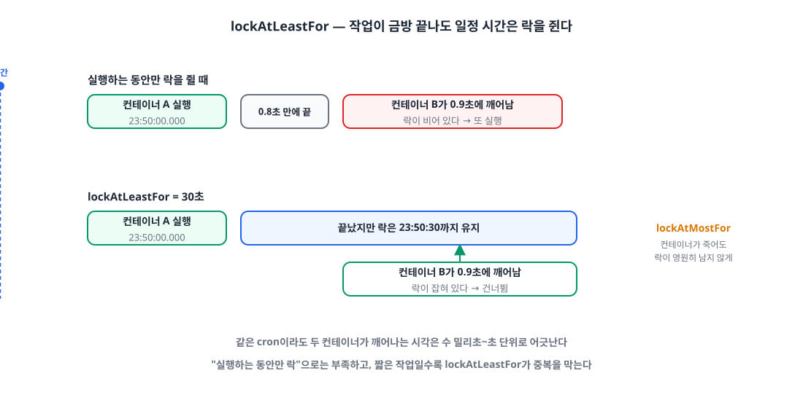

## 들어가며

요즘 서비스 배포 방식을 Kamal 무중단 배포로 바꾸고 있습니다.
([온프레미스 서버에 Kamal로 무중단 배포 도입하기]())

무중단 배포는 **새 컨테이너를 먼저 띄우고, 준비되면 트래픽을 넘긴 뒤 옛 컨테이너를 내리는** 방식입니다.
그래서 배포하는 동안에는 같은 서비스가 **잠깐 두 개** 떠 있게 됩니다.
API 서버라면 아무 문제가 없는데, 예약 작업(`@Scheduled`)을 돌리는 **배치 서버**는 이야기가 다릅니다.

이 글은 그 "두 개 떠 있는 수십 초" 동안 예약 작업이 두 번 실행되는 문제를 어떻게 막았는지 정리한 글입니다.

## 1. 문제 — 같은 작업이 두 번 돈다 🔁

{: width="1100" height="500" }

Spring의 `@Scheduled`는 **인스턴스마다 따로** 돕니다. 인스턴스가 둘이면 둘 다 실행합니다.
제 배치 서버에는 예약 작업이 15개 있었는데, 겹치면 곤란한 것들이 꽤 있었습니다.

| 작업 | 주기 | 두 번 돌면 |
|---|---|---|
| 보증금 단가 적용 · 재고 수불 계산 | 매일 23:50 | 같은 날짜가 두 번 반영된다 |
| 분기 실적 엑셀 생성 | 매일 00:40 | 같은 파일을 두 번 만든다 |
| 기안 미작성 · 영업 · 연차 촉진 알림 | 5분·10분·매일 | **알림이 두 번 간다** |
| 테넌트별 수집 작업 틱 | 10분 | 외부 API를 두 번 부른다 |

물론 일부 작업은 겹쳐 돌아도 결과가 같게(멱등하게) 만들어 두었지만, 모든 작업을 그렇게 만드는 건 현실적이지 않았습니다.
무엇보다 앞으로 추가될 예약 작업도 매번 "이건 두 번 돌아도 괜찮나?"를 고민해야 한다는 게 부담이었습니다.

## 2. 어떤 방법이 있었나 🧐

### 방법 1️⃣ 배치 서버만 무중단을 포기한다

배치 서버는 옛 컨테이너를 먼저 내리고 새 컨테이너를 띄우는(stop → start) 방식으로 배포합니다.

- 👍 가장 단순하다
- 👎 그동안 배치 서버가 **아예 없다.** 배치 서버는 다른 서비스가 부르는 API 도 가지고 있어서, 무중단 배포를 도입한 이유 자체가 사라진다

### 방법 2️⃣ 이미 있는 Redis 분산 락(Redisson)을 쓴다

프로젝트에는 이미 Redisson 기반의 `@DistributedLock`이 있었습니다.

- 👍 새 의존성이 없다
- 👎 이 락은 "락을 잡을 때까지 **기다렸다가** 실행"하는 용도라, 먼저 실행한 쪽이 끝나면 다른 쪽이 기다렸다가 **한 번 더 실행**한다
- 👎 기다리지 않게(waitTime 0) 바꿔도, 먼저 실행한 쪽이 금방 끝나 락을 놓으면 조금 늦게 깨어난 다른 쪽이 또 실행한다 (뒤에서 자세히 다룹니다)

### 방법 3️⃣ Spring Batch의 JobRepository로 막는다

일부 작업은 Spring Batch Job이라서, 같은 파라미터의 JobInstance가 이미 완료됐으면 다시 실행되지 않게 할 수 있습니다.

- 👎 Spring Batch Job이 아닌 예약 작업(알림 등)에는 적용할 수 없다
- 👎 재시도를 위해 실행 시각을 파라미터에 넣고 있어서, 매번 다른 JobInstance가 된다

### 방법 4️⃣ Quartz 클러스터 모드

- 👍 클러스터 환경의 예약 작업을 위해 만들어진 도구다
- 👎 `@Scheduled`로 짠 작업 15개를 Quartz Job으로 다시 짜야 하고, Quartz 전용 테이블 10여 개가 생긴다. 지금 문제에 비해 너무 크다

### 방법 5️⃣ ShedLock

[ShedLock](https://github.com/lukas-krecan/ShedLock)은 "**예약 작업이 동시에 최대 한 번만 실행되게**" 하는 딱 그 용도의 라이브러리입니다.
`@Scheduled` 메서드에 어노테이션 하나를 더 붙이면 되고, 락은 DB·Redis·Mongo 등 이미 쓰고 있는 저장소에 둡니다.

- 👍 기존 `@Scheduled` 코드를 그대로 둔다
- 👍 락을 잡지 못하면 **기다리지 않고 건너뛴다**
- 👍 `lockAtLeastFor`로 "금방 끝나도 일정 시간은 락을 유지"할 수 있다

| | 기존 코드 유지 | 두 번째 실행을 건너뜀 | 바뀌는 범위 |
|---|---|---|---|
| 배치만 무중단 포기 | ○ | ○ | 배포 방식 (공백 생김) |
| Redisson 분산 락 | ○ | △ | 작음 |
| Spring Batch JobRepository | △ | △ | Batch Job만 |
| Quartz 클러스터 | ✕ | ○ | 큼 |
| **ShedLock** | **○** | **○** | **작음** |

## 3. 왜 "실행하는 동안만" 잡는 락으로는 부족할까 💡

처음엔 "작업을 실행하는 동안만 락을 잡으면 되지 않나?" 싶었는데요.
그림으로 보면 바로 보입니다.

{: width="1100" height="560" }

같은 cron(`0 50 23 * * *`)이라도 두 컨테이너가 깨어나는 시각은 **수 밀리초에서 1초 정도 어긋납니다.**
작업이 0.8초 만에 끝나 버리면, 0.9초에 깨어난 다른 컨테이너는 비어 있는 락을 보고 또 실행합니다.
알림처럼 짧게 끝나는 작업일수록 이런 일이 쉽게 생깁니다.

ShedLock의 `lockAtLeastFor`가 정확히 이 문제를 풉니다.
작업이 금방 끝나더라도 **정해 둔 시간(예: 30초)까지는 락을 놓지 않기** 때문에, 조금 늦게 깨어난 쪽도 건너뜁니다.
반대로 `lockAtMostFor`는 컨테이너가 작업 도중에 죽었을 때 락이 영원히 남지 않도록 하는 **최대 유지 시간**입니다.

## 4. 적용하기 🛠️

환경은 Spring Boot 4.1 · Kotlin · MySQL 이고, ShedLock 7.x를 썼습니다(7.x가 Spring Framework 7 대상).

### 4-1. 의존성

```groovy
implementation 'net.javacrumbs.shedlock:shedlock-spring:7.10.1'
implementation 'net.javacrumbs.shedlock:shedlock-provider-jdbc-template:7.10.1'
```

### 4-2. 락 저장소는 Redis가 아니라 DB로

ShedLock은 Redis에도 락을 둘 수 있고, 다른 서비스들은 이미 Redis를 쓰고 있어서 처음엔 Redis로 하려고 했습니다.
그런데 확인해 보니 **배치 서버는 Redis에 연결돼 있지 않았습니다.** 그래서 이미 쓰고 있는 MySQL에 두기로 했습니다.

- **새 의존이 생기지 않는다**: 배치 서버는 원래 DB 없이는 돌 수 없습니다. 락을 Redis에 두면 배치가 Redis에도 의존하게 되고, Redis가 끊기면 락을 잡지 못해 예약 작업이 전부 건너뛰어집니다.
- **Redis의 장점(속도)이 필요 없다**: 락은 예약 작업 15개가 분 단위로 한 번씩 잡는 게 전부라 DB 부하는 무시할 수준입니다.
- **락이 사라지지 않는다**: Redis를 재시작하거나 메모리 정책으로 키가 지워져도, DB에 둔 락은 그대로 남습니다.

이미 Redis로 분산 락을 쓰고 있는 서버라면 Redis provider를 써도 충분합니다. 결국 "그 서버가 **이미 의존하고 있는 저장소**"에 두는 게 핵심인 것 같습니다.

```kotlin
@Configuration
@EnableSchedulerLock(defaultLockAtMostFor = "PT30M")
class SchedulerLockConfig {

    @Bean
    fun lockProvider(dataSource: DataSource): LockProvider {
        val jdbcTemplate = JdbcTemplate(dataSource)
        jdbcTemplate.execute(CREATE_TABLE_SQL)   // 배치 서버는 Flyway 를 쓰지 않아서 기동할 때 만든다
        return JdbcTemplateLockProvider(
            JdbcTemplateLockProvider.Configuration.builder()
                .withJdbcTemplate(jdbcTemplate)
                .withTableName("shedlock")
                .usingDbTime()                    // 컨테이너마다 시계가 달라도 DB 시계 하나로 판단
                .build(),
        )
    }

    companion object {
        private const val CREATE_TABLE_SQL = """
            CREATE TABLE IF NOT EXISTS shedlock (
                name VARCHAR(64) NOT NULL,
                lock_until TIMESTAMP(3) NOT NULL,
                locked_at TIMESTAMP(3) NOT NULL,
                locked_by VARCHAR(255) NOT NULL,
                PRIMARY KEY (name)
            )
        """
        const val AT_LEAST = "PT30S"
    }
}
```

`usingDbTime()`은 꼭 켜는 걸 추천합니다.
락 만료 시각을 각 컨테이너의 시계가 아니라 DB의 시계로 비교하기 때문에, 컨테이너 사이의 시계 차이에 영향을 받지 않습니다.

### 4-3. 예약 작업에 붙이기

```kotlin
@Scheduled(cron = "0 50 23 * * *")
@SchedulerLock(name = "apply-stock-io", lockAtLeastFor = SchedulerLockConfig.AT_LEAST, lockAtMostFor = "PT30M")
fun applyStockIoJob() {
    // ...
}

@Scheduled(cron = "0 */5 * * * *")
@SchedulerLock(name = "draft-reminder", lockAtLeastFor = SchedulerLockConfig.AT_LEAST, lockAtMostFor = "PT4M")
fun sendDueReminders() {
    // ...
}
```

`lockAtMostFor`는 작업마다 이렇게 정했습니다.

- **주기보다 짧게**: 매분 도는 작업은 55초, 5분 작업은 4분, 10분 작업은 9분. 컨테이너가 죽어도 다음 주기에는 다시 돌 수 있게 합니다.
- **실제 작업 시간보다 넉넉하게**: 하루 한 번 도는 작업은 30분, 오래 걸리는 분기 엑셀은 1시간. 작업이 아직 도는데 락이 풀리면 다른 컨테이너가 또 실행할 수 있기 때문입니다.

## 5. 함께 챙긴 것 — 내려갈 때 작업을 끊지 않기 ✋

락으로 "두 번 실행"은 막았지만, 반대 방향의 문제도 있었습니다.
배포 때문에 옛 컨테이너가 내려가는 순간 **실행 중이던 작업이 중간에 끊길 수 있다**는 점입니다.
23:50 재고 계산이 도는 도중에 배포가 겹치면, 계산이 절반만 반영된 채 끝날 수 있습니다.

그래서 내려가라는 신호(SIGTERM)를 받으면 **실행 중인 예약 작업이 끝날 때까지 기다리게** 했습니다.

```yaml
server:
  shutdown: graceful
spring:
  lifecycle:
    timeout-per-shutdown-phase: 300s
  task:
    scheduling:
      shutdown:
        await-termination: true
        await-termination-period: 300s
```

컨테이너를 내리는 쪽(Kamal의 `stop_timeout`)은 이보다 긴 330초로 맞췄습니다.
옛 컨테이너가 작업을 마무리하는 동안에도 새 컨테이너는 이미 떠 있지만, ShedLock 덕분에 같은 작업을 다시 시작하지는 않습니다.

## 6. 앞으로 빠뜨리지 않게 — 테스트 ✅

어노테이션 방식의 약점은 **새 예약 작업에 붙이는 걸 잊기 쉽다**는 점입니다.
그래서 "모든 `@Scheduled` 메서드에 서로 다른 이름의 `@SchedulerLock`이 붙어 있다"를 테스트로 만들었습니다.

```kotlin
@Test
fun `batch 의 모든 예약 메서드는 서로 다른 이름의 SchedulerLock 을 단다`() {
    val scanner = ClassPathScanningCandidateComponentProvider(false)
        .apply { addIncludeFilter(AnnotationTypeFilter(Component::class.java)) }
    val scheduled = scanner.findCandidateComponents("com.example.batch")
        .mapNotNull(BeanDefinition::getBeanClassName)
        .map(Class<*>::forName)
        .flatMap { it.declaredMethods.asList() }
        .filter { it.isAnnotationPresent(Scheduled::class.java) }

    val missing = scheduled.filterNot { it.isAnnotationPresent(SchedulerLock::class.java) }
        .map { "${it.declaringClass.simpleName}.${it.name}" }
    assertThat(missing).isEmpty()

    val names = scheduled.map { it.getAnnotation(SchedulerLock::class.java).name }
    assertThat(names).doesNotHaveDuplicates()
}
```

락 이름이 겹치면 **서로 다른 작업이 서로를 막아 버리기** 때문에, 이름 중복도 함께 검사합니다.

락 동작 자체도 H2로 검증했습니다.

- 락을 쥔 동안 같은 이름의 두 번째 실행은 락을 얻지 못하고, 다른 이름은 얻는다
- 작업이 바로 끝나도 `lockAtLeastFor` 동안은 다시 실행하지 못한다
- 기동할 때마다 테이블을 만들어도(`CREATE TABLE IF NOT EXISTS`) 기존 락 행은 지워지지 않는다

## 마무리

정리하면 이렇습니다.

- 무중단 배포는 **같은 서비스가 잠깐 두 개 뜬다**는 뜻이고, `@Scheduled`는 그 둘에서 모두 돈다
- ShedLock으로 **동시에 한 번만** 실행하게 하고, `lockAtLeastFor`로 **조금 늦게 깨어난 쪽까지** 막는다
- 락은 **이미 의존하고 있는 저장소(DB)** 에 두어 새 의존을 만들지 않는다
- 내려갈 때는 graceful shutdown으로 **실행 중인 작업을 끝까지** 기다린다
- 테스트로 **앞으로 추가될 예약 작업도** 락을 빠뜨리지 않게 한다

생각해 보면 이 문제는 무중단 배포가 아니더라도, 서버를 두 대 이상으로 늘리는 순간 똑같이 생기는 문제입니다.
배치 서버를 이중화할 계획이 있으시다면 미리 넣어 두는 것도 좋을 것 같습니다. 🙇🏻‍♂️

> 참고
> - [ShedLock](https://github.com/lukas-krecan/ShedLock)
> - [Spring Boot — Graceful Shutdown](https://docs.spring.io/spring-boot/reference/web/graceful-shutdown.html)
> - [온프레미스 서버에 Kamal로 무중단 배포 도입하기]()
