## 들어가며

서버 개발을 하다 보면 언젠가는 배치 작업을 만나게 됩니다. 그리고 그때 고를 수 있는 도구가 생각보다 많습니다.

올바른 일에 올바른 도구를 고르는 것은 중요하지만, 실무에서는 금전적 비용과 시간적 비용도 함께 따져야 합니다. 저는 결국 **Airflow**로 배치를 만들기로 했고, 이 글은 그 이유와 macOS에서 Airflow를 설치해 띄우기까지의 과정입니다.

## 1. 배치 도구 선택지 🧐

| 도구 | 사용 사례 | 특징 |
|---|---|---|
| Spring Batch | 엔터프라이즈 수준의 배치 처리 | 트랜잭션 관리, 재시도와 오류 처리, 청크 기반 처리, 다양한 데이터 소스 통합, 스케줄링 |
| Apache Spark | 대규모 데이터 처리 (배치·스트리밍) | 인메모리 처리, 내결함성, 하둡 생태계 통합, MLlib, 스트리밍, 그래프 처리 |
| AWS Step Functions + AWS Batch | 클라우드 기반 배치 처리와 오케스트레이션 | 서버리스 실행, 확장성, 모니터링, 다른 AWS 서비스와의 통합 |

Airflow를 고른 이유는 단순합니다. 회사에 **이미 Airflow가 구축되어 있었고**, 배치 하나를 위해 서버를 새로 여는 것은 비용 면에서 낭비였기 때문입니다.

## 2. 설치가 끝나면 이렇게 돈다 🗺️

{: width="1100" height="540" }

설치할 것을 먼저 정리하면 이렇습니다.

| 구성 요소 | 역할 |
|---|---|
| webserver | 8080 포트로 웹 UI를 띄운다. DAG와 태스크 상태를 보고 직접 실행할 수 있다 |
| scheduler | `dags/` 폴더의 DAG 파일을 읽고, 일정에 맞춰 태스크를 실행한다 |
| 메타데이터 DB | DAG 실행 이력, 태스크 상태, 사용자 정보를 저장한다. 따로 설정하지 않으면 `AIRFLOW_HOME` 아래 SQLite 파일을 쓴다 |
| `AIRFLOW_HOME` | `airflow.cfg`, `dags/`, 로그가 놓이는 디렉터리 |
| provider | MySQL, AWS처럼 외부 시스템을 다루는 연산자·훅 패키지 |

## 3. Python과 MySQL 클라이언트 준비 🐍

### ① Python 설치

```bash
brew install python@3.8
```

```bash
echo 'export PATH="/opt/homebrew/opt/python@3.8/bin:$PATH"' >> ~/.zshrc
```

뒤에서 만들 Conda 환경은 자기만의 Python 3.8을 따로 갖기 때문에, Airflow가 실제로 쓰는 Python은 Conda 환경 쪽입니다.

### ② MySQL 설치

```bash
brew install mysql
```

```bash
brew install mysql-client
```

`mysql-client`는 뒤에서 설치할 MySQL provider가 의존하는 `mysqlclient` 패키지를 빌드할 때 필요한 클라이언트 라이브러리입니다. 여기서 설치하는 MySQL은 Airflow의 메타데이터 DB가 아니라, **태스크에서 다룰 데이터베이스**입니다.

## 4. Conda 가상환경 만들기 📦

Airflow는 의존성이 많아서 시스템 Python에 바로 설치하면 다른 프로젝트와 버전이 섞이기 쉽습니다. 그래서 전용 가상환경을 만들어 그 안에 설치했습니다.

### ① Anaconda 설치

[Anaconda 사이트](https://www.anaconda.com/download)에서 설치한 뒤, 셸에서 `conda` 명령을 쓸 수 있도록 초기화합니다.

```bash
conda init
```

```bash
source ~/.zshrc
```

### ② airflow_env 만들고 활성화

```bash
conda create -n airflow_env python=3.8
```

```bash
conda activate airflow_env
```

이후의 명령은 모두 `airflow_env`가 활성화된 터미널에서 실행합니다.

## 5. Airflow 설치하기 ✈️

[Airflow Quick Start](https://airflow.apache.org/docs/apache-airflow/stable/start.html) 가이드를 따랐습니다.

### ① AIRFLOW_HOME 지정

Airflow가 설정 파일, DAG, 로그, SQLite DB를 둘 디렉터리입니다.

```bash
export AIRFLOW_HOME=~/airflow
```

### ② constraint URL 만들기

Airflow는 의존 패키지가 많아서, 그냥 `pip install`하면 그때그때 최신 버전이 섞여 들어와 깨지기 쉽습니다. 그래서 Airflow 버전과 Python 버전 조합마다 검증된 패키지 버전 목록(constraint 파일)을 제공합니다.

```bash
AIRFLOW_VERSION=2.10.2
```

```bash
PYTHON_VERSION="$(python -c 'import sys; print(f"{sys.version_info.major}.{sys.version_info.minor}")')"
```

```bash
CONSTRAINT_URL="https://raw.githubusercontent.com/apache/airflow/constraints-${AIRFLOW_VERSION}/constraints-${PYTHON_VERSION}.txt"
```

`PYTHON_VERSION`은 지금 활성화된 환경의 Python에서 읽어 오므로, 반드시 `airflow_env` 안에서 실행해야 합니다.

### ③ Airflow 설치

```bash
pip install "apache-airflow==${AIRFLOW_VERSION}" --constraint "${CONSTRAINT_URL}"
```

### ④ 메타데이터 DB 초기화와 관리자 계정 생성

`airflow db migrate`는 메타데이터 DB에 테이블을 만들고, 이때 `AIRFLOW_HOME`에 `airflow.cfg`도 생깁니다. 웹 UI에 로그인하려면 계정이 필요하니 Admin 역할의 사용자를 만듭니다. 비밀번호는 명령을 실행하면 입력하라고 묻습니다.

```bash
airflow db migrate
```

```bash
airflow users create \
    --username admin \
    --firstname Admin \
    --lastname User \
    --role Admin \
    --email admin@example.com
```

## 6. 추가 패키지 설치 🧩

### ① 웹서버 관련 패키지

당시에는 Airflow 웹서버에 필요하다고 보고 Flask-Admin과 Werkzeug 패키지를 함께 설치했습니다.

```bash
pip install apache-airflow flask-admin werkzeug
```

> Airflow 2.x 웹서버는 Flask-AppBuilder 기반이라 Flask-Admin은 필요하지 않습니다. 웹서버 의존성은 5단계의 constraint 설치로 이미 들어오고, 오히려 constraint 없이 `apache-airflow`를 다시 설치하면 패키지 버전이 어긋날 수 있습니다. 이 단계는 건너뛰어도 됩니다.
{: .prompt-warning }

### ② (옵션) MySQL provider

태스크에서 MySQL에 데이터를 저장하거나 쿼리를 실행하려면 MySQL provider를 설치합니다.

```bash
pip install apache-airflow-providers-mysql
```

설치 중 `mysqlclient` 빌드에서 에러가 난다면, 빌드가 MySQL 클라이언트 라이브러리를 찾지 못한 것입니다. `pkg-config`를 설치하고 컴파일·링크 플래그를 알려준 뒤 다시 설치합니다.

```bash
brew install pkg-config
```

```bash
export MYSQLCLIENT_LDFLAGS=$(pkg-config --libs mysqlclient)
```

```bash
export MYSQLCLIENT_CFLAGS=$(pkg-config --cflags mysqlclient)
```

### ③ (옵션) AWS provider

태스크에서 S3 같은 AWS 서비스를 다루려면 Amazon provider를 설치합니다.

```bash
pip install apache-airflow-providers-amazon
```

## 7. 예제 DAG 끄고 실행하기 🚀

### ① 예제 DAG 끄기

기본 설정에서는 Airflow가 제공하는 예제 DAG가 함께 올라와 목록이 복잡해집니다. `$AIRFLOW_HOME/airflow.cfg`의 `[core]` 섹션에서 `load_examples`를 끕니다.

```ini
[core]
load_examples = False
```

### ② 웹서버와 스케줄러 실행

웹서버와 스케줄러는 별개의 프로세스라 터미널을 두 개 열어 각각 띄웁니다. 두 터미널 모두 `airflow_env`가 활성화되어 있고, 같은 `AIRFLOW_HOME`을 보고 있어야 합니다.

```bash
airflow webserver --port 8080
```

```bash
airflow scheduler
```

이제 `localhost:8080`에서 앞에서 만든 관리자 계정으로 로그인할 수 있습니다.

## 마무리

- 배치 도구는 기능만큼 비용도 따진다. 이미 구축된 Airflow가 있다면 서버를 새로 여는 것보다 그 위에 올리는 편이 낫다.
- Airflow는 constraint 파일과 함께 설치한다. Airflow 버전과 Python 버전에 맞는 패키지 버전이 고정되어 의존성이 꼬이지 않는다.
- 전용 Conda 환경에 설치하고, constraint URL을 만들 때와 웹서버·스케줄러를 띄울 때 모두 그 환경을 활성화한다.
- 메타데이터 DB는 따로 설정하지 않으면 SQLite다. MySQL provider는 태스크에서 MySQL을 다루기 위한 것이다.
- 웹서버와 스케줄러는 따로 띄운다. 스케줄러가 없으면 DAG가 파싱되지도, 실행되지도 않는다.

> 참고
> - [Apache Airflow: Quick Start](https://airflow.apache.org/docs/apache-airflow/stable/start.html)
> - [Apache Airflow: Installation from PyPI](https://airflow.apache.org/docs/apache-airflow/stable/installation/installing-from-pypi.html)
> - [apache-airflow-providers-mysql](https://airflow.apache.org/docs/apache-airflow-providers-mysql/stable/index.html)
> - [apache-airflow-providers-amazon](https://airflow.apache.org/docs/apache-airflow-providers-amazon/stable/index.html)
{: .prompt-info }
