## 들어가며

Kong은 인증, 트래픽 제한, 로깅 같은 기본 플러그인을 많이 제공합니다. 그래도 요구사항에 딱 맞는 플러그인이 없을 때가 있는데, 이럴 때를 위해 Kong은 **커스텀 플러그인**을 넣을 수 있게 되어 있습니다.

커스텀 플러그인은 기본적으로 Lua로 작성합니다. Go, Java 같은 다른 언어로도 만들 수 있지만 추가 설정이 필요합니다. 이번 글에서는 Lua로 만든 JWT 인증 플러그인(`jwt-custom`)을 Docker 이미지에 넣어 Kong에 적용해 보겠습니다.

PostgreSQL, Kong DB 초기화, Konga 설치는 이미 끝났다고 가정합니다. 아직이라면 [Docker로 Kong API Gateway와 Konga 설치하기]()를 먼저 보시면 됩니다.

## 1. 플러그인은 요청의 어느 단계에서 도나 🧩

{: width="1100" height="560" }

Kong은 요청 하나를 여러 **단계(phase)**로 나눠 처리하고, 플러그인은 단계 이름과 같은 함수를 `handler.lua`에 구현해 원하는 단계에 끼어듭니다. 인증 플러그인은 보통 업스트림으로 넘기기 전인 `access` 단계에서 동작합니다. 토큰이 잘못됐다면 여기서 바로 응답을 돌려주고, 요청은 업스트림 서버까지 가지 않습니다.

플러그인 하나는 디렉터리 하나이고, 최소한 아래 두 파일이 있어야 합니다.

| 파일 | 역할 |
|---|---|
| `handler.lua` | 각 단계에서 실행할 로직 |
| `schema.lua` | 플러그인 설정 값의 형태와 기본값 |

## 2. 플러그인을 넣은 이미지 만들기 🐳

### ① Dockerfile 작성

플러그인 디렉터리(`./jwt-custom`)를 공식 Kong 이미지 안에 복사합니다.

```dockerfile
FROM kong:latest

USER root

# Add custom plugin to the image
COPY ./jwt-custom /usr/local/share/lua/5.1/kong/plugins/jwt-custom
ENV KONG_PLUGINS=bundled,jwt-custom

# Ensure kong user is selected for image execution
USER kong

# Get Kong ready to run
EXPOSE 8000 8443 8001 8444 8002
STOPSIGNAL SIGQUIT
HEALTHCHECK --interval=10s --timeout=10s --retries=10 CMD kong health
CMD ["sleep", "infinity"]
```

줄마다 이유가 있습니다.

- `USER root`: 이미지 안의 시스템 경로에 파일을 복사하려면 권한이 필요하다. 복사가 끝나면 `USER kong`으로 되돌린다.
- `COPY ... /usr/local/share/lua/5.1/kong/plugins/jwt-custom`: Kong은 플러그인을 `kong.plugins.<이름>` 모듈로 찾는다. Lua 모듈 경로 아래 `kong/plugins/` 안에 두어야 이름으로 불러올 수 있다.
- `ENV KONG_PLUGINS=bundled,jwt-custom`: Kong은 이 목록에 있는 플러그인만 불러온다. `bundled`는 기본 플러그인 전체를 뜻하므로, 기본 플러그인을 유지한 채 `jwt-custom`을 추가한다.
- `EXPOSE ... 8002`: 8002는 뒤에서 쓸 **Kong Manager**(Kong 내장 관리 화면) 포트다.

### ② 이미지 빌드

Dockerfile이 있는 디렉터리에서 빌드합니다.

```bash
docker build -t kong-custom .
```

빌드가 끝나면 `kong-custom` 이미지가 생깁니다.

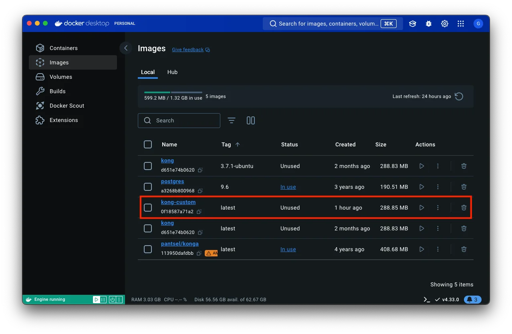{: width="1278" height="835" }

## 3. 커스텀 이미지로 Kong 실행하기 🚀

### ① 컨테이너 실행

설치 글과 같은 DB 정보와 네트워크로 실행하되, 이미지를 `kong-custom`으로 바꾸고 Kong Manager용 8002 포트를 추가로 엽니다.

```bash
docker run -d --name kong \
  --network=kong-net \
  -e "KONG_DATABASE=postgres" \
  -e "KONG_PG_HOST=kong-database" \
  -e "KONG_PG_USER=kong" \
  -e "KONG_PG_PASSWORD=kong" \
  -e "KONG_PROXY_ACCESS_LOG=/dev/stdout" \
  -e "KONG_ADMIN_ACCESS_LOG=/dev/stdout" \
  -e "KONG_PROXY_ERROR_LOG=/dev/stderr" \
  -e "KONG_ADMIN_ERROR_LOG=/dev/stderr" \
  -e "KONG_ADMIN_LISTEN=0.0.0.0:8001, 0.0.0.0:8444 ssl" \
  -p 8000:8000 \
  -p 8443:8443 \
  -p 8002:8002 \
  -p 127.0.0.1:8001:8001 \
  -p 127.0.0.1:8444:8444 \
  kong-custom
```

컨테이너 목록에 `kong-custom` 이미지로 만든 `kong` 컨테이너가 생깁니다.

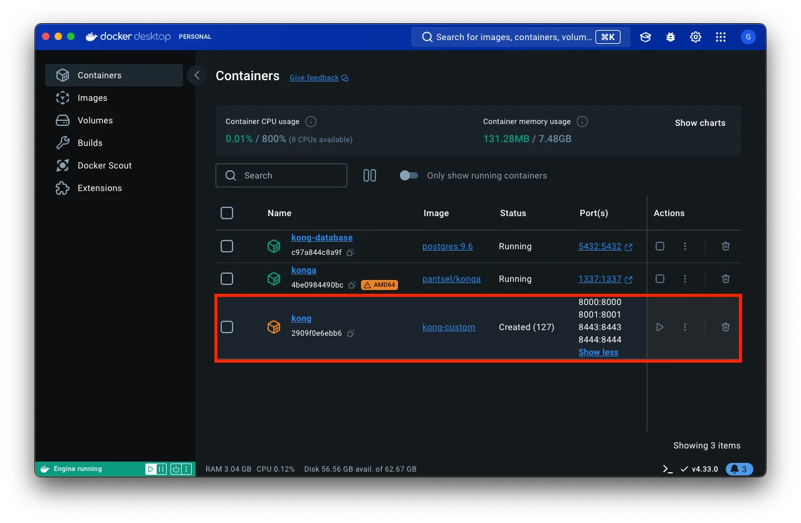{: width="1278" height="835" }

### ② Kong 시작

Dockerfile에서 `CMD`를 `sleep infinity`로 덮어썼기 때문에, 컨테이너는 떠 있지만 Kong 프로세스는 아직 시작되지 않았습니다. 컨테이너에 들어가 직접 시작합니다.

```bash
docker exec -it kong bash
```

```bash
kong start
```

> 공식 Kong 이미지의 기본 `CMD`는 `kong docker-start`입니다. Dockerfile에서 `CMD` 줄을 빼면 컨테이너가 뜰 때 Kong도 함께 시작되므로 이 단계가 필요 없습니다.
{: .prompt-tip }

## 4. Konga에서 Route에 플러그인 붙이기 🖱️

플러그인은 아래 네 단위 중 하나에 붙일 수 있습니다.

| 대상 | 적용 범위 |
|---|---|
| Services | 그 Service로 가는 모든 요청 |
| Routes | 그 Route에 매칭된 요청 |
| Consumers | 그 Consumer로 인증된 요청 |
| Global | 모든 요청 |

이번에는 **Route**에 `jwt-custom`을 붙였습니다.

### ① 대상 Route 선택

`localhost:1337`로 Konga에 접속해 플러그인을 붙일 Route를 클릭합니다.

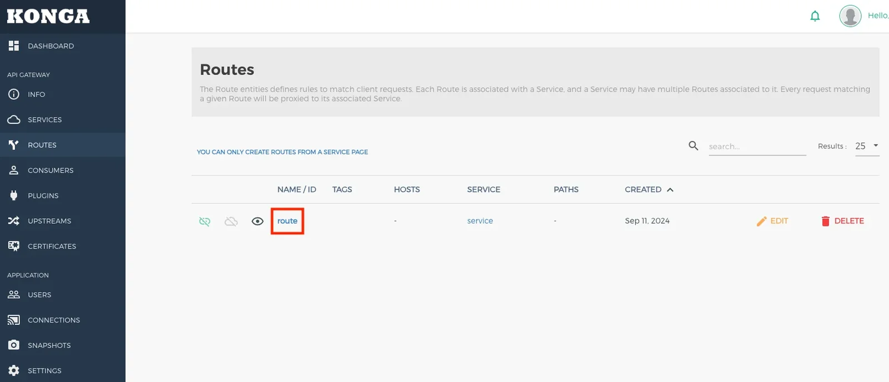{: width="1600" height="688" }

### ② 플러그인 추가

Plugins 탭으로 이동해 ADD PLUGIN을 클릭합니다.

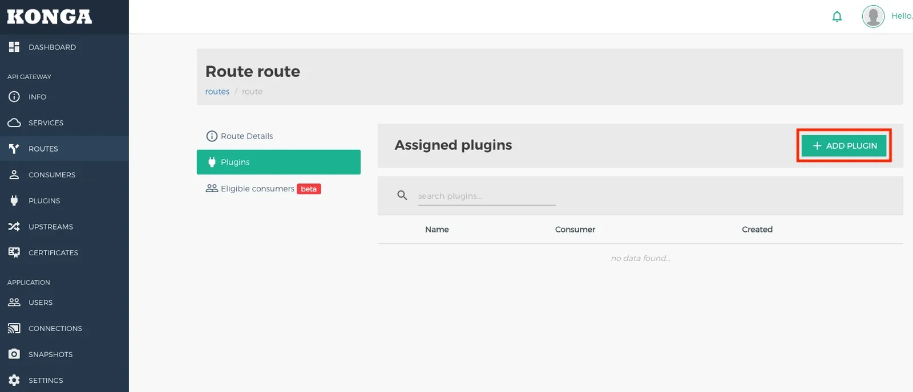{: width="1600" height="688" }

### ③ 커스텀 플러그인 선택

커스텀 플러그인은 Other 탭에 있습니다. `KONG_PLUGINS`에 넣은 `jwt-custom`이 여기 보이면 Kong이 플러그인을 제대로 불러온 것입니다.

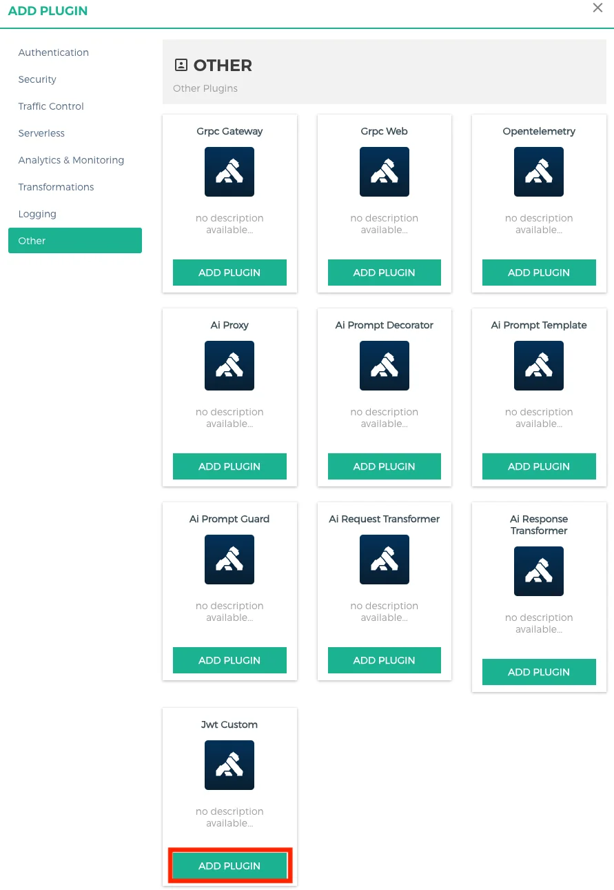{: width="891" height="1290" }

### ④ 속성 설정

`schema.lua`에 정의한 설정 값들을 입력합니다.

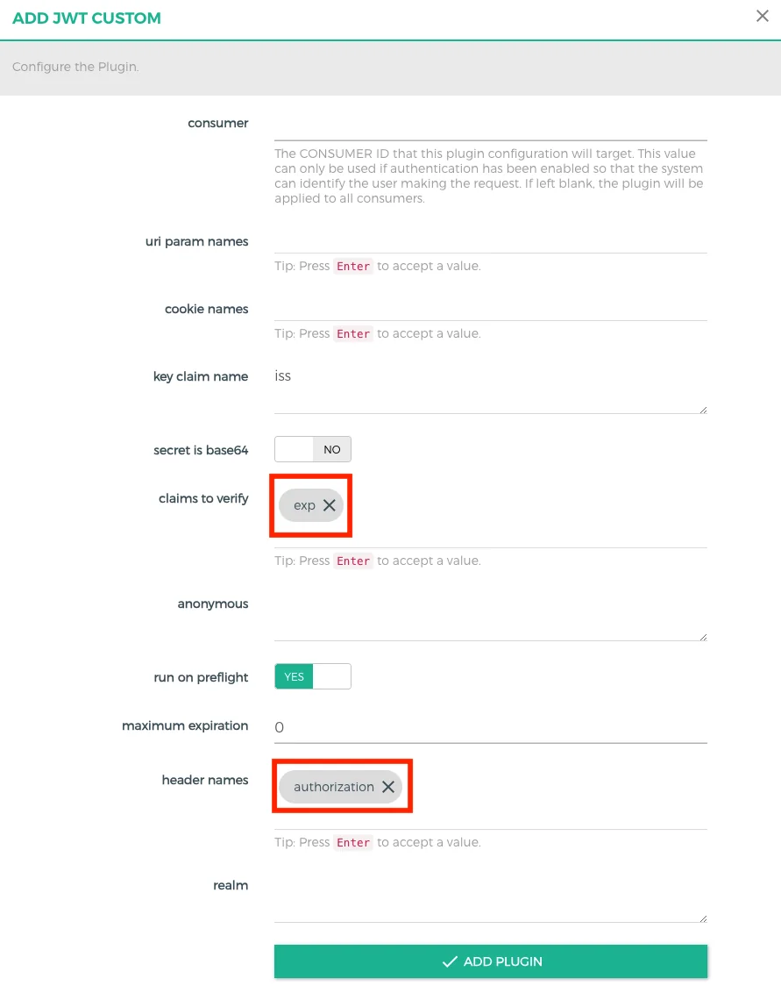{: width="891" height="1140" }

## 5. Kong Manager에서 JWT credential 설정하기 🔑

플러그인은 붙었지만 아직 끝이 아닙니다. 토큰을 검증하려면 Consumer에 **JWT credential**(issuer, secret, algorithm)이 있어야 하는데, 이 값(특히 alg와 secret)은 Konga에서 바꿀 수 없어서 **Kong Manager**에서 설정했습니다.

{: width="1100" height="460" }

핵심은 **기본 JWT 플러그인을 credential을 넣는 입구로만 쓰고 끈다**는 점입니다. 실제 토큰 검증은 Route에 붙인 `jwt-custom`이 합니다.

### ① Consumer 만들기

`localhost:8002`로 Kong Manager에 접속해 Consumers 탭에서 New Consumer를 누릅니다.

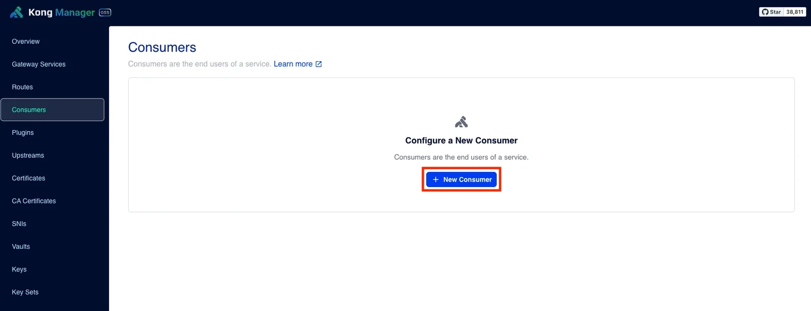{: width="1600" height="615" }

Username을 입력하고 저장합니다. 여기서는 `consumer`로 만들었습니다.

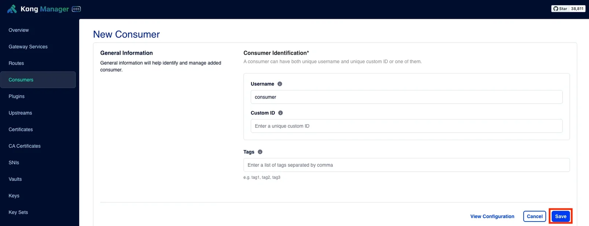{: width="1600" height="615" }

### ② Credentials 탭에서 기본 JWT 플러그인 설치

만든 Consumer를 클릭해 상세 화면으로 들어갑니다.

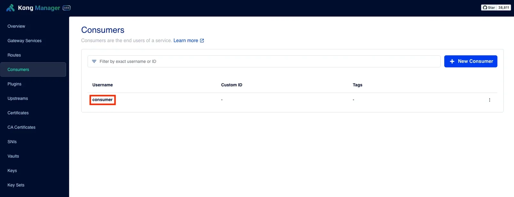{: width="1600" height="615" }

Credentials 탭을 열면 "No Plugins Enabled"가 보입니다. Consumer에 credential을 추가하려면 ACL, Basic Authentication, JWT 같은 인증 플러그인이 하나라도 설치되어 있어야 하기 때문입니다. Install Plugin을 누릅니다.

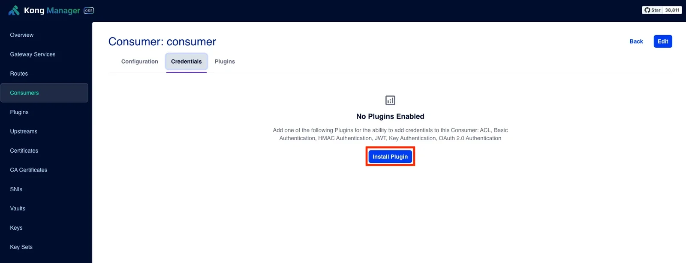{: width="1600" height="615" }

인증 플러그인 목록에서 기본 JWT 플러그인을 고릅니다.

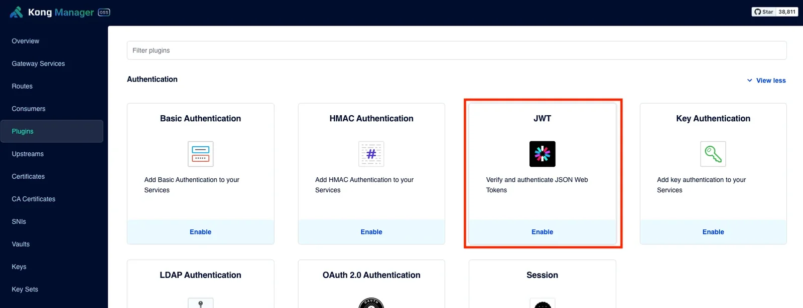{: width="1600" height="615" }

### ③ 기본 JWT 플러그인은 Disabled로 저장

목적은 `jwt-custom`으로 검증하는 것이고, 기본 JWT 플러그인은 credential을 DB에 넣는 데만 씁니다. 두 플러그인이 함께 검증하지 않도록 설정 화면 맨 위의 스위치를 꺼서 **Disabled** 상태로 둡니다.

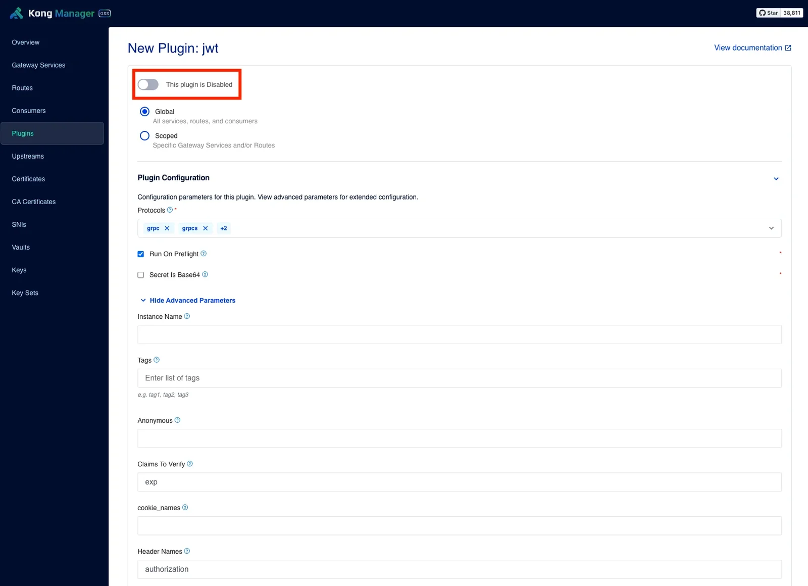{: width="1600" height="1160" }

나머지 값은 기본값 그대로 두고 저장합니다. Key Claim Name이 `iss`인 것을 볼 수 있는데, 토큰의 `iss` 값으로 어떤 credential인지 찾는다는 뜻입니다.

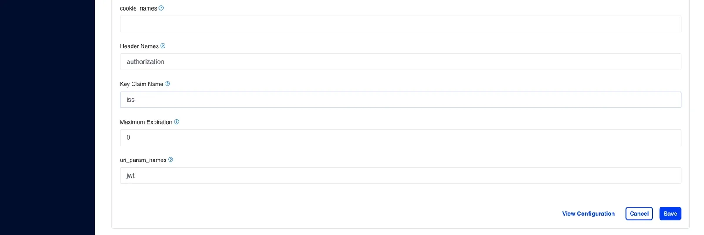{: width="1600" height="536" }

### ④ JWT credential 등록

이제 Consumer의 Credentials 탭에 JWT 영역이 생깁니다. New JWT Credential을 누릅니다.

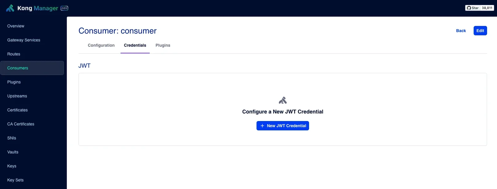{: width="1600" height="609" }

Key(issuer), Secret, Algorithm 값을 입력합니다. Key에는 토큰의 `iss`와 같은 값을, Secret에는 토큰을 서명한 비밀 키를 넣습니다.

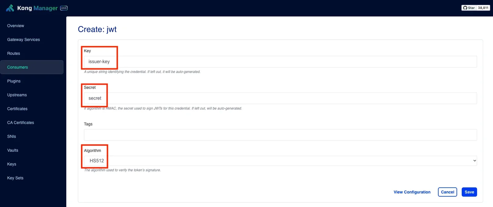{: width="1600" height="675" }

이것으로 커스텀 플러그인 적용이 끝났습니다.

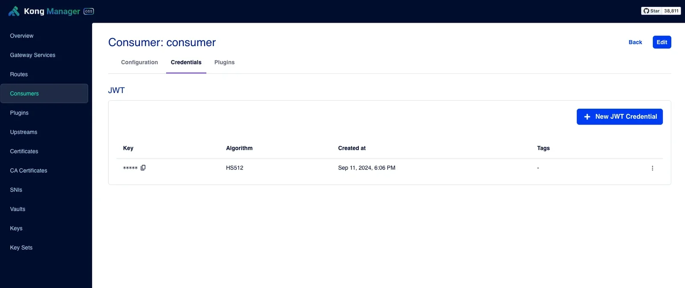{: width="1600" height="675" }

{: width="1288" height="720" }

## 마무리

- 커스텀 플러그인은 `kong/plugins/<이름>` 경로에 두고 `KONG_PLUGINS`에 이름을 넣어야 Kong이 불러온다. `bundled`를 함께 적어야 기본 플러그인이 유지된다.
- 인증 플러그인은 `access` 단계에서 돈다. 여기서 막힌 요청은 업스트림까지 가지 않는다.
- 플러그인은 Service, Route, Consumer, Global 중 하나에 붙인다. Konga의 Other 탭에 보이면 Kong이 플러그인을 제대로 불러온 것이다.
- Consumer에 JWT credential을 넣으려면 기본 JWT 플러그인이 설치되어 있어야 한다. Disabled로 설치해 credential의 입구로만 쓰고, 검증은 커스텀 플러그인 하나가 맡는다.

> 참고
> - [Kong Gateway: Plugin Distribution](https://docs.konghq.com/gateway/latest/plugin-development/distribution/)
> - [Docker로 Kong API Gateway와 Konga 설치하기]()
> - [API Gateway가 있다면 토큰 인증은 Gateway로 넘기자]()
{: .prompt-info }
