## 들어가며

백엔드에 Spring Boot 서버가 여러 대 있었습니다. 회원가입, 로그인처럼 토큰을 발급하는 일은 Auth 서버 하나가 맡고, 나머지 서버들은 각자 Token Filter로 토큰을 검증해 인증·인가를 처리했습니다. 그리고 모든 요청은 API Gateway를 거쳐 각 서버로 전달되고 있었습니다.

이 상황에서 받은 요구사항은 **"토큰 인증을 한 곳으로 통합하자"**였습니다. 이 글은 두 가지 선택지를 비교하고, API Gateway(Kong)에서 인증하기로 한 뒤 기본 플러그인의 한계 때문에 커스텀 플러그인을 만들기로 한 과정입니다.

## 1. 지금 구조: 검증 코드가 서버마다 있다 🧩

{: width="1060" height="600" }

토큰을 만드는 곳은 Auth 서버 하나인데, 토큰을 검증하는 코드는 모든 서버에 흩어져 있습니다. 검증 방식을 바꾸려면 모든 서버를 고쳐 다시 배포해야 합니다.

## 2. 선택지 1️⃣ 모든 요청을 Auth 서버로 보내기

{: width="1060" height="560" }

- 모든 요청이 Auth 서버를 거치게 해서, 회원 인증 로직을 Auth 서버에 위임한다.
- 나머지 서버들은 Auth 서버가 인증한 회원 정보로 서비스 로직만 수행한다.

인증 로직은 한 곳에 모이지만, 요청마다 Auth 서버를 한 번 더 거치게 됩니다.

## 3. 선택지 2️⃣ API Gateway에서 토큰 검증하기

{: width="1060" height="560" }

- API Gateway가 이미 구축되어 있으니, 여기에 토큰 검증 로직만 추가한다.
- 검증한 회원 정보를 요청과 함께 넘겨서, 나머지 서버들은 인증 절차를 건너뛸 수 있게 한다.

## 4. Gateway를 고른 이유 💡

두 선택지를 나란히 놓으면 이렇습니다.

| | Auth 서버로 모으기 | API Gateway에서 검증 |
|---|---|---|
| 인증 로직 위치 | Auth 서버 | Gateway 플러그인 |
| 요청 경로 | Gateway → Auth 서버 → 서비스 서버 | Gateway → 서비스 서버 |
| Auth 서버 부담 | 모든 요청을 받으니 트래픽이 몇 배로 는다 | 기존과 같다 |

결론은 **API Gateway에서 인증**이었습니다.

- Auth 서버에 모든 토큰 인증을 맡기면 Auth 서버의 트래픽 부담이 몇 배로 늘어난다.
- 모든 요청이 이미 Gateway를 지나가고 있다. 있는 구성을 활용하는 편이 낫다.

Kong은 JWT 플러그인을 기본으로 무료 제공하니, 이걸 켜기만 하면 될 것 같았습니다.

## 5. 기본 JWT 플러그인으로는 부족했다 🤦🏻‍♂️

{: width="1100" height="510" }

문제는 **토큰이 없는 요청**이었습니다. Kong의 기본 JWT 플러그인은 토큰 인증에 실패하면 401을 돌려주고, 그 응답 형식은 바꿀 수 없습니다.

이미 서비스 중인 서버들에는 비회원도 응답을 받을 수 있는 API가 있었습니다. 기본 플러그인을 Route에 그대로 붙이면 이런 API까지 토큰이 없다는 이유로 401로 막힙니다.

기본 플러그인에도 인증에 실패한 요청을 익명 Consumer로 통과시키는 `anonymous` 설정이 있습니다. 하지만 그러면 토큰이 없는 요청과 잘못된 토큰을 보낸 요청이 똑같이 통과해 버립니다. 원하는 동작은 "토큰이 없으면 통과, 토큰이 있으면 반드시 검증"이었습니다.

## 6. 해결: 커스텀 플러그인 📖

Kong에는 원하는 동작의 플러그인을 Lua로 직접 만들어 Gateway에 추가할 수 있는 길이 있습니다.

게다가 JWT 플러그인 자체가 오픈 소스입니다. 이를 바탕으로 **토큰이 있을 때만 검증하고, 없으면 검증 없이 라우팅**하도록 고치면 됩니다. 직접 만드는 플러그인이니 실패했을 때의 응답도 원하는 형식으로 바꿀 수 있습니다.

{: width="1280" height="720" }

Kong 설치와 커스텀 플러그인을 이미지에 넣어 적용하는 과정은 시리즈의 앞 글에 정리해 두었습니다.

- [Docker로 Kong API Gateway와 Konga 설치하기]()
- [Lua로 만든 Kong 커스텀 플러그인을 Docker 이미지로 적용하기]()

## 마무리

- 토큰 발급이 한 곳이어도 검증 코드가 서버마다 있으면, 검증 방식을 바꿀 때 모든 서버를 고쳐야 한다.
- 인증을 Auth 서버로 모으면 Auth 서버가 모든 트래픽을 받는다. 모든 요청이 이미 지나가는 Gateway에서 한 번 검증하는 편이 부담이 적다.
- 기본 JWT 플러그인은 토큰이 없으면 401이다. 비회원도 쓰는 API가 있다면 그대로 붙일 수 없다.
- "토큰이 없으면 통과, 있으면 검증"은 오픈 소스 JWT 플러그인을 고친 커스텀 플러그인으로 만든다.

> 참고
> - [Kong Gateway: JWT plugin](https://docs.konghq.com/hub/kong-inc/jwt/)
> - [Kong JWT plugin 소스 (GitHub)](https://github.com/Kong/kong/tree/master/kong/plugins/jwt)
> - [Docker로 Kong API Gateway와 Konga 설치하기]()
> - [Lua로 만든 Kong 커스텀 플러그인을 Docker 이미지로 적용하기]()
{: .prompt-info }
