## 들어가며

모바일 앱(iOS·Android)과 macOS 데스크톱 앱을 릴리스할 때마다 Xcode에서 아카이브하고, Transporter로 올리고, Play 콘솔에 AAB를 끌어다 놓았습니다. iPhone·iPad·Android·Mac 네 곳을 손으로 하니 빠뜨리기 쉬웠습니다.

이번에 **main에 머지하면 각 스토어에 업로드까지 끝나도록** fastlane을 도입했습니다. 이 글은 도입에 필요한 설정을 순서대로 정리한 것입니다.

## 1. fastlane을 고른 이유 🧐

| 방법 | 장점 | 단점 |
|---|---|---|
| 수동 (Transporter, Play 콘솔) | 준비할 것이 없다 | 매번 사람이 해야 하고 실수가 난다 |
| Xcode Cloud | Apple이 관리, 설정이 쉽다 | iOS·macOS만. Android는 따로 |
| Codemagic·Bitrise | 모바일 전용 CI, UI가 편하다 | 외부 서비스 의존, 비용, CI가 둘로 나뉜다 |
| gradle-play-publisher | Gradle 안에서 끝난다 | Android만 |
| **fastlane** | 도구 하나로 두 스토어, 기존 GitHub Actions에 붙는다 | Ruby 의존성, 버전마다 동작 차이 |

기존 CI(GitHub Actions)를 그대로 쓰면서 iOS·Android·macOS를 한 도구로 다룰 수 있는 것이 fastlane뿐이었습니다.

**좋은 점**
- App Store Connect **API 키**로 인증해서 CI에서 2단계 인증 없이 돈다.
- TestFlight 업로드(`upload_to_testflight`), 스토어 버전 준비(`deliver`), Play 업로드(`upload_to_play_store`), 프로파일 발급(`get_provisioning_profile`)이 이미 액션으로 있다.
- 레인을 Ruby 코드로 쓰니 조건 분기와 재사용이 자유롭다.

**아쉬운 점**
- Kotlin·Flutter·Node 저장소에 **Ruby와 Bundler**가 들어온다.
- 버전마다 동작이 미묘하게 바뀐다. 그래서 버전을 고정해야 한다.
- 암묵적인 동작이 있다. 상위 폴더의 `.env`를 알아서 읽는 식이다(5장).
- 일부 액션은 API 키를 지원하지 않는다. 앱 레코드를 만드는 `produce`는 Apple ID 로그인이 필요해서, 앱 생성은 콘솔에서 사람이 한다.

## 2. 준비물 🔑

{: width="1100" height="520" }

| 대상 | 필요한 것 | 비고 |
|---|---|---|
| Apple | App Store Connect API 키 (Issuer ID, Key ID, `.p8`) | 사용자 및 액세스 → 키. 역할은 "앱 관리" |
| Apple | 배포 인증서 `.p12`와 비밀번호 | 프로비저닝 프로파일은 API 키로 그때그때 받는다 |
| Google | Play 서비스 계정 JSON | Play 콘솔에서 서비스 계정에 앱 권한 부여 |
| Google | 업로드 키스토어, 비밀번호, alias | AAB 서명용 |
| Google | **첫 AAB는 콘솔에 손으로 업로드** | API는 앱에 빌드가 하나도 없으면 거부한다 |

파일은 base64로 인코딩해 GitHub 시크릿에 넣습니다. 시크릿은 저장소 전체가 아니라 **main만 접근 가능한 Environment**(`store`)에 둡니다. 다른 브랜치의 워크플로가 서명 키를 읽지 못하게 하기 위해서입니다.

```bash
base64 -i AuthKey_XXXXXX.p8 | pbcopy        # ASC_KEY_P8_BASE64
base64 -i distribution.p12 | pbcopy          # APPLE_DIST_CERT_P12_BASE64
base64 -i upload-keystore.jks | pbcopy       # ANDROID_UPLOAD_KEYSTORE_BASE64
```

## 3. 설치 📦

```ruby
# Gemfile — CI 는 bundle exec 로만 쓴다
source "https://rubygems.org"
gem "fastlane", "2.241.1"
```

버전을 정확히 고정하고 `Gemfile.lock`까지 커밋합니다. fastlane은 서명 키를 다루는 프로세스라 하위 gem까지 고정하는 게 맞고, 마이너 버전마다 동작이 바뀌어서 "어제 되던 업로드가 오늘 안 되는" 일을 막기 위해서입니다. CI에서는 `ruby/setup-ruby`의 `bundler-cache: true`로 설치와 캐시를 한 번에 합니다.

## 4. Fastfile 레인 세 개 🛠️

{: width="1100" height="600" }

### iOS

```ruby
def asc_api_key
  app_store_connect_api_key(
    key_id: ENV.fetch("ASC_KEY_ID"),
    issuer_id: ENV.fetch("ASC_ISSUER_ID"),
    key_content: ENV.fetch("ASC_KEY_P8_BASE64"),
    is_key_content_base64: true
  )
end

platform :ios do
  lane :release do |options|
    api_key = asc_api_key
    setup_ci                                  # CI 전용 임시 키체인
    import_certificate(certificate_path: ENV.fetch("APPLE_DIST_CERT_PATH"),
                       certificate_password: ENV.fetch("APPLE_DIST_CERT_PASSWORD"),
                       keychain_name: "fastlane_tmp_keychain", keychain_password: "")
    get_provisioning_profile(api_key: api_key, app_identifier: APP_ID, platform: "ios")

    # 저장소는 Automatic 서명(로컬 개발용) — 배포 빌드에서만 수동 서명으로
    update_code_signing_settings(path: "ios/Runner.xcodeproj", use_automatic_signing: false,
                                 team_id: TEAM_ID, code_sign_identity: "Apple Distribution",
                                 profile_name: lane_context[SharedValues::SIGH_NAME])
    build_app(workspace: "ios/Runner.xcworkspace", scheme: "Runner", export_method: "app-store")

    upload_to_testflight(api_key: api_key, skip_waiting_for_build_processing: false)
    deliver(api_key: api_key, app_version: options[:version], build_number: options[:build].to_s,
            skip_binary_upload: true, skip_screenshots: true,
            submit_for_review: false)          # 심사 제출은 사람이
  end
end
```

두 가지가 핵심입니다. 인증서는 `setup_ci`가 만든 **임시 키체인**에만 넣어 러너에 남기지 않고, 프로파일은 시크릿으로 들고 있지 않고 API 키로 **그때그때 받습니다.**

`deliver`는 심사 제출할 때만 빌드를 버전에 연결합니다. 제출을 끄면 빌드가 붙지 않아서, 레인 끝에서 Spaceship(fastlane의 App Store Connect API 클라이언트)으로 직접 연결합니다.

### Android

```ruby
platform :android do
  lane :release do
    upload_to_play_store(
      package_name: APP_ID,
      json_key_data: ENV.fetch("PLAY_SERVICE_ACCOUNT_JSON"),
      track: ENV.fetch("PLAY_TRACK", "production"),   # 개인 계정은 비공개 테스트 기간 동안 alpha
      release_status: "draft",                        # 출시 시작은 사람이
      aab: "build/app/outputs/bundle/release/app-release.aab",
      skip_upload_metadata: true, skip_upload_images: true, skip_upload_screenshots: true
    )
  end
end
```

AAB 서명은 Gradle이 업로드 키스토어로 미리 합니다. 개인 개발자 계정은 테스터 12명과 14일의 비공개 테스트를 거쳐야 프로덕션이 열려서, 트랙을 저장소 변수로 뺐습니다.

### macOS (Electron)

```ruby
platform :mac do
  lane :profile do
    setup_ci
    import_certificate(...)                   # 인증서가 있어야 sigh 가 프로파일을 고른다
    begin
      get_provisioning_profile(api_key: asc_api_key, app_identifier: APP_ID,
                               platform: "macos", output_path: "build")
    ensure
      delete_keychain(name: "fastlane_tmp_keychain")
    end
    FileUtils.cp(lane_context[SharedValues::SIGH_PROFILE_PATH], "build/embedded.provisionprofile")
  end

  lane :release do |options|
    upload_to_testflight(api_key: asc_api_key, app_platform: "osx", pkg: mas_pkg)
    # 이후 iOS 와 같이 deliver(submit_for_review: false) + 빌드 연결
  end
end
```

서명과 pkg 생성은 electron-builder가 하고, fastlane은 프로파일 발급과 업로드만 맡습니다.

### 자동화는 업로드까지만

처음에는 심사 제출까지 자동으로 했습니다. 엿새 만에 되돌렸습니다. 스토어 문구와 스크린샷을 콘솔에서 다듬는 중에 빌드가 자동으로 심사에 들어가 버리기 때문입니다. 지금은 **업로드와 버전 준비까지 자동, "심사에 추가"는 사람이** 누릅니다. 이미 심사 중인 버전이 있으면 새 버전 준비를 건너뜁니다.

## 5. GitHub Actions 연결 ⚙️

```yaml
build-ios:
  runs-on: macos-latest
  environment: ${{ needs.setup.outputs.store == 'true' && 'store' || '' }}   # main 일 때만 시크릿 접근
  steps:
    - name: Check store secrets
      run: |
        [ -z "$ASC_KEY_ID" ] && echo "::warning::App Store 시크릿이 없어 업로드를 건너뜁니다" && exit 0
    - uses: ruby/setup-ruby@v1
      with: { ruby-version: '3.3', bundler-cache: true, working-directory: app }
    - name: Upload to App Store
      working-directory: app
      run: |
        printf '%s' "$APPLE_DIST_CERT_P12_BASE64" | base64 --decode > "$APPLE_DIST_CERT_PATH"
        bundle exec fastlane ios release version:"$VERSION" build:"$BUILD_NUMBER"
```

- **시크릿이 없으면 실패가 아니라 경고 후 건너뜁니다.** 시크릿을 넣기 전에도 워크플로를 머지할 수 있습니다.
- **main은 업로드 도중 취소하지 않습니다.** `concurrency.cancel-in-progress`를 dev에서만 켭니다. 업로드 중간에 끊기면 스토어에 반쯤 처리된 빌드가 남습니다.
- 디코딩한 `.p12`는 `RUNNER_TEMP`에 두고 `always()` 단계로 지웁니다.

## 6. 첫 실행에서 막힌 다섯 가지 ⚠️

스토어 업로드는 main에서만 돌아서 dev에서는 검증할 수 없습니다. 첫 실행에서 단계마다 막혔고, 같은 날 전부 풀었습니다.

| # | 증상 | 원인 | 해결 |
|---|---|---|---|
| 1 | iOS 레인 시작 직후 `Errno::EISDIR` | fastlane은 `fastlane/`에 `.env*`가 없으면 **상위 폴더의 `.env`**를 읽는데, 그게 앱 설정 **폴더**였다 | `fastlane/.env.default`(주석만)를 둬 탐색을 멈춘다 |
| 2 | macOS 프로파일 받기 실패 | `get_provisioning_profile`의 `filename`은 macOS에서도 `.mobileprovision`만 받는다 | 기본 이름으로 받고 `lane_context`의 경로를 복사 |
| 3 | `Could not find a matching code signing identity` | sigh는 키체인에 있는 인증서와 맞는 프로파일만 고른다 | 프로파일 받기 전에 임시 키체인에 인증서를 넣는다 |
| 4 | `Could not find pkg file` | electron-builder 26.18이 pkg 위치를 `release/`에서 `release/mas-universal/`로 바꿨다 | pkg 경로를 `release/` 아래에서 찾게 |
| 5 | `build_app` 전에 시간 초과 | 러너가 느리면 `xcodebuild -showBuildSettings`가 기본 대기 시간을 넘긴다 | `FASTLANE_XCODEBUILD_SETTINGS_TIMEOUT=60`, `..._RETRIES=5` |

main에서만 재현되니 고치는 방식도 정해 두었습니다. `origin/main`에서 hotfix 브랜치를 따서 고치고, 같은 커밋을 dev에도 동기화합니다.

## 마무리

- iOS·Android·macOS를 기존 GitHub Actions 하나로 다루려면 fastlane이 가장 짧은 길이다. 대신 Ruby 의존성과 버전별 동작 차이를 받아들이고 버전을 고정한다.
- 인증은 App Store Connect API 키와 Play 서비스 계정으로. 인증서는 임시 키체인에만, 프로파일은 그때그때 받는다.
- 시크릿은 main 전용 Environment에. 없으면 경고 후 건너뛰고, main은 업로드 중에 취소하지 않는다.
- 자동화는 업로드까지만 하고, 심사 제출은 사람이 누른다.

## 업데이트 (2026-11-02)

Android도 TestFlight처럼 버전마다 테스터가 바로 받게 했습니다. Play **내부 테스트** 트랙에 `release_status: "completed"`로 올린 뒤, 같은 빌드를 비공개 테스트 트랙에 초안으로 승격합니다(같은 versionCode 재업로드는 API가 거부해서 승격으로). 테스트 앱에서 빌드를 고르는 경험은 Play에 없어서, 같은 AAB에서 bundletool로 범용 APK를 뽑아 `firebase_app_distribution` 플러그인으로 Firebase App Distribution에도 올립니다. 두 설치본은 서명 키가 달라(Play는 Google 앱 서명 키, APK는 업로드 키) 한 기기에 겹쳐 설치할 수 없습니다.

> 참고
> - [fastlane docs](https://docs.fastlane.tools/)
> - [fastlane: App Store Connect API](https://docs.fastlane.tools/app-store-connect-api/)
> - [fastlane: upload_to_play_store (supply)](https://docs.fastlane.tools/actions/upload_to_play_store/)
> - [fastlane: setup_ci](https://docs.fastlane.tools/actions/setup_ci/)
> - [GitHub Actions: Using environments for deployment](https://docs.github.com/en/actions/deployment/targeting-different-environments/using-environments-for-deployment)
> - [Firebase App Distribution with fastlane](https://firebase.google.com/docs/app-distribution/android/distribute-fastlane)
{: .prompt-info }
