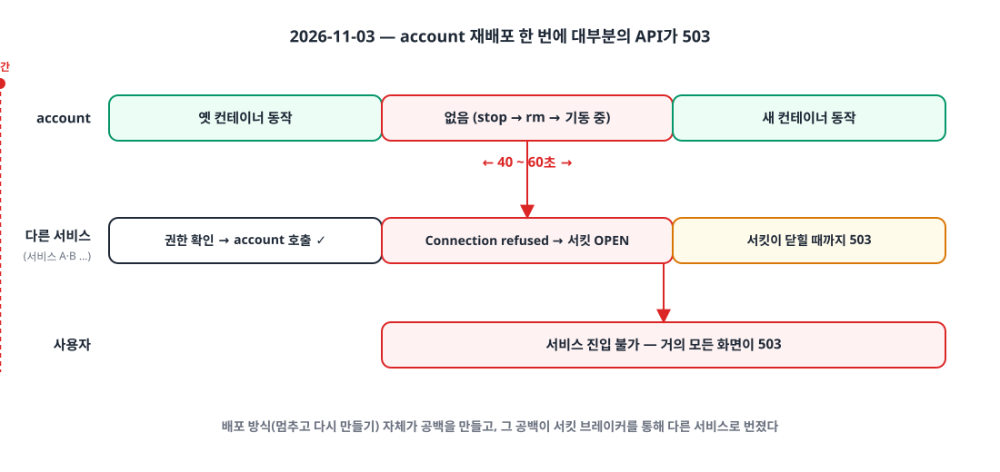

## 들어가며

저는 요즘 업무용 SaaS(백엔드 10개, 웹 7개, 소개 사이트 6개)를 거의 혼자 만들고 운영하고 있습니다.
서버는 온프레미스 서버 **한 대**이고, 이 한 대에서 dev, prd, GitHub Actions self-hosted runner가 함께 돌고 있습니다.

배포는 지금까지 아래처럼 하고 있었습니다.

- GitHub Actions가 Docker 이미지를 빌드해서 GHCR에 `latest-dev`·`latest-prd` 태그로 올린다
- 서버의 **Watchtower**가 새 `latest` 이미지를 발견하면 컨테이너를 다시 만든다
- 앞단의 **Caddy**가 도메인·경로별로 각 컨테이너의 호스트 포트로 보낸다

설정이 단순하고 따로 신경 쓸 게 없어서 꽤 오래 잘 썼는데요.
어느 날 백엔드 하나를 재배포했을 뿐인데 **서비스 대부분이 503**을 내는 일이 생겼습니다.

이 글은 그 일을 계기로 무중단 배포 방법을 찾아보고, **Kamal**을 고르고, 실제로 23개 서비스 × 2개 환경을 옮기면서 겪은 일을 정리한 글입니다.
비슷하게 작은 팀이나 혼자서 온프레미스 서버를 운영하시는 분들께 참고가 되면 좋겠습니다.

## 1. 무슨 일이 있었나 🔥

{: width="1100" height="560" }

문제가 된 건 Watchtower가 컨테이너를 다시 만드는 방식이었습니다.
Watchtower는 같은 이름의 컨테이너를 **멈추고(stop) → 지우고(rm) → 새로 띄웁니다(run)**.
Spring Boot 백엔드는 뜨는 데 40~60초가 걸리기 때문에, 그 사이에는 그 서비스가 아예 없는 상태가 됩니다.

평소에는 그 1분 동안 해당 서비스만 안 되는 정도였는데, 이번에 재배포한 서비스가 **계정(account) 서비스**였던 게 문제였습니다.

{: width="1100" height="520" }

다른 서비스들은 요청마다 account에 권한을 확인합니다.
account가 사라진 40~60초 동안 이 호출이 전부 `Connection refused`로 실패했고, 내부 호출에 걸어 둔 **서킷 브레이커가 열리면서** 서킷이 닫힐 때까지 거의 모든 API가 503을 돌려줬습니다.
사용자 입장에서는 업무 화면에 아예 들어갈 수가 없었습니다.

정리하면 원인은 이렇습니다.

- 배포 방식 자체가 **공백을 만든다** (멈추고 다시 만들기)
- 새 컨테이너가 **준비됐는지 확인하지 않고** 끝난다 (헬스체크 없음)
- 모든 배포가 `latest` 태그라서 **지금 어떤 버전이 떠 있는지, 무엇으로 되돌릴지** 알기 어렵다

그래서 목표를 이렇게 잡았습니다.

> 새 버전이 **준비된 뒤에** 트래픽을 넘기고, 언제든 **이전 버전으로 되돌릴 수 있게** 하자.
> 단, 혼자 운영하니까 **도구는 단순하고 무료**여야 한다.

## 2. 어떤 선택지가 있었나 🧐

### 선택지 1️⃣ 지금 구조에서 블루그린을 직접 만들기

`deploy.sh`를 고쳐서 새 컨테이너를 다른 포트로 띄우고, 헬스체크가 통과하면 Caddy의 upstream을 바꾼 뒤 옛 컨테이너를 내리는 방식입니다.

- 👍 지금 쓰는 Docker·Caddy를 그대로 쓴다
- 👎 포트 할당, 헬스체크 대기, Caddy 설정 교체, 실패 시 되돌리기, 동시 배포 잠금까지 **전부 직접 만들고 유지해야** 한다

23개 서비스 × 2개 환경에 이걸 직접 짠 스크립트로 관리하는 건 자신이 없었습니다.

### 선택지 2️⃣ Kamal

[Kamal](https://kamal-deploy.org)은 37signals(Basecamp, HEY를 만든 회사)가 만든 배포 도구입니다.
서버에는 Docker만 있으면 되고, 배포하는 쪽에서 **SSH로 접속해 docker 명령을 실행**합니다.
서버마다 `kamal-proxy`라는 작은 프록시가 하나 떠 있고, 새 컨테이너의 **헬스체크가 통과해야 트래픽을 넘깁니다.**

- 👍 무료, 설정 파일(YAML) 하나로 끝, 서버에 상주하는 관리 프로그램이 없다
- 👍 롤백 = 이전 버전으로 다시 배포
- 👎 kamal-proxy가 **서버당 하나**라 같은 서버에 여러 환경을 올릴 때 신경 쓸 게 생긴다 (뒤에서 다룹니다)

### 선택지 3️⃣ Coolify / Dokploy

Heroku나 Vercel 같은 경험을 내 서버에 만들어 주는 셀프 호스팅 PaaS입니다.
웹 UI에서 Git 저장소를 연결하면 빌드부터 배포까지 해 줍니다.

- 👍 UI가 편하고, 무중단 배포·롤백이 기본으로 들어 있다
- 👎 서버에 **관리 플랫폼(DB·대시보드·프록시)이 하나 더 상주**하고, 그 플랫폼 자체를 운영하고 백업해야 한다
- 👎 이미 쓰고 있는 Caddy·GitHub Actions 파이프라인을 플랫폼 방식에 맞춰 다시 짜야 한다

### 선택지 4️⃣ Docker Swarm

Docker에 들어 있는 오케스트레이션 기능으로, `docker service update`가 롤링 업데이트를 해 줍니다.

- 👍 추가 설치 없이 Docker만으로 된다
- 👎 컨테이너를 `docker run`이 아니라 stack·service 단위로 다시 정의해야 하고, 네트워크도 overlay로 바뀌는 등 **바뀌는 범위가 크다**
- 👎 서버 한 대에서 쓰기엔 기능이 과하고, 생태계도 예전보다 많이 줄었다

(Kubernetes·k3s도 잠깐 떠올렸지만, 서버 한 대를 혼자 운영하는 지금 상황에는 너무 무거워서 바로 제외했습니다.)

### 한눈에 비교

| | 직접 블루그린 | **Kamal** | Coolify / Dokploy | Docker Swarm |
|---|---|---|---|---|
| 비용 | 무료 | **무료** | 무료(셀프 호스팅) | 무료 |
| 서버에 추가로 상주하는 것 | 없음 | **kamal-proxy 하나** | 관리 플랫폼 전체 | Swarm 매니저 |
| 무중단·헬스체크 | 직접 구현 | **기본** | 기본 | 기본 |
| 롤백 | 직접 구현 | **이전 버전 재배포** | UI에서 | `service rollback` |
| 기존 구조 유지 (Docker·Caddy·Actions) | ○ | **○** | △ | △ |
| 바뀌는 범위 | 작음(대신 직접 짬) | **작음** | 큼 | 큼 |

## 3. Kamal을 고른 이유 💡

최종적으로 **Kamal**을 골랐습니다.

1. **지금 구조를 거의 그대로 둘 수 있습니다.** Docker 이미지, GHCR, GitHub Actions, Caddy를 모두 그대로 쓰고, "컨테이너를 어떻게 바꿔 끼우느냐"만 Kamal에 맡기면 됐습니다.
2. **서버에 새로 운영할 게 거의 없습니다.** 상주하는 건 kamal-proxy 하나뿐이고, 배포는 SSH로 들어와서 끝납니다. 혼자 운영할 때는 "관리할 시스템이 하나 늘어나는 것" 자체가 비용입니다.
3. **무중단 원리가 단순해서 이해하고 디버깅하기 쉽습니다.**

{: width="1100" height="520" }

새 버전 컨테이너를 옛 버전 옆에 띄우고, `/actuator/health`가 200을 돌려줄 때까지 기다린 다음 kamal-proxy가 트래픽을 넘깁니다.
옛 컨테이너는 처리 중인 요청을 끝낸 뒤(drain) 내려갑니다.
요청은 언제나 **준비된 쪽으로만** 가기 때문에 공백이 생기지 않습니다.

4. **서버를 나눌 때도 그대로 쓸 수 있습니다.** 조만간 dev와 prd를 서버 두 대로 나눌 예정인데, Kamal은 배포 대상 호스트만 바꾸면 됩니다.

설정은 서비스마다 공통 파일 하나와 환경별 파일 하나로 나눴습니다.

```yaml
# deploy/kamal/deploy.account-backend.yml (공통)
service: account-backend
image: my-org/account-backend
require_destination: true

proxy:
  app_port: 8080
  path_prefix: /api/account
  healthcheck:
    path: /actuator/health
    interval: 2
    timeout: 5
drain_timeout: 30
```

```yaml
# deploy/kamal/deploy.account-backend.prd.yml (환경별)
image: my-org/account-backend   # dev 는 account-backend-dev 패키지
servers:
  web:
    hosts:
      - <%= ENV.fetch("KAMAL_HOST_PRD") %>
    cmd: --spring.profiles.active=prd
    stop_timeout: 40
    options:
      env-file:
        - /srv/env/backend-prd
      network: app-network
proxy:
  hosts:
    - example.com
    - kamal-proxy-prd
```

Spring Boot 쪽에는 `server.shutdown: graceful`과 `spring.lifecycle.timeout-per-shutdown-phase: 20s`를 넣어서, 내려가라는 신호를 받으면 새 요청은 받지 않고 처리 중인 요청을 끝낸 뒤 종료하게 했습니다.

## 4. 옮기면서 만난 문제들 🤦🏻‍♂️

여기서부터가 진짜였습니다.
Kamal 공식 문서의 예시는 "서버에 앱 하나"인 경우가 많아서, 제 환경에 맞추려면 풀어야 할 문제가 꽤 있었습니다.

### 4-1. 서버에는 Tailscale로만 SSH가 열려 있다

Kamal은 SSH로 서버에 들어옵니다.
그런데 제 서버는 보안상 **Tailscale(사설 VPN)로만 SSH를 허용**하고 있어서, GitHub가 제공하는 runner는 서버에 접속할 수가 없습니다.

다행히 GitHub Actions를 이미 **self-hosted runner**로 돌리고 있었고, runner가 같은 tailnet 안에 있었습니다.
그래서 runner가 서버의 tailnet 이름으로 SSH 하도록 했고, 대신 아래처럼 범위를 최대한 좁혔습니다.

- 배포 전용 `deploy` 사용자를 만들고, 공개키에 `from="<runner의 tailnet IP>",restrict`로 **접속 출처를 제한하고 포워딩을 막았습니다.**
- 개인키는 서버에 남기지 않고 GitHub 시크릿에만 둡니다.
- 시크릿은 저장소 시크릿이 아니라 **Environment 시크릿**으로 두고, dev 키는 `dev` 브랜치 잡만, prd 키는 `main` 브랜치 잡만 받을 수 있게 했습니다. PR이나 작업 브랜치에서 도는 잡은 서버 키를 아예 받지 못합니다.

> **삽질 하나**: 배포 잡을 재사용 워크플로(`workflow_call`)로 부르고 있었는데, Environment 시크릿으로 옮긴 직후 모든 배포가 `Could not parse PKey`로 실패했습니다.
> 재사용 워크플로를 부를 때는 호출하는 쪽에서 `secrets: inherit`를 줘야 Environment 시크릿까지 보입니다. 수동 실행(`workflow_dispatch`)으로 확인했을 때는 잘 돼서 처음엔 놓쳤습니다.

### 4-2. 서비스끼리는 어떻게 부르나

예전에는 서비스끼리 `http://account-backend-dev:8080`처럼 **컨테이너 이름**으로 불렀습니다.
그런데 Kamal은 컨테이너 이름에 버전을 붙입니다(`account-backend-web-dev-a1b2c3d`). 배포할 때마다 이름이 바뀝니다.

처음에는 Docker 네트워크 별칭(alias)으로 옛 이름을 붙이면 되겠다고 생각했는데, 별칭은 **컨테이너가 시작되자마자** DNS에 올라갑니다.
즉 아직 기동 중인(40~60초) 새 컨테이너로 내부 호출이 가 버립니다. 이번 장애의 원인을 그대로 다시 만드는 셈이죠.

{: width="1100" height="560" }

그래서 **서비스끼리의 호출도 kamal-proxy를 거치게** 했습니다.
환경변수를 `BASE_URL_ACCOUNT=http://kamal-proxy/api/account`처럼 바꾸면, kamal-proxy가 헬스체크를 통과한 컨테이너로만 보내 줍니다.
바깥 요청과 안쪽 요청이 같은 규칙으로 움직이니 오히려 단순해졌습니다.

### 4-3. 서버 한 대에 dev와 prd를 함께 올리기

kamal-proxy는 **서버당 하나**입니다.
처음에는 prd를 새 서버로 옮길 때 Kamal을 적용하려고 했는데, 서버를 나누기까지 몇 주가 남아 있어서 지금 서버에서 dev와 prd를 함께 Kamal로 올리기로 했습니다.

문제는 dev와 prd가 **같은 경로**(`/api/account`)를 쓴다는 점이었습니다.
그래서 경로에 더해 **Host로 환경을 나눴습니다.**

{: width="1100" height="600" }

- 바깥 요청: Caddy가 Host(`dev.example.com` / `example.com`)를 그대로 넘긴다
- 안쪽 요청: dev는 `http://kamal-proxy/...`, prd는 `http://kamal-proxy-prd/...` — kamal-proxy 컨테이너에 네트워크 별칭 `kamal-proxy-prd`를 하나 더 붙였다. 호출하는 주소가 곧 Host가 된다

여기서 조심해야 할 점을 kamal-proxy 소스를 읽다가 알게 됐습니다.
kamal-proxy는 요청의 Host로 경로를 찾을 때 **정확한 Host → `*.도메인` → Host 없이 등록된 앱** 순서로 찾습니다.
그래서 어느 한 앱이라도 `proxy.hosts`를 비워 두면 그 앱이 "기본값"이 되고, Host가 맞지 않는 다른 환경의 요청이 그쪽으로 샐 수 있습니다.
그래서 **46개 설정 파일 모두에 Host를 명시**했고, kamal-proxy에 모르는 Host로 요청하면 404가 나는 것까지 확인했습니다.

하나 더 있었습니다. Kamal의 부속 컨테이너(accessory) 이름은 `<서비스>-<이름>`이라 **환경이 붙지 않습니다.** 같은 서버에서 dev와 prd가 같은 이름을 쓰려고 하면 충돌하기 때문에, prd 쪽 이름 앞에는 `prd-`를 붙였습니다.

### 4-4. HTTP가 아닌 것 — SMTP

메일 서비스는 앱 비밀번호로 접속하는 메일 프로그램을 위해 SMTP(465)도 받고 있습니다.
kamal-proxy는 HTTP만 다루기 때문에 SMTP는 무중단 전환을 해 줄 수 없습니다.
게다가 호스트 포트 465는 컨테이너 하나만 잡을 수 있어서, 새·옛 컨테이너를 겹쳐 띄우는 Kamal 방식도 쓸 수 없었습니다.

{: width="1100" height="500" }

그래서 SMTP 컨테이너를 두 개(a, b) 두고, 앞에 **HAProxy**를 하나 두었습니다.
HAProxy가 465를 잡고 TCP를 그대로 넘기며(TLS는 풀지 않습니다), 배포할 때는 **a를 다시 띄우고 → SMTP가 뜬 로그를 확인한 뒤 → b를 다시 띄웁니다.** 한쪽이 내려가 있는 동안에는 HAProxy가 다른 쪽으로 보내니 포트가 닫히는 순간이 없습니다.

그런데 HAProxy를 거치면 SMTP 서버가 보는 접속 IP가 HAProxy 컨테이너 IP로 바뀝니다.
앱 비밀번호마다 "마지막 사용 IP"를 보여 주고 있어서 이건 그냥 넘길 수 없었습니다.
HAProxy의 `send-proxy`로 원래 IP를 PROXY protocol 헤더에 실어 보내고, 쓰고 있던 SMTP 라이브러리(SubEthaSMTP)가 이를 지원하지 않아 **헤더를 읽은 뒤 TLS를 여는 소켓을 직접 구현**했습니다.

### 4-5. 겹치는 동안 예약 작업이 두 번 돈다

무중단 배포는 새·옛 컨테이너가 **잠깐 함께 뜬다**는 뜻이기도 합니다.
배치 서버의 `@Scheduled` 작업이 그 사이에 걸리면 두 컨테이너가 같은 작업을 동시에 실행합니다.
밤 11시 50분에 도는 재고 계산이나 알림 발송이 두 번 돌면 곤란하죠.

이 문제는 **ShedLock**으로 모든 예약 작업에 락을 걸어 해결했습니다.
배치 서버가 이미 쓰는 DB에 락을 둔 이유, 작업이 금방 끝나도 중복을 막는 `lockAtLeastFor`, 내려갈 때 실행 중인 작업을 끊지 않는 graceful shutdown, 앞으로 추가될 작업도 락을 빠뜨리지 않게 하는 테스트까지 내용이 꽤 길어서 먼저 별도 글로 정리해 두었습니다.

> 👉 [무중단 배포에서 두 번 도는 예약 작업, ShedLock으로 막기]()

### 4-6. `latest` 태그를 버리기

롤백을 하려면 "어떤 버전으로" 되돌릴지가 분명해야 합니다.
그래서 이미지 태그를 `latest` 대신 **커밋 해시 7자**로 바꿨고, GHCR 패키지도 환경별로 나눴습니다(`account-backend-dev` / `account-backend`).
이제 컨테이너 이름만 봐도 어떤 커밋이 떠 있는지 알 수 있고, 롤백은 Actions에서 이전 해시로 배포를 다시 실행하면 됩니다.

### 4-7. 모니터링도 컨테이너 이름에 기대고 있었다

옮기고 나서 Grafana를 열어 보니 **Service Down 경보가 34건** 떠 있었습니다.
서비스는 멀쩡했는데, Prometheus가 `account-backend-dev:8080`처럼 **옛 컨테이너 이름**으로 메트릭을 긁고 있었고, 로그 경보도 컨테이너 이름 패턴으로 서비스를 고르고 있었기 때문입니다.

- 메트릭 수집은 요청 경로가 아니라서, 여기에는 네트워크 별칭(`<서비스>-<환경>`)을 다시 붙여 해결했습니다.
- 로그는 Kamal이 컨테이너에 붙이는 라벨(`service`, `destination`)로 `service`·`env` 라벨을 만들어, 배포마다 컨테이너 이름이 바뀌어도 경보가 잡히게 했습니다.

"컨테이너 이름이 바뀐다"는 사실이 생각보다 여러 곳에 숨어 있다는 걸 배웠습니다.

## 5. 어떻게 옮겼나 🚚

한 번에 옮기지 않고 **서비스 하나씩** 옮겼습니다. 장애를 냈던 account를 가장 먼저 옮겼고, 순서는 매번 같았습니다.

1. Kamal로 새 컨테이너를 **옛 컨테이너 옆에** 띄운다 (이때는 아직 옛 컨테이너가 요청을 받는다)
2. 서버에서 `curl -H 'Host: …' 127.0.0.1:11080/…`로 kamal-proxy를 직접 불러 확인한다
3. Caddy를 kamal-proxy로 바꾼다 → 바깥 요청이 Kamal로 간다
4. 다른 서비스들의 env를 `http://kamal-proxy/...`로 바꾸고 다시 배포한다 → 안쪽 요청도 Kamal로 간다
5. 옛 컨테이너를 지운다

옛 컨테이너가 마지막까지 살아 있기 때문에, 중간에 문제가 생기면 Caddy만 되돌리면 1초 안에 원래대로 돌아갈 수 있었습니다.
이 순서로 dev 23개, prd 23개를 옮기고 마지막에 Watchtower와 서비스별 `deploy.sh`를 지웠습니다.

최종 CI/CD는 이렇게 됐습니다.

{: width="1100" height="620" }

## 6. 결과 ✨

- **배포 중 공백이 없어졌습니다.** account를 다시 배포해도 다른 서비스는 아무 일 없이 동작합니다.
- **롤백이 쉬워졌습니다.** Actions에서 이전 커밋 해시로 Kamal Deploy를 실행하면 같은 방식으로 되돌아갑니다.
- **배포 경로가 하나가 됐습니다.** dev는 dev 머지, prd는 main 머지 한 가지 길이고, 모니터링 컨테이너까지 같은 방식(Kamal accessory)으로 배포합니다.
- **서버를 나눌 준비가 됐습니다.** prd 서버가 생기면 `KAMAL_HOST_PRD`만 새 서버로 바꾸면 됩니다.

## 마무리

정리하면서 다시 보니, 결국 이번 일의 핵심은 도구보다 **"준비된 뒤에 넘긴다"**는 원칙이었던 것 같습니다.
Kamal은 그 원칙을 가장 적은 비용으로 지금 구조에 얹을 수 있는 도구였고, 나머지 문제들(내부 호출, 한 서버의 두 환경, SMTP, 예약 작업, 모니터링)은 모두 **"두 버전이 잠깐 함께 떠 있다"**, **"컨테이너 이름이 바뀐다"**는 두 가지 사실에서 나왔습니다.

혼자 운영하는 작은 서비스라도, 배포 한 번이 전체 장애로 번질 수 있다는 걸 이번에 제대로 배웠습니다.
비슷한 고민을 하시는 분들께 조금이라도 도움이 되면 좋겠습니다. 🙇🏻‍♂️

> 참고
> - [Kamal 공식 문서](https://kamal-deploy.org/docs/)
> - [kamal-proxy](https://github.com/basecamp/kamal-proxy)
> - [무중단 배포에서 두 번 도는 예약 작업, ShedLock으로 막기]()
> - [HAProxy PROXY protocol](https://www.haproxy.org/download/2.8/doc/proxy-protocol.txt)
