## 요약

- **문제**: 백엔드 하나를 고쳐도 배포가 30분을 넘기는 일이 잦았습니다. 실측해 보니 dev 배포 73회 중 **44회가 10개 서비스 전체 배포**였습니다.
- **원인**: ① 모든 서비스가 쓰는 공용 모듈(core)에 **응답 코드 enum 하나**가 있어서, 기능 하나에 코드 하나만 추가해도 10개가 다 다시 배포됐고, ② Dockerfile 마지막 `chown -R`이 **145MB 레이어를 매번 새로** 만들었습니다.
- **해결**: 응답 코드를 서비스별 enum으로 나누고, 이미지가 나오는 대로 바로 배포하고, 빌드 캐시를 다시 켰습니다. 프런트와 Flutter는 **실제 의존 그래프**로 바뀐 패키지와 그 소비자만 빌드·검사합니다.
- **결과**: 백엔드 전체 배포 **35.6분 → 13.7분**, dev push 전체 CI 15.4분 → 10.5분. Flutter 기능 PR 검사 대상 10개 → 2개 패키지.

## 들어가며

[Kamal로 무중단 배포를 도입]()한 뒤, 배포 중 공백은 없어졌는데 이번엔 **배포 자체가 오래 걸리는 게** 눈에 들어왔습니다.
백엔드 한 줄을 고치고 머지했는데 dev에 반영되기까지 30분 넘게 기다리는 일이 잦았습니다.

느낌으로 "core를 고치면 다 배포돼서 그렇겠지" 하고 넘어갈 수도 있었지만, 이번에는 먼저 **재 보기로** 했습니다.
어디가 느린지 모르고 고치면, 고친 게 효과가 있었는지도 알 수 없기 때문입니다.

구성은 이렇습니다.

- 백엔드: Kotlin + Spring Boot 서비스 10개, Gradle 멀티 모듈(공용 `core` + 서비스별 `-api`/`-domain`)
- 웹: Next.js 앱 13개(pnpm workspace + Turborepo), 모바일: Flutter 패키지 10개
- CI/CD: GitHub Actions self-hosted runner → GHCR → Kamal, 서버 한 대

## 배포 시간은 어디서 새고 있었나 — 73회 실측 📏

**배포 시간은 거의 "배포한 서비스 수"에 비례했고, 그 서비스 수를 키운 주범은 공용 모듈의 enum 하나였습니다.**

측정은 단순하게 했습니다. 2026-10-15부터 11-08까지 성공한 dev 백엔드 배포 73회에 대해

1. `gh api .../runs`, `.../jobs`로 잡별 시작·종료 시각을 받고
2. 직전 성공 실행의 커밋과 이번 커밋 사이의 `git diff`로 **바뀐 경로**를 뽑아
3. "어떤 경로가 바뀌어서 몇 개 서비스가 배포됐는지"를 짝지었습니다.

결과는 이랬습니다.

| 항목 | 값 |
|---|---|
| 10개 전체 배포 비율 | **44 / 73회 (60%)** |
| 전체 배포 1회 소요 (중앙값) | **35.6분** (이미지 빌드·push 24.9분 + Kamal 9.2분) |
| 회귀식 | 배포 시간 ≈ **5.9분 + 3.45분 × 서비스 수** |
| 서비스당 이미지 push (중앙값) | 55초 (최대 117초) |

서비스 하나가 3.45분이니, 전체 배포를 줄이는 게 가장 큰 레버였습니다. 전체 배포를 일으킨 경로를 세 보면:

{: width="1100" height="560" }

1. **`core`의 `ExceptionCode.kt`·`SuccessCode.kt`** — 응답 코드 1,350개가 든 enum 두 개. 기능을 만들 때마다 코드가 하나씩 추가되니, 결재 서비스 기능을 만들어도 영업 서비스까지 다시 배포됐습니다.
2. **배포 파이프라인 파일 변경** — Kamal 전환 기간이라 워크플로를 자주 고쳤는데, 이것만으로 전체 배포된 게 13회였습니다.
3. 내부 계정 클라이언트, 권한 enum(`RoleType`), 인증 설정처럼 **일부 서비스만 쓰는데 core에 있는 것들**.

그리고 서비스 수와 상관없이 매번 새는 시간이 두 개 더 있었습니다. 이미지 push가 이상하게 오래 걸렸고(뒤에서 다룹니다), Kamal 배포는 **모든 이미지 push가 끝난 뒤에야** 한 서비스씩 직렬로 시작했습니다.

### 고치기 전에 시뮬레이션부터

73회의 "바뀐 경로" 데이터가 있으니, 규칙을 바꿨다면 몇 개 서비스가 배포됐을지 다시 계산해 볼 수 있습니다(회당 평균 30.7분 기준).

| 개선안 | 예상 단축 |
|---|---|
| 서비스별 `src/main`만 보고, 파이프라인만 바뀐 커밋은 제외 | -12% |
| core 안에서 실제로 쓰는 서비스만 매핑 | -15% |
| **응답 코드를 서비스별로 분리** | **-26%** |
| 위 전부 + Dockerfile 수정 + 이미지 나오는 대로 배포 | **-47% (16.3분)** |

응답 코드 분리가 가장 크고, 나머지와 합치면 절반 가까이 줄어든다는 예측이 나왔습니다. 이 순서대로 고쳤습니다.

## core의 응답 코드 enum을 서비스별로 나누기 ✂️

**core에는 인터페이스만 남기고, 한 서비스만 쓰는 코드 962개를 각 서비스의 `-api` 모듈 enum으로 옮겼습니다.** 응답 JSON의 `code` 문자열은 그대로라서 API 계약과 프런트 타입은 바뀌지 않습니다.

```kotlin
// core: 인터페이스만
interface ApiResponseCode { val name: String; val httpStatus: HttpStatus; val message: String }
interface ApiErrorCode : ApiResponseCode

// account-api: 이 서비스만 쓰는 코드
enum class AccountExceptionCode(
    override val httpStatus: HttpStatus,
    override val message: String,
) : ApiErrorCode {
    USER_TRANSFER_SAME_COMPANY(BAD_REQUEST, "..."),
    // ...
}
```

`CustomException`과 응답 DTO는 enum 대신 `ApiErrorCode` 인터페이스를 받게 바꿨습니다. core에 남긴 건 세 종류뿐입니다.

- 여러 서비스가 함께 쓰는 코드
- 필드 이름으로 코드 이름을 조립하는 검증 코드(`*_FIELD_REQUIRED`)
- domain 모듈이 쓰는 코드 (domain에는 spring-web이 없어서 `HttpStatus`를 못 씁니다. 그래서 서비스 enum을 `-api`에 뒀습니다)

결과적으로 core의 응답 코드는 1,350개에서 **388개**로 줄었습니다.

enum이 흩어지면 **이름이 겹칠** 수 있다는 게 걱정이었습니다. 응답 `code` 문자열이 같은데 의미가 다르면 프런트가 헷갈리니까요. 그래서 모듈마다 `ResponseCodeNamesTest`를 두어 core와 이름이 겹치지 않는지 검사하고, 다른 `-api` 모듈은 컴파일 의존이 없으니 소스를 정규식으로 훑어서 확인합니다.

이 PR 하나를 머지한 직후 전체 배포가 **35.6분 → 18.2분**이 됐습니다. 이후 같은 방식으로 권한 enum을 별도 `:role` 모듈로, 영업 서비스 내부 클라이언트를 `:sales-client` 모듈로, 한 서비스만 쓰는 Provider를 그 서비스로 옮겼습니다.

> 권한 enum은 계정·배치·MCP 서비스만 런타임에 의존하고, 나머지 서비스는 `SalesRoles.ADMIN` 같은 **문자열 상수**를 씁니다. 상수가 `RoleType`과 어긋나면 테스트가 깨지고, 혹시 어긋나도 권한이 "거부"되는 쪽으로 틀리게 해 두었습니다.

## Dockerfile의 `chown -R` 한 줄이 145MB를 매번 올리고 있었다 🐳

**`COPY` 다음에 `RUN chown -R`을 하면 복사한 파일 전체가 새 레이어로 다시 쓰여서, 의존성이 그대로여도 그 레이어는 매번 새로 push됩니다.** `COPY --chown`으로 바꾸니 코드만 바뀐 배포에서는 14MB짜리 애플리케이션 레이어만 올라갑니다.

{: width="1100" height="520" }

```dockerfile
# before — 마지막 chown -R 이 의존성(130MB)+앱(14MB)을 새 레이어(145MB)로 다시 쓴다
COPY --from=extract /extract/extracted/dependencies/ ./
COPY --from=extract /extract/extracted/application/ ./
RUN groupadd --system --gid 10001 app && useradd ... app && \
    chown -R app:app /app

# after — 사용자를 먼저 만들고, 복사할 때 소유자를 지정한다
RUN groupadd --system --gid 10001 app && useradd ... app
WORKDIR /app
RUN chown app:app /app
COPY --from=extract --chown=app:app /extract/extracted/dependencies/ ./
COPY --from=extract --chown=app:app /extract/extracted/application/ ./
```

서비스당 push가 **55초 → 약 4초**가 됐습니다. 서비스 10개면 이것만으로 몇 분입니다.

같은 맥락에서 BuildKit 레지스트리 캐시도 `mode=max` → `mode=min`으로 바꿨습니다. `mode=max`는 중간 단계(jar를 푸는 extract 단계)까지 캐시로 내보내는데, 그 단계의 산출물은 빌드마다 달라서 재사용은 안 되고 **내보내기에만 60초**가 걸리고 있었습니다.

```yaml
- cache-to: type=registry,ref=ghcr.io/<owner>/<image>:buildcache-dev,mode=max
+ cache-to: type=registry,ref=ghcr.io/<owner>/<image>:buildcache-dev,mode=min
```

카나리 서비스 기준 docker 단계가 129초 → 44초, 캐시 내보내기가 60초 → 11초로 줄었습니다.

## 이미지가 나오는 대로 바로 배포하기 🚚

**Kamal 배포를 composite action으로 빼서, 각 서비스의 이미지 push 잡이 끝나자마자 그 잡 안에서 바로 배포하게 했습니다.** 예전에는 10개 push가 전부 끝난 뒤에 배포 잡이 한 서비스씩 직렬로 돌았습니다.

{: width="1100" height="560" }

같은 서버에 동시에 배포가 겹치는 건 원래 걸어 둔 서버 단위 `flock`이 줄을 세워 줍니다. 그래서 "push는 병렬, 배포는 도착한 순서대로 직렬"이 됩니다.

이때 **무엇을 배포할지 정하는 규칙**도 다시 짰습니다. 경로를 세 종류로 나눕니다.

```yaml
shared:   ['backend/core/src/main/**', 'backend/core/build.gradle',
           'backend/build.gradle', 'backend/docker/**']          # → 전체 배포
pipeline: ['.github/workflows/backend-publish-dev.yml',
           '.github/actions/kamal-deploy/**']                    # → 카나리 하나만
account-api: ['backend/account-api/**', 'backend/account-domain/**',
              'backend/role/src/main/**',
              'deploy/kamal/deploy.account-backend*.yml']         # → 그 서비스만
```

{: width="1100" height="560" }

- core라도 `src/main`과 빌드 파일만 봅니다. **core 테스트만 바꾼 커밋은 배포하지 않습니다.**
- **배포 절차만 바뀐 커밋은 카나리 서비스 하나만** 배포합니다. 배포 스크립트가 깨졌는지 확인하는 데는 하나면 충분합니다.
- 비교 기준 커밋은 "마지막으로 성공한 **push 이벤트** 실행"입니다. 수동으로 일부만 배포한 실행이 기준이 되면, 그 사이의 배포 안 된 변경을 건너뛰게 되기 때문입니다.
- 그래도 전체가 필요할 때를 위해 `workflow_dispatch`에 `modules` 입력을 두었습니다(비우면 전체).

### 컴파일은 캐시, 테스트는 캐시 없이

dev push와 야간 CI는 그동안 `--no-build-cache`로 돌고 있었습니다. "날짜에 따라 깨지는 테스트를 잡으려면 캐시 없이 돌려야 한다"는 이유였는데, 그 바람에 core와 domain도 매번 처음부터 컴파일했습니다.
필요한 건 **테스트만 캐시 없이** 도는 것이었습니다.

```groovy
tasks.withType(Test).configureEach {
    if (project.hasProperty('noTestCache')) {
        outputs.cacheIf { false }
        outputs.upToDateWhen { false }
    }
}
```


```yaml
GRADLE_CACHE: --build-cache
GRADLE_TEST_CACHE: ${{ github.event_name == 'pull_request' && '-PtestCache' || '-PnoTestCache' }}
```


## 프런트·Flutter: 실제 의존 그래프로 영향 범위만 📦

**프런트와 Flutter는 경로 규칙 대신 패키지 매니저가 아는 실제 의존 그래프로 "바뀐 패키지 + 그걸 쓰는 앱"을 계산합니다.** 백엔드처럼 경로를 손으로 매핑하면 workspace 패키지가 늘어날 때마다 규칙을 고쳐야 하기 때문입니다.

웹은 `package.json`의 workspace 의존을 따라 **전이 소비자**까지 넓힙니다. 의존을 지운 변경도 놓치지 않도록 이전 그래프와 현재 그래프를 둘 다 봅니다.

```python
while True:
    expanded = selected | {
        d["name"] for d in graph.values()
        if any(selected.intersection(d.get(k, {})) for k in DEPENDENCIES)
    }
    if expanded == selected:
        break
    selected = expanded
```

lockfile, Turborepo 설정, 공용 Dockerfile처럼 판단이 어려운 경로는 전체로, 테스트·README만 바뀌면 아무것도 빌드하지 않습니다. 이미지는 `turbo prune <앱> --docker`로 앱별 컨텍스트만 보내서 영업 서비스 앱의 Docker 컨텍스트가 **약 98MB → 16.7MB**가 됐습니다.

Flutter는 `flutter pub deps --json`과 `package_config.json`을 읽어서 같은 계산을 합니다. pubspec을 직접 파싱하지 않는 게 포인트입니다.

{: width="1100" height="540" }

그래프가 생기니 **패키지를 어떻게 나누느냐**가 곧 빌드 범위가 됩니다. 레코드 공유 UI는 앱 3개만 쓰는데 공용 `ui` 패키지에 들어 있어서, 고칠 때마다 `ui`를 쓰는 앱 11개가 다 검사·배포됐습니다. 이걸 `@my/records` 패키지로 떼어 내 영향 범위를 3개로 줄였습니다(`ui`가 records를 다시 export하지 못하게 테스트로 막았습니다).

| 대상 | 전 | 후 |
|---|---|---|
| Flutter 기능 패키지 변경 시 PR 검사 | 패키지 10개 | **2개** (기능 + 셸) |
| 레코드 UI 변경 시 영향 앱 | 11개 | **3개** |
| 웹 앱 Docker 컨텍스트(영업 서비스) | ~98MB | **16.7MB** |
| 앱과 무관한 push(`.gitignore`만 변경) | 모바일 빌드 전체 | **16초에 스킵** |

## 만난 함정들 🪤

**KSP가 오류 없이 QueryDSL Q 클래스 일부를 빠뜨리고, 그게 빌드 캐시에 들어가 버렸습니다.** 빌드 캐시를 다시 켜고 나서 같은 입력의 빌드가 계속 이렇게 실패했습니다.

```text
e: Unresolved reference 'Q…'
```

`--parallel`로 같은 데몬에서 KSP가 동시에 돌 때 생기는 것으로 보이는데, 문제는 **오류 없이 끝난 불완전한 산출물이 캐시에 저장된다**는 점이었습니다. 한 번 들어가면 같은 입력은 계속 그 산출물을 받아 옵니다. KSP 태스크는 캐시하지 않게 하고(`outputs.cacheIf { false }`), 엔티티가 없는 모듈은 KSP를 껐습니다. 모듈당 몇 초~20초를 더 쓰는 대신 재현 안 되는 실패를 없앴습니다.

**한글 파일명은 `git diff --name-only`에서 따옴표로 감싸여 나옵니다.** `"app/\355\225\234..."`처럼 C 스타일로 이스케이프되면 `startswith("app/")`에 안 걸려서 검사 대상에서 빠집니다. `-z`로 받아 NUL로 자르게 고쳤습니다.

```python
changed = check_output(
    ["git", "diff", "--name-only", "--no-renames", "-z", merge_base, "HEAD"]
).split("\0")
```

**GitHub API의 `status=success` 필터가 몇 주 전 실행을 돌려준 적이 있습니다.** 비교 기준이 몇 주 전으로 가면 그 사이 모든 변경이 "바뀐 것"이 되어 전체 배포가 됩니다. 필터 없이 최근 실행을 받아 `jq`에서 고르게 바꿨습니다.

## 결과 ✨

| 측정 | 전 | 후 |
|---|---|---|
| 백엔드 10개 전체 배포 | 35.6분 (중앙값) | **13.7분** |
| dev push 전체 CI | 15.4분 (중앙값) | **10.5분** |
| 서비스당 이미지 push | 55초 | **약 4초** |
| 웹 13개 전체 배포 | 32.4분 (중앙값, 6회) | 19분 (1회) |
| Android AAB 잡 전체 | 19분 | 11분 26초 (1회) |

단계별로 보면 응답 코드 분리 후 18.2분, 빌드 캐시 후 15.9분, core 정리 후 13.7분이었습니다. 시뮬레이션의 예측(16.3분)보다 조금 더 줄었습니다.

다만 이 숫자들은 **통제된 실험이 아닙니다.** "후" 값은 대부분 1회 관측이고, 러너 부하나 캐시 상태가 같지 않습니다. 특히 웹은 앱 수만 맞춰 비교했고 새 캐시를 처음 채운 실행이라, "41% 단축" 같은 비율로 말하지 않으려고 합니다. 반복 측정은 앞으로 쌓아 갈 일입니다.

남은 일도 있습니다. 내부 계정 클라이언트는 아직 core에 있어서(9개 모듈이 다른 메서드를 씀) 소비자별로 나눠야 하고, PR CI와 배포 잡이 같은 러너의 Gradle 캐시를 공유하는 건 배포 전용 러너를 따로 둬야 풀립니다.

## 정리

- 배포가 느리다면 먼저 **실행 기록과 `git diff`를 짝지어** "무엇이 바뀌어서 몇 개가 배포됐는지"를 세 보세요. 저는 그게 공용 모듈의 enum 하나였습니다.
- 모노레포에서 **공용 모듈에 무엇을 두느냐가 곧 배포 범위**입니다. 한 서비스만 쓰는 코드는 그 서비스에 둡니다.
- Dockerfile에서 `COPY` 뒤 `chown -R`은 `COPY --chown`으로 바꾸세요. 레이어가 통째로 다시 쓰입니다.
- "테스트를 캐시 없이"가 필요하면 빌드 캐시 전체를 끄지 말고 **Test 태스크만** 캐시에서 빼세요.
- 영향 범위 계산은 손으로 쓴 경로 규칙보다 **패키지 매니저의 실제 의존 그래프**가 오래 갑니다.

> 참고
> - [온프레미스 서버에 Kamal로 무중단 배포 도입하기]()
> - [Docker — COPY --chown](https://docs.docker.com/reference/dockerfile/#copy---chown---chmod)
> - [Docker — Cache storage backends (mode=min/max)](https://docs.docker.com/build/cache/backends/)
> - [Gradle — Build Cache](https://docs.gradle.org/current/userguide/build_cache.html)
> - [Turborepo — prune](https://turborepo.com/docs/reference/prune)
