## 요약

- **문제**: Kamal로 배포는 자동화했는데 env는 여전히 **서버의 파일**이었습니다. 서버에서 vi로 직접 고치니 어느 쪽이 원본인지 알 수 없었고, 로컬 사본은 낡아 있었고, env만 바꾸고 재배포를 빼먹는 일이 생겼습니다.
- **해결**: 환경별 GitHub Environment에 **env 파일 전체를 Secret 하나(번들)로** 넣고, 배포 잡이 그 번들을 검증한 뒤 서버 파일을 원자적으로 다시 쓰고 `kamal deploy`를 실행합니다.
- **안전장치**: 값은 어떤 로그에도 남기지 않고, 실패하면 **행 번호와 고정된 분류 코드**만 남깁니다. 첫 전환 때는 옛 서버 파일과 비교해서 다르면 **컨테이너를 바꾸기 전에** 멈춥니다.
- **결과**: dev·prd의 백엔드 10개, 웹 13개, 모니터링이 모두 번들 기반으로 배포됩니다. dev·prd 서버를 나눌 때는 Variable 하나(`KAMAL_HOST`)만 바꾸면 됩니다.

## 들어가며

[Kamal로 무중단 배포를 도입](/posts/kamal-zero-downtime/)하고, [배포 시간도 줄였습니다](/posts/monorepo-deploy-time-reduction/).
그런데 배포 과정에서 마지막까지 사람 손을 타던 게 하나 남아 있었습니다. **env 파일**입니다.

Kamal 설정의 `env-file:`은 서버의 `~/app/env/app-backend-dev` 같은 파일을 가리키고 있었고, 값을 바꾸려면 서버에 SSH로 들어가 vi로 고친 뒤 재배포해야 했습니다.

- 서버에서 직접 고치니 **원본이 어디인지** 알 수 없었습니다. 로컬에 있던 웹 env는 9개 키였는데 실제 서버 파일은 43개 키였습니다.
- env만 바꾸고 **재배포를 빼먹으면** 반영이 안 됩니다. 실제로 소개 사이트 재기동을 빼먹어 장애가 난 적이 있습니다.
- 배포 키는 Repository Secret에 `_DEV`, `_PRD` 접미사를 붙여 흩어져 있었습니다.

목표는 이렇게 잡았습니다.

> env의 원본은 GitHub 한 곳. 바꾸면 배포가 그대로 반영한다.
> 단, **키마다 Secret을 따로 만들지는 않는다.** env 파일 하나 = Secret 하나.

키별 Secret을 피한 이유는 단순합니다. 키가 수십 개라 등록·변경이 번거롭고, 워크플로에 키 이름을 하나하나 나열해야 해서 키를 추가할 때마다 워크플로까지 고쳐야 하기 때문입니다.

## env 파일 전체를 Environment Secret 하나로 🔐

**GitHub Environment를 dev·prd 두 개 만들고, 두 환경에 같은 이름의 Secret을 두어 "어느 Environment에서 도느냐"로 값이 갈리게 했습니다.** 워크플로는 이름만 알면 되고, 접미사로 환경을 구분하지 않습니다.

{: width="1100" height="580" }

| Environment (배포 브랜치 제한) | Secrets | Variables |
|---|---|---|
| `development` (dev 브랜치만) | `BACKEND_ENV`, `FRONTEND_ENV`, `MCP_LINK_ENV`, `LIVEKIT_ENV`, `APP_ENV`, `KAMAL_SSH_KEY`, `KAMAL_KNOWN_HOSTS`, `AWS_S3_BUCKET` | `KAMAL_HOST` |
| `production` (main 브랜치만) | 위와 같음 + `MONITORING_ENV` | `KAMAL_HOST` |

번들 형식은 평범한 `KEY=VALUE` 줄들입니다. **셸로 실행하지 않습니다**(`source` 하지 않음). 그래서 `$`나 따옴표가 보간되거나 다시 인코딩될 일이 없습니다.

Environment에 배포 브랜치 제한을 걸어 두면 prd Secret은 main에서 도는 잡만 꺼낼 수 있습니다. 덤으로 배포 키도 환경마다 새로 만들었습니다(예전 개인키 원본이 남아 있지 않았습니다).

## 배포 잡이 서버 env 파일을 다시 쓰는 흐름 🔁

**배포 잡은 번들을 검증하고, 값을 마스킹하고, SSH의 stdin으로 서버에 보내 임시 파일에 쓴 뒤 `rename`으로 원자 교체합니다. 그다음에 `kamal deploy`를 실행합니다.** Kamal은 바뀐 것 없이 예전처럼 서버의 `env-file`을 읽을 뿐입니다.

{: width="1100" height="600" }

1. 서버 단위 `flock`을 잡습니다. dev와 prd가 아직 같은 서버라 배포가 한 줄로 섭니다.
2. `known_hosts`와 SSH 설정을 `umask 077` 임시 디렉터리에 만들고, 끝나면 `trap`으로 지웁니다.
3. `sync.py`가 번들을 파싱·검증하고, 모든 값을 `::add-mask::`로 등록합니다.
4. 번들을 JSON으로 묶어 **SSH의 stdin으로** 보냅니다. 명령줄 인자(argv)에는 값이 없고, SSH의 stdout·stderr는 버립니다.
5. 서버의 `remote_sync.py`가 `~/.app-env/`(디렉터리 700, 파일 600, symlink 거부)에 임시 파일을 쓰고 `os.replace`로 교체합니다.
6. `kamal deploy`. 이때 Kamal 자식 프로세스에는 번들 환경변수를 넘기지 않습니다.

```bash
# Kamal 은 서버 파일만 읽으면 된다. 번들이 담긴 변수는 자식 프로세스에서 지운다
kamal() {
  env -u BUNDLE -u MCP_LINK_BUNDLE -u APNS_AUTH_KEY_P8 -u LIVEKIT_BACKEND_BUNDLE kamal "$@"
}
```

Kamal 쪽 설정은 경로만 바뀌었습니다. `.kamal/secrets`에는 레지스트리 비밀번호와 SSH 키 두 줄만 있고, 앱 env는 Kamal의 `env.secret`을 쓰지 않고 서버 파일로 넘깁니다.

```yaml
servers:
  web:
    options:
      env-file:
        - /home/deploy/.app-env/app-backend-dev
        - /home/deploy/.app-env/mcp-link-dev
ssh:
  key_data: [KAMAL_SSH_KEY]
  keys_only: true
```

`env.secret`을 쓰지 않은 이유는 키 이름을 Kamal 설정에 전부 나열해야 해서입니다. 키별 Secret을 피한 이유와 같습니다.

하나 기억할 점은, **`env-file`은 컨테이너를 만들 때만 읽힌다**는 겁니다. Secret만 바꿨다면 같은 버전으로 다시 배포해야 반영됩니다. 다행히 이 재배포도 무중단이라 부담이 없습니다.

### 웹은 빌드 때 env가 필요하다

Next.js는 `NEXT_PUBLIC_*` 값을 **빌드할 때 이미지에 구워 넣습니다.** 그래서 웹은 서버 파일만으로는 부족하고, 빌드에도 env를 줘야 합니다.

번들을 빌드 컨텍스트 밖(`$RUNNER_TEMP`)에 파일로 쓰고, BuildKit secret mount로 빌드 단계에만 넘깁니다. 이미지 레이어에는 남지 않고, 빌드가 끝나면 `always()`로 지웁니다.

```dockerfile
# secret 을 빌드하는 동안만 앱의 .env 자리에 마운트하고, standalone 산출물에 복사된 .env 는 지운다
RUN --mount=type=secret,id=frontend_env,target=/app/apps/${APP}/.env,required=true \
    pnpm run build && find .next/standalone -name '.env*' -delete
```

함정은 **BuildKit 캐시 키에 secret 내용이 들어가지 않는다**는 점입니다. Secret을 바꿔도 캐시가 맞으면 빌드를 건너뛰고 옛 값이 구워진 이미지가 나옵니다. 그래서 `no-cache-filters: builder`로 빌드 단계는 항상 다시 돌리고, 대신 Dockerfile을 의존성 단계와 빌드 단계로 나눠 `pnpm install` 캐시는 살렸습니다.

## 값은 숨기고 실패 이유는 남기기 🕵️

**로그에는 값도, 값일 수도 있는 문자열도 남기지 않습니다. 대신 "몇 번째 줄에서, 어떤 종류로" 실패했는지를 고정된 코드로 남깁니다.** 처음에는 값이 샐까 봐 실패 위치조차 안 알려 줬는데, 그랬더니 실패해도 아무것도 고칠 수가 없었습니다.

### 번들 검증 — 행 번호와 허용된 키 이름만

번들 파서는 꽤 깐깐합니다.

- 제어문자, CRLF, `export` 접두사, `=` 앞뒤 공백은 거부
- 키는 `^[A-Za-z_][A-Za-z0-9_]*$`, 빈 번들과 **중복 키** 거부
- 웹 값에 앞뒤 공백이나 `$ # ' " \`가 있으면 거부 (Next의 dotenv와 Docker가 이 문자들을 다르게 해석합니다)
- 앱 설정 번들은 URL이 **그 환경의 정확한 호스트**인지 확인 → prd 번들에 dev 주소가 들어가면 거부

실패 메시지에는 행 번호를 넣되, 키 이름은 **공개해도 되는 이름의 허용 목록**에 있을 때만 넣습니다. 형식이 깨진 줄이라면 키 자리에 비밀값이 들어 있을 수도 있기 때문입니다.

```python
if key in result:
    label = f' {key}' if key in DIAGNOSTIC_KEYS else ''   # 허용 목록의 이름만 출력
    raise BundleValidationError(
        f'line {line_number}: duplicate variable name{label}; '
        f'first defined at line {first_lines[key]}')
```

실제로 이게 바로 쓸모가 있었습니다. 웹 dev 배포 13개 잡이 env 단계에서 한꺼번에 실패했는데, 처음에는 아무 단서가 없었고, 행 번호를 넣은 뒤에야 이 메시지가 나왔습니다.

```text
line 51: duplicate variable name NEXT_PUBLIC_..._WS_URL; first defined at line 46
```

GitHub 화면에서 Secret을 고치다가 같은 키를 두 번 넣었던 겁니다.

### 실패를 고정된 분류 코드로

Kamal 출력과 서버 쪽 동기화 실패는 원문을 버리고 **분류 코드 하나**로 바꿔 남깁니다.

```text
::warning::Kamal deploy failed (exit 1); category=SSH_HOST_KEY_UNKNOWN; command and error text suppressed
::error::Environment sync failed: LEGACY_VALUE_MISMATCH
```

서버 스크립트는 종료 코드로 이유를 알려 줍니다.

```python
class RemoteStatus(IntEnum):
    SYMLINK_REJECTED = 40
    UNSAFE_TARGET_DIRECTORY = 41
    LEGACY_FILE_MISSING = 44
    LEGACY_KEY_MISSING_FROM_BUNDLE = 46
    LEGACY_VALUE_MISMATCH = 47
    REMOTE_PERMISSION_DENIED = 48
    # ...
```

Kamal 출력은 `SSH_HOST_KEY_MISMATCH`, `SSH_AUTHENTICATION_FAILED`, `HEALTHCHECK_FAILED`, `CONTAINER_BOOT_FAILED` 같은 20여 개 분류 중 하나로 바꾸고, 해당하는 게 없으면 `UNCLASSIFIED_KAMAL_ERROR`로 남깁니다.
코드를 붙이기 전에는 13개 잡이 똑같이 `Environment sync failed`라고만 말해서, 원인이 서버 권한인지 번들 형식인지 구분할 수 없었습니다.

## 첫 전환: 옛 서버 값과 다르면 컨테이너 교체 전에 멈춘다 🛑

**새 경로에 파일이 아직 없고 옛 서버 파일이 있으면, 번들과 옛 파일을 메모리에서 비교해서 키가 빠졌거나 값이 다르면 배포를 멈춥니다.** 번들을 등록할 때 실수가 있어도 운영 컨테이너가 틀린 값으로 바뀌지 않게 하려는 장치입니다.

{: width="1100" height="600" }

```python
def verify_legacy(path, selected, *, allow_value_changes=False):
    values = parse_legacy(path)
    for key in values:
        if key not in selected:
            raise SyncRejected(RemoteStatus.LEGACY_KEY_MISSING_FROM_BUNDLE)
    if not allow_value_changes and any(selected[k] != v for k, v in values.items()):
        raise SyncRejected(RemoteStatus.LEGACY_VALUE_MISMATCH)
```

- 옛 파일도 새 파일도 없으면(새 서버) 번들만으로 파일을 만듭니다.
- 새 파일이 이미 있으면 비교하지 않습니다. 그때부터는 번들이 원본입니다.

그리고 실제로 걸렸습니다. **prd 웹 13개와 모니터링의 첫 배포가 `LEGACY_VALUE_MISMATCH`로 멈췄습니다.** 이미지 빌드는 성공했고, 컨테이너를 바꾸기 직전에 멈췄기 때문에 서비스에는 아무 영향이 없었습니다.

여기서 원칙은 하나였습니다. **비교를 통과시키려고 옛 파일을 지우거나 검증을 느슨하게 하지 않는다.** 대신 어느 쪽이 맞는지를 사람이 정했습니다. 모니터링은 GitHub Secret 쪽이 최신이었고, 웹은 로컬의 prd env 파일이 원본이라 값을 출력하지 않고 검사(43개 키, 필수 키 6개, dev 주소 없음)한 뒤 Secret으로 다시 등록했습니다.

그다음 "값이 다른 것만 받아들이는" 수동 채택 워크플로를 따로 만들었습니다.

```yaml
on:
  workflow_dispatch:
    inputs:
      frontend:   { type: boolean }
      monitoring: { type: boolean }
jobs:
  adopt:
    if: github.ref == 'refs/heads/main' && (inputs.frontend || inputs.monitoring)
    environment: production
    env: { KAMAL_ADOPT_LEGACY_VALUES: 'true' }
    steps:
      - name: Require production publishers to finish   # 진행 중인 배포가 있으면 중단
      # ...
      - run: python3 deploy/env/sync.py frontend prd
```

- main, prd, 수동 실행, 웹·모니터링일 때만 채택 모드가 켜집니다.
- 채택 모드가 허용하는 건 **값이 다른 것뿐**입니다. 키 누락, 파일 누락, symlink, 권한 문제는 그대로 실패합니다.
- 옛 파일은 지우지 않고, 컨테이너도 재기동하지 않습니다. 파일만 새 경로에 씁니다.
- **진행 중인 배포가 있으면 멈춥니다.** 옛 Secret으로 시작한 배포 잡이 방금 채택한 파일을 다시 덮어쓰면 안 되니까요. 실제로 첫 시도는 이 단계에서 멈췄고, 배포가 끝난 뒤 다시 돌려 통과했습니다.

## SSH 호스트 키를 핀했는데 `SSH_HOST_KEY_UNKNOWN` 🔑

**SSHKit은 `호스트명`과 `IP` 양쪽에 등록된 키의 교집합을 찾기 때문에, 호스트명으로만 등록한 정상 핀을 "모르는 키"로 판단했습니다.** `HostKeyAlias`로 조회 이름을 고정해서 풀었습니다.

호스트 키 검증을 엄격하게(`StrictHostKeyChecking yes`) 걸고, `KAMAL_KNOWN_HOSTS` Secret에는 등록한 호스트명으로 키를 넣었습니다. 그런데 dev 백엔드 10개가 전부 Kamal 단계에서 실패했습니다. 이때는 아직 분류 코드가 없어서 로그에 아무것도 없었고, 분류를 붙인 뒤에야 `SSH_HOST_KEY_UNKNOWN`이라는 걸 알았습니다.

{: width="1100" height="520" }

Kamal 2.12 / SSHKit 1.25 / Net::SSH 7.3 조합에서 SSHKit의 known_hosts 조회는 `호스트명,IP`로 찾아서 **둘 다에 있는 키**만 인정합니다. 호스트명으로만 등록해 두면 교집합이 비어서 unknown이 됩니다.

검증을 느슨하게 하는 대신, 조회 이름을 등록한 호스트명으로 고정하는 SSH 설정을 만들어 Kamal에 넘겼습니다.

```bash
printf 'Host *\n  HostKeyAlias %s\n  StrictHostKeyChecking yes\n  UserKnownHostsFile %s\n  GlobalKnownHostsFile /dev/null\n  ForwardAgent no\n' \
  "$host" "$ssh_dir/known_hosts" > "$KAMAL_SSH_CONFIG"
```

```yaml
ssh:
  config: <%= ENV["KAMAL_SSH_CONFIG"] ? ENV["KAMAL_SSH_CONFIG"].inspect : "false" %>
```

고친 뒤에는 오프라인으로 네 경우(수정 전 unknown, 수정 후 정상 핀 통과, 다른 키는 mismatch, 등록 안 된 호스트는 unknown)를 재현해서, **엄격함은 그대로**인지 확인했습니다.

## 결과와 남은 일 ✨

- dev·prd 모두 백엔드 10개, 웹 13개, 모니터링이 번들로 배포됩니다. 이후 MCP 링크, LiveKit 설정 YAML, APNs 키(`.p8`)도 같은 경로로 옮겼습니다.
- env를 바꾸는 방법이 **GitHub에서 Secret 수정 → 재배포** 하나가 됐습니다. 서버에 SSH로 들어갈 일이 없습니다.
- 실패하면 값은 하나도 보이지 않는데 **어느 줄, 어떤 종류**인지는 바로 보입니다.
- dev·prd 서버를 나눌 때는 Environment Variable `KAMAL_HOST`만 바꾸면 됩니다.

운영하면서 알게 된 주의점도 있습니다.

- 웹 Secret을 바꾼 뒤 실패한 잡만 다시 돌리면(Re-run failed jobs) **옛 이미지가 그대로 배포됩니다.** 공개 설정은 빌드 때 구워지므로 반드시 전체를 다시 빌드해야 합니다.
- 재사용 워크플로를 부를 때 `secrets: inherit`를 빠뜨리면 Environment Secret이 비어서 배포가 전부 실패합니다.

남은 일은 옛 `~/app/env` 디렉터리 정리(읽기 전용 감사 스크립트로 참조가 없는지 확인한 뒤)와 쓰지 않는 Repository Variable·Secret 삭제, 그리고 dev·prd 서버 분리입니다.

## 정리

Q. env 파일을 GitHub Secret으로 관리할 때 키마다 Secret을 만들어야 하나요?
A. 아니요. env 파일 전체를 Secret 하나에 넣고, 배포 잡이 파싱·검증해서 서버 파일로 쓰면 됩니다. 키를 추가해도 워크플로를 고칠 필요가 없습니다.

Q. dev와 prd 값은 어떻게 나누나요?
A. GitHub Environment를 두 개 만들고 같은 이름의 Secret을 두면, 잡이 어느 Environment에서 도느냐로 값이 갈립니다. Environment에 배포 브랜치 제한을 걸어 prd Secret은 main에서만 꺼내게 합니다.

Q. Secret 값을 로그에 안 남기면서 실패 원인은 어떻게 알 수 있나요?
A. 값 대신 행 번호, 허용 목록에 있는 키 이름, 고정된 분류 코드만 출력하세요. 형식이 깨진 줄은 키 자리에 값이 있을 수 있으니 키 이름도 함부로 찍지 않습니다.

Q. Kamal에서 known_hosts를 넣었는데 `SSH_HOST_KEY_UNKNOWN`이 납니다.
A. SSHKit이 `호스트명,IP` 교집합으로 키를 찾기 때문일 수 있습니다. SSH 설정에 `HostKeyAlias <등록한 호스트명>`을 넣어 조회 이름을 고정하세요.

> 참고
> - [온프레미스 서버에 Kamal로 무중단 배포 도입하기](/posts/kamal-zero-downtime/)
> - [모노레포 배포 시간 실측과 단축기](/posts/monorepo-deploy-time-reduction/)
> - [GitHub — Managing environments for deployment](https://docs.github.com/en/actions/managing-workflow-runs-and-deployments/managing-deployments/managing-environments-for-deployment)
> - [Kamal — SSH configuration](https://kamal-deploy.org/docs/configuration/ssh/)
> - [Docker — Build secrets](https://docs.docker.com/build/building/secrets/)
