## Introduction

Today I pushed the first commit with `Co-Authored-By: Claude` to our backend repository. Until now, this repo was eleven months and 133 commits of me working alone, and it had never seen a single PR.

This is the first post in the "AI-Native Development" series. I plan to write, in date order, about how I built the harness, what trouble the agents got into, and how I put AI into the product and then took it back out. So this first post records two things: **how the tools have changed** and **what I started today**.

## 1. Four years of tools 🕰️

{: width="1100" height="560" }

The way I see it, AI coding tools have gone through four stages. Dates are from the official announcements.

| Since | Shape | Representative tools | What the developer does |
|---|---|---|---|
| 2021-06 | **Autocomplete** | GitHub Copilot (preview 2021-06, GA 2022-06) | Accept or reject suggestions one line or one function at a time |
| 2022-11 | **Chat** | ChatGPT (2022-11-30) | Copy code in, paste the answer back |
| 2023 | **Agents in the editor** | Cursor (2023), Copilot agent mode (2025-04) | Edits span several files, but a human runs things |
| 2025-02 | **Terminal agents** | Claude Code (preview 2025-02-24, GA 2025-05-22), Codex CLI (2025-04-16) | The agent runs builds, tests and commits; the human directs and reviews |

What sets the fourth stage apart is that **the agent holds the shell**. Autocomplete saves typing, chat helps you think, an editor agent does the editing for you — but a terminal agent runs `./gradlew test`, reads the output, and fixes things again. From that point on, "how much do I let it do?" stops being a tooling question and becomes a question of **permissions and gates**. MCP, released in November 2024, became the standard way to connect tools, and in 2025 the `AGENTS.md` instruction-file convention took hold across many agents. In December 2025 both were donated to the Agentic AI Foundation under the Linux Foundation.

I followed the same path. I worked with autocomplete switched on and pasted things into a chat window, and then in March this year I installed a terminal agent for the first time.

## 2. Before: alone, 133 commits, zero PRs 📉

| Period | Commits per month | Notes |
|---|---|---|
| 2025-05 – 2025-09 | 3 · 17 · 22 · 12 · 8 | Master data, orders and sales, inventory, PDF and Excel export |
| 2025-10 – 2026-02 | 0 · 15 · 10 · 0 · 1 | Two months at zero; February was a single commit, "add a lot of different things" |
| 2026-03 | 38 | 16 of them were CI trial and error ("test new ci flow" four times, "swagger ui access" four times) |

{: width="1100" height="520" }

The shape was the problem more than the numbers. Every commit title was a short English line like `[FEAT] add ...`, I pushed straight to the branch, and the only CI was the deploy pipeline, so nothing checked a PR. The coverage gate I'd set at 10% in the first commit got lowered to 1% in March — effectively a number I'd given up on. There were tests, but by early April some of them didn't even compile.

### March's failure: config files alone change nothing

On March 11 I installed an agent for the first time and wrote its setup **by hand**: a 65-line instruction file describing the module layout, build commands and conventions, with permissions limited to `./gradlew` and read-only git.

```json
{
  "permissions": {
    "allow": ["Bash(./gradlew *)", "Bash(git log *)", "Bash(git diff *)", "Bash(git status *)", "Bash(git branch *)"],
    "deny":  ["Read(.env/**)", "Write(.env/**)", "Bash(rm -rf *)", "Bash(curl * | bash)", "Bash(wget * | bash)"]
  }
}
```

All 37 commits that followed in March were made **by me, by hand**. Same commit titles, no PRs, no hooks, no memory. The agent was there, but the workflow didn't change. In hindsight that's obvious. A config file explains the repository to the agent; it doesn't change **the order in which work gets done**. If nothing decides who writes commits and how, what gets checked before a push, and where decisions get written down, the agent is just a smart autocomplete.

## 3. Today: the first commit wasn't a feature 🔧

This morning I cleared out the March setup and tidied up what I'd been fixing by hand in a commit titled "last fixes before using claude code". Then the first job I gave the agent was **getting the test infrastructure to run**.

```text
[FIX] Fix test infrastructure and set up Claude Code harness

- Switch Jacoco config to lazy configuration (JDK 24 compatibility)
- Set JDK 21 path in gradle.properties (Gradle 8.13 compatibility)
- Auto-load .env/env-test for the test task
- Fix typo in schema.sql (qutoation → quotation)
- Fix FK reference in schema.sql (quotation_item.item_id → item)
- Fix QuotationEntity memo nullable mismatch
- Fix BusinessServiceTest assertion field count mismatch
- Set up Claude Code harness (based on claude-code-starter v1.5.3)

Co-Authored-By: Claude Opus 4.6 (1M context)
```

41 files, 6,008 lines. A schema typo, a broken FK reference, a nullable mismatch, broken assertions. It's also proof that over eleven months of working alone, the tests had been quietly rotting. The first thing the agent did was find every reason my tests weren't running, so that evening I didn't need to write down why I'd adopted it.

The harness came from a public starter repository I'd built separately. The difference from March is that what came in wasn't a config file but a **workflow**.

{: width="1100" height="600" }

```json
"hooks": {
  "PreToolUse":  [{ "matcher": "Bash", "hooks": [{ "command": "bash .claude/hooks/pre-push.sh" }] }],
  "PostToolUse": [{ "matcher": "Edit|Write|MultiEdit",
                    "hooks": [{ "command": "if [[ \"$FILE\" == *.kt ]]; then ./gradlew ktlintCheck --daemon -q | tail -20; fi" }] }],
  "Stop":        [{ "hooks": [{ "command": "./gradlew test jacocoTestReport --daemon -q | tail -30" }] }]
}
```

- ktlint runs on every edit, the full test suite and coverage run at the end of every turn, and a hook blocks a push if line coverage is under 90%.
- `/commit` writes messages in Conventional Commits format, and `/pr` opens the PR. From the second commit that same day, titles changed to things like `fix(business): missing delivery info when creating a sale …`.
- A CI workflow that gates PRs (`pr-ci.yml`) appeared for the first time, and this evening **PR #1** was merged — the first PR this repository has ever had.
- `memory/MEMORY.md` appeared: a one-line template saying "Accumulate technical decisions, lessons and recurring patterns here", plus today's first entry.

Once the workflow came in, **direct pushes disappeared.** From this day on, every change in the repository is a squashed PR commit.

## 4. What's visible right away 📈

I'm writing this on the day I adopted it, so I have no numbers for "how much faster". What I can see immediately is that the **shape** changed.

| | March | From April 16 |
|---|---|---|
| Commit titles | One English line, `[FEAT] ...` | `type(scope): summary in Korean` + a list of changes in the body |
| Pushing | Straight to the branch | PR → CI → squash merge |
| Checks before push | None | Tests + 90% coverage hook |
| Coverage gate | CI at 1% | Hook at 90% (CI still at 1%) |
| Decision log | None | `memory/MEMORY.md` |

The 90% coverage gate is going to push me hard starting tomorrow. Current coverage per module is 5.9%, 27.8%, 59.4%, 65.3% and 78.9%, so to push anything I'll have to fill in tests first. I'll write up those three days separately.

One thing to note up front: measuring productivity by commits or PRs measures output, not value. Whenever I use numbers in this series, I'll state that limit alongside them. For today, one number is enough: **a repository that had zero PRs for eleven months got its first one today.**

## Wrapping up

- Autocomplete → chat → editor agents → terminal agents. What makes the fourth different is that the agent holds the shell, and from then on the problem isn't the tool but **permissions and gates**.
- March, with only a config file, changed nothing. What changed things today was hooks, a commit convention, a PR workflow and memory arriving **as one package**.
- The agent's first job wasn't a feature but broken test infrastructure. That commit was the first thing to expose the state of a repository I'd built up alone.
- I didn't write down why I adopted it. There was no need, but starting with the next post I've decided to make a habit of recording decisions.

> References
> - [GitHub Copilot technical preview (2021-06)](https://github.blog/news-insights/product-news/introducing-github-copilot-ai-pair-programmer/) · [GA (2022-06)](https://github.blog/news-insights/product-news/github-copilot-is-generally-available-to-all-developers/)
> - [Introducing ChatGPT (2022-11-30)](https://openai.com/index/chatgpt/)
> - [Model Context Protocol (2024-11-25)](https://www.anthropic.com/news/model-context-protocol)
> - [Claude Code research preview (2025-02-24)](https://www.anthropic.com/news/claude-3-7-sonnet) · [GA (2025-05-22)](https://www.anthropic.com/news/claude-4)
> - [OpenAI Codex CLI (2025-04-16)](https://openai.com/index/introducing-o3-and-o4-mini/)
> - [GitHub Copilot agent mode (2025-04)](https://github.blog/news-insights/product-news/github-copilot-agent-mode-activated/)
> - [Agentic AI Foundation (2025-12-09)](https://openai.com/index/agentic-ai-foundation/) · [AGENTS.md](https://agents.md)
> - [Conventional Commits](https://www.conventionalcommits.org/en/v1.0.0/)
{: .prompt-info }
