## Introduction

Since I brought in an agent three weeks ago, the backend and frontend repositories each had their own harness: two copies of `.claude/`, `CLAUDE.md` and `memory/MEMORY.md`, all from the same starter. Over yesterday and today, 30 PRs went into the two repositories, and three of them were "align with the backend API spec". Change a DTO on one side and the types on the other side drifted, so someone opened yet another PR to line them up.

Today I merged the two repositories into one. The backend history came along intact under `backend/` via `git-filter-repo`. While I was at it, I sorted out in one go **how to teach the repository to the agent**. I split it into three layers: what the agent reads (instructions, memory, patterns), the procedures it follows (skills), and what stops it (hooks, CI).

## 1. Two copies of dead config 💀

{: width="1100" height="560" }

Two facts were the first things I confirmed after the merge. Claude Code reads **only the root `settings.json`**. The hooks in `backend/.claude/` and `frontend/.claude/` were both dead config that never ran. GitHub likewise recognizes **only the root `.github/`**. The seven workflows in the subdirectories had never once been triggered.

So everything moved to the root. I deleted 8,049 lines of duplicated starter files, put 12 agents, 15 commands, 4 hooks and 9 pattern docs in the root `.claude/`, and moved the seven workflows to the root with `paths-filter` so only the stack that changed runs.

With two stacks, the hooks and commands need to know "which stack am I in right now?" The answer lives in one file.

```json
// .claude/stacks.json — the single source of truth
{ "mode": "monorepo",
  "stacks": [ { "role": "backend",  "type": "kotlin-multi", "path": "backend" },
              { "role": "frontend", "type": "nextjs",       "path": "frontend" } ] }
```

`/new`, `/plan`, `/test` and every hook read this file and branch on it. The lint hook finds the stack from the edited file's path and runs ktlint or eslint in that directory; the test hook that runs at the end of a turn loops over the list of stacks.

## 2. Three layers of instructions, 300 lines in total 📚

Claude Code reads the `CLAUDE.md` files in **the parent directories of the file being edited, cumulatively**. So I split the instructions into three layers. The root file, 76 lines, is an index; `backend/CLAUDE.md` (275 lines) and `frontend/CLAUDE.md` (73 lines) hold the per-stack rules. When the agent edits a backend file, only the root and backend files go into its context.

```markdown
# Core — Monorepo
A monorepo where several stacks live side by side. Claude Code cumulatively loads the CLAUDE.md in each parent directory of the file being edited.

| Role | Path | Stack | Detailed rules |
| backend | backend | kotlin-multi | backend/CLAUDE.md |
| frontend | frontend | nextjs | frontend/CLAUDE.md |

## Planning → implementation workflow
/start <feature> → create worktree → docs/specs/<name>.md (PRD) → per-role prompts → run generator agents in parallel → /review → /pr

## Cautions
- Keep stack boundaries — backend ↛ frontend direct references. Connect only through the API contract
- PR scope — one stack per PR where possible

> CLAUDE.md ≤ 300-line cap — including the root index and every per-role sub-CLAUDE.md.
```

Stack rules are written as **MUST and NEVER paired with code**. Examples land better than sentences.

```markdown
## Rules you must follow (MUST)
// Constructor injection only
@Service class UserService(private val userRepository: UserRepository)
// Never — field injection
@Autowired lateinit var userRepository: UserRepository

## Things you must never do (NEVER)
- Add eager loading (FetchType.EAGER) that causes N+1 queries
- Add a new Controller endpoint without SpringDoc annotations
- Write dynamic queries with @Query JPQL or native queries instead of QueryDSL
- `{domain}-api` must not import another domain's `-domain` directly — share through core
```

The 300-line cap is self-imposed. I had a feeling that when instructions get long the agent only reads the beginning, so details go into pattern docs like `.claude/skills/kotlin-patterns.md` and `CLAUDE.md` keeps a one-line index entry. That said, the three files add up to 424 lines, so I'm already failing the "300 in total" rule.

## 3. What it reads, what it follows, what stops it 🧱

{: width="1100" height="620" }

| Layer | What | When |
|---|---|---|
| Reads | 3 layers of `CLAUDE.md`, `.claude/skills/*.md` pattern docs, `memory/MEMORY.md`, `docs/specs/*` | Automatically at session start and on file edits; specs via `/start` |
| Follows | `/start /plan /new /test /review /commit /pr /merge /memory /rule` | When a human invokes them |
| Stops | 4 hooks, 10 CI workflows | Before and after tool calls, at end of turn, on PRs |

Here's how the hooks are wired.

```json
"hooks": {
  "SessionStart": [{ "hooks": [{ "command": "bash .claude/hooks/session-start.sh" }] }],
  "PreToolUse":   [{ "matcher": "Bash", "hooks": [{ "command": "bash .claude/hooks/safety-guard.sh" }] },
                   { "matcher": "Bash", "hooks": [{ "command": "bash .claude/hooks/pre-push.sh" }] }],
  "PostToolUse":  [{ "matcher": "Edit|Write|MultiEdit", "hooks": [{ "command": "bash .claude/hooks/post-edit-lint.sh" }] }],
  "Stop":         [{ "hooks": [{ "command": "jq -c '.stacks[]' .claude/stacks.json | while read s; do ... ./gradlew test / npx jest ...; done" }] }]
}
```

`safety-guard.sh` blocks `rm -rf /`, `DROP TABLE`, and force push, `reset --hard` and `--amend` on protected branches with `exit 2`. In Claude Code hooks, 2 is the exit code that blocks a tool call.

```bash
case "$CMD" in
  *"rm -rf /"*|*"rm -rf ~"*)                       echo "[SafetyGuard] Blocked: rm -rf root/home" >&2; exit 2 ;;
  *"DROP TABLE"*|*"TRUNCATE "*|*"DROP DATABASE"*)   echo "[SafetyGuard] Blocked: destructive SQL" >&2; exit 2 ;;
esac
case "$(git branch --show-current)" in
  main|master|production|release/*)
    case "$CMD" in *"git push --force"*|*"git push -f"*) echo "[SafetyGuard] Blocked: force push to protected branch" >&2; exit 2 ;; esac ;;
esac
```

`pre-push.sh` detects `git push`, runs each stack's tests, and blocks the push if line coverage is under 90%. Today I added one more check: **block direct pushes to main.** We're on the free plan with a private repository, so GitHub's branch protection API returns 403, and a local hook stands in for it. A deliberate bypass stays open via `git push --no-verify`, and I noted in memory: "try again if we move to GitHub Pro".

`/pr` includes a security review gate. Unless you pass `--skip-security`, the `security-reviewer` agent looks at the diff and returns PASS, REVIEW or BLOCK; on BLOCK, no PR is created.

To be honest about the limits: hooks only see **Claude's tool calls**. If I `git push` from the terminal myself, it skips the 90% gate, and the coverage threshold in CI is still 1%. A gate that "exists" is not the same as a gate that "runs everywhere".

## 4. Memory: memory/MEMORY.md 🧠

The place where the agent remembers things across sessions is a single file. Rules go in `CLAUDE.md`; context and the "why" go in `memory/MEMORY.md`. The format is dated entries, added with `/memory add` or written by the agent itself in certain situations.

```markdown
## Auto-record triggers (added automatically, without the user asking)
| Implementation starts after /plan is approved | Feature being built, chosen design approach, reason |
| New rule added via /rule                      | What the mistake was, summary of the added rule |
| Complex bug fixed                             | Root cause, fix, how to prevent recurrence |
| External library/API adopted                  | Reason for the choice, alternatives considered |
```

I wrote four entries today: adopting API contract automation, branch protection not being applied and its workaround, a unified backend/frontend version, and a secrets cleanup. Every entry gets a **Why** and a **How to apply**, so that the agent in the next session doesn't have to ask "why is it like this?"

```markdown
## 2026-05-07: Unified version (backend + frontend)    **Category:** decision
release-please configured as a single root package → backend and frontend share one version.
**Why:** One release line for the monorepo. Separate versioning only splits PRs and adds complexity, with no real benefit.
**How to apply:** Bump backend/build.gradle + frontend/package.json together via extra-files.
```

## 5. The real reason for the merge: one source for the API contract 🔗

{: width="1100" height="560" }

The fundamental reason for merging the repositories wasn't the harness but **type drift**. The backend's Kotlin DTOs and the frontend's TypeScript types were being kept in sync by hand, and the more PRs the agent opened, the more often they drifted apart.

Here's the flow I put in today.

1. Backend: the springdoc plugin boots the app with the H2 profile and generates OpenAPI JSON for the four modules into `backend/openapi/`.
2. Frontend: `openapi-typescript` generates `frontend/types/api/*.gen.ts` from that JSON.
3. CI (`api-contract.yml`): on every PR, regenerate both sides and compare with the committed output using `git diff --exit-code`. A PR that commits only one side fails.

I also added "regenerate both sides when changing backend controllers or DTOs" to the root `CLAUDE.md`. When the agent changes a controller, regenerating the types is part of the same task.

The cost showed up within a day. springdoc's output is **non-deterministic**. From the same code, the order of descriptions and JSON keys changed, CI reported false diffs, and tomorrow I have to add a normalization script (merging descriptions, sorting keys).

## 6. Decisions made while consolidating 📝

- **Unified version.** release-please is set up as a single root package, so the backend and frontend share one version. The side with no code changes still gets rebuilt under the same version, which is intended.
- **PR template.** It includes stack checkboxes, a 90% coverage check and the contract regeneration commands, so the agent's PRs explain themselves. CODEOWNERS came along too.
- **The cost of upgrading the starter.** Since the harness is pulled from the starter repository, an upgrade can overwrite `stacks.json` and the hooks. That leaves me with homework: move project-specific config outside the paths the starter manages.

## Wrapping up

- `.claude/` and `.github/` in subdirectories **are not read.** A monorepo gets one harness at the root, and one `stacks.json` for branching by stack.
- Instructions go in three layers to match cumulative loading from parent directories, rules as MUST/NEVER code pairs, details in pattern docs, with a 300-line cap.
- What the agent reads (instructions, memory, specs), what it follows (skills) and what stops it (hooks, CI) live in **separate layers**. Stopping it means `exit 2`.
- Keep memory separate from rules. `CLAUDE.md` says "how to do it from now on"; `memory/` says "why it's this way".
- The real reason for the merge was a single source for the API contract, and as soon as it went in it charged a price: non-determinism.

## Update (2026-05-31)

Here's how May turned out: 209 commits and 186 PRs, with `Co-Authored-By: Claude` on 168 of the commits. On May 11, the first spec-first feature (a 243-line PRD + 2 per-role prompts + 58 implementation files) went in through the `/start` flow — and the third commit in that PR fixed a CI failure caused by the agent regenerating OpenAPI for only one module and skipping normalization. On May 14, I cleared out 1,616 `// ADDED` and `// MODIFIED` markers the agent had left behind across two PRs, and put the first "never do this" rule at the **very top** of the root `CLAUDE.md`. A few of those markers had ended up inside JSX and were showing up on screen. Only two features went through the spec-first flow in May; the other 160 PRs were small fixes with no spec. Memory is still one file, 9 entries, 176 lines.

> References
> - [Claude Code: Memory and CLAUDE.md](https://code.claude.com/docs/en/memory)
> - [Claude Code: Hooks reference](https://code.claude.com/docs/en/hooks)
> - [Claude Code: Settings and permissions](https://code.claude.com/docs/en/settings)
> - [Claude Code: Subagents](https://code.claude.com/docs/en/sub-agents)
> - [GitHub Actions `paths` filters](https://docs.github.com/en/actions/writing-workflows/workflow-syntax-for-github-actions#onpushpull_requestpull_requestpaths)
> - [release-please](https://github.com/googleapis/release-please)
> - [springdoc-openapi Gradle plugin](https://github.com/springdoc/springdoc-openapi-gradle-plugin) · [openapi-typescript](https://openapi-ts.dev/)
> - [git-filter-repo](https://github.com/newren/git-filter-repo)
{: .prompt-info }
