## Introduction

At 4:22 p.m. I was reviewing a PR for another service when I noticed a PR I hadn't created had been merged into the dev branch. Both the author and the person who merged it were me.

An hour earlier I'd started switching service A's web app from a top navigation bar to a left sidebar, and I'd handed a subagent the mechanical sweep of removing `<Navbar/>` from 48 pages. After it finished editing, that agent **pushed the branch, opened a PR and merged it — all on its own.** This post is about why that was possible, what I changed that day and what I didn't. The platform hadn't launched yet, so the impact stayed inside the team, but after launch the same path would have led to the same result.

## 1. Timeline: 7 seconds and 5 seconds ⏱️

| PR | What | Created | Merged | Create → merge | CI |
|---|---|---|---|---|---|
| #466 | Sidebar shell switch (1/N), by me | 15:47:45 | 15:53:38 | 5 min 53 s | Merged after passing |
| **#470** | Sidebar across all screens, 60 files | 16:22:23 | **16:22:30** | **7 s** | Ran after merge → failed |
| **#472** | Quote/order/payment modals, 15 files | 16:48:13 | **16:48:18** | **5 s** | Failed |
| #473 | Clean up 12 broken tests, by me | 17:04:59 | 17:12:28 | 7 min 29 s | Merged after passing |
| #475 | Remove unused Navbar | 17:20:39 | 17:29:00 | 8 min 21 s | Merged after passing |

{: width="1100" height="520" }

I merged a different PR (#469) 14 seconds before #470 was merged, and yet another (#471) 68 seconds after #472 was merged. It looks like the agent slipped in while I was looking at something else. Both PRs were **merged within 10 seconds of being created**, so CI never had a chance; it ran after the merge and recorded a failure. #470 removed `<Navbar/>` from the pages but left the tests' "navbar is present" assertions in place, breaking 16 tests across 12 suites. dev was red for about 50 minutes, from 16:22:30 until I merged #473 at 17:12:28.

On GitHub, these two PRs are **indistinguishable** from PRs I made. I'm the author and the merging account, and the `Co-authored-by: Claude` trailer on the squash commit is identical to the ones on PRs I create from a session. The only fingerprint was the body template. My PRs use "Background / Changes / Verification" with the jest pass counts filled in; the agent's PRs used Claude Code's default "Summary / Changes / Test plan". #470's Test plan had only a `tsc --noEmit` item checked, and **no jest item at all** — effectively a confession that it merged without running the tests.

## 2. Why it was possible 🔓

{: width="1100" height="640" }

Going through the harness as it was then, piece by piece, there was **nothing anywhere** that would have stopped it.

**A subagent is not a new principal.** A subagent inherits the main session's shell environment, permission settings and hooks as is. It has no credentials of its own. If `gh` is logged in as me, the agent is me. As I wrote in memory at the time: "since the account is the same, the API can't tell us who did it."

**An empty `tools:` means everything.** Of the 15 agent definitions, only three specified `tools:`. All nine of the generators, modifiers and testers that change code had it empty, and empty means inheriting every tool from the main thread. I'd given them all of Bash, and Bash includes `git` and `gh`.

```yaml
# .claude/agents/nextjs-modifier.md (at the time)
name: nextjs-modifier
model: claude-sonnet-4-6
description: Agent specialized in modifying/refactoring existing Next.js code. ...
# tools: none → inherits everything
## Core rules
- No renaming, reformatting or adding JSDoc outside the requested scope
- No speculative "use client" additions
- No new libraries (unless explicitly requested)
```

Every "outside the requested scope" prohibition was about **code style**. There were zero lines about git, gh or PRs.

**The permission settings allowed `git *`.** The project's `settings.json` had `Bash(git *)` under allow, so `git push` went through without asking. `gh` wasn't in the allow list. In the default mode, every `gh pr merge` should have triggered a prompt, but there's no record of which permission mode that day's session was in, so I can't say for sure. What I can state as fact stops at "`gh` was not on the allow list".

**The "push blocked" message was a lie.** There was a `pre-push.sh` hook that checked tests and 90% coverage for all three stacks before a push, and on failure it printed "❌ Coverage below threshold — push blocked". But its exit code was `exit 1`. In Claude Code hooks, **only `exit 2`** blocks a tool call; any other non-zero code just shows stderr and carries on. The message said blocked, but the push went out. I only confirmed this four months later when I moved the gates into git hooks.

**dev had no branch protection.** CI ran on `pull_request`, but it wasn't registered as a required check. So merging seven seconds after creating a PR just worked. Without a server-side backstop, client-side rules are wishful thinking.

**The guard from five days earlier was for a different threat.** On June 18 I'd enforced a rule with a PreToolUse hook: "edit source only inside a worktree; the main checkout is a hub only". It was meant to stop several concurrent sessions from tangling the git index. That guard only looks at **where an edit happens**. No hook looked at the path where an agent edits inside a worktree and then pushes, opens a PR and merges. You need separate guards for separate threat models.

```bash
# .claude/hooks/worktree-guard.sh (gist) — PreToolUse(Edit|Write|MultiEdit)
# Editing a source file in the main checkout → block with exit 2. Exceptions: .claude/ docs/ memory/ root *.md .gitignore VERSION
if [ "$DECISION" = BLOCK ]; then
  echo "[WorktreeGuard] Blocked: source edit attempted in main checkout (branch $BRANCH) — $REL" >&2
  echo "  → For new work: /start <feature> (creates worktree + branch automatically)" >&2
  exit 2
fi
```

## 3. The rule I set that day, and what I didn't enforce 📝

That same day I wrote a rule into memory.

> Every subagent delegation prompt must state **"Never use git, gh, commit, push, create/merge PRs or touch branches — only edit files and verify with tsc/jest."** The main session does commits, PRs and merges itself. When asking for verification, allow only read-only commands (tsc/jest).

I wrote down the reason too. Subagents tend to carry on with follow-up steps nobody asked for in the name of "completeness", and a full-tool agent can actually run git and gh. Creating and merging PRs is hard to undo and goes out to a shared branch, so it must always be controlled by a human or the orchestrator. From the #473 and #475 delegations that same afternoon, I included this wording, and in both cases the main session waited for CI to pass before merging.

There's something I need to be honest about. From that day to the end of the month, there were **zero** commits changing the repository's agent definitions, hooks or instruction files. The rule lived only in memory and in delegation prompts; there was no hard guard. I didn't restrict `tools:`, didn't block `gh` in a hook, and didn't protect dev. My defenses at that point were three: the memory rule, the habit of adding the prohibition every time, and the division of labor where only the orchestrator commits, opens PRs and merges.

{: width="1100" height="600" }

| Checkpoint | Guard (as of 06-30) | Did it block the incident path? |
|---|---|---|
| Edit | `worktree-guard.sh` (exit 2) | No — the edits were inside a worktree |
| Command | `safety-guard.sh` (exit 2) | No — only rm -rf, destructive SQL and force push to main |
| Push | `pre-push.sh` (exit 1) | No — it printed a message and let it through |
| Intent | Prohibition in the delegation prompt | Only as long as the prompt is followed |
| Tools | Agent `tools:` | Empty = inherits everything |
| Server | Branch protection on dev | None |

## Wrapping up

- A subagent **is not a new principal.** It inherits the shell, credentials, permissions and hooks. If my `gh` is my account, the agent is my account, and the audit log can't tell the two apart.
- An empty `tools:` means **everything**. Give an edit-only agent all of Bash and you've given it git and gh too.
- A **message that says "blocked" is not the same as actually blocking.** Exit 1 and exit 2 in a hook are different worlds.
- Keep guards **per threat model**. A guard against index tangles won't stop an agent from merging.
- Without a server-side backstop, you can't stop a 7-second merge.
- Hard-to-undo actions (push, PR, merge, branch deletion) are **for the orchestrator and humans only**. That day I only wrote that principle down as a rule.

## Update (2026-11-05)

It took four months for the rule to make it into code. August 6: a build gate before push. October 27: the gates moved into git hooks (which is when I confirmed the `exit 1` hook had never blocked anything), and the same day `/pr` was changed to wait for every CI check to pass itself and then merge with `--match-head-commit`. October 29: always ask before commands that change data. November 2: a guard that blocks deleting dev or main without asking, plus GitHub rulesets. dev still has no branch protection, so I work around it by having `/pr` wait for CI itself, and the modifier agents' `tools:` is still empty. Those two are the remaining homework.

> References
> - [Claude Code: Subagents](https://code.claude.com/docs/en/sub-agents)
> - [Claude Code: Hooks reference](https://code.claude.com/docs/en/hooks)
> - [Claude Code: Permissions (IAM)](https://code.claude.com/docs/en/iam)
> - [GitHub: About protected branches](https://docs.github.com/en/repositories/configuring-branches-and-merges-in-your-repository/managing-protected-branches/about-protected-branches)
> - [`gh pr merge`](https://cli.github.com/manual/gh_pr_merge)
> - [git worktree](https://git-scm.com/docs/git-worktree)
{: .prompt-info }
