## Introduction

For six months, this repository's harness was really "the Claude Code config": instructions in `CLAUDE.md`, gates in `.claude/hooks/`, skills in `.claude/commands/`. Once I started using Codex alongside it, three things got in the way. Codex doesn't read those instructions; work done in Codex or the terminal passes through no gates at all; and if you maintain the same rules in two places, they will drift.

The state I wanted came down to three sentences. **Consolidate with no duplicated files. If one side's subscription lapses or hits its limit, everything still runs on the other. A judgment model picks the subagent model.** Today I got there in five PRs.

{: width="1100" height="620" }

| Time (UTC) | PR | What |
|---|---|---|
| 10-21 | #1950 | `CLAUDE.md` → `AGENTS.md` (root + 5 stacks + 4 templates) |
| 10-27 04:11 | #2012 | Build, coverage and hub-commit gates moved into git hooks |
| 05:17 | #2015 | Skills and commands consolidated into `.agents/skills/` |
| 07:32 | #2022 | Cross review in `/pr`; exit 3 if the opposite model isn't available |
| 07:45 | #2023 | Codex port: hook adapter, generated subagent TOML, `/handoff` |
| 07:58 | #2025 | A router where a judgment model (Jev) picks the subagent model, in log mode |

## 1. One instruction file: AGENTS.md 📄

Since 2.1.277, Claude Code reads `AGENTS.md` directly. Codex reads the same file, so the instructions can live in one place. There's a catch, though: if there's even one `CLAUDE.md` in the working directory or any parent, Claude Code **ignores AGENTS.md entirely**. So I renamed the files with `git mv` and put a warning at the top of the root file.

> **There is exactly one instruction file: `AGENTS.md`.** Claude Code (≥ 2.1.277), Codex and other coding agents read the same file. **Do not recreate `CLAUDE.md`, `.claude/CLAUDE.md` or `CLAUDE.local.md`.** If even one exists in the working directory or a parent, Claude Code's default settings ignore AGENTS.md entirely. An AGENTS.md in a subdirectory is loaded when files under it are read.

The content was a rename with 94% similarity; the only changes were path strings and this paragraph. Old references left in specs and memory are history, so I left them alone. There are six files: root 217 lines, backend 276, frontend 70, app 88, plus two per-service files. A lint hook enforces a 300-line cap per file, and the backend file, at 276, is closest to it. If one goes over, a warning tells you to move the details into `.agents/skills/<topic>/SKILL.md` or `docs/` and leave a one-line index entry.

## 2. Gates belong in git hooks: the hook that never blocked anything 🚧

The build and coverage gates were hung on Claude's `PreToolUse` hook. The moment Claude tried to run `git push`, `pre-push.sh` would build and test the changed stacks and block the push if line coverage was under 90%. The problem is that the hook sees **only Claude's tool calls**. If Codex pushed, or a person pushed from the terminal, nothing was checked.

Moving it turned up two things. First, the Claude hook's `pre-push.sh` was returning `exit 1` on failure. In Claude Code hooks, **only `exit 2`** blocks a tool call. So all this time the gate had been printing warnings and had **never once blocked a push.** Second, when I went to enable the relocated git hooks, `core.hooksPath` turned out to point at a path from another repository I used to work in. The repository's git hooks **had never run either.**

```bash
# .githooks/pre-push (15 lines)
cd "$(git rev-parse --show-toplevel)"
unset $(git rev-parse --local-env-vars)     # prevent GIT_DIR leaking — see below
exec bash .claude/hooks/pre-push.sh --git-hook
```

```bash
# .githooks/pre-commit (51 lines, gist)
# ① If .claude/agents or .codex/agents is staged, check the generated files haven't drifted from the source
# ② Block committing source files in the main checkout (the hub) — reuses worktree-guard.sh for the decision
for f in $(git diff --cached --name-only); do
  echo "{\"tool_input\":{\"file_path\":\"$f\"}}" | bash .claude/hooks/worktree-guard.sh || BLOCKED+=("$f")
done
```

`pre-commit` calls `worktree-guard.sh` as is so that **the decision rules live in one place**. The rule — the main checkout is a hub only, and source edits happen only inside a worktree — is enforced for Claude at edit time (PreToolUse), and for Codex and the terminal at commit time (pre-commit). The exception list is one file.

As soon as the gate actually started blocking, the side effects showed up. Running the full test suites for all three stacks on every push was too much, so I narrowed it to only the stacks that changed. Even so, the backend gate averaged 6 minutes, and took up to 27.

There were two more traps. git passes `GIT_DIR` to hooks as an environment variable, and if you call Flutter in that state, Flutter looks at this repository instead of its SDK, reads its version as `0.0.0-unknown`, and `pub get` fails. That's why `unset $(git rev-parse --local-env-vars)` is there. And git connects to the remote **before** running `pre-push`, so by the time a 10-minute gate finishes, the SSH connection has already dropped and you get `exit 141`. I made it record the commit that passed in a file, so pushing again skips the gate.

## 3. One skills folder: `.agents/skills/` 🧰

The 17 commands (`.claude/commands/*.md`) and 13 pattern docs were gathered into `.agents/skills/<name>/SKILL.md`. That's the folder Codex reads directly, and on the Claude side `.claude/skills` is a symlink to it. After the move, I checked that all 32 skills were visible from both `claude -p` and `codex exec`. Claude's `/start` is `$start` in Codex.

I was careful about one thing: once a command becomes a skill, **the model can invoke it on its own.** The nine with side effects — commit, PR, merge, release, start, rule registration, init, starter and upgrade — got `disable-model-invocation: true`, so they only run when a person calls them.

## 4. The other side reviews: cross review and exit 3 🔍

I added a step to `/pr`: **the model opposite to the tool you're working in does the review.** If you worked in Claude, Codex reviews; if you worked in Codex, Claude does. The reason is one line in the skill doc: "the same model is bad at spotting its own mistakes."

{: width="1100" height="600" }

```bash
# scripts/cross-review.sh (gist)
# Exit codes: 0 review done (last line VERDICT: PASS|REVIEW|BLOCK) · 3 reviewer unavailable → self-review · 1 any other error
if   [ -n "$CLAUDECODE" ];      then REVIEWER=codex       # inside Claude now → Codex reviews
elif [ -n "$CODEX_THREAD_ID" ]; then REVIEWER=claude
fi
# Go deep if it touches migrations, auth, permissions, payments, security or hooks
grep -qiE 'db/migration|auth[/._-]|security|permission|payment|billing|^\.githooks/|^\.claude/hooks/' <<<"$CHANGED" && DEPTH=high || DEPTH=medium

case "$REVIEWER" in
  codex)  command -v codex >/dev/null || exit 3
          timeout 900 codex review -c sandbox_mode=read-only -c model_reasoning_effort="$DEPTH" "$PROMPT" ;;
  claude) command -v claude >/dev/null || exit 3
          [ "$DEPTH" = high ] && MODEL=opus || MODEL=sonnet
          git diff "origin/$BASE"...HEAD > "$DIFF_FILE"                       # no shell; the diff goes in a file
          timeout 900 env -u CLAUDECODE claude -p "$PROMPT" --model "$MODEL" --tools "Read,Grep,Glob" ;;
esac
# Abnormal exit · empty output · limit/login messages → exit 3
```

The reviewer prompt says: "Real defects only: bugs, regressions, security, data loss, rule violations. No praise, summaries or style preferences. Severity and file:line for every item. If you're not sure, say 'needs checking'. Don't modify files." The last line must start with `VERDICT:`; Critical means BLOCK, High means REVIEW.

Exit 3 is the key. If the other side isn't installed, has hit its limit or its subscription has lapsed, **it doesn't block.** The current tool's reviewer stands in, and the PR body says "cross review unavailable → self-review". That's where the requirement that everything runs on one side alone holds up.

This PR itself was reviewed by this script: once by Codex, twice by Claude. Fixes that came out of review: detect failure independently of the VERDICT string; an infinite loop when an option value was missing; take the shell away from the Claude reviewer (it could write files via `git diff --output=`); and words like "security" in the answer text causing false positives.

## 5. Porting to Codex: no file is maintained twice by hand 🔁

Codex hooks are almost the same as Claude's: event names, JSON on stdin, `exit 2` to block. There are only two differences. File edits go through a single `apply_patch` instead of `Edit`/`Write`, and the target path isn't in `tool_input.file_path` but in the patch body's `*** Update File: <path>` line. So an 88-line adapter bridges just that gap and leaves the decisions to the existing Claude hook scripts.

```json
// .codex/hooks.json (gist)
"SessionStart": [ "codex-adapter.sh session-start" ],
"PreToolUse":  [ { "matcher": "Bash",        "command": "safety-guard.sh" },
                 { "matcher": "apply_patch", "command": "codex-adapter.sh pre-edit" } ],   // → worktree-guard.sh
"PostToolUse": [ { "matcher": "apply_patch", "command": "codex-adapter.sh post-edit" } ]   // → post-edit-lint.sh
```

The 15 subagent definitions (`.claude/agents/*.md`) are **generated** into TOML for Codex. The generated files say "auto-generated — do not edit" at the top, and `pre-commit` blocks any commit where they've drifted from the source. Models are chosen via an alias ladder (`opus → sol`, `sonnet → terra`, `haiku → luna`) that picks the Codex model in the same tier. When switching tools, `/handoff` leaves a handoff note, and the next session's SessionStart shows it, whether that's Claude or Codex.

Something broke the same day. Codex parses a hook's stdout as JSON if it starts with `[` or `{`, and otherwise discards it as "invalid JSON output". The context SessionStart was injecting was vanishing entirely; I fixed it by wrapping it in `hookSpecificOutput.additionalContext` JSON. It was the cross review that caught this, too: the Codex reviewer pointed out that "Codex discards plain stdout from PostToolUse".

The division of labor is written in AGENTS.md: **Claude implements** (because the edit-time guards and the per-stack subagents live on the Claude side), **the other side reviews**, one agent per worktree, only one Gradle at a time (daemon deadlocks), no bare `git stash` (worktrees share the stash), and reviews are advisory — verify against the code and fix only what's right.

## 6. A judgment model picks the model — logging only, for now 📊

The last PR is a hook that, when a subagent is launched, asks TypeSafe's Jev two things: **difficulty** (0 for a mechanical rename up to 3 for design judgment, bugs of unknown cause, or security audits) and **risk** (does it touch auth, permissions, migrations, payments, secrets or deploy rights?). Code turns those answers into a tier.

| Condition | Tier → model |
|---|---|
| risk ≥ 0.5 | high → opus |
| difficulty ≥ 2 | high → opus |
| difficulty ≤ 0.7 and risk < 0.2 | low → haiku |
| otherwise | mid → sonnet |
| difficulty confidence < 0.4, no key, over 4 seconds | keep the original model |

The reviewer, security reviewer, planner and API designer never go below `sonnet`. The hook returns only `updatedInput.model` and never `permissionDecision`. That was caught in review: if you include `allow`, it **skips the execution approval as well**.

The default mode is `log`. It only writes decisions to a jsonl file and changes nothing. The plan is to look at one to two weeks of logs and then switch to `apply`; as of this post, the router hasn't changed a model even once. "Observing" is more accurate than "routing".

## Wrapping up

- **One set of instructions.** Switch to `AGENTS.md`, and write at the top of the file the condition that it's ignored if even one `CLAUDE.md` remains.
- **Gates belong in git hooks.** An agent hook sees only that agent's tool calls. Moving them turned up a hook that had never blocked anything because of `exit 1`, and a `core.hooksPath` pointing at the wrong place. A gate that "exists" is not a gate that "runs".
- **One skills folder.** Don't let the model invoke skills with side effects on its own.
- **The other side reviews.** If it can't, exit 3 and self-review. Everything runs on one side alone.
- **No file is maintained twice.** The Codex side is either an adapter or generated output, and pre-commit blocks drift.
- **The model router only logs, for now.** Don't turn it on before looking at the numbers.

## Update (2026-10-29)

Two days later, Claude and Codex suddenly started asking for permission all the time. There were two causes. On the Claude side, `autoMode.environment` in my user settings had been overwritten — by a setup command I'd run in another repository — without the default "trust the repository you're working in", and that value can't be fixed from a project settings file. On the Codex side, the `workspace-write` sandbox had networking turned off, so every fetch and `gh` call asked for escalation; I sorted that out with `.codex/config.toml` and nine prefix rules.

While widening what's allowed, I drew one line: **commands that delete or change data** (DB writes, `flyway clean`, Docker volumes, S3 deletes, remote DELETE/PUT/PATCH, ssh, force push) always ask. For Claude, the hook returns `permissionDecision: "ask"`; Codex doesn't support `ask` in PreToolUse, so it blocks and hands off to a person. The same day, I also switched memory so that the repository's `memory/` is the source of truth, read and written by both Claude and Codex.

> References
> - [Claude Code: Memory and AGENTS.md](https://code.claude.com/docs/en/memory)
> - [Claude Code: Hooks reference](https://code.claude.com/docs/en/hooks)
> - [Claude Code: Skills](https://code.claude.com/docs/en/skills)
> - [Claude Code: Settings](https://code.claude.com/docs/en/settings)
> - [AGENTS.md](https://agents.md)
> - [OpenAI Codex: AGENTS.md](https://learn.chatgpt.com/docs/agent-configuration/agents-md)
> - [OpenAI Codex: Hooks](https://learn.chatgpt.com/docs/hooks)
{: .prompt-info }
