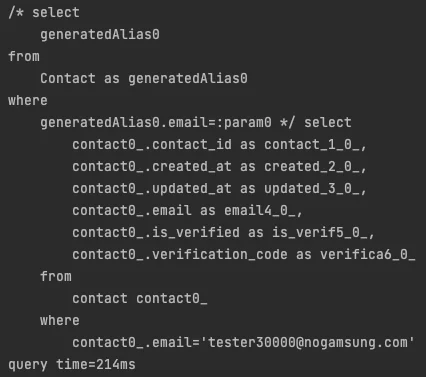
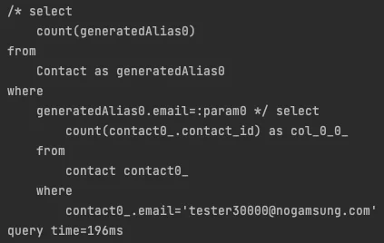
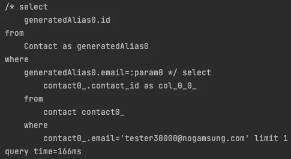

## Introduction

Most services check at sign-up whether a username or email is already taken. I'd always written that check with `findByEmail` without giving it much thought. It returns an `Optional`, so `isPresent()` seemed like all I needed.

But a duplicate check only needs one answer: yes or no. Do we really need to pull the whole row to get it? I ran the three query methods Spring Data JPA offers for this, `findBy`, `countBy` and `existsBy`, under the same conditions and compared the SQL each one actually sends.

## 1. The setup 🧪

The check runs against a `Contact` entity that holds an email. The `email` column has a unique constraint.

```java
@Getter
@Entity
@NoArgsConstructor(access = AccessLevel.PROTECTED)
public class Contact extends BaseEntity {
    // ...
    @Column(nullable = false, unique = true)
    private String email;
    // ...
}
```

Before testing I inserted 50,000 rows, from `tester1@nogamsung.com` to `tester50000@nogamsung.com`, and had all three methods look up `tester30000@nogamsung.com`.

{: width="1100" height="520" }

## 2. findBy fetches the whole row 📦

```java
public interface ContactRepository extends JpaRepository<Contact, Long> {
    Optional<Contact> findByEmail(String email);
}
```

```java
@Test
void findByEmail() {
    // given
    String email = "tester30000@nogamsung.com";

    // when
    Optional<Contact> result = contactRepository.findByEmail(email);

    // then
    assertThat(result).isPresent();
}
```

The log shows it `SELECT`s all six columns of the `contact` table. Values a duplicate check never touches, like `verification_code` and `created_at`, travel over the network, get mapped into an entity and land in the persistence context.

{: width="426" height="377" }

It took **214ms**.

## 3. countBy counts rows 🔢

```java
public interface ContactRepository extends JpaRepository<Contact, Long> {
    int countByEmail(String email);
}
```

```java
@Test
void countByEmail() {
    // given
    String email = "tester30000@nogamsung.com";

    // when
    int result = contactRepository.countByEmail(email);

    // then
    assertThat(result).isEqualTo(1);
}
```

Only `count(contact_id)` comes back, so less data moves. But `count` asks **how many** rows match, which in principle means counting every matching row. Here the unique constraint caps the matches at one, so the cost is small. On a non-unique column, though, you'd only get an answer after counting all the matches, and that's information a duplicate check doesn't need.

{: width="423" height="268" }

It took **196ms**.

## 4. existsBy stops at the first match ✅

```java
public interface ContactRepository extends JpaRepository<Contact, Long> {
    boolean existsByEmail(String email);
}
```

```java
@Test
void existsByEmail() {
    // given
    String email = "tester30000@nogamsung.com";

    // when
    boolean result = contactRepository.existsByEmail(email);

    // then
    assertThat(result).isTrue();
}
```

Spring Data JPA turns `existsBy` into a query that selects only `contact_id` and appends `limit 1`. It stops as soon as it finds the first row, and Java gets back a single `boolean`. The shape of the query matches the shape of the question exactly.

{: width="485" height="266" }

It took **166ms**.

## 5. Comparing the results 📊

| | findBy | countBy | existsBy |
|---|---|---|---|
| What it SELECTs | All 6 columns | `count(contact_id)` | `contact_id` + `limit 1` |
| Return type | `Optional<Contact>` | `int` | `boolean` |
| When it stops | After fetching every matching row | After counting every matching row | At the first matching row |
| Query time | 214ms | 196ms | **166ms** |

`existsBy` ran about 22% faster than `findBy`. That said, each method ran only once, so the numbers matter less than the difference in **what each query asks and what it gets back**. That difference grows with more data, with more columns, and when the column you check isn't unique.

> If the question is "does it exist?", have the query ask only that. Fetching rows or counting them is a different question.
{: .prompt-tip }

## Wrapping up

- Checking for duplicates with `findBy` sends columns you won't use and maps them into an entity.
- `countBy` asks for a count, so it counts every matching row. On a unique column the difference is small; on a non-unique one it adds up.
- `existsBy` selects one identifier with `limit 1`, stops at the first row and returns a `boolean`. That's the right tool for a duplicate check.
- When comparing performance, look at the SQL that actually goes out before you look at the numbers.

> References
> - [Spring Data JPA Reference: Query Methods](https://docs.spring.io/spring-data/jpa/reference/jpa/query-methods.html)
> - [Spring Data JPA Reference: Supported query method subject keywords](https://docs.spring.io/spring-data/jpa/reference/repositories/query-keywords-reference.html)
{: .prompt-info }
