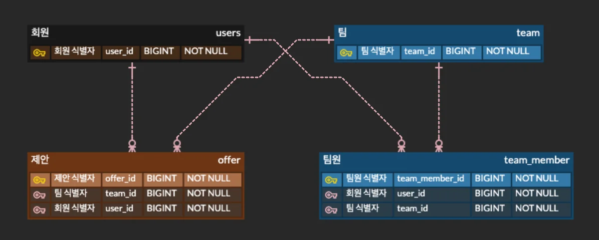
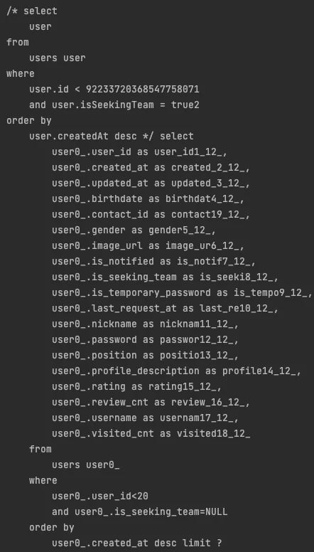
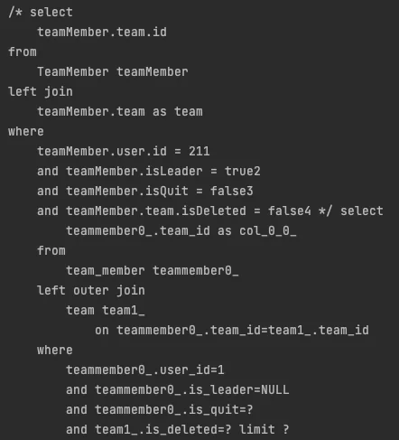
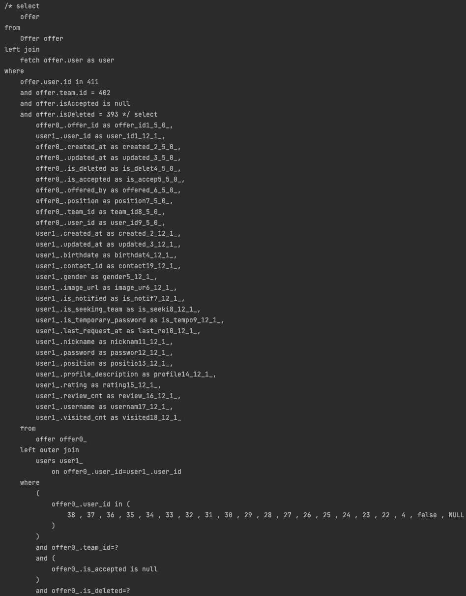

## Introduction

Gabojait ('가보자IT') is a side project of mine: a service for finding teammates, or a team, to build a side project with. Team leaders can browse a list of users who are looking for a team and send an **offer** to join to anyone they like.

That list API had an N+1 problem. Showing 20 users took 22 queries. This post is about collapsing that repeated lookup into a single IN clause.

## 1. N+1 and how this API is built 🧩

**N+1** is what happens when you load a list of entities with one query (the 1), then fire one more query per entity (the N) to fetch its associated data. A list of 20 means 21 queries; a list of 100 means 101.

Four tables are involved. There are users (`users`) and teams (`team`), linked through team members (`team_member`). An offer (`offer`) records which team sent it to which user, via `team_id` and `user_id`.

{: width="1201" height="481" }

## 2. Before: one offer lookup per user 🐢

The original logic fetched things one at a time with `JpaRepository` methods.

1. Page through users, filtered by position. (1 query)
2. Look up the team the caller leads. (1 query)
3. If the caller is a team leader, loop over the users from step 1 and check each one for a pending offer. (N queries)
4. If not, return the users from step 1 as they are.

When a team leader requests a page of 20, that's `1 + 1 + 20`, **22 queries** in total. The response time was **0.337s**.

{: width="1100" height="470" }

## 3. After: offers in a single IN query 🛠️

I rewrote step 3, the one running per user inside the loop, in Querydsl so it takes the list of user IDs and runs one IN query.

```java
public List<Offer> findAllByUserIds(List<Long> userIds, long offerorUserId) {
    Long teamId = queryFactory
            .select(teamMember.team.id)
            .from(teamMember)
            .leftJoin(teamMember.team, team)
            .where(
                    teamMember.user.id.eq(offerorUserId),
                    teamMember.isLeader.isTrue(),
                    teamMember.isQuit.isFalse(),
                    teamMember.team.isDeleted.isFalse()
            ).fetchFirst();

    if (teamId == null) return List.of();

    return queryFactory
            .select(offer)
            .from(offer)
            .where(
                    offer.user.id.in(userIds),
                    offer.team.id.eq(teamId),
                    offer.isAccepted.isNull(),
                    offer.isDeleted.isFalse()
            ).fetch();
}
```

It first finds the team the caller leads and returns an empty list if there isn't one, so the non-leader case goes through the same flow without a separate branch. If there is a team, `offer.user.id.in(userIds)` fetches the offers for every user on the page in one go.

In the service, the offers are grouped by user ID into a `Map`, then attached to each user.

```java
public Page<ProfileOfferResponse> findPageUser(String username, Position position, long pageFrom, int pageSize) {
    User user = findUser(username);

    Page<User> users = userRepository.findPage(position, pageFrom, pageSize);

    List<Offer> offers = offerRepository.findAllByUserIds(users.stream()
                    .map(User::getId)
                    .collect(Collectors.toList()),
            user.getId());

    Map<Long, List<Offer>> oMap = offers.stream()
            .collect(Collectors.groupingBy(o -> o.getUser().getId()));
    List<ProfileOfferResponse> responses = users.stream()
            .map(u -> new ProfileOfferResponse(u, oMap.getOrDefault(u.getId(), Collections.emptyList())))
            .collect(Collectors.toList());

    return new PageImpl<>(responses, Pageable.ofSize(pageSize), users.getTotalElements());
}
```

{: width="1100" height="470" }

A user with no offers has no key in the `Map`, so `getOrDefault` gives them an empty list. No matter how many users there are, nothing gets queried again.

## 4. Checking the query log 🪵

After the change, three queries go out.

**① The user page query.** It fetches users looking for a team, cursor-style. I built this one with a [Querydsl dynamic query](/posts/querydsl-dynamic-pagination/).

{: width="442" height="776" }

**② The leader's team query.** It fetches the ID of one team the caller leads, hasn't left, and that isn't deleted.

{: width="442" height="487" }

**③ The offer IN query.** It puts the IDs of the users on the page into an IN clause and fetches their offers at once.

{: width="948" height="1211" }

The response time was **0.039s**.

## 5. Results 📊

| | Before | After |
|---|---|---|
| Queries (20 users, team leader) | 22 (`2 + N`) | 3 |
| Response time | 0.337s | 0.039s (about 8.6x faster) |

Listing 20 users in the same environment went from 0.337s to 0.039s, roughly 8.6x faster. More importantly, the number of queries no longer grows with the page size.

> A query inside a loop is an N+1. Collect the IDs first, fetch with one IN clause, and stitch the results back with a `Map`.
{: .prompt-tip }

## Wrapping up

- N+1 is a structural problem: the query count grows with the size of the list, so it gets more expensive as the page size goes up.
- Fetch associated data with one IN query on a list of IDs, group it with `groupingBy`, and reattach it in memory.
- Entities with no associated data get an empty list from `getOrDefault`. Don't query again.
- When there's nothing to look up, as with a non-leader, return an empty list right away and save the query.

Later, during performance testing, I ran into another N+1 that an IN clause couldn't catch. That story continues in [An N+1 that IN clauses couldn't fix: when @OneToOne lazy loading can't create a proxy](/posts/one-to-one-n-plus-1/).

> References
> - [Querydsl Reference Guide](https://querydsl.com/static/querydsl/latest/reference/html/)
> - [One method per condition is too many: a cursor-paginated dynamic query in Querydsl](/posts/querydsl-dynamic-pagination/)
> - [An N+1 that IN clauses couldn't fix: when @OneToOne lazy loading can't create a proxy](/posts/one-to-one-n-plus-1/)
{: .prompt-info }
