## Introduction

Gabojait ('가보자IT'), my side project, has a list of users who are looking for a team. At first it only showed everyone. Soon a position filter followed, things like "backend developers only". Writing one query with the filter and one without, I could see that every new condition would double the number of methods.

This post is about merging those two queries into a single Querydsl **dynamic query**: SQL whose conditions depend on the input, built at runtime and then sent to the database.

## 1. Static queries need a method per condition 🧱

Say we paginate users in the `users` table **by cursor**. Cursor-based pagination cuts the next page relative to the last value of the previous one, as in "the 10 rows with an id lower than this".

**Example 1: all users.**

```sql
SELECT * FROM users WHERE user_id < 100 ORDER BY created_at DESC LIMIT 10;
```

**Example 2: users whose position is `BACKEND`.**

```sql
SELECT * FROM users WHERE user_id < 100 AND position = 'BACKEND' ORDER BY created_at DESC LIMIT 10;
```

With Spring Data JPA derived queries, each condition needs its own method.

```java
public interface UserRepository extends JpaRepository<User, Long> {
    Page<User> findByIdLessThan(Long id, Pageable pageable);

    Page<User> findByIdLessThanAndPosition(Long id, Position position, Pageable pageable);
}
```

Querydsl doesn't change that if the conditions are fixed. Example 1 looks like this:

```java
@RequiredArgsConstructor
public class UserRepositoryImpl implements UserCustomRepository {
    private final JPAQueryFactory queryFactory;

    @Override
    public Page<User> findByPage(long pageFrom, int pageSize) {
        Long count = queryFactory.select(user.count())
                .from(user)
                .where(
                        user.isSeekingTeam.isTrue()
                ).fetchOne();

        Pageable pageable = Pageable.ofSize(pageSize);

        if (count == null || count == 0)
            return new PageImpl<>(List.of(), pageable, 0);

        List<User> users = queryFactory.selectFrom(user)
                .where(
                        user.id.lt(pageFrom),
                        user.isSeekingTeam.isTrue()
                ).orderBy(user.createdAt.desc())
                .limit(pageSize)
                .fetch();

        return new PageImpl<>(users, pageable, count);
    }
}
```

Example 2 differs by a single condition, yet it needs a whole second method.

```java
@Override
public Page<User> findByPage(Position position, long pageFrom, int pageSize) {
    Long count = queryFactory.select(user.count())
            .from(user)
            .where(
                    user.position.eq(position)
            ).fetchOne();

    Pageable pageable = Pageable.ofSize(pageSize);

    if (count == null || count == 0)
        return new PageImpl<>(List.of(), pageable, 0);

    List<User> users = queryFactory.selectFrom(user)
            .where(
                    user.id.lt(pageFrom),
                    user.position.eq(position)
            ).orderBy(user.createdAt.desc())
            .limit(pageSize)
            .fetch();

    return new PageImpl<>(users, pageable, count);
}
```

Two filters make four combinations; three make eight. That doesn't scale.

## 2. Picking a tool for dynamic queries 🧰

Derived queries bake the conditions into the method name, so you can't add or drop one at runtime. There are several ways to build dynamic queries instead.

| Approach | Combining conditions | When errors surface |
|---|---|---|
| Derived query methods | One method per combination | At application startup |
| Concatenating JPQL strings | Possible | At runtime |
| JPA Criteria / Specification | Possible | At compile time with the metamodel, but the code is verbose |
| Querydsl | Possible | At compile time, and it reads much like SQL |

I went with Querydsl: it catches errors at compile time and the code reads like SQL.

## 3. Return null and the condition disappears 🪄

The key is that Querydsl's `where()` **ignores `null` conditions**. If the method that builds a condition returns `null` in some cases, one query produces two different SQL statements.

```java
@RequiredArgsConstructor
public class UserRepositoryImpl implements UserCustomRepository {
    private final JPAQueryFactory queryFactory;

    @Override
    public Page<User> findPage(Position position, long pageFrom, int pageSize) {
        Long count = queryFactory.select(user.count())
                .from(user)
                .where(
                        positionEq(position)
                ).fetchOne();

        Pageable pageable = Pageable.ofSize(pageSize);

        if (count == null || count == 0)
            return new PageImpl<>(List.of(), pageable, 0);

        List<User> users = queryFactory.selectFrom(user)
                .where(
                        user.id.lt(pageFrom),
                        positionEq(position)
                ).orderBy(user.createdAt.desc())
                .limit(pageSize)
                .fetch();

        return new PageImpl<>(users, pageable, count);
    }

    private Predicate positionEq(Position position) {
        return position != Position.NONE ? user.position.eq(position) : null;
    }
}
```

`positionEq()` returns `null` when the position is `NONE` and `user.position.eq(position)` otherwise. Since `where(a, b, null)` is the same as `where(a, b)`, `NONE` sends SQL without a position condition and `BACKEND` sends SQL with one.

{: width="1100" height="470" }

A new filter just means another condition method dropped into `where()`. You don't need one query per combination.

## 4. How the cursor pagination flows 🔁

Inside that one method, two queries go out.

1. The **count query** counts every row that matches. Since it's a total, it leaves out the cursor condition (`user.id.lt(pageFrom)`).
2. If the count is 0, the list query is never sent and an empty page comes back immediately.
3. The **list query** applies the cursor condition along with the filters and uses `limit` to fetch just one page.

The next page is requested by passing the last id of the previous page as `pageFrom`. The first page has no id to start from, so in this project I passed `Long.MAX_VALUE`.

{: width="1100" height="500" }

Compared with offset pagination:

| | Offset (`OFFSET n LIMIT 10`) | Cursor (`WHERE id < ? LIMIT 10`) |
|---|---|---|
| What defines the next page | How many rows to skip | The last value of the previous page |
| Cost of later pages | Reads the skipped rows and throws them away | Reads from the index starting at that value |
| Rows added while paging | Can cause duplicates or gaps | Only reads past the cursor, so less affected |
| Jumping to an arbitrary page | Easy | Hard |

## 5. Watch out: match the cursor key and the sort key ⚠️

The code above cuts the cursor on `user.id` but sorts on `created_at`. As long as user ids come from `IDENTITY` and increase in creation order, the two orders agree and nothing shows. But the moment they diverge, say because someone sets or edits `created_at` separately, users go missing or show up twice at page boundaries.

The safe choice is to cursor and sort on the same column.

```java
List<User> users = queryFactory.selectFrom(user)
        .where(
                user.id.lt(pageFrom),
                positionEq(position)
        ).orderBy(user.id.desc())
        .limit(pageSize)
        .fetch();
```

> The column in the cursor condition and the `ORDER BY` column must be the same. Otherwise "everything after this value" stops meaning anything.
{: .prompt-tip }

## Wrapping up

- Derived queries and fixed queries need a new method for every combination of conditions.
- Querydsl's `where()` ignores `null` conditions. Let condition methods return `null` when they don't apply, and one query produces several SQL statements.
- Keep the cursor condition out of the count query, and skip the list query when the count is 0.
- Use the same column for the cursor key and the sort key.

This `findPage` also served as the first query, the one that loads the users, in the post where I [fixed an N+1 with an IN clause](/posts/n-plus-1-in-clause/).

> References
> - [Querydsl Reference Guide](https://querydsl.com/static/querydsl/latest/reference/html/)
> - [Spring Data JPA Reference: Query Methods](https://docs.spring.io/spring-data/jpa/reference/jpa/query-methods.html)
> - [Spring Data JPA Reference: Specifications](https://docs.spring.io/spring-data/jpa/reference/jpa/specifications.html)
{: .prompt-info }
