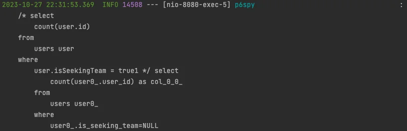
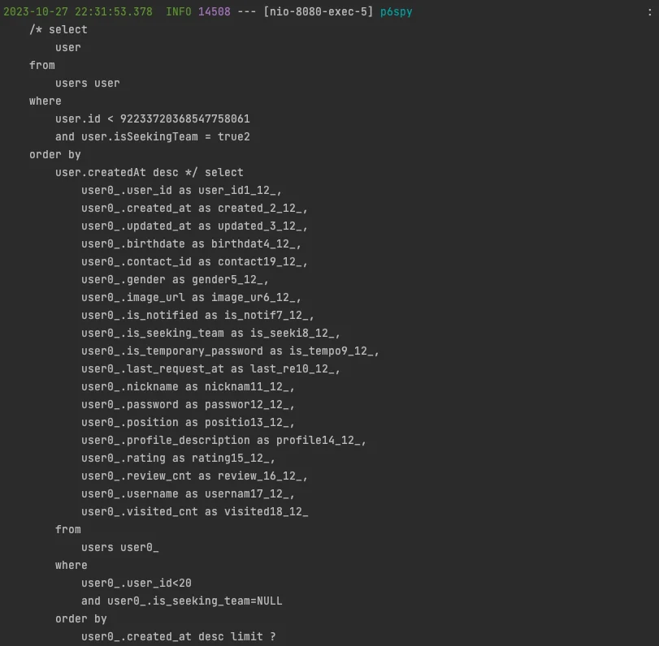
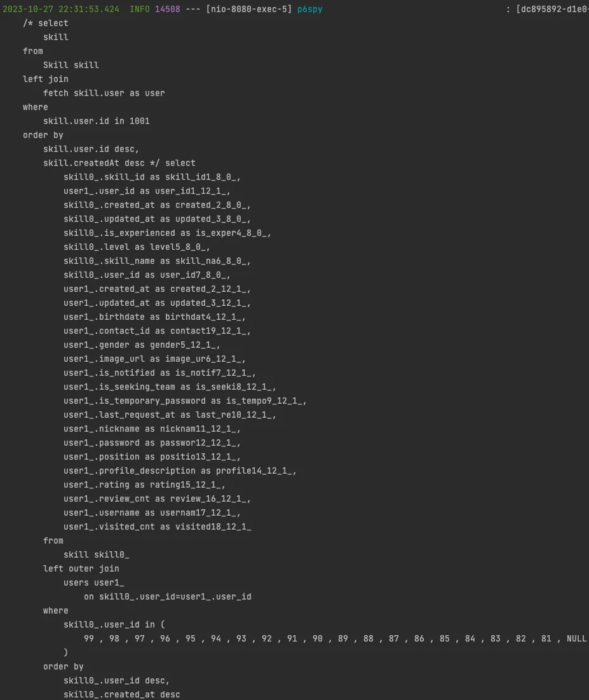
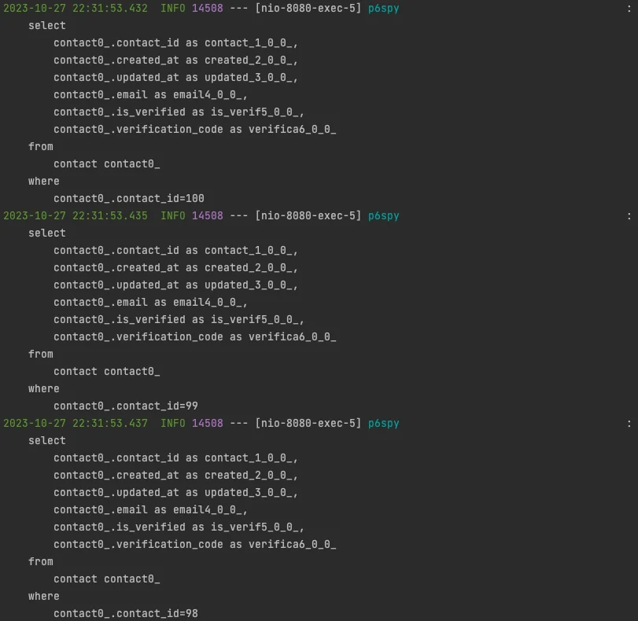
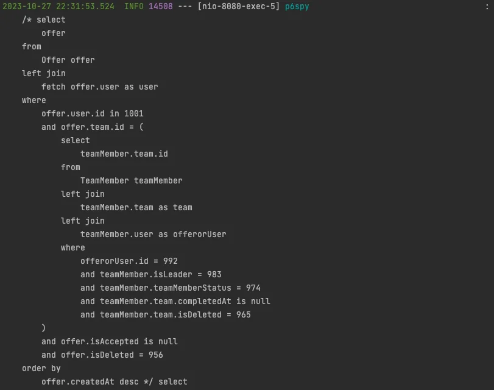
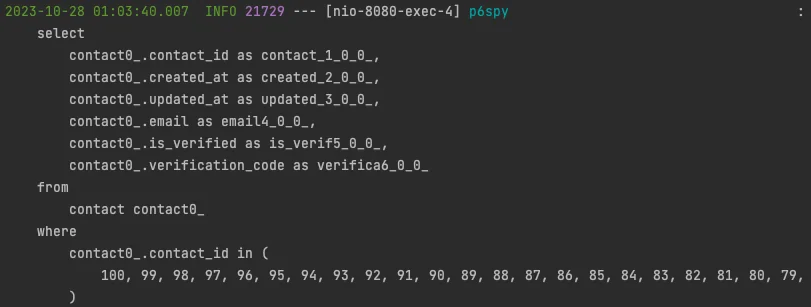

## Introduction

While refactoring my side project Gabojait ('가보자IT') from top to bottom, I removed N+1 problems one by one. Most of them went away with Querydsl IN clauses, which I wrote up in [Fixing N+1 with an IN clause](/posts/n-plus-1-in-clause/).

Then, during performance testing, an N+1 showed up **again**. In an API I thought I'd fully covered with IN clauses, a query was firing for every user it loaded. This post is about how `@OneToOne` turned out to be the cause.

## 1. Users and contacts are one-to-one 🔗

The requirement is "one account per email". A user never has more than one contact, so I mapped `User` and `Contact` with `@OneToOne`. I suspected the default `EAGER` would cause trouble later, so I switched it to `LAZY` from the start.

```java
@Getter
@Entity(name = "users")
@NoArgsConstructor(access = AccessLevel.PROTECTED)
public class User extends BaseEntity implements UserDetails {

    @Id
    @GeneratedValue(strategy = GenerationType.IDENTITY)
    @Column(name = "user_id")
    private Long id;

    @OneToOne(fetch = FetchType.LAZY, cascade = CascadeType.REMOVE, orphanRemoval = true)
    @JoinColumn(name = "contact_id", nullable = false)
    private Contact contact;

    // ...
}
```

It's `LAZY`, so as long as nothing touches `contact`, no query should go out. That assumption was wrong.

## 2. Where it broke: paging users looking for a team 🔍

The affected API lists users who are looking for a team. The logic has four steps.

1. Page through users.
2. Fetch those users' skills in one go **with an IN clause** on their IDs.
3. Fetch the offers already sent to or received by those users in one go, **with an IN clause**.
4. Combine users, skills and offers with `Map`s and return them.

```java
public PageData<List<ProfileOfferResponse>> findPageUser(String username, Position position, long pageFrom, int pageSize) {
    User user = findUser(username);

    Page<User> users = userRepository.findPage(position, pageFrom, pageSize);
    List<Long> userIds = users.stream().map(User::getId).collect(Collectors.toList());

    List<Skill> skills = skillRepository.findAllInFetchUser(userIds);            // IN clause
    List<Offer> offers = offerRepository.findAllInUserIds(userIds, user.getId()); // IN clause

    Map<Long, List<Skill>> sMap = skills.stream().collect(Collectors.groupingBy(s -> s.getUser().getId()));
    Map<Long, List<Offer>> oMap = offers.stream().collect(Collectors.groupingBy(o -> o.getUser().getId()));

    List<ProfileOfferResponse> responses = users.stream()
            .map(u -> new ProfileOfferResponse(u,
                    sMap.getOrDefault(u.getId(), Collections.emptyList()),
                    oMap.getOrDefault(u.getId(), Collections.emptyList())))
            .collect(Collectors.toList());

    return new PageData<>(responses, users.getTotalElements());
}
```

Every association is fetched once with an IN clause. By design, that's four queries: count, users, skills, offers.

## 3. Following the log 🪵

{: width="1100" height="520" }

I set the page size to 50 and read the query log in order.

**① The user count query.** It's a paged query, so the total comes first.

{: width="811" height="262" }

**② The user page query.** It fetches the users by cursor.

{: width="811" height="796" }

**③ The skills IN query.** It fetches skills for all loaded users at once by their IDs. So far, so good.

{: width="927" height="1101" }

**④ One contact query per user.** Suddenly a contact `SELECT` runs for every loaded user, even though no code anywhere reads `contact`.

{: width="811" height="790" }

**⑤ The offers IN query.** Finally, the offers come back in one query.

{: width="811" height="640" }

In this state, the response took **124ms**.

{: width="916" height="26" }

## 4. The cause: LAZY doesn't always mean lazy 🧐

{: width="1100" height="560" }

`FetchType.LAZY` is a **hint** that says "don't fetch this now", not a guarantee. For lazy loading to work, Hibernate has to put a **proxy** in the association field and only send a query when you actually access it.

The trouble is that with `@OneToOne`, sometimes it can't create that proxy. With `@ManyToOne`, the fact "if there's a related entity, its id is this" is all it needs to build a proxy. In a one-to-one relationship, though, Hibernate first has to know **whether** the related entity exists at all, to decide between a proxy and `null`. The side that doesn't hold the foreign key (the `mappedBy` side) in particular can't tell that from its own table. So Hibernate **queries right away** to find out. That's one query per entity it populates: 50 users, 50 contact queries.

In short:

| Relationship | Proxy | Is `LAZY` respected? |
|---|---|---|
| `@ManyToOne` | Built from the foreign key value alone | Yes |
| `@OneToOne` (side holding the FK) | Usually built | Usually |
| `@OneToOne` (`mappedBy` side) | Can't be built without knowing whether a row exists | **No, it becomes an immediate query** |

### Why 600 tests missed it

The project had more than 600 tests, and none of them caught this. There were two reasons.

1. The paging tests only ran on **small data**. With two or three users, two or three contact queries don't stand out.
2. When I read the logs, I only checked **that the IN clauses went out**. I only looked at the queries I wanted to see.

## 5. The fix: default_batch_fetch_size 🛠️

The easiest fix is Hibernate's batch fetching. Instead of firing the same kind of lazy load one at a time, Hibernate gathers them into an IN clause and fetches them at once.

```yaml
# application.yml
spring:
  jpa:
    properties:
      hibernate:
        default_batch_fetch_size: 100
```

```properties
# application.properties
spring.jpa.properties.hibernate.default_batch_fetch_size=100
```

People commonly set it somewhere between 100 and 1000, depending on the server and the data size. This project ran on the AWS free tier, so I went with 100.

With that in place, the per-user contact queries collapsed into a single IN query.

{: width="811" height="307" }

The response time went **from 124ms to 54ms**.

{: width="916" height="26" }

| | Before | After |
|---|---|---|
| Contact queries (page size 50) | 50 | 1 (IN clause) |
| Response time | 124ms | 54ms (about 2.3x faster) |

## 6. The alternative: switch to @ManyToOne 🤔

Since the root cause is a property of one-to-one relationships, changing the mapping to `@ManyToOne` would make the proxy problem disappear entirely. I didn't go that way.

- A user never has more than one contact. The domain is clearly one-to-one.
- Even when a user verifies a new contact, we just update the existing row. There's no need for many-to-one.

Rather than change the relationship the domain describes just to save queries, I decided turning on batch fetching with one line of config was the right call.

## Wrapping up

- `FetchType.LAZY` is a hint. If Hibernate can't build a proxy, it fills the field with an immediate query.
- `@OneToOne` has to know whether the related entity exists before it can create a proxy, so lazy loading breaks on the side without the foreign key.
- Even when you gather associations with IN clauses, lookups triggered while entities are being populated are a separate problem. `default_batch_fetch_size` batches those into IN clauses.
- Tests on small data won't show an N+1. Don't just look for the queries you expect in the log; count all of them.

> References
> - [How can I make a JPA OneToOne relation lazy (Stack Overflow)](https://stackoverflow.com/questions/1444227/how-can-i-make-a-jpa-onetoone-relation-lazy)
> - [Hibernate ORM User Guide: Batch fetching](https://docs.jboss.org/hibernate/orm/6.6/userguide/html_single/Hibernate_User_Guide.html#fetching-batch)
> - [From 22 queries to 3: replacing a per-user offer lookup with a Querydsl IN clause](/posts/n-plus-1-in-clause/)
{: .prompt-info }
