## Introduction

When the company decided to go through an ISMS audit (Korea's national information security management certification), the word came down that anything on an end-of-support (deprecated) version had to be upgraded. That meant moving our Spring Boot 2 projects to Spring Boot 3.

Java 11, which we ran with Spring Boot 2, still had some runway. But since we were upgrading several projects at once anyway, we decided to take Java to 21 at the same time.

| Item | Before | After |
|---|---|---|
| Java | 11 | **21** |
| Spring Boot | 2.7.1 | **3.3.0** |
| io.spring.dependency-management | 1.0.11.RELEASE | 1.1.5 |
| Gradle wrapper | 7.6.1 | 8.7 |
| Querydsl | 5.0.0 | 5.0.0 (`jakarta` classifier) |

This post covers how I split the upgrade up and what changed at each step.

## 1. Don't do it in one jump 🪜

{: width="1100" height="500" }

Going straight from 2.7.1 to 3.3.0 buries you in compile errors, and it's hard to tell whether each one comes from the version change or from a library. So I split it into three steps.

| Step | What | What to check |
|---|---|---|
| 1 | Java 21 + the **last 2.x release** of Spring Boot (2.7.18) | Library dependencies, deprecation warnings |
| 2 | Spring Boot **3.3.0**, Gradle 8.7, Querydsl jakarta | `gradle build` passes |
| 3 | Code changes | javax to jakarta, SecurityConfig, entity and Querydsl review |

## 2. Step 1: Java 21 and the last 2.x release ☕

First, bring Spring Boot up to the latest 2.7.x and make sure the library dependencies are fine. Most APIs that disappear in 3.x show up as deprecation warnings in 2.7.x first, so clearing those warnings here makes the next step much lighter.

`build.gradle` **before**

```groovy
plugins {
    id 'java'
    id 'org.springframework.boot' version '2.7.1'
    // ...
}

sourceCompatibility = '11'

dependencies {
    implementation 'mysql:mysql-connector-java'
    // ...
}
```

`build.gradle` **after**

```groovy
plugins {
    id 'java'
    id 'org.springframework.boot' version '2.7.18'
    // ...
}

sourceCompatibility = '21'

dependencies {
    implementation 'mysql:mysql-connector-java'
    // ...
}
```

> The MySQL driver's coordinates have changed to `com.mysql:mysql-connector-j`. From Spring Boot 3.0 on, the version of the old `mysql:mysql-connector-java` coordinates is no longer managed, so change it when you move to 3.x.
{: .prompt-warning }

## 3. Step 2: Spring Boot 3.3 and Gradle 8.7 🛠️

Now upgrade Spring Boot to the latest version. With the changes below, `gradle build` passes.

### build.gradle

**Before**

```groovy
buildscript {
    ext {
        queryDslVersion = "5.0.0"
    }
}

plugins {
    id 'java'
    id 'org.springframework.boot' version '2.7.18'
    id 'io.spring.dependency-management' version '1.0.11.RELEASE'
    // ...
}

dependencies {
    implementation "com.querydsl:querydsl-jpa:${queryDslVersion}"
    annotationProcessor "com.querydsl:querydsl-apt:5.0.0:jpa"
    annotationProcessor("jakarta.persistence:jakarta.persistence-api")
    annotationProcessor("jakarta.annotation:jakarta.annotation-api")
    // ...
}
```

**After**

```groovy
plugins {
    id 'java'
    id 'org.springframework.boot' version '3.3.0'
    id 'io.spring.dependency-management' version '1.1.5'
    // ...
}

dependencies {
    implementation 'com.querydsl:querydsl-core:5.0.0'
    implementation 'com.querydsl:querydsl-jpa:5.0.0:jakarta'
    annotationProcessor "com.querydsl:querydsl-apt:5.0.0:jakarta"
    annotationProcessor 'jakarta.persistence:jakarta.persistence-api'
    annotationProcessor 'jakarta.annotation:jakarta.annotation-api'
    // ...
}
```

Querydsl 5.0.0's default artifacts target `javax.persistence`. Spring Boot 3 is built on Jakarta EE 9+, so you need the artifacts with the `jakarta` classifier for the Q-classes to be generated against `jakarta.persistence`. I also removed the `buildscript` block that kept the version in `ext` at this point.

### gradle-wrapper.properties

**Before**

```properties
distributionUrl=https\://services.gradle.org/distributions/gradle-7.6.1-bin.zip
```

**After**

```properties
distributionUrl=https\://services.gradle.org/distributions/gradle-8.7-bin.zip
```

Running Gradle itself on Java 21 requires Gradle 8.5 or later. If you switch the JDK to 21 but leave the wrapper on 7.x, the build fails before it even finishes reading the build script.

## 4. Step 3: code changes ✍️

Even with the build configuration passing, compilation is still broken. I fixed two main areas.

### 4-1. javax → jakarta

Spring Boot 3 uses the Jakarta EE (`jakarta.*`) packages instead of Java EE (`javax.*`). Every import in the project has to change.

**Before**

```java
import javax.persistence.*;
import javax.annotation.*;
import javax.validation.*;
import javax.servlet.*;
```

**After**

```java
import jakarta.persistence.*;
import jakarta.annotation.*;
import jakarta.validation.*;
import jakarta.servlet.*;
```

### 4-2. SecurityConfig: the Spring Security 6 lambda DSL

Spring Boot 3 uses Spring Security 6. Here's what changed from the chained style of earlier versions.

| Spring Security 5.x (Boot 2.7) | Spring Security 6.x (Boot 3.3) |
|---|---|
| `.csrf().disable()` | `.csrf(AbstractHttpConfigurer::disable)` |
| Chain settings with `.and()` | Wrap each setting in a lambda (`Customizer`) |
| `authorizeRequests()` | `authorizeHttpRequests()` |
| `antMatchers(...)` | `requestMatchers(...)` (`antMatchers` is removed) |
| `@EnableWebSecurity` includes `@Configuration` | Add `@Configuration` yourself |

`SecurityConfig.java` **before**

```java
@EnableWebSecurity
@RequiredArgsConstructor
public class SecurityConfig {

    @Bean
    protected SecurityFilterChain configure(HttpSecurity http) throws Exception {
        http
            .csrf()
            .disable()
            .exceptionHandling()
            .authenticationEntryPoint(jwtAuthenticationEntryPoint)
            .accessDeniedHandler(jwtAccessDeniedHandler)
            .and()
            .sessionManagement()
            .sessionCreationPolicy(SessionCreationPolicy.STATELESS)
            .and()
            .authorizeRequests()
            .antMatchers(WHITELIST).permitAll()
            .anyRequest().authenticated()
            .and()
            .apply(new JwtSecurityConfig(tokenProvider));

        return http.build();
    }
}
```

`SecurityConfig.java` **after**

```java
@Configuration
@EnableWebSecurity
@RequiredArgsConstructor
public class SecurityConfig {

    @Bean
    protected SecurityFilterChain configure(HttpSecurity http) throws Exception {
        http
            .csrf(AbstractHttpConfigurer::disable)
            .exceptionHandling(customizer -> customizer
                .authenticationEntryPoint(jwtAuthenticationEntryPoint)
                .accessDeniedHandler(jwtAccessDeniedHandler))
            .sessionManagement(customizer -> customizer
                .sessionCreationPolicy(SessionCreationPolicy.STATELESS))
            .authorizeHttpRequests(customizer -> customizer
                .requestMatchers(AUTHENTICATE_LIST).authenticated()
                .requestMatchers(PERMIT_LIST).permitAll()
                .anyRequest().permitAll())
            .httpBasic(Customizer.withDefaults())
            .apply(new JwtSecurityConfig(tokenProvider));

        return http.build();
    }
}
```

The new code doesn't just port the syntax; the shape of the authorization rules changed too. Before, only `WHITELIST` was permitted and everything else required authentication. After, only `AUTHENTICATE_LIST` requires authentication and everything else (`anyRequest()`) is permitted. If you change the rules while porting the syntax, make sure that difference is intentional.

> `HttpSecurity.apply(...)` is deprecated as of Spring Security 6.2. It still works for now, but with the next upgrade in mind, it's better to switch to `with(configurer, Customizer.withDefaults())`.
{: .prompt-tip }

## 5. A passing build isn't the finish line ⚠️

Some problems only showed up once the application actually ran.

- **Deployment config.** If you build with CodeBuild, as we did for ECS, change the Java version in `buildspec.yml` too.
- **Table names that include the schema.** If an entity puts the schema in the name, as in `@Table(name = "schema.table")`, the table can no longer be read. Split it into `@Table(catalog = "schema", name = "table")`. (In MySQL, a schema is a catalog.)
- **Querydsl templates.** Template code like `Expressions.stringTemplate` sometimes needed changes too, so we had to review the code behind every API.

## Wrapping up

- Don't cross a major version in one jump. Clear the deprecations on the last 2.x release first, and what breaks on 3.x narrows down to "removed APIs".
- Moving to Java 21 means the Gradle wrapper must be 8.5 or later. The build tool is part of the upgrade.
- The core change in Spring Boot 3 is Jakarta EE. `javax.*` imports, the Querydsl `jakarta` classifier and the MySQL driver coordinates all change with it.
- When moving SecurityConfig to the lambda DSL, check that the authorization rules are unchanged before worrying about syntax.
- Even after it compiles, problems like `@Table` name resolution and Querydsl templates only surface at runtime. Review the code behind every API.

> References
> - [Spring Boot 3.0 Migration Guide](https://github.com/spring-projects/spring-boot/wiki/Spring-Boot-3.0-Migration-Guide)
> - [Spring Boot 3.0 migration notes (luvstudy, in Korean)](https://luvstudy.tistory.com/221)
> - [Notes after upgrading to Spring Boot 3 (hodolman, in Korean)](https://hodolman.com/54)
{: .prompt-info }
