## Introduction

There are plenty of ways to prevent concurrency problems. Java's `synchronized` and JPA's optimistic and pessimistic locks are the usual suspects.

But if you already run several server nodes and at least one Redis node, a **Redisson distributed lock** was usually the best option in terms of speed and performance. This post covers how I made a Redisson lock something you can put on a method with a single annotation.

## 1. Why a distributed lock 🔐

{: width="1100" height="560" }

When the same request reaches two servers at almost the same moment, both read "not processed yet" and both process it. The problem is **the gap between checking and acting**. To line that gap up across every server, the lock has to live in shared storage outside the servers.

| Approach | Where the lock lives | Across servers | Cost |
|---|---|---|---|
| `synchronized` | JVM memory | **Doesn't work** | Cheapest |
| Optimistic lock | A version column on the DB row | Works (exception on conflict) | Lots of retries when conflicts are frequent |
| Pessimistic lock | DB row lock (`SELECT … FOR UPDATE`) | Works | Holds a DB connection and the lock while waiting |
| Redisson distributed lock | A Redis key | Works | Needs Redis (we already had it) |

While waiting for a lock, Redisson doesn't keep polling Redis; it gets notified of the release through pub/sub. What settled it was that it puts no load on the DB and reuses the Redis we already ran.

## 2. Dependency and RedissonClient ⚙️

`build.gradle`

```groovy
dependencies {
    implementation 'org.redisson:redisson-spring-boot-starter'
    // ...
}
```

`RedisConfig.java`

```java
@Configuration
public class RedisConfig {

    @Value("${spring.redis.host}")
    private String redisHost;
    @Value("${spring.redis.port}")
    private int redisPort;
    private static final String REDISSON_HOST_PREFIX = "redis://";

    @Bean
    public RedissonClient redissonClient() {
        Config config = new Config();
        config.useSingleServer().setAddress(REDISSON_HOST_PREFIX + redisHost + ":" + redisPort);
        return Redisson.create(config);
    }
}
```

The address prefix is `redis://`. For Redis over TLS, use `rediss://`.

## 3. The @RedissonLock annotation 🏷️

To avoid repeating `tryLock` and `unlock` in every method that needs a lock, I made it declarative with an annotation and let AOP handle it.

`RedissonLock.java`

```java
@Target({ElementType.METHOD, ElementType.TYPE})
@Retention(RetentionPolicy.RUNTIME)
@Documented
public @interface RedissonLock {

    /**
     * Lock name (unique value, SpEL)
     */
    String key();

    /**
     * Lock time unit
     */
    TimeUnit timeUnit() default TimeUnit.MILLISECONDS;

    /**
     * Maximum time to keep trying to acquire the lock
     */
    long waitTime() default 5000L;

    /**
     * Maximum time to hold the lock once acquired
     */
    long leaseTime() default 2000L;
}
```

| Attribute | Default | Meaning |
|---|---|---|
| `key` | (required) | The lock name. References method parameters via SpEL |
| `waitTime` | 5000ms | Give up if the lock can't be acquired within this time |
| `leaseTime` | 2000ms | Once acquired, the lock is released automatically after this time |

## 4. RedissonLockAspect 🧩

{: width="1100" height="420" }

`RedissonLockAspect.java`

```java
@Slf4j
@Aspect
@Component
@RequiredArgsConstructor
public class RedissonLockAspect {

    private final RedissonClient redissonClient;

    @Around("@annotation(com.example.account.annotation.RedissonLock)")
    public Object redissonLock(ProceedingJoinPoint joinPoint) throws Throwable {
        MethodSignature signature = (MethodSignature) joinPoint.getSignature();
        Method method = signature.getMethod();
        RedissonLock annotation = method.getAnnotation(RedissonLock.class);

        String key = getDynamicValue(signature.getParameterNames(), joinPoint.getArgs(), annotation.key());
        RLock lock = redissonClient.getLock(key);
        log.debug("Attempting to lock method: {} with key: {}", method, key);

        boolean lockAcquired = false;

        try {
            lockAcquired = lock.tryLock(annotation.waitTime(), annotation.leaseTime(), annotation.timeUnit());
            if (!lockAcquired) {
                log.debug("Failed to acquire lock for key: {}", key);
                return false;
            }
            return joinPoint.proceed();
        } catch (InterruptedException e) {
            log.error("Interrupted while trying to lock method: {}, errorMessage: {}", method, e.getMessage());
            Thread.currentThread().interrupt();
            throw e;
        } catch (Exception e) {
            log.error("Exception in method: {}, errorMessage: {}", method, e.getMessage(), e);
            throw e;
        } finally {
            if (lockAcquired) {
                try {
                    lock.unlock();
                    log.debug("Unlocked key: {}", key);
                } catch (Exception e) {
                    log.error("Failed to unlock key: {}", key, e);
                }
            }
        }
    }

    private String getDynamicValue(String[] parameterNames, Object[] args, String key) {
        SpelExpressionParser parser = new SpelExpressionParser();
        StandardEvaluationContext context = new StandardEvaluationContext();

        for (int i = 0; i < parameterNames.length; i++) {
            context.setVariable(parameterNames[i], args[i]);
        }

        return parser.parseExpression(key).getValue(context, String.class);
    }
}
```

It works in four steps.

**① Compute the key.** Put the method's parameter names and values into a SpEL context and evaluate the annotation's `key`. With `'function_' + #request.id`, each request id gets its own lock. Only requests with the same key wait on each other; different keys don't block.

**② tryLock.** Wait up to `waitTime` for the lock, and once it's acquired, schedule it to release automatically after `leaseTime`.

**③ proceed.** Run the actual method only if the lock was acquired. On interruption, restore the interrupt flag and rethrow.

**④ unlock in finally.** Release the lock only if we acquired it. `unlock()` has its own try/catch because calling it after `leaseTime` has already released the lock, or while another thread holds it, throws `IllegalMonitorStateException`. We only log it, so it doesn't overwrite the method's result or exception.

### Things to watch out for

**leaseTime must be longer than the method takes.** Setting `leaseTime` turns off Redisson's watchdog (automatic lock extension). If the method runs longer than 2 seconds, the lock is released mid-run, the next request gets in, and you're back to overlapping requests.

**Returning `false` on a failed acquisition hides the failure in void methods.** The code above does `return false` when it can't get the lock. A method returning `boolean` lets the caller see that value, but in a `void` method it's discarded and the caller assumes success. If the caller needs to know about the failure, throwing an exception is safer.

```java
if (!lockAcquired) {
    log.debug("Failed to acquire lock for key: {}", key);
    throw new IllegalStateException("Failed to acquire lock: " + key);
}
```

**The transaction must commit before the unlock.** If the method is `@Transactional` and the transaction is opened outside the lock, the lock is released first and the commit happens afterward. If the next request grabs the lock in that window, it reads the previous, uncommitted state. The Kurly tech blog post I referenced (Kurly is a Korean grocery delivery company) runs `joinPoint.proceed()` in a `REQUIRES_NEW` transaction so the commit finishes before the unlock.

> What a distributed lock protects is the gap between checking and acting. If that gap closes (the commit) later than the lock is released (leaseTime, unlock), the lock protects nothing.
{: .prompt-tip }

## 5. Using it in a service 🎯

Now any method that needs a lock just gets the annotation.

`SomeService.java`

```java
public class SomeService {
    // ...

    @RedissonLock(key = "'function_' + #request.id")
    public void function(Request request) {
        // ...
    }
}
```

Since `key` is SpEL, string literals go in single quotes and parameters are referenced as `#parameterName`.

## 6. Concurrency test 🧪

Three threads call the method with the same request at the same time, and we check that one succeeds and two fail.

`SomeServiceTest.java`

```java
public class SomeServiceTest {
    // ...

    @DisplayName("Works correctly under concurrent requests")
    @Test
    void givenConcurrent_whenFunction_thenReturn() throws InterruptedException {
        // given
        Request request = createValidRequest();

        int threadCnt = 3;
        CountDownLatch doneSignal = new CountDownLatch(threadCnt);
        ExecutorService executorService = Executors.newFixedThreadPool(threadCnt);
        AtomicInteger successCnt = new AtomicInteger();
        AtomicInteger failCnt = new AtomicInteger();

        // when
        for (int i = 0; i < threadCnt; i++) {
            executorService.execute(() -> {
                try {
                    someService.function(request);
                    successCnt.getAndIncrement();
                } catch (Exception e) {
                    failCnt.getAndIncrement();
                } finally {
                    doneSignal.countDown();
                }
            });
        }
        doneSignal.await();
        executorService.shutdown();

        // then
        assertAll(
            () -> assertThat(successCnt.get()).isEqualTo(1),
            () -> assertThat(failCnt.get()).isEqualTo(2)
        );
    }
}
```

`doneSignal.await()` and `executorService.shutdown()` must sit **outside** the loop. Inside it, the test would submit only the first task and then wait for a count of 3 to reach 0, and it would never finish.

Also, for this test to end with "1 success, 2 failures", the second and third calls have to end **with an exception**. A lock only lines requests up; a request that waits and then gets the lock runs the method as usual. So the assertion only means something if the method, once it holds the lock, rejects an already-processed request with an exception, or if a failed acquisition throws as shown above.

## Wrapping up

- With more than one server, `synchronized` can't prevent concurrency problems. The lock has to live in shared storage outside the servers.
- If you already have Redis, a Redisson distributed lock is the lightest option that puts no load on the DB.
- Wrapped in an annotation and AOP, the service code only needs one line: `@RedissonLock(key = ...)`. Use SpEL so the key differs per request.
- Set `leaseTime` longer than the method runs, and make sure the transaction commits before the unlock.
- Tell the caller when lock acquisition fails. Returning `false` from a void method hides the failure.
- In a concurrency test, call `CountDownLatch.await()` after submitting every task.

> References
> - [How the fulfillment inbound service team uses distributed locks (Kurly tech blog, in Korean)](https://helloworld.kurly.com/blog/distributed-redisson-lock/)
> - [Redisson: Distributed locks and synchronizers](https://redisson.org/docs/data-and-services/locks-and-synchronizers/)
{: .prompt-info }
