## Introduction

It's been two weeks since I started building an in-house ERP backend from scratch at my new company. The stack is Kotlin, Spring Boot, JPA and QueryDSL, and right now I'm laying down the master-data APIs first: companies, clients, departments, users.

This post is about one of the smallest decisions in that work: how I designed **soft deletes that flip a status column instead of removing the row**, and why today I pulled the name `DELETE` out of the codebase. As a commit, it's a rename across 28 files. But the options and costs behind it seemed worth writing down once.

## 1. An enum that changed three times in 16 days 🔍

Every business table has had a `status` column since the first commit. It started out like this:

```kotlin
// 2025-05-31 first commit
enum class Status(val text: String) {
    ACTIVE("활성화"),
    SOFT_DEL("소프트 삭제"),
    HARD_DEL("하드 삭제"),
    ;
}
```

(The `text` values are the Korean labels shown in the UI: "active", "soft delete", "hard delete".)

The idea was that splitting "soft" from "hard" would let a cleanup batch pick out just the `HARD_DEL` rows and remove them later. But the entity's `hardDelete()` method only assigned `status = HARD_DEL`, and nothing anywhere read that value. A status nobody reads isn't design, it's a note to the future, so five days later I merged the two into a single `DELETE`.

```kotlin
// 2025-06-05
enum class Status(val text: String) {
    ACTIVE("활성화"),
    DELETE("삭제"),
    ;
}
```

And today I renamed it again.

```kotlin
// 2025-06-16 (this post)
enum class Status(val text: String) {
    ACTIVE("활성화"),
    DEACTIVATE("비활성화"),
    ;
}
```

That last change is what this post is about. First, why `DELETE` was a lie.

## 2. Four options 🧐

{: width="1100" height="600" }

In an ERP, master data is what everything else points at. Delete one client and every order, sale and stock movement for that client loses its parent. So a physical delete wasn't on the table even at the first commit, and in fact there isn't a single `deleteById` or `delete(entity)` call anywhere in the repository.

| Option | Pros | Cons | Verdict |
|---|---|---|---|
| A. Physical delete | Simple. UNIQUE and FK constraints mean what they say | Business records that reference the row are orphaned or deleted with it. No audit trail | Ruled out from the start |
| B. `deleted_at` timestamp | A widely used idiom. Captures "when" | Only two states. `IS NULL` on every query. `update_datetime` and `update_user_id` already record "when and who" | Not chosen |
| C. Status enum column, filtered explicitly on every query | Reversible. Business states (e.g. on hold) fit in the same column. The filter is visible in the query | Every new query has to remember the filter. Unique constraints can't be used as is | **Chosen** |
| D. Hibernate `@SQLRestriction` / `@SoftDelete` | Applied to every load automatically | Rows silently disappear from joins and collections. Admin screens need a workaround to see inactive rows. `@SoftDelete` is boolean-only | Not chosen |

I went with C for two reasons. First, master data always comes with a request to **bring things back**. A client that stopped doing business with us often comes back a year later, and when it does, we want the same code and history. Second, I could already see this column eventually holding business states like "pending approval". If so, one status column made more sense than B, which only tracks whether the row is deleted.

I avoided D because I don't like **invisible behavior**. `@SQLRestriction` is convenient, but when you're tracking down why a row dropped out of a join, you have to trace it all the way back to an annotation. At this stage, with every query written by hand in QueryDSL, I'd rather see the condition in the `where` clause.

## 3. The design: declare it once, deactivate explicitly in the service 🛠️

### 3-1. The column lives in one `@MappedSuperclass`

```kotlin
@MappedSuperclass
abstract class BaseEntity(
    @Column(nullable = false, length = 30)
    @Enumerated(EnumType.STRING)
    var status: Status = Status.ACTIVE,

    createDatetime: LocalDateTime = LocalDateTime.now(),
    updateDatetime: LocalDateTime = LocalDateTime.now(),
) : UpdateEntity(createDatetime, updateDatetime)
```

Twenty-one of the 23 entities extend this class. The two exceptions are **log-style tables that never need deleting**, email send records and login records, and they use the status-free `CreateEntity` or `UpdateEntity` instead. Storing it with `EnumType.STRING` means you can read `'ACTIVE'` when you open the database directly.

```sql
status           VARCHAR(30) DEFAULT 'ACTIVE' NOT NULL,
update_datetime  DATETIME(6) DEFAULT CURRENT_TIMESTAMP(6) ON UPDATE CURRENT_TIMESTAMP(6) NOT NULL,
create_datetime  DATETIME(6) DEFAULT CURRENT_TIMESTAMP(6) NOT NULL,
```

### 3-2. Deactivating also records "who"

```kotlin
/**
 * Deactivate a company
 * @param updateUserEntity the user making the change
 */
fun deactivate(updateUserEntity: UserEntity) {
    this.updateUserEntity = updateUserEntity
    this.status = Status.DEACTIVATE
}
```

There's no `deleted_at`, but the person and time of the status change land in the shared audit columns (`update_user_id`, `update_datetime`). Even without a delete-specific column, I can answer "who took this down, and when".

### 3-3. The service deactivates children, not cascade

{: width="1100" height="560" }

```kotlin
@Transactional
fun deactivateCompany(userId: Long, companyId: Long) {
    val updateUserEntity = userRepository.find(userId)
        ?: throw CustomException(ExceptionCode.USER_NOT_FOUND)
    val companyEntity = companyRepository.find(companyId)
        ?: throw CustomException(ExceptionCode.COMPANY_NOT_FOUND)

    companyEntity.deactivate(updateUserEntity)
    companyManagerRepository.findAllByCompanyId(companyId).forEach { it.deactivate() }
    shipmentReportApprovalRepository.findAllByCompanyId(companyId).forEach { it.deactivate() }
}
```

I didn't use JPA `cascade` or `orphanRemoval`. A status transition isn't a delete, it's a **business rule**, and whether deactivating a company also deactivates its contacts and approval lines belongs in service code where you can read it. There's no `save()` call because the entities are managed, so dirty checking sends the `UPDATE` at commit time.

### 3-4. Every query states `status = ACTIVE`

```kotlin
override fun find(userId: Long): UserEntity? =
    queryFactory.selectFrom(userEntity)
        .where(
            userEntity.id.eq(userId),
            userEntity.status.eq(Status.ACTIVE)
        ).fetchFirst()
```

Joins get it on both sides:

```kotlin
.where(userRoleEntity.status.eq(Status.ACTIVE))
.join(userRoleEntity.userEntity, userEntity).on(userEntity.status.eq(Status.ACTIVE))
```

Across the current 10 repository implementations, this condition shows up in 30 places. That sounds like a lot, but those 30 lines are the documentation that says "this query excludes inactive rows".

## 4. Today's change: making the name match the facts ✏️

That's the structure that settled in over two weeks. What I changed today is the **name**.

The controller's Swagger summary said "회사 삭제" (Delete company), and the response message said "회사 삭제를 완료했습니다." (Company deleted.). But the SQL this API runs contains no `DELETE` statement at all. Users clicking "Delete" will believe the data is gone, and operators will ask "I deleted it, so why is it still in the database?" On the code side, a method called `delete()` hints at a physical delete to the next developer.

So I changed it all at once.

| Target | Before | After |
|---|---|---|
| Enum value | `DELETE("삭제")` | `DEACTIVATE("비활성화")` |
| 7 entity methods | `delete(...)` | `deactivate(...)` |
| 3 request DTOs | `CompanyDeleteRequest` etc. | `CompanyDeactivateRequest` etc. |
| 3 response codes | `COMPANY_DELETE` "deleted" | `COMPANY_DEACTIVATE` "deactivated" |
| Swagger summary | "Delete company" | "Deactivate company" |

```kotlin
@DeleteMapping("/company")
@Operation(summary = "회사 비활성화")
fun deactivateCompany(
    principal: Principal,
    @Valid @RequestBody request: CompanyDeactivateRequest
): ResponseEntity<DefaultResponse> {
    companyService.deactivateCompany(UserUtils.getUserId(principal), request.companyId!!)
    return DefaultResponse.toResponseEntity(SuccessCode.COMPANY_DEACTIVATE)
}
```

I left the HTTP method as `DELETE`. From the client's point of view, "take this resource off the list" is still best expressed by `DELETE`, and changing it now would have meant changing the frontend call sites too. That said, the mismatch between the name "deactivate" and the `DELETE` verb is one I left knowingly. I wrote down that if we ever need to set a status directly, the right move is something like `PATCH /company/{id}/status`.

I updated both the entity-level and repository-level tests. The repository test flips one of three rows to `DEACTIVATE` and checks that the list query returns only two.

```kotlin
userRoleEntity3.status = Status.DEACTIVATE
userRoleRepository.save(userRoleEntity3)

val found = userRoleRepository.findAll(userEntity.id)

assertThat(found).extracting("id", "status")
    .containsExactlyInAnyOrder(
        tuple(userRoleEntity1.id, Status.ACTIVE),
        tuple(userRoleEntity2.id, Status.ACTIVE),
    )
```

## 5. What this design costs ⚠️

While I was fixing the name, I also wanted to write down the holes the status-column approach has left in the codebase.

**Uniqueness.** The schema has no `UNIQUE` constraints at all, and the duplicate-username check, `existsByUsername`, only looks within `status = ACTIVE`. So a deactivated username can be registered again, and then there are two rows with the same `username`. This is where restoring and re-registering collide. To enforce it in the database, you can use a composite UNIQUE on `(username, status)` (which allows only one inactive row) or append `#id` to the identifier on deactivation. I haven't applied either yet. Business registration numbers have no duplicate check at all.

**Missing filters.** Two repositories filter `ACTIVE` in `find(id)` but not in `findAll()`. That's the obvious weakness of "state it on every query": every new query is another chance to forget. It's the price of having no global guard.

**Inactive rows pile up.** The company update API replaces contacts and approval lines by "deactivating all the existing ones and inserting new ones". That's simpler to implement than applying only the diff, but every update leaves more inactive rows behind. You get usable history and a growing table in the same package.

## Wrapping up

- Master data is what other records point at, so a physical delete was never an option. Thinking about restores and future business states, I chose a **status enum column** over `deleted_at`.
- The column lives in one `@MappedSuperclass`, child transitions are **spelled out in the service** instead of cascaded, and every query shows `status = ACTIVE`.
- When an API's name doesn't match what it does, both users and the next developer get fooled. Renaming `DELETE` to `DEACTIVATE` was less a refactor than **naming things honestly**.
- In exchange, I took on costs: unique constraints, missing filters, piling inactive rows. I think writing those down instead of pretending they don't exist is part of the design.

> References
> - [Jakarta Persistence `@MappedSuperclass`](https://jakarta.ee/specifications/persistence/3.1/apidocs/jakarta.persistence/jakarta/persistence/mappedsuperclass)
> - [Hibernate 6 User Guide: `@SQLRestriction`](https://docs.jboss.org/hibernate/orm/6.6/userguide/html_single/Hibernate_User_Guide.html#pc-where)
> - [Hibernate 6 User Guide: `@SoftDelete`](https://docs.jboss.org/hibernate/orm/6.6/userguide/html_single/Hibernate_User_Guide.html#soft-delete)
> - [Spring Data JPA Auditing](https://docs.spring.io/spring-data/jpa/reference/auditing.html)
> - [PostgreSQL Partial Indexes](https://www.postgresql.org/docs/current/indexes-partial.html)
{: .prompt-info }
