## Introduction

When a sale is registered in our ERP, the client needs a **transaction statement** (*georaemyeongseoseo*). In Korean B2B trade this is the standard one-page A4 document that goes out with a delivery: supplier and recipient details, a table of line items, subtotal, VAT and total, plus the delivery site and the contact's phone number. Think of it as a delivery note and itemized invoice in one. Until now, people exported to Excel and copied it onto the form by hand.

We were already generating Excel with Apache POI, so I decided to draw the PDF directly with a library as well. Yesterday I built the API and the layout, and today I added the company stamp image. This post collects what I learned over those two days drawing a form-style table with PDFBox.

## 1. What to draw it with 🧐

| Option | Pros | Cons |
|---|---|---|
| HTML → PDF (headless browser, Flying Saucer) | Layout in CSS. Easy to work with designers | Container depends on a browser or renderer. Fonts and page breaks are controlled only indirectly |
| iText | Rich table and page-break features | AGPL. Commercial use needs a paid license |
| JasperReports | Strong at template-based reports | Template tooling to learn. Heavy for one small form |
| **Apache PDFBox** | Apache 2.0. A single dependency. Same low-level style as POI | No tables. You draw everything by coordinates |

I chose PDFBox. With a single form of fixed shape, I could afford the cost of "drawing the table by coordinates", and it had the lightest license and deployment footprint. The flip side was building tables, cell merging, line wrapping and page numbers myself. So before writing anything statement-specific, I built a **general-purpose drawing DSL**.

```kotlin
PdfUtils.createDocument {
    page {
        text("거 래 명 세 서") { fontSize(20f); customFont(document, boldFont) }
        table(x = 30f, y = getY(), width = page.mediaBox.width - 60) {
            columns(23f, 40f, 80f, 40f, 80f, 23f, 40f, 80f, 40f, 80f)
            row { cell("공\n급\n자", rowSpan = 4) { align(CENTER) } /* ... */ }
        }
    }
    addPageNumbers(position = BOTTOM_CENTER, fontSize = 8f, font = font)
}
```

The Korean strings are the real text printed on the form: "거 래 명 세 서" is the title (transaction statement, letter-spaced as on the paper original) and "공급자" is the "supplier" label.

The DSL is 978 lines and the statement layout is 484. The general-purpose part is much bigger, as an investment so the next form only needs a layout.

## 2. The coordinate system: the origin is at the bottom left 📐

{: width="1100" height="640" }

The first thing you run into when drawing a PDF is that **the y axis grows upward**. The origin is at the bottom left, so to draw top to bottom like a screen UI, you subtract from a cursor. A4 is 595.28 × 841.89pt, and I start 50pt below the top of the page.

```kotlin
class PageBuilder(val document: PDDocument, val page: PDPage) {
    private var currentY: Float = page.mediaBox.height - 50f   // 50pt below the top
    private val defaultMargin = 50f

    fun text(value: Any?, x: Float? = null, y: Float? = null, block: (TextStyleBuilder.() -> Unit)? = null) {
        val style = TextStyleBuilder().apply { block?.invoke(this) }
        val font = style.getFont(document)
        contentStream.beginText()
        contentStream.setFont(font, style.fontSize)
        contentStream.newLineAtOffset(x ?: defaultMargin, y ?: currentY)   // baseline position
        contentStream.showText(value.toString())
        contentStream.endText()
        if (y == null) currentY -= style.fontSize * 1.5f                    // move down one line
    }
}
```

Centering is computed by hand too. Glyph widths come in units of 1/1000 em, so multiply by the font size to get points.

```kotlin
val textWidth = font.getStringWidth(text) / 1000f * fontSize
val posX = (page.mediaBox.width - textWidth) / 2f
```

Once these two things are second nature, "subtract y to move down" and "divide widths by 1000", the rest is arithmetic.

## 3. Korean fonts: the Standard 14 have no Hangul 🔤

The standard 14 fonts built into PDF (Helvetica and friends) have no Korean glyphs. To print Korean you have to **embed** a TTF in the document, and in PDFBox 3, `PDType0Font.load` handles both embedding and subsetting.

I put four Nanum Gothic files in the resources and load them from the classpath, so I don't have to assume the container has system fonts.

```kotlin
enum class FontConstants(private val fontPath: String) {
    NANUM_GOTHIC("fonts/NanumGothic.ttf"),
    NANUM_GOTHIC_BOLD("fonts/NanumGothicBold.ttf"),
    ;

    /** @throws FONT_LOAD_ERROR 500 */
    fun loadFontFile(): File {
        val input = FontConstants::class.java.classLoader.getResourceAsStream(fontPath)
            ?: throw CustomException(ExceptionCode.FONT_LOAD_ERROR)
        val tmp = File.createTempFile("font", ".ttf").apply { deleteOnExit() }
        input.use { it.copyTo(tmp.outputStream()) }
        return tmp
    }
}
```

```kotlin
fun customFont(document: PDDocument, fontFile: File) {
    customFont = PDType0Font.load(document, fontFile)   // embed + subset
}

internal fun getFont(document: PDDocument): PDFont =
    customFont ?: PDType1Font(Standard14Fonts.FontName.HELVETICA)   // no Korean, digits and Latin only
```

The four font files come to about 15MB, and the jar grew by that much. The statement only uses Regular and Bold; the other two are headroom for the next form.

There's one inefficiency I left in knowingly. The current code calls `customFont` **per cell**, and `PDType0Font.load` runs every time. With 200 cells, you get 200 font objects. The right thing is to load once per document and pass the `PDFont` around. I haven't measured it yet.

## 4. Drawing tables: merged cells via a matrix 🧮

In the header of the form, the vertical "supplier" and "recipient" labels each span 4 rows, and the address merges 3 columns. Supporting merged cells meant precomputing a **cell matrix** that says, for each (row, column) slot, "is this the original cell, or is another cell covering it?"

```kotlin
internal fun render() {
    var currentY = startY
    val cellMatrix = buildCellMatrix()   // mark slots covered by rowSpan/colSpan
    rows.forEachIndexed { rowIndex, row ->
        var currentX = startX
        for (colIndex in 0 until numColumns) {
            val info = cellMatrix[rowIndex][colIndex]
            if (info.isOriginal) {
                val cell = info.cell!!
                val w = calculateCellWidth(colIndex, cell.colSpan)
                val h = calculateCellHeight(rowIndex, cell.rowSpan)

                cell.backgroundColor?.let { bg ->
                    contentStream.setNonStrokingColor(bg)
                    contentStream.addRect(currentX, currentY - h, w, h)   // rects are bottom-left anchored too
                    contentStream.fill()
                }
                if (cell.borderTop) { contentStream.moveTo(currentX, currentY); contentStream.lineTo(currentX + w, currentY); contentStream.stroke() }

                val lines = cell.value.split("\n").flatMap { wrapText(it, w - cell.padding * 2, cell.getFont(document), cell.fontSize) }
                val lineHeight = cell.fontSize * 1.2f
                val textY = when (cell.verticalAlignment) {
                    MIDDLE -> currentY - (h - lines.size * lineHeight) / 2 - cell.fontSize
                    TOP    -> currentY - cell.padding - cell.fontSize
                    BOTTOM -> currentY - h + cell.padding + lines.size * lineHeight - cell.fontSize
                }
                lines.forEachIndexed { i, line -> drawText(line, currentX, textY - i * lineHeight, cell) }
            }
            currentX += columnWidths[colIndex]
        }
        currentY -= row.height
    }
}
```

The vertical "supplier" label isn't a special feature. It's just `"공\n급\n자"` with `rowSpan = 4`: one Hangul syllable per line. Because `wrapText` splits on newlines first and then wraps on spaces, the characters naturally stack vertically. ("공급받는자" is "recipient", and "등록번호" is the business registration number.)

```kotlin
row {
    cell("공\n급\n자", rowSpan = 4) { customFont(document, boldFont); align(CENTER); verticalAlign(MIDDLE); fontSize(10f) }
    cell("등록번호") { customFont(document, font); align(CENTER); fontSize(9f) }
    cell(company.registerNumber, colSpan = 3) { customFont(document, font); align(CENTER) }
    cell("공\n급\n받\n는\n자", rowSpan = 4) { /* same style */ }
    cell("등록번호") { /* ... */ }
    cell(client.registerNumber, colSpan = 3) { /* ... */ }
}
```

`wrapText` has a limitation: it only breaks at spaces. Long Korean text with no spaces doesn't wrap and runs past the cell. The header cells hold short values, so it's not a problem today, but places with long text, like a notes field, will need character-level breaking.

## 5. Page breaks: split up front instead of measuring what's left 📄

With many items, the statement runs to several pages. There are two ways to do it: a **flow approach**, where you draw rows and move to a new page when the remaining height runs out, and a **fixed approach**, where you fix the rows per page and split the list ahead of time.

I went fixed. The paper statement is a form printed with its empty rows, so even with three items the table has to be drawn all the way down. The first page has the header, so it gets 18 rows; the following pages get 25.

```kotlin
data class PdfPage(val startIndex: Int, val endIndex: Int, val maxRows: Int, val emptyRows: Int)

fun calculatePagination(totalItems: Int, firstPageMax: Int, otherPagesMax: Int): List<PdfPage> {
    if (totalItems <= firstPageMax) return listOf(PdfPage(0, totalItems, firstPageMax, firstPageMax - totalItems))

    val pages = mutableListOf(PdfPage(0, firstPageMax, firstPageMax, 0))
    var index = firstPageMax
    var remaining = totalItems - firstPageMax
    while (remaining > 0) {
        val take = minOf(remaining, otherPagesMax)
        pages.add(PdfPage(index, index + take, otherPagesMax, otherPagesMax - take))
        index += take; remaining -= take
    }
    return pages
}
```

```kotlin
val pages = PdfUtils.calculatePagination(salesItems.size, firstPageMaxBodyRow = 18, otherPagesMaxBodyRow = 25)
return PdfUtils.createDocument {
    pages.forEachIndexed { pageIndex, pdfPage ->
        page {
            if (pageIndex == 0) {
                drawTitle(sales.salesDate, boldFont)
                table(...) { drawHeaderTable(...) }
                if (!company.taxInvoiceStampImageUrl.isNullOrBlank()) drawTaxInvoiceStampImage(company.taxInvoiceStampImageUrl!!)
            }
            table(...) { drawBodyTable(salesItems.subList(pdfPage.startIndex, pdfPage.endIndex), emptyRows = pdfPage.emptyRows, ...) }
            if (pageIndex == pages.size - 1) table(...) { drawFooterTable(...) }
        }
    }
    addPageNumbers(position = BOTTOM_CENTER, fontSize = 8f, font = font)
}
```

The header goes on the first page only, the totals on the last page only, and blank rows fill out every page. Page numbers in the form "n/total" need the total, so after all pages are built I reopen each page's content stream with `AppendMode.APPEND` and draw on top.

The weakness of the fixed approach is that if one cell's text wraps to several lines and exceeds the 25pt row height, it simply overlaps. I haven't seen an item name wrap to two lines yet, but if it happens, row heights will need to grow with the line count.

## 6. Adding the stamp image 🖼️

{: width="1100" height="560" }

This is what I added today. Korean companies stamp official documents with a company seal instead of signing them, and our company records already stored a URL for the seal image used on tax invoices (S3, PNG/JPG). The request was to print that image next to the supplier's "company name" cell.

```kotlin
enum class ImageLayer { BACKGROUND, FOREGROUND }

fun imageFromUrl(url: String, x: Float, y: Float, width: Float? = null, height: Float? = null,
                 layer: ImageLayer = ImageLayer.FOREGROUND) {
    val bytes = downloadImage(url)
    val pdImage = PDImageXObject.createFromByteArray(document, bytes, null)   // PNG alpha kept as SMask
    when (layer) {
        FOREGROUND -> contentStream.drawImage(pdImage, x, y, width ?: pdImage.width.toFloat(), height ?: pdImage.height.toFloat())
        BACKGROUND -> {
            contentStream.close()
            PDPageContentStream(document, page, AppendMode.PREPEND, true).use { it.drawImage(pdImage, x, y, ...) }   // behind existing content
            contentStream = PDPageContentStream(document, page, AppendMode.APPEND, true)
        }
    }
}

// First page, after drawing the header table
private fun PdfUtils.PageBuilder.drawTaxInvoiceStampImage(url: String) {
    imageFromUrl(url, 265f, 690f, 40f, 40f)   // bottom-left corner, 40×40pt
}
```

`createFromByteArray` preserves a PNG's transparent background as an SMask, so only the stamp's outline sits over the text. I also left a path for drawing it as a background layer, by opening another stream in `PREPEND` mode so it's drawn before the existing content. But a stamp naturally sits on top of the text, so I drew it in the foreground.

The position `(265, 690)` is a hard-coded coordinate. The right thing is to compute it relative to the header table's "company name" cell, but since the form is fixed, I left it as a constant for now.

The image download happens synchronously on the request thread. At first I used `HttpURLConnection` and threw an `IllegalStateException`, but that same afternoon I switched to `java.net.http.HttpClient` and added a 10-second timeout and a dedicated error code. The failure is in fetching from external storage, so it responds with 502.

```kotlin
private fun downloadImage(url: String): ByteArray {
    val client = HttpClient.newBuilder().connectTimeout(Duration.ofSeconds(10)).build()
    val request = HttpRequest.newBuilder().uri(URI.create(url)).GET().timeout(Duration.ofSeconds(10)).build()
    val response = client.send(request, HttpResponse.BodyHandlers.ofByteArray())
    if (response.statusCode() != 200) throw CustomException(ExceptionCode.IMAGE_DOWNLOAD_FAIL)   // 502
    return response.body()
}
```

With bucket, key and request ID attached, an S3 URL can exceed 500 characters, so I also widened the storage column to `VARCHAR(1000)`.

## 7. Delivery: upload to S3 instead of streaming the response ☁️

The API doesn't return the PDF bytes directly. It uploads to S3 and returns the URL with a 201.

```kotlin
fun exportTransactionStatement(salesId: Long, request: TransactionStatementExportServiceRequest,
                               servletRequest: HttpServletRequest, now: LocalDateTime = LocalDateTime.now()): String {
    val salesItems = salesItemRepository.findAllFetchBySalesId(salesId)
    val sales = salesItems.firstOrNull()?.salesEntity ?: throw CustomException(ExceptionCode.SALES_ITEM_NOT_FOUND)

    val company = accountService.getCompaniesByIds(accessToken, listOf(sales.companyId)).block()?.data?.firstOrNull()
        ?: throw CustomException(ExceptionCode.COMPANY_NOT_FOUND)
    // the client's region is also fetched from the account service

    val document = TransactionStatementPdfUtils.createTransactionStatementPdf(salesItems, sales, company, client, clientRegion, request)
    return s3Service.uploadFile(document.toByteArray(), FileConstants.TRANSACTION_STATEMENT_PDF, company.companyId, now)
}

fun PDDocument.toByteArray(): ByteArray = ByteArrayOutputStream().also { save(it); close() }.toByteArray()
```

Compared to sending it straight down with `Content-Disposition`, this adds one S3 round trip, but it leaves a **link you can reopen** for each generated statement, and the frontend only has to open the URL in a new tab. A statement is a document you send to a client, so people often need to find "the exact file we sent back then", which is why I went this way. The object key looks like `sales/{companyId}/거래명세서-{companyId}-{yyyyMMddHHmm}-{8-char request ID}`, so it includes a Korean segment ("거래명세서" is "transaction statement"). S3 accepts UTF-8 keys as is, but viewed as a URL in a browser it becomes a long percent-encoded string.

The request carries whether to show prices and font sizes for the header, body and footer. Sometimes the same statement goes to a client without unit prices; in that case the cell values are blanked rather than the columns removed. The layout stays the same, so the form keeps its shape.

## 8. I added one stamp and a test broke 🧪

The service test `거래명세서 내보내기가 정상 작동한다` ("exporting a transaction statement works"), which passed yesterday, failed right after today's stamp commit. The test fixture's company response had `taxInvoiceStampImageUrl = "example.com"`, and until yesterday no code read that value. Today a new branch appeared, "if the URL isn't blank, download it", and a string with no scheme couldn't be parsed as a `URI`, so it threw. Had the fixture held a real URL, it would have been worse: a unit test going over the network.

For today, I commented out the `// when` call and left a `TODO("FIX TEST CODE")`. The proper fix is to move image downloading behind an interface that tests can swap out. Right now, what's left for PDF rendering is a controller validation test (400 on a missing required field) and a service exception test (400 when the client's region is missing); nothing checks what actually gets drawn. That's the most honest part of this post.

## Wrapping up

- Drawing a form with table-less PDFBox rests on three things: **the coordinate system (origin at bottom left, widths in 1/1000 em)**, **embedding a Korean font (`PDType0Font.load`)**, and **handling merges with a cell matrix**.
- To match the paper form, the fixed approach of **setting rows per page, splitting up front and filling blank rows** worked better than a flow approach that measures the remaining space.
- The stamp is drawn in the foreground with `PDImageXObject`. Downloading the external image is a synchronous HTTP call on the request thread, so it got a timeout and a 502 mapping.
- Reloading the font per cell, Korean text without spaces not wrapping, the hard-coded stamp position, and the disabled test are all debts I left knowingly.

> References
> - [Apache PDFBox](https://pdfbox.apache.org/)
> - [PDFBox 3.0 Migration Guide](https://pdfbox.apache.org/3.0/migration.html)
> - [PDFBox 3.0 Cookbook](https://pdfbox.apache.org/3.0/cookbook/)
> - [PDFBox Javadoc](https://javadoc.io/doc/org.apache.pdfbox/pdfbox/latest/index.html)
> - [Nanum fonts (SIL Open Font License, in Korean)](https://hangeul.naver.com/font)
> - [`java.net.http.HttpClient`](https://docs.oracle.com/en/java/javase/21/docs/api/java.net.http/java/net/http/HttpClient.html)
{: .prompt-info }
