## Introduction

An ERP has a **month-end close**. Once a month is over and its sales and stock movements have been tallied, that month's orders, sales, deposits and stock reports must not change anymore. The totals can't be allowed to shift.

To support that, there's been a `locked_yn` column since the first commit. Today I dropped it: 26 files, 75 lines added, 256 removed. This post starts from one thing I confirmed with `git grep` before deleting it: **not a single place in production code ever set this flag to `true`.**

## 1. Two locking mechanisms 🔍

From the start, locking was implemented in two overlapping ways.

**The flag.** A `lockedYn` that four entities inherit through a `@MappedSuperclass`, and a guard that checks it on update.

```kotlin
@MappedSuperclass
abstract class LockEntity(
    @Column(nullable = false)
    var lockedYn: Boolean = false,
    status: Status = Status.ACTIVE,
    createDatetime: LocalDateTime = LocalDateTime.now(),
    updateDatetime: LocalDateTime = LocalDateTime.now(),
) : BaseEntity(status, createDatetime, updateDatetime)
```

```kotlin
// StockReportEntity
fun update(request: StockReportPutServiceRequest, updateUserId: Long, now: LocalDateTime) {
    if (this.lockedYn) throw CustomException(ExceptionCode.STOCK_REPORT_LOCKED)   // 409
    this.title = request.title
    this.reportDate = request.reportDate
    // ...
}

/** Close the stock report */
fun lock() { this.lockedYn = true }   // no callers in production code
```

**The date rule.** A check that rejects a document whose business date (order date, sale date, deposit date, report date) falls in "last month". It went in back in September along with the order, sales and deposit APIs.

```kotlin
// Generation 1 (2025-09-22): reject anything before this month
fun validateNotCurrentYearMonth(date: LocalDate): Boolean =
    YearMonth.from(date).isBefore(YearMonth.now())
```

The flag models "it's locked once someone closes it". The date rule models "last month's documents are already locked". Having both raises a question: if nobody has pressed the close button, can you edit last month's document? The answer was "the date rule stops you", so **there was no need for a close button, and none was ever built.** The `lock()` method was defined, and its only callers were three tests.

## 2. The date rule changed three times 📅

While the flag sat idle, the date rule changed three times in 74 days. Why it changed is how the business requirement came into focus.

| When | Rule | Applies to |
|---|---|---|
| 09-22 | Reject anything before this month | Orders, sales, deposits |
| 11-06 | Up to the 10th, entries allowed from the 11th of last month; from the 11th, from the 11th of this month | Stock reports |
| 11-26 | Entries allowed only within this month | Stock reports |
| 12-05 | **Last month stays open through the 10th and locks on the 11th** | All four |

Generation 1 was too strict. People in the field enter the last day of the month's transactions at the start of the next month, so last month has to stay open for the first few days. That's why stock reports got a "close on the 10th" rule. But generation 2 expressed that as a window, "you can enter from the 11th", and users couldn't make sense of the error message. There's a commit history of the message being rewritten twice within three minutes.

> If you can't write the error message in one sentence, the rule is too clever.
{: .prompt-tip }

At the end of November, while adding an export feature, stock reports quietly changed to "this month only", and the message kept describing the 10th rule, so the two drifted apart. On December 5, I unified all four document types under one function, and the rule settled.

```kotlin
// Generation 3 (2025-12-05) — core/common/util/DateUtils.kt
fun isPassedRequestDate(date: LocalDate, now: LocalDate = LocalDate.now()): Boolean {
    val nowYearMonth = YearMonth.from(now)
    val targetYearMonth = YearMonth.from(date)
    return when {
        targetYearMonth.isBefore(nowYearMonth.minusMonths(1)) -> true      // two or more months ago: always locked
        targetYearMonth.isAfter(nowYearMonth) -> false                      // future: open
        targetYearMonth == nowYearMonth -> false                            // this month: open
        targetYearMonth == nowYearMonth.minusMonths(1) -> now.dayOfMonth > 10   // last month: locked from the 11th
        else -> false
    }
}
```

{: width="1100" height="560" }

| Target month | Today ≤ 10th | Today ≥ 11th |
|---|---|---|
| Two or more months ago | Locked | Locked |
| Last month | **Open** | Locked |
| This month | Open | Open |
| Next month or later | Open | Open |

The message got unified into a single sentence too: "매달 11일부터는 전달 또는 그 이전의 수주를 입력할 수 없습니다." ("From the 11th of each month, orders for the previous month or earlier can't be entered."). Compared with the generation 2 message, the sentence got shorter as the rule got simpler.

Pulling `now` out as a parameter with a default value is for testing. Service methods also take `now: LocalDateTime = LocalDateTime.now()` as their **last** parameter, so controllers don't pass it and only tests pin the date.

## 3. So what was the flag doing? 🧐

Looking at the code again after the December 5 unification, the picture was clear:

- Creating and updating all four document types is already blocked by `isPassedRequestDate`.
- The `lockedYn` guard exists only on the update path, and no production code makes `lockedYn` `true`.
- Eight response DTOs send `lockedYn` to the frontend, and the value is always `false`.

Here are the options:

| Option | How | Pros | Cons |
|---|---|---|---|
| A. Keep the flag, add a close action | A "close November" button or a batch on the 11th of each month runs `UPDATE ... SET locked_yn = true` | Records who closed it and when. Reopening = flipping the flag back. Per-company rules possible | New UI, endpoint and scheduler. Rows that arrive after the batch aren't locked (drift). Two checks per update. Field exposed in every DTO |
| **B. Date rule only** | At write time, decide with a pure function of `(document date, today)` | No stored state. No backfill. Drift is impossible. Easy unit tests by injecting `now`. One message | Reopening needs a code change or an override permission (none today). The cutoff day of 10 is hard-coded globally. Depends on server clock and time zone |
| C. Closing-period table | Locked if a `closing_period(company_id, year_month, closed_at, closed_by)` row exists | A's audit trail plus B's lack of per-row state. Per-company reopening | More tables and endpoints than needed right now |
| D. Frontend only | Disable the date picker | — | Not a control. The API can be called directly |

I chose B. Right after the date rule had changed three times in six weeks, **the truth had to live in exactly one place**, and the flag's only users were tests. Deleting 256 lines beat building a close workflow that didn't exist. C can be layered on top of B when per-company closing dates or "reopen" become real requirements: the date rule stays the default and the table expresses the exceptions.

{: width="1100" height="600" }

## 4. What I removed 🗑️

```kotlin
// the four entities
-) : LockEntity() {
+) : BaseEntity() {
```

```kotlin
// update branch of BusinessService.putOrder (same for putSales, putDeposit)
val orderEntity = orderRepository.findFetch(request.orderId!!) ?: throw CustomException(ExceptionCode.ORDER_NOT_FOUND)
-if (orderEntity.lockedYn) throw CustomException(ExceptionCode.ORDER_LOCKED)
orderEntity.update(request, clientEntity, companyId, employeeResponse.userId)
```

```kotlin
// ExceptionCode — 409 CONFLICT
-ORDER_LOCKED(CONFLICT, "마감된 수주 건입니다."),
-SALES_LOCKED(CONFLICT, "마감된 판매 건입니다."),
-DEPOSIT_LOCKED(CONFLICT, "마감된 입금 건입니다."),
-STOCK_REPORT_LOCKED(CONFLICT, "마감된 보고는 수정할 수 없습니다."),
 ORDER_DATE_PASSED(CONFLICT, "매달 11일부터는 전달 또는 그 이전의 수주를 입력할 수 없습니다."),
 SALES_DATE_PASSED(CONFLICT, "매달 11일부터는 전달 또는 그 이전의 판매를 입력할 수 없습니다."),
 DEPOSIT_DATE_PASSED(CONFLICT, "매달 11일부터는 전달 또는 그 이전의 수금을 입력할 수 없습니다."),
 STOCK_REPORT_DATE_PASSED(CONFLICT, "매달 11일부터는 전달 또는 그 이전의 보고를 입력할 수 없습니다."),
```

(These are the user-facing messages. The removed ones say "this order/sale/deposit is closed" and "a closed report can't be edited"; the remaining ones are the one-sentence rule above, per document type.)

```sql
-- schema.sql — orders, sales, deposit, stock_report
-    locked_yn    BOOLEAN DEFAULT FALSE NOT NULL,
     status       VARCHAR(30) DEFAULT 'ACTIVE' NOT NULL,
```

The `lockedYn` field and its Swagger description came out of eight response DTOs, and the 15-line `LockEntity.kt` and `TestConstants.LOCKED_YN` are gone. The status code stays 409: the request is well-formed but conflicts with the state of the period, which fits better than 400.

Four tests that set the flag to `true` directly were deleted.

```kotlin
// Deleted — the only places that ever made the flag true
fun `마감된 재고 보고 수정을 하면 예외가 발생한다`() { stockReportEntity.lockedYn = true; /* ... */ }   // updating a closed stock report throws
fun `재고 보고 마감이 정상 작동한다`() { stockReportEntity.lock(); assertThat(stockReportEntity.lockedYn).isTrue() }   // closing a stock report works
fun `마감한 수주 수정을 하면 예외가 발생한다`()   // updating a closed order throws
fun `마감한 판매 수정을 하면 예외가 발생한다`()   // updating a closed sale throws
```

The date rule tests stayed. But they all use dates like `LocalDate.now().minusMonths(2)` that are locked under every generation of the rule, and nothing pins down **the boundary between the 10th and the 11th**. There's no unit test for `DateUtils` at all yet. That's the biggest gap this commit leaves.

We don't use a migration tool yet, so "dropping the column" means editing four lines of `schema.sql`. Development databases that already exist still have the `locked_yn` column, and someone has to run `ALTER TABLE ... DROP COLUMN` by hand. Schema changes are starting to pile up, so it's time to bring in a migration tool.

## 5. What the date rule leaves open ⚠️

Removing the flag isn't the end of it. Here are the gaps in deciding with a pure function:

- **No reopening.** If an edit is truly needed after the close, today that means changing code or touching the database directly. This is the first place an override permission or a closing-period table (option C) becomes necessary.
- **Only the incoming date is checked.** An update looks at the date in the request body and doesn't recheck the stored date. That leaves a way to pull a document out of a locked month by changing only its date to this month. Updates should check the stored date as well.
- **The cutoff is hard-coded.** `> 10` is a global constant. If companies have different closing days, it needs to move into configuration.
- **The clock.** `LocalDate.now()` uses the JVM's default time zone. A request at 23:59 on the 10th and one at 00:00 on the 11th get different results, and nothing records which one it was. The right thing is to inject a `Clock` and make the time zone explicit.

## Wrapping up

- The `locked_yn` that existed since the first commit was never `true` in production code over 191 days. There was no need to build a close button, because the date rule was already doing the closing.
- When stored state (a flag) and a computed rule (dates) express the same fact, they will drift apart. I removed one of them: the one nobody was writing to.
- The rule itself changed three times in 74 days. When the error message wouldn't fit in one sentence, suspecting the rule was the right call.
- The remaining debt: boundary tests, rechecking the stored date, reopening, and injecting the clock.

> References
> - [`java.time.YearMonth`](https://docs.oracle.com/en/java/javase/21/docs/api/java.base/java/time/YearMonth.html)
> - [`java.time.Clock`](https://docs.oracle.com/en/java/javase/21/docs/api/java.base/java/time/Clock.html)
> - [Kotlin default arguments](https://kotlinlang.org/docs/functions.html#default-arguments)
> - [RFC 9110 §15.5.10 409 Conflict](https://www.rfc-editor.org/rfc/rfc9110.html#name-409-conflict)
> - [Spring Boot: Initialize a Database Using Basic SQL Scripts](https://docs.spring.io/spring-boot/how-to/data-initialization.html)
{: .prompt-info }
