## Introduction

Our in-house ERP backend is half a year old. It's a Gradle multi-project build in Kotlin, Spring Boot 3.4, JPA and QueryDSL, and its module structure has changed twice so far. Today I changed it a third time, in a commit touching 313 files with 1,620 lines added and 921 removed.

This isn't a "multi-module is good" post. It was multi-module from the start, and I still got **which module the entities belong in** wrong twice. This is how that became obvious once a scheduled batch job ended up living inside the web application, and how I split things today.

## 1. Two earlier attempts 🔍

| When | Modules | Where entities lived | Problem |
|---|---|---|---|
| May 31 (first commit) | `core`, `erp-client-api`, `erp-admin-api`, `auth-api`, `batch-api` (5) | All in `core` | The shared module *was* the whole domain. ERP tables and account tables bundled into one module |
| June 30 | `core`, `erp-api`, `batch-api`, `account-api` (4) | Each API module owns its own tables | No other application has a way to reach those entities |
| December 8 (this post) | The 4 above + `erp-domain`, `account-domain` (6) | Domain modules | — |

The first structure was a "shared kernel": one `core` library holding every entity and repository, with several thin Boot applications using it. I changed it after a month because `core` had become not a set of shared utilities but **the entire domain**. ERP and the account system have different lifecycles, yet with both in one module, changing either one rebuilt every application.

So at the end of June I pushed the entities down into each API module. "An application owns its own tables" looked clean, and it caused no trouble for nearly six months.

## 2. The day a batch job moved into the web app ⚠️

In late November, we needed a Spring Batch job that periodically aggregates stock. The `batch-api` module was an empty shell, declared in `settings.gradle` with no code. When I went to put the job there, **the stock entities were inside `erp-api`**. For the batch module to read the stock tables, it would have had to depend on the web application module, and depending on a Boot application module as if it were a library drags in its controllers and security config along with everything else.

In the end, the job went under `erp-api/config/batch/`, and `spring-boot-starter-batch` became a dependency of the web app.

```groovy
// erp-api/build.gradle (late November)
dependencies {
    implementation 'org.springframework.boot:spring-boot-starter-batch'   // batch starter in the web app
    implementation 'org.apache.poi:poi-ooxml:5.5.0'
    implementation 'org.apache.pdfbox:pdfbox:3.0.6'
}
```

It worked. But at that point two things became clear:

1. If **applications** own the entities, the structure jams the moment a second application shows up. Batch was the first case; the next was the account API reading ERP data. In fact, the account API couldn't read ERP tables through JPA and was detouring through DTOs for HTTP calls.
2. The boundaries had gone slack. A repository implementation was importing a **controller's request DTO**.

```kotlin
// account-api/.../domain/company/custom/EmployeeRepositoryImpl.kt (before the split)
import com.example.accountapi.controller.company.request.EmployeeQueryRequest   // repository → controller dependency
```

Inside a single module, the compiler says nothing. A module boundary is the cheapest way to turn a dependency like that into a **build failure**.

## 3. How to split it 🧐

There were three options.

| Option | Pros | Cons |
|---|---|---|
| Move entities back into `core` | Everyone can reach them | Back to May's problem. ERP and accounts in one module again |
| Duplicate only the entities batch needs | Smallest change right now | Two mappings for the same table. Change one column and you fix both |
| A **domain module** per bounded context + thin API modules | Multiple applications share the same domain. Dependency direction is visible in the build | More modules and a big move |

I chose the third. The dependency direction is fixed as `api → domain → core`. Batch depends on both domains, while each API module depends only on its own.

{: width="1100" height="620" }

```
core             enums, BaseEntity, shared DTOs/exceptions/utils, QueryDSL/JPA auditing config, external integration config
erp-domain       21 entities, repositories + QueryDSL impls, service DTOs, schema.sql
account-domain   9 entities, repositories, service DTOs, schema.sql + data.sql
erp-api          controllers, services, security/JWT, Swagger, Excel/PDF export   → erp-app.jar
account-api      controllers, services, JWT                                         → account-app.jar
batch-api        Spring Batch job + scheduler (moved from erp-api)                  → batch-app.jar
```

## 4. Applying it 🛠️

### 4-1. Gradle wiring

Dependencies are declared in one place, the root `build.gradle`. Domain modules don't build an executable jar.

```groovy
// settings.gradle — 4 → 6
include 'core'
include 'erp-domain'
include 'erp-api'
include 'account-domain'
include 'account-api'
include 'batch-api'
```

```groovy
// build.gradle (root)
project(":erp-domain") {
    bootJar.enabled = false
    jar.enabled = true
    dependencies { implementation(project(":core")) }
}
project(":erp-api") {
    dependencies {
        implementation(project(":core"))
        implementation(project(":erp-domain"))
    }
}
project(":batch-api") {
    dependencies {
        implementation(project(":core"))
        implementation(project(":account-domain"))
        implementation(project(":erp-domain"))
    }
}
```

Because I only used `implementation`, the fact that `erp-domain` depends on `core` doesn't propagate to `erp-api`. That's why API modules declare `core` themselves. Exposing it with `api(...)` from the `java-library` plugin is another option, but for now I find it easier to read when each module lists its own dependencies.

Plugins and starters are applied identically to every module by the root `subprojects {}` block. kapt lives there too, so QueryDSL `Q` classes are generated in `build/generated/source/kapt/main` **of the module that holds the entities**, and API modules pick them up from the domain jar on the classpath. No extra configuration was needed.

### 4-2. Component scanning

I didn't add `@EntityScan` or `@EnableJpaRepositories`; I only widened `scanBasePackages`.

```kotlin
// erp-api
-@SpringBootApplication(scanBasePackages = ["com.example.erpapi", "com.example.core"])
+@SpringBootApplication(scanBasePackages = ["com.example.erpapi", "com.example.erpdomain", "com.example.core"])
class ErpApiApplication
```

The packages listed in `scanBasePackages` are also registered, through `@AutoConfigurationPackage`, as base packages for entity scanning and JPA repository scanning, so this one line picks up the domain module's `@Entity` classes and `JpaRepository` interfaces.

I also gave each domain module a `@SpringBootApplication` class. It's not for running, it's **for tests**. The repository tests start a context with `@SpringBootTest`, and Boot searches for a `@SpringBootConfiguration` by walking up from the test class's package. That search needed somewhere to end.

```kotlin
// erp-domain/src/test/.../StockRepositoryTest.kt — moved over from erp-api as is
@ActiveProfiles("test")
@SpringBootTest
@Transactional
class StockRepositoryTest {
    @Autowired private lateinit var stockRepository: StockRepository

    @Test
    fun `재고 ID로 재고 조회를 하면 정상 작동한다`() {   // finding stock by stock ID works
        val itemEntity = TestUtils.createSaveItemEntity(itemRepository)
        val stockEntity = TestUtils.createSaveStockEntity(stockRepository, itemEntity)

        assertThat(stockRepository.find(stockEntity.id))
            .extracting("id", "quantity", "companyId")
            .containsExactly(stockEntity.id, stockEntity.quantity, stockEntity.companyId)
    }
}
```

The test config that loads `schema.sql` into H2 with `spring.sql.init.mode: always` moved to the domain module along with the entities. We don't use a migration tool yet, so the schema file simply moved with them.

### 4-3. Where DTOs belong

This is the part I thought about most: where to put the service layer's request and response DTOs.

Repository implementations were taking query-condition DTOs, so if those DTOs stayed in the API module, there'd be a reverse `domain → api` dependency and the build would break. I moved them under `dto/` in the domain module, on the rule that **the module that runs a query owns its query conditions**.

```kotlin
// account-domain/.../EmployeeRepositoryImpl.kt (after the split)
-import com.example.accountapi.controller.company.request.EmployeeQueryRequest
+import com.example.accountdomain.dto.company.request.EmployeeQueryRequest
```

Now a repository can't see a controller; the compiler won't allow it. On the other hand, the domain module now knows the shape of a "service request", so the boundary between the domain and application layers is still loose. More on that below.

### 4-4. Test utilities

The entity factory `TestUtils` is used both by repository tests (in the domain module) and by service tests (in the API module). In Gradle, `testImplementation(project(":erp-domain"))` doesn't expose the other module's `src/test`, so the fastest route was putting `TestUtils` in the domain module's **`src/main`**.

```kotlin
// erp-domain/src/main/kotlin/.../common/TestUtils.kt
class TestUtils {
    companion object {
        fun createItemEntity(...): ItemEntity = ...
        fun createSaveItemEntity(itemRepository: ItemRepository, ...): ItemEntity =
            itemRepository.save(createItemEntity(...))
        // a create / createSave pair for each entity
    }
}
```

That means test code ships in the production jar. The right fix is the `java-test-fixtures` plugin, which I didn't apply this time.

### 4-5. What moved where

{: width="1100" height="560" }

| Item | Count | Notes |
|---|---|---|
| Files changed | 313 (+1,620 / −921) | 223 renamed, 27 added, 5 deleted, 58 modified |
| Entities | 30 | `erp-domain` 21, `account-domain` 9 |
| Repository interfaces | 56 | |
| QueryDSL implementations | 29 | |
| Service DTOs | 57 | `*-api/service/**` → `*-domain/dto/**` |
| Tests | 44 | Repository and entity tests, moved as is |
| Batch job and scheduler | 2 | `erp-api` → `batch-api` |
| `scanBasePackages` additions | 1 per API app | |
| CI workflows | 4 files, 1 line each | Added the other app's domain to `paths-ignore` |

Git recognizing 223 files as renames means their contents barely changed. Mostly just package declarations and imports. I didn't measure build time or jar size, so I have no numbers for those.

## 5. What's still left 📝

This split is a first step, and it's a long way from a clean layered structure. Here's what's left:

- **The domain modules aren't libraries.** They carry a `@SpringBootApplication` class, every `application-{local,dev,prd,test}.yml`, even the logback config. They're Boot applications with `bootJar` switched off.
- **They get every starter.** The root `subprojects {}` applies the web, security, mail and webflux starters to every module, so even `erp-domain`, which has no controllers, compiles against `spring-boot-starter-web`. The per-module `build.gradle` files are practically empty.
- **Only `implementation`, no `api`.** No `java-library`, no `java-test-fixtures`, no convention plugins, no version catalog.
- **`core` is still fat.** Besides shared enums and base entities, it mixes in S3, Sentry and WebClient config and DTOs for the account integration.
- **DTOs live in the domain.** The repositories' reverse dependency is gone, but the domain module knows what a service request looks like.
- **CI triggers.** `paths-ignore` excludes the other application's folder, so an `erp-domain` change doesn't trigger the `account` build. But a `core` change still triggers everything.

Still, I got the most important things: when the next application comes along, **it won't need to duplicate entities or depend on a web app**, and a repository importing a controller now breaks the build.

## Wrapping up

- A structure where applications own the entities only holds while there's one application. When the second one (batch) appeared, the job ended up inside the web app, and that was the signal to split.
- I gave each bounded context a domain module and fixed the dependency direction as `api → domain → core`. A module boundary is the cheapest way to turn "a repository imports a controller DTO" into a compile error.
- One line in `scanBasePackages` brings entity and repository scanning with it, and kapt runs per module so Q-classes are generated next to the entities. The `@SpringBootApplication` in each domain module is where `@SpringBootTest`'s search ends.
- Plenty is unfinished, like test utilities in `src/main` and every module getting every starter. Writing that down instead of hiding it is where the next cleanup starts.

> References
> - [Gradle: Structuring Projects with Gradle](https://docs.gradle.org/current/userguide/multi_project_builds.html)
> - [Gradle: Declaring Dependencies between Subprojects](https://docs.gradle.org/current/userguide/declaring_dependencies_between_subprojects.html)
> - [Gradle: The Java Library Plugin (`api` vs `implementation`)](https://docs.gradle.org/current/userguide/java_library_plugin.html)
> - [Gradle: Java test fixtures](https://docs.gradle.org/current/userguide/java_testing.html#sec:java_test_fixtures)
> - [Spring Boot: Structuring Your Code](https://docs.spring.io/spring-boot/reference/using/structuring-your-code.html)
> - [Spring Boot: `@SpringBootApplication` (`scanBasePackages`)](https://docs.spring.io/spring-boot/api/java/org/springframework/boot/autoconfigure/SpringBootApplication.html)
> - [Kotlin kapt](https://kotlinlang.org/docs/kapt.html)
{: .prompt-info }
