## Introduction

We added voice and video calls to our internal messenger. A self-hosted [LiveKit](https://livekit.io/) SFU handles the media, and the backend only manages **the call lifecycle**: who called, who answered, when it ended, and pushing those changes out over STOMP and push notifications.

When the first call connected, I thought we were done. Then three problems showed up, one after another, in the three days after launch.

1. **Every** webhook from LiveKit was getting a **401**, and LiveKit kept retrying every 0.5–1 seconds.
2. Once that was fixed, **hanging up didn't end the call on the other side**, and a "call in progress" banner lingered in the conversation like a ghost.
3. Answering on one device **didn't stop the ringing on the same person's other devices.**

This post walks through the cause and fix for each, in order. Number 2 is the main event, and the interesting part is that number 1 had been hiding it.

## 1. The setup 🧩

{: width="1100" height="600" }

- **Media**: LiveKit OSS runs as a container on the same server as the backend. TURN is built in, and the same code works from 1:1 up to dozens of participants. I ruled out a P2P mesh because it degrades quickly in group calls and we'd have had to write all the signaling ourselves, and ruled out hosted services because of per-minute billing and company data passing through a third party.
- **Tokens**: Only the server signs LiveKit access tokens. `identity = userId`, fixed room name, 1-hour TTL.
- **Signaling**: We added event types like `CALL_RINGING`, `CALL_ACCEPTED` and `CALL_ENDED` to the existing per-user STOMP topic `/topic/user.{userId}`. It's purely additive: no new topics, no authorization changes.
- **Incoming calls in the background**: FCM data-only messages (TTL 45 seconds) on Android and web, and APNs VoIP pushes that bring up CallKit on iOS.
- **Settlement**: LiveKit sends `participant_joined`, `participant_left` and `room_finished` webhooks, and the backend uses them to finalize participant and call state.

The state machine is simple.

```text
RINGING ─(join)─▶ ACTIVE ─(leave, 0–1 participants left)─▶ ENDED
   │ (decline, 1:1)                                ▶ DECLINED
   │ (no answer for 45s)                           ▶ MISSED
```

"One active call per conversation" is a uniqueness rule conditional on a status value, so a DB UNIQUE constraint can't express it. The service layer enforces it with a short Redis lock (5 seconds) plus a DB re-check. Keep one thing in mind: **"active" is defined by the status value (`RINGING`, `ACTIVE`)**. If the end-of-call settlement gets skipped, that conversation is "in a call" forever.

## 2. Problem 1: every webhook returns 401 🚫

### Symptom

The server logs showed `TOKEN_UNAUTHENTICATED` 401s repeating **every 0.5–1 seconds from anonymous requests**. The exception was thrown in the filter, so nothing about the request was logged, and there was no way to tell which client was sending what.

The first step was a diagnostic log in the filter. It doesn't log the token, only the method, URI, IP and User-Agent.

```kotlin
try {
    jwtVerifier.authenticate(accessToken)
} catch (e: Exception) {
    log.warn("Token verification failed: {} {} ip={} ua={}", request.method, request.requestURI,
        request.getHeader("X-Forwarded-For") ?: request.remoteAddr, request.getHeader("User-Agent"))
    throw e
}
```

The culprit showed up immediately.

```text
Token verification failed: POST /calls/livekit/webhook ua=Go-http-client/2.0
```

### Cause

When LiveKit sends a webhook, it puts **a JWT signed with its own API key** in the `Authorization` header. Our auth filter, however, verified any `Authorization` header as a **user JWT**. The path was already registered as `permitAll` in the Spring Security config, but the custom filter ran first regardless.

> `permitAll` alone isn't enough. If there's a header, the filter tries to verify it and dies with a 401.

### Fix

The webhook path skips the filter, and the controller verifies the signature with the LiveKit SDK's `WebhookReceiver`. That part was already in place; the filter just had to step aside.

```kotlin
override fun shouldNotFilter(request: HttpServletRequest): Boolean =
    request.requestURI == "/calls/livekit/webhook"
```

```kotlin
private val webhookReceiver by lazy { WebhookReceiver(properties.apiKey, properties.apiSecret) }

override fun verifyWebhook(body: String, authHeader: String): CallWebhookEvent? {
    val event = try {
        webhookReceiver.receive(body, authHeader)
    } catch (e: Exception) {
        log.warn("LiveKit webhook signature verification failed: {}", e.message)
        return null
    }
    ...
}
```

A nine-line fix. And those nine lines opened the door to the next problem.

## 3. Problem 2: hung up, but the call doesn't end ☎️

### Two paths

A call can end through two paths.

- **REST path (synchronous)**: the client calls `POST /calls/{id}/leave`.
- **Webhook path (asynchronous)**: when the client disconnects from the LiveKit room, LiveKit sends `participant_left`.

Both change the same `call_participant.state` and `call_session.status`. And the client disconnects **from LiveKit first, then calls REST**.

```ts
export async function hangUpCall() {
  await teardownLiveKit();                           // ① LiveKit disconnect first
  try {
    await client.post(`/calls/${call.id}/leave`);    // ② REST afterwards
  } catch {
    // Optimistic end — the LiveKit webhook handles final settlement.
  }
}
```

LiveKit sits on the same server as the backend, so it's actually common for the webhook to arrive **before** the browser's REST call.

### The code before the fix

The end-of-call check (if one or fewer participants remain, end the call and broadcast `CALL_ENDED`) lived **only inside the REST `leave`**.

```kotlin
@Transactional
fun leave(callId: Long, userId: Long) {
    val call = getOrThrow(callId)
    val participant = callParticipantRepository.find(callId, userId) ?: return
    if (participant.state == CallParticipantState.LEFT) return          // ← early return
    participant.leave()

    val participants = callParticipantRepository.findAllByCallId(callId)
    broadcastToMembers(call, participants, excludeUserId = userId, type = CALL_PARTICIPANT_LEFT)

    if (call.isFinished()) return
    val joinedCount = participants.count { it.state == CallParticipantState.JOINED }
    val threshold = if (call.conversationType == ConversationType.CHANNEL) 0 else 1
    if (joinedCount <= threshold) {
        endCall(call, CallEndReason.ALL_LEFT)
        broadcastToMembers(call, ..., excludeUserId = null, type = CALL_ENDED)
    }
}

// handleWebhook
"participant_left" -> {
    val userId = event.participantIdentity?.toLongOrNull() ?: return
    callParticipantRepository.find(target.id, userId)
        ?.let { if (it.state == JOINED) it.leave() }    // only changes state, no end-of-call check
}
```

### The failing sequence

{: width="1100" height="640" }

Take a 1:1 call where the callee, B, hangs up on the web.

1. B's browser disconnects from the LiveKit room.
2. LiveKit → `participant_left(B)` webhook. The server marks B as `LEFT`. **That's it.**
3. B's `POST /leave` arrives. `participant.state == LEFT`, so it **returns early.** No end-of-call check, no `CALL_ENDED` broadcast. The log shows `leave 1ms`.
4. Result: `call_session.status` stays `ACTIVE`. Caller A never gets `CALL_ENDED`, so **their screen stays in the call**. The conversation's `GET /calls/active` returns `true`, so the **ghost banner** appears, and the next call attempt fails with a `CALL_ALREADY_ACTIVE` 409.

Before Problem 1 was fixed, every webhook was a 401, so step 2 never happened and the REST `leave` always finished the settlement. Everything "seemed to work without webhooks," and the moment the 401 was fixed, the hidden race came out.

There was a more fundamental mismatch too. The design doc said "webhooks are the source of truth for settlement; `leave` is an optimistic early update." The REST `leave` is a call that **may never arrive** if a tab is force-closed or the app crashes, and only LiveKit, which actually watches the media connection, can confirm that a participant is really gone. Yet the implementation did the opposite and put the end-of-call check only in REST.

### Fix: idempotent settlement

I separated two things. **"Already LEFT" is a condition for avoiding a duplicate state transition, not a reason to skip the end-of-call check.** Then I pulled the end-of-call check and the broadcast into one function and made **both REST and the webhook call it**.

```kotlin
@Transactional
fun leave(callId: Long, userId: Long) {
    val call = getOrThrow(callId)
    val participant = callParticipantRepository.find(callId, userId) ?: return
    if (participant.state != CallParticipantState.LEFT) {       // only avoid the duplicate transition
        participant.leave()
        broadcastToMembers(call, ..., excludeUserId = userId, type = CALL_PARTICIPANT_LEFT)
    }
    settleIfNoLongerViable(call, CallEndReason.ALL_LEFT)        // always run the end-of-call check
}

/**
 * Called from both REST leave and the webhook; idempotent so the result is the same whichever arrives first.
 * Returns immediately for a call that has already ended, so settlement and broadcasts happen exactly once.
 */
private fun settleIfNoLongerViable(call: CallEntity, reason: CallEndReason) {
    if (call.isFinished()) return
    val participants = callParticipantRepository.findAllByCallId(call.id)
    val joinedCount = participants.count { it.state == CallParticipantState.JOINED }
    val threshold = if (call.conversationType == ConversationType.CHANNEL) 0 else 1
    if (joinedCount > threshold) return

    endCall(call, reason)
    broadcastCallEndedAndCancelRinging(call, participants)
}

// handleWebhook
"participant_left" -> {
    val userId = event.participantIdentity?.toLongOrNull() ?: return
    callParticipantRepository.find(target.id, userId)?.let { participant ->
        if (participant.state == JOINED) participant.leave()
        // Also finalizes settlement here when the REST leave never arrives (tab force-closed, app crash).
        settleIfNoLongerViable(target, CallEndReason.HANGUP)
    }
}
"room_finished" -> {
    if (!target.isFinished()) {
        endCall(target, CallEndReason.HANGUP)
        broadcastCallEndedAndCancelRinging(target, callParticipantRepository.findAllByCallId(target.id))
    }
}
```

Now if the webhook arrives first, the webhook settles the call, and when REST arrives later and calls `settleIfNoLongerViable`, it returns right away at `isFinished()`. The reverse order gives the same result. Each call is `@Transactional` and broadcasts go out after commit, so a rollback means no broadcast either.

One caveat: the `isFinished()` guard resolves the **out-of-order** race. It doesn't prevent, at the DB level, **concurrent writes** where two transactions come in at exactly the same moment. What actually bit us in production was the former, with the webhook arriving tens to hundreds of milliseconds early.

These tests pin the behavior down:

```text
REST leave settles the call even when the webhook has already marked the participant LEFT
when webhook participant_left removes the last JOINED participant, the call ends and CALL_ENDED is broadcast with a CANCELLED notification
a call that has already ended is not settled again when another webhook participant_left arrives
```

## 4. Problem 3: the other devices keep ringing 🔔

### Cause

The smallest unit of a STOMP topic is the **userId**. All of a person's devices (web tabs, phone, desktop) subscribe to the same `/topic/user.{id}`.

The accept event was being sent to everyone "except the person who accepted" (`excludeUserId = accepter`), which **also excludes the accepter's other devices**. Answer on the phone, and the web never gets the signal to close its incoming-call screen. Answer on the web, and the phone keeps ringing. The server has no way to express "all of this user's devices except device A."

{: width="1100" height="560" }

### Fix

Accept, decline, timeout and early-end signals now go to **everyone, including the responder**. The `CALL_CANCELLED` push that stops the ringing also goes to every participant. Since it's a signal that turns something off, I figured over-sending it was harmless.

```kotlin
// join
// STOMP topics are per user, so exclude can't single out "another device of the same user" —
// the accepter's remaining devices need this event too, so they can close their own incoming-call screen.
broadcastToMembers(call, participants, excludeUserId = null, type = CALL_ACCEPTED)
notifyCancelled(call, participants.map { it.userId })
```

That means **the device that pressed Accept** also receives its own `CALL_ACCEPTED`. If that echo arrives while the device is still waiting for the REST `join` response, it misreads it as "my other device answered" and closes the incoming-call screen. The server can't tell "my device" from "my other device" (both have the same userId), so the client tells them apart with an in-progress flag.

```dart
/// The call id this device is waiting on a REST `join` response for — an in-progress flag that stops
/// its own CALL_ACCEPTED event, if it arrives first, from being misread as "another device accepted" and closing the incoming call.
int? _acceptingCallId;

if (_acceptingCallId == call.id) return;            // our own echo — the accept flow wins
final myJoined = call.participantOf(_myUserId!)?.state == CallParticipantState.joined;
if (myJoined) state = const CallState();             // another device of mine accepted first — close the incoming call here
```

## 5. Other things we fixed along the way 🧹

- **Missing `Firebase.initializeApp` in the FCM background handler.** The background handler runs in a separate isolate and has to initialize Firebase again. Skip it, and FCM arrives and the process starts, but CallKit never shows up. I first read `Default FirebaseApp has not been initialized` in the native logs as "harmless, analytics logging skipped," then the next day realized it was the culprit.
- **One device = the last user who signed in.** When A signed out and B signed in on the same device, A's incoming-call pushes still went to that device. Device token registration only upserted on (userId, deviceId), so A's row stayed active. Now, right after registration, all rows for the same deviceId belonging to other users are deactivated. Even if the sign-out API fails, the next sign-in cleans up the previous user.
- **Ring timeout uses DB polling alone.** The design doc said "Redis TTL key + polling, belt and braces," but Redis key-expiry events can be lost across multiple instances, so polling was needed anyway, and polling alone met the requirement. In the end only a 10-second poll (`RINGING AND created < now - 45s`) remained.

## 6. Two months later 📝

The assumption that "over-sending a signal that stops ringing is harmless" broke on iOS. Sending `CALL_CANCELLED` to every participant meant **a VoIP push reached the caller's iPhone too**. When iOS receives a VoIP push, the app must report a new incoming call to CallKit (or the app gets killed), so **the caller saw a new incoming call right after the call was answered**.

Now iOS VoIP pushes are only for `CALL_RINGING`, and cancel, end and accept are delivered only over authenticated server connections such as STOMP or polling. "Send the cancel VoIP push and ignore it in the app" isn't a fix: PushKit forces every delivery to become an incoming call.

## Wrapping up

If I had to boil the three problems down to one lesson, it would be: **if two paths change the same state, both must call the same idempotent function.** The end-of-call check living only in REST was the result of the design doc and the implementation drifting apart, and that drift was hidden behind another bug, the webhook 401.

It's common for fixing one bug to expose the one it was hiding. What I took away is the habit of asking one more question after a fix: "once this starts working, what else changes?"

> References
> - [LiveKit Webhooks](https://docs.livekit.io/home/server/webhooks/)
> - [LiveKit Server SDK (Kotlin/Java)](https://github.com/livekit/server-sdk-kotlin)
> - [Apple PushKit — Responding to VoIP Notifications](https://developer.apple.com/documentation/pushkit/responding-to-voip-notifications-from-pushkit)
> - [FlutterFire — Background messages](https://firebase.flutter.dev/docs/messaging/usage/#background-messages)
{: .prompt-info }
