## Introduction

"Rotate refresh tokens, and if a retired token comes back, treat it as stolen and kill every session."
It's best practice, recommended everywhere from OWASP on down. A security review flagged it for us, and I implemented and shipped it that same evening.

The next day, **every user started getting signed out of every service at once, every 30 minutes.**
That afternoon, I ripped rotation out entirely.

This post is about why the best practice was the wrong answer for our architecture, exactly what order things happened in, and what I kept when I pulled it out.

## 1. Background: one token, six places 🧩

Here's what the setup looked like at the time.

- The account service issues HS256 JWTs. Access tokens last 30 minutes; refresh tokens last 28 days on the web and 90 days on mobile and desktop.
- There are five web apps, each signing in separately **on its own subdomain**. Cookies live only on their own subdomain.
- Each web app's Next.js middleware, when there's no `access_token` cookie, calls the reissue endpoint **itself** with the `refresh_token` cookie and rewrites both cookies.
- The desktop app (an Electron shell) wraps the five web apps in one window. The user signs in to the shell **once**, and the shell plants the tokens it receives as cookies on all five subdomains.

{: width="1100" height="560" }

The shell's cookie injection code looks like this:

```ts
export function cookieSpecsFor(origins: readonly string[], tokens: AuthTokens): CookieSpec[] {
  return origins.flatMap((origin) => [
    { url: origin, name: "access_token",  value: tokens.accessToken,  httpOnly: false, ... },
    { url: origin, name: "refresh_token", value: tokens.refreshToken, httpOnly: true,  ... },
  ]);
}

// Every time sign-in or reissue changes the tokens, re-plant the session cookies for every service
private async adopt(tokens: AuthTokens) {
  this.tokens = tokens;
  this.store.save(tokens);                         // the shell's own store (6th holder)
  await applyTokens(this.jar, this.origins, tokens); // cookies for 5 origins
}
```

So one refresh token is copied to **five web app cookies + the shell store = six places**, and these six holders each call reissue **independently**. The five web app middlewares never go through the shell, and the shell runs its own 5-minute timer.

The desktop shell's README spelled out why this design worked:

> Tokens are pure JWTs that are neither stored nor rotated on the server, so multiple sessions using the same token at the same time don't invalidate each other. This is what makes the design above work.

I wrote that sentence, and the next day I broke it.

## 2. Timeline 📅

| When | What happened |
|---|---|
| 09-03 | While evaluating an API gateway, we security-reviewed the auth code. Findings: "no module verifies the access token's `exp`," "a refresh token is accepted as an access token," "refresh tokens aren't rotated, so a stolen one stays valid for 90 days" |
| 09-03 19:03 | **① Added expiry and token-use checks.** The JWT library's `verifySignature` only checked the signature. Added `exp` verification and a `token_use` claim check (ACCESS/REFRESH) |
| 09-03 21:44 | **② Added refresh token rotation + reuse detection.** Redis ledger, 60-second grace period, revoke all sessions on reuse |
| 09-04 afternoon | Noticed **everyone getting signed out of every service every 30 minutes** |
| 09-04 16:13 | **③ Removed rotation.** Keep the same jti and extend expiry. Kept the auth rate limit and device-scoped sign-out |

①, ②, and the six-holder setup from section 1. **It took all three together to cause the incident.**

## 3. What I added: rotation and reuse detection 🔐

The design I shipped in ② was close to textbook.

- Refresh tokens carry a `jti` (UUID), and a Redis ledger keeps the active list as `auth:refresh:{userId}:{jti}`.
- On reissue, whoever **atomically consumes** the old jti (`DEL` returns 1/0) wins and gets a new jti.
- To handle concurrent tabs, the old jti keeps a `rotated:{jti} = PENDING | DONE(newJti) | REVOKED` state for a **60-second grace period**. Requests that arrive with the same old token within the grace period get a pair re-signed with the new jti.
- If the old token comes back after the grace period, it's **treated as theft and all of that user's refresh tokens are revoked**.

```kotlin
@Transactional
fun refreshToken(userId: Long, refreshToken: String, ...) {
    val jti = jwtVerifier.parse(refreshToken, JwtType.REFRESH).jti ?: throw unauthenticated()

    if (refreshTokenStore.consume(userId, jti)) {                 // atomic one-time consume — the winner
        refreshTokenStore.markRotating(jti, grace)                // PENDING (SET NX, 60s)
        val issued = issueAndRegister(userEntity, ...)            // issue and register a new jti
        refreshTokenStore.completeRotation(jti, issued.refreshJti, issued.refreshExpiresAt, grace)
        return
    }

    repeat(ROTATION_WAIT_ATTEMPTS) {                              // not in the ledger — the losers
        when (val rotation = refreshTokenStore.findRotation(jti)) {
            Rotation.Pending -> Thread.sleep(100)                 // concurrent tab: wait a moment
            is Rotation.Done -> {
                if (refreshTokenStore.isActive(userId, rotation.newJti)) {
                    writeTokens(response, reissueWith(rotation.newJti))   // re-sign with the same new jti
                    return
                }
                revokeOnReuse(userId, jti)
            }
            Rotation.Revoked -> throw unauthenticated()
            null -> revokeOnReuse(userId, jti)                    // grace period (60s) passed = judged as theft
        }
    }
    throw unauthenticated()
}

private fun revokeOnReuse(userId: Long, jti: String): Nothing {
    log.warn("Refresh token reuse detected — revoking all refresh tokens for user {} jti={}…", userId, jti.take(8))
    refreshTokenStore.revokeAll(userId)
    refreshTokenStore.markRevoked(jti, Duration.ofDays(90))
    throw unauthenticated()
}
```

PENDING waits, a 60-second grace period, a single winner guaranteed by `SET NX`. The race handling was thorough.
The problem was that the only race this design anticipated was **"concurrent tabs in the same browser."** Even the test name said so: "a racing reissue within the grace period returns the same new pair - concurrent tabs."

## 4. How it blew up 💥

{: width="1100" height="640" }

1. The user signs in on the shell. Refresh `jti = A` is registered in the ledger and copied to six places.
2. Thirty minutes later the access token expires. The six holders start reissuing **on their own schedules**. Who goes first varies every time: it might be the shell's timer, or the middleware of whichever web app the user happens to have open.
3. The first holder (say, web app ④'s middleware) reissues successfully with `A`. A new `jti = B` is issued, and `rotated:A = DONE(B)` is kept with a 60-second TTL. **Only web app ④'s cookie becomes B.** The other five still hold A.
4. Holders that arrive within 60 seconds see DONE and get a pair re-signed with B. So far, everything works as designed.
5. **61 seconds later.** The user finally opens web app ②'s tab. Its middleware requests a reissue with `A`. A is no longer in the ledger, and `rotated:A` has expired. The server judges this as **reuse of a stolen token**.
6. `revokeAll`. **Every** refresh token for that user, B included, is revoked. All six places get a 401 on their next reissue.
7. The web app middleware redirects to the sign-in page, and the shell sees the failed reissue, calls `signOut()`, and clears all five cookies.
8. The user signs in again. A new jti is copied to six places, and **30 minutes later it starts over from step 2**.

There was an amplifier that made it worse. When a web app drops to the sign-in page, the shell has recovery logic that "re-plants the tokens and refreshes once." But the token the shell holds at that point is **A, already retired by rotation**. It overwrote the cookie of web app ④, the only holder that had B, back to A.

The key point is that **this wasn't a concurrency problem**. The 60-second grace period handled concurrent tabs just fine. The problem was **independent holders more than 60 seconds apart**, and there's no upper bound on when a user will open the next service, so no grace period, however long, can cover it.

Why was ① a precondition? Before ①, the server didn't check `exp`, so even when a reissue failed, the expired access token kept working. Users noticed nothing. After ①, an expired access token meant a 401, so **a reissue had to succeed every 30 minutes** to keep the session alive, and ② had planted a landmine right on that reissue path.

## 5. How I fixed it 🛠️

### 5-1. Drop rotation and just extend expiry on the same jti

```kotlin
/**
 * Token reissue — no rotation. If the refresh token is active in the ledger, issue a new access token
 * and a refresh token with extended expiry under the same jti.
 * The desktop shell copies one refresh token into five web app origins and its own store, and each reissues
 * on its own, so whichever copy comes in must point to the same ledger entry.
 */
@Transactional
fun refreshToken(userId: Long, refreshToken: String, ...) {
    val jti = jwtVerifier.parse(refreshToken, JwtType.REFRESH).jti ?: throw unauthenticated()
    if (!refreshTokenStore.isActive(userId, jti)) throw unauthenticated()

    val issued = jwtProvider.issueTokens(userEntity, clientType,
        RefreshReuse(jti, jwtProvider.refreshExpiryFrom(clientType)))   // same jti, only the expiry is new
    refreshTokenStore.register(userId, jti, issued.refreshTtl())        // extend the ledger TTL
    jwtProvider.writeTokens(response, issued)
}
```

The ledger stayed. I deleted the rotation state machine (PENDING/DONE/REVOKED) and its keys, and kept just four operations.

```kotlin
interface RefreshTokenStore {
    fun register(userId: Long, jti: String, ttl: Duration)   // register as active or extend its lifetime
    fun isActive(userId: Long, jti: String): Boolean          // reissue only while active
    fun consume(userId: Long, jti: String): Boolean           // sign out that device
    fun revokeAll(userId: Long)                               // password change / sign out all devices
}
```

Here's what we lost and what we kept.

| | With rotation | Without rotation (now) |
|---|---|---|
| Sign-out revokes that device's session | ✅ | ✅ (`consume`) |
| Password change revokes all sessions | ✅ | ✅ (`revokeAll`) |
| **Reuse detection** for a stolen refresh token | ✅ | ❌ |
| Smaller exposure window through rotation | ✅ | ❌ |
| Works with multiple holders | ❌ | ✅ |

The original finding, "the server has no way to end a session," is solved by the ledger alone. I gave up on reuse detection, and decided to fill that gap later with "an absolute cap measured from the first sign-in (30 days on the web, 90 days on mobile)." With sliding extension alone, a refresh token could live forever.

### 5-2. Sign-out means "this device only"

While removing rotation, I also handled another review finding. On the web, each service has its own sign-in, so signing out of one service shouldn't kill every session.

```kotlin
fun signOut(userId: Long, refreshToken: String?) {
    val jti = refreshToken?.let { runCatching { jwtVerifier.parse(it, JwtType.REFRESH) }.getOrNull() }
        ?.takeIf { it.userId == userId }?.jti
    if (jti == null) { refreshTokenStore.revokeAll(userId); return }   // missing or corrupted → play it safe, all devices
    refreshTokenStore.consume(userId, jti)                            // present → this device only
}
```

### 5-3. Rate limiting the auth endpoints

I added a per-IP, per-minute fixed-window rate limit to the sign-in and reissue endpoints. With a single instance, a local Caffeine counter was enough.

```kotlin
@Component
class AuthRateLimitFilter(
    @Value("\${app.auth.rate-limit.sign-in-per-minute:30}") private val signInPerMinute: Int,
    @Value("\${app.auth.rate-limit.token-per-minute:120}") private val tokenPerMinute: Int,
) : OncePerRequestFilter() {

    private val counters = Caffeine.newBuilder().expireAfterWrite(Duration.ofMinutes(1))
        .maximumSize(100_000).build<String, AtomicInteger>()

    override fun shouldNotFilter(request: HttpServletRequest): Boolean = target(request) == null

    override fun doFilterInternal(request, response, chain) {
        val (path, limit) = target(request) ?: return chain.doFilter(request, response)
        val count = counters.get("$path|${clientIp(request)}") { AtomicInteger() }!!.incrementAndGet()
        if (count > limit) {
            response.status = 429
            response.setHeader("Retry-After", "60")
            ...
            return
        }
        chain.doFilter(request, response)
    }
}
```

Users are clustered behind the office NAT, so the limits are more generous than a per-person number would suggest.

### 5-4. Gotcha: don't make a filter's `shouldNotFilter` public

I made `shouldNotFilter` `public` to make testing easier, and it killed the Tomcat context. The only visible symptom was "OpenAPI spec generation timed out," so tracking down the cause took a while.

If a `@Component` filter has a public method, Spring AOP wraps it in a CGLIB subclass proxy. CGLIB proxies create instances without running the constructor, so `GenericFilterBean`'s `logger` field never gets initialized. Boot registers that proxy as a servlet filter, Tomcat calls `init()`, `logger` is null, you get an NPE, and the context fails to start.
The fix is to keep it `protected`. The tests go through `doFilter` instead.

## 6. Looking back 💡

The lesson here isn't "rotation is bad." On the typical web, where one browser holds one token, rotation and reuse detection are still the right call.

What I missed was the premise that **"reuse = theft" only holds if the token has a single holder**. We had deliberately broken that premise for a product requirement (one sign-in on desktop for five services), and it was even written in the shell README as "what makes the design work." Yet when the review finding came in, I forgot all that and went straight to implementing it.

| Premise of the best practice | Our architecture |
|---|---|
| One refresh token holder (one browser) | Six (5 web apps + 1 shell) |
| That holder reissues sequentially | Each holder reissues independently, with no bound on timing |
| The same token showing up again = a copy = theft | The same token showing up again is normal |

Later, we merged the per-service subdomains into a single portal (with shared cookies), and "refresh tokens don't rotate" was again the premise that let six apps reissue from one cookie without breaking sessions. A decision made once ended up as a pillar of the architecture that followed.

When applying a security recommendation, start by writing down **the assumptions the recommendation rests on, and whether our architecture actually satisfies them**. If you take one thing from this post, make it that.

> References
> - [OWASP Cheat Sheet: JSON Web Token](https://cheatsheetseries.owasp.org/cheatsheets/JSON_Web_Token_for_Java_Cheat_Sheet.html)
> - [OAuth 2.0 Security Best Current Practice — Refresh Token Rotation](https://datatracker.ietf.org/doc/html/draft-ietf-oauth-security-topics#name-refresh-token-protection)
> - [Spring `OncePerRequestFilter`](https://docs.spring.io/spring-framework/docs/current/javadoc-api/org/springframework/web/filter/OncePerRequestFilter.html)
> - Next post: [Roles changed, but the old ones kept working for 30 minutes: putting a permission version in the JWT](/posts/jwt-permission-version/)
{: .prompt-info }
