## Introduction

A security re-check came back with the item "Spring Boot 3.4.5 is out of OSS support." There were six CVEs across Tomcat, Spring Framework and Spring Security.

Moving to 3.5 would only buy us until June 2026. 4.0 is supported until December 2026, and 4.1 until July 2027. If we were going to upgrade anyway, we'd go all the way to 4.1. 4.1 requires Kotlin 2.2+ and Gradle 8.14+, so Kotlin had to move from 1.9 to 2.3 (K2) as well. We had 18 Gradle modules and 232 entities.

This post covers how I broke the upgrade into steps, and three things it uncovered. Two of the three had nothing to do with the upgrade itself: they were **bugs that had been there all along**.

## 1. Breaking it into steps 🪜

Do it all at once and you can't tell what broke where. It was done within a day, but I split it into seven PRs.

| Step | What | Size |
|---|---|---|
| 0 | Boot 3.4.5 → **3.5.16** (just the 6 CVEs) | 13 files |
| 1 | AWS SDK v1 → v2 (v1 support ended 2025-12, can't be used with Boot 4) | |
| 2 | Kotlin 1.9.25 → **2.3.21 (K2)**, Gradle 8.13 → 8.14.6 | 8 files |
| 3 | Boot 3.5.16 → **4.1.2** (Jackson 2 kept via bridge) | **574 files** |
| 4 | Jackson 2 → **Jackson 3** | **437 files** |
| 5 | kapt → **KSP** | 131 files |
| 6 | Open entities + real lazy loading | 26 files |

The versions:

| Item | Before | After |
|---|---|---|
| Spring Boot | 3.4.5 | 4.1.2 |
| Spring Framework / Security / Batch | 6.2 / 6.4 / 5 | 7 / 7.1 / 6 |
| Hibernate | 6.6 | 7.4 |
| Kotlin | 1.9.25 | 2.3.21 (K2) |
| Jackson | 2 (`com.fasterxml`) | 3 (`tools.jackson`) |
| QueryDSL | `com.querydsl` 5.0.0 + kapt | OpenFeign fork 7.7 + KSP |
| springdoc | 2.7 | 3.2 |
| Java | 21 | 21 |

I didn't move to Jackson 3 in step 3 because the app code had 120 places injecting `ObjectMapper` and 37 DTOs using `JsonNode`. Boot 4 defaults to Jackson 3, but when both are present, the HTTP converters and WebClient codecs pick Jackson 3 first and the response format changes. So in step 3 I removed the whole `tools.jackson.*` group from the classpath and kept Jackson 2 through the deprecated bridge (`spring-boot-jackson2`), then switched over all at once in step 4.

That in-between state had a trap. Flyway 12 needs `tools.jackson.databind.ObjectMapper` internally, so with Jackson 3 removed, **any API that used Flyway failed to boot**. It was only resolved in step 4. I left myself a note: "remove Jackson 3 again and Flyway dies."

## 2. Finding 1: LAZY was EAGER because the entities were final 😱

In step 2, I changed nothing but the Kotlin plugin version number, from 1.9.25 to 2.3.21, and one test broke.

```text
StockMovementSourceLoaderDetachedTest → LazyInitializationException
```

### Kotlin 2.x's `plugin.jpa` turns on all-open too

Here's what the build config looked like before the upgrade:

```groovy
plugins {
    id 'org.jetbrains.kotlin.plugin.spring' version '1.9.25'
    id 'org.jetbrains.kotlin.plugin.jpa' version '1.9.25'
}
allOpen {
    annotation 'org.springframework.boot.context.properties.ConfigurationProperties'
}
```

The only all-open targets are Spring annotations and `@ConfigurationProperties`. In 1.9, `plugin.jpa` **only generated no-arg constructors**. Kotlin classes are `final` by default, so all 232 entities were `final` in the bytecode. I confirmed it with `javap`.

In Kotlin 2.x, `plugin.jpa` **also turns on all-open** for `@Entity`, `@Embeddable` and `@MappedSuperclass`, on top of no-arg. The moment the plugin version went up, every entity became open.

### How `@ManyToOne(fetch = LAZY)` behaves on a final entity

{: width="1100" height="620" }

Hibernate implements lazy loading for to-one associations with **runtime subclass proxies**. If the class is `final`, it can't be subclassed. With no proxy available, Hibernate **loads the associated entity immediately with a secondary select** when it loads the owning entity, and puts the real object there.

```kotlin
@Entity
class StockPurchaseEntity(
    @Id @GeneratedValue val id: Long = 0L,

    @ManyToOne(fetch = FetchType.LAZY)        // ← the code says LAZY
    @JoinColumn(name = "client_id")
    val clientEntity: ClientEntity,

    @ManyToOne(fetch = FetchType.LAZY)
    @JoinColumn(name = "stock_report_id")
    val stockReportEntity: StockReportEntity,
) : BaseEntity()
```

| | final entity (until now) | open entity (after the upgrade) |
|---|---|---|
| `findById(purchase)` | purchase select + a secondary select per association, **immediately** | 1 purchase select; associations are proxies (id only) |
| `purchase.clientEntity.name` outside a transaction | already loaded, works | **`LazyInitializationException`** |
| A list of 100 | 100 × secondary select (batched into IN by `default_batch_fetch_size`) | only what you touch gets loaded |

The codebase had 67 `@ManyToOne` associations, and **every one was `fetch = LAZY`**. So the code said "lazy loading" 100% of the time, but in reality all 67 were loading eagerly. And there was **code reading associations outside a transaction** that relied on that. The broken test was exactly that kind of code: the instant inventory ledger export runs outside a transaction because of an S3 upload, and while drawing the sheet it reads the sales → project and purchase → client associations.

### Keep final for the upgrade, switch separately

Switching to lazy loading is its own job, since every association access has to be audited. In step 2, I preserved identical behavior: I used `plugin.noarg` instead of `plugin.jpa` to generate only the no-arg constructors, and checked with `javap` that the entities were still `final`.

```groovy
id 'org.jetbrains.kotlin.plugin.noarg' version '2.3.21'

noArg {
    annotation 'jakarta.persistence.Entity'
    annotation 'jakarta.persistence.Embeddable'
    annotation 'jakarta.persistence.MappedSuperclass'
}
```

Then, in the final step 6, I made them open **on purpose**. `plugin.noarg` plus an explicit `allOpen` has the same effect as Kotlin 2.x's `plugin.jpa`, but I wanted the build file to say what's actually happening.

```groovy
allOpen {
    annotation 'org.springframework.boot.context.properties.ConfigurationProperties'
    // Make JPA entities open — Hibernate can then create proxies, so @ManyToOne(fetch = LAZY) is truly lazy.
    // (Since the 1.9 days entities were final, so to-one associations effectively ran EAGER.) Code that reads associations
    // outside a transaction will throw LazyInitializationException, so readers must be inside @Transactional or the query must fetch join.
    annotation 'jakarta.persistence.Entity'
    annotation 'jakarta.persistence.MappedSuperclass'
    annotation 'jakarta.persistence.Embeddable'
}
```

After switching to open, 20 tests failed in the account module and 1 in the inventory module. The account failures came from 3 places where a non-transactional service loaded a user with `userRepository.findById(id)` and read `user.companyEntity?.tenantId`; I changed those to a query that fetch-joins the company. The inventory one leads to the next finding.

## 3. Finding 2: 179 fake fetch joins 🎭

The query the broken test used was clearly calling `.fetchJoin()`. Its KDoc even said, "each query fetch-joins the associations the calculation needs, so reading them outside a transaction is safe." So why the exception?

```kotlin
// Before — entity join + on + fetchJoin
.selectFrom(stockPurchaseEntity)
.innerJoin(stockReportEntity).on(
    stockReportEntity.id.eq(stockPurchaseEntity.stockReportEntity.id),
    stockReportEntity.reportDate.between(startDate, endDate)
).fetchJoin()
.innerJoin(clientEntity).on(
    clientEntity.id.eq(stockPurchaseEntity.clientEntity.id)
).fetchJoin()
.where(eqStatus(status))
```

{: width="1100" height="560" }

In JPQL, a fetch join only means something on an **association path** (`join fetch p.client`). `join ClientEntity c on c.id = p.client.id` is an **entity join**. It produces the same SQL join, but Hibernate **doesn't put** the result into the `p.client` association. It doesn't know the two are related. In QueryDSL, `.innerJoin(QEntity).on(...).fetchJoin()` is exactly this shape.

Back when entities were final, the immediate secondary select filled in the association. So it was easy to believe "the fetch join works." **One bug was hiding behind another.** My guess at how this pattern spread: someone wanted to put filters like the date or company into the `on` clause, so they used an entity join, tacked `.fetchJoin()` on, and the pattern got copy-pasted from there.

Counting with a regex, there were **179** of them across 23 `*RepositoryImpl` files in the inventory and sales domain modules.

```kotlin
// After — association-path join + fetchJoin, remaining on conditions move to where
.selectFrom(stockPurchaseEntity)
.innerJoin(stockPurchaseEntity.stockReportEntity, stockReportEntity).fetchJoin()
.innerJoin(stockPurchaseEntity.clientEntity, clientEntity).fetchJoin()
.where(eqStatus(status), stockReportEntity.reportDate.between(startDate, endDate))
```

Moving the `on` filters to `where` is equivalent because these are inner joins. There was only one left join, and it had no extra conditions, so it was safe. I converted them in bulk with a script and **diffed to make sure every condition removed from `on` ended up in `where`**. The script missed `status = ACTIVE` in 3 places, which I restored by hand.

There was one more trap. To fetch an association below an intermediate entity, you **have to fetch the parent association too**. Hibernate rejects it when "the owner of the fetched association is not in the select list."

### Why didn't the tests catch it?

In a `@Transactional` test, the persistence context is alive, so lazy loading quietly succeeds. The only test that caught this defect was one that called the loader **deliberately without a transaction**. Its comment says it all:

> `@Transactional` tests can't catch this defect, so this one deliberately runs without a transaction.

For everything else, I fell back on static checks: every API service that reads associations has a class-level `@Transactional`; all 9 APIs have `open-in-view: false` and `default_batch_fetch_size: 100`; the 15 non-transactional services only deal with entities that have no associations. Even so, "association reads outside a transaction that tests can't catch" could still be lurking, so after deploying, we set up Sentry alerts for `LazyInitializationException`.

## 4. Finding 3: Jackson 3 and a 408 on every request ⏱️

Right after step 4 (Jackson 3), one service in the dev environment failed **every authenticated request with a 408 `REQUEST_TIMEOUT`**. The response time was 39 ms. That's not a timeout.

Here's how it happened.

1. A few months earlier, the account service had removed `isRoot` from the access profile response. But the consuming side's client DTO still had `val isRoot: Boolean` **with no default value**. It was a dead field that nothing read.
2. Jackson 2 filled a `boolean` constructor argument missing from the JSON with `false`. So for months there were no symptoms.
3. Jackson 3 **fails decoding** when a non-null constructor argument with no default is missing: `Missing required creator property 'isRoot'`.
4. The WebClient call's `.onErrorResume { throw CustomException(REQUEST_TIMEOUT, it) }` wrapped **every error** as a timeout.
5. The access profile lookup is on the path of every authenticated request, so every request got a 408 in 39 ms.

```kotlin
return accountWebClient.get()
    .uri { it.path("/auth/access-profile").queryParam("service", service.name).build() }
    .retrieve()
    .bodyToMono(AccessProfileWrappedResponse::class.java)
    .timeout(requestTimeout)
    .onErrorResume { throw CustomException(ExceptionCode.REQUEST_TIMEOUT, it) }   // ← a decoding failure is also a "timeout"
```

The log only had `code=REQUEST_TIMEOUT`, which hid the cause. The fix had three parts:

- Delete the dead field. I checked every other internal client DTO against the server responses too, and this was the only one that broke under Jackson 3.
- Add **a one-line cause** to the error log. Stack traces are still only logged for 500s.

```kotlin
val cause = ex.throwable?.let { " | cause=${it.javaClass.simpleName}: ${it.message?.replace('\n', ' ')}" } ?: ""
log.error("===== [{} | ERROR] {} | {} | code={}{}", uuid, className, methodName, errorName, cause)
```

- Add a **contract test**. It actually serializes the server DTO and reads it into the client DTO with the same decoder WebClient uses. Hand-written JSON fixtures are shaped to the client DTO, so they can't catch this kind of drift. In fact, 29 test fixture files were passing `isRoot = false` explicitly.

```kotlin
@Test
fun `decodes the server response DTO into the core client DTO`() {
    val server = AuthAccessProfileResponse(rowScope = "SELF_ONLY", selfUserId = 7L, ...)
    val json = JsonMapper.builder().findAndAddModules().build()
        .writeValueAsBytes(mapOf("code" to "ACCESS_PROFILE_FOUND", "data" to server))

    val decoded = (JacksonJsonDecoder().decodeToMono(
        Flux.just(DefaultDataBufferFactory().wrap(json)),
        ResolvableType.forClass(AccessProfileWrappedResponse::class.java), MediaType.APPLICATION_JSON, null,
    ).block() as AccessProfileWrappedResponse).data

    assertEquals(7L, decoded.selfUserId)
}
```

## 5. Other traps 🧱

- **kapt OOM → KSP.** kapt generates Java stubs from Kotlin and then runs APT, and that stub step ran out of memory on the CI runner and needed `-Xmx4g` even locally. Switching to OpenFeign QueryDSL 7's KSP codegen removed the stub step entirely.
- **Q-classes in a companion object.** The Q-classes KSP generates are Kotlin, so `QFoo.foo` lives inside a companion, and Kotlin can't import companion members with `import pkg.QFoo.foo`. I rewrote 275 static import lines across 129 files to `import pkg.QFoo.Companion.foo`.
- **springdoc 3.2 and 1,138 `@Schema(type = "long")`.** The new swagger-core emits the non-standard `type = "long"|"int"|"double"` as `string`, a regression that turned numbers into strings, so I removed the attribute everywhere. It's inferred from the Kotlin type.
- **Spring Batch 6 package moves in 78 files.** `batch.item.*` → `batch.infrastructure.item.*` and so on. I rewrote them automatically from the jar's class list.
- **Spring Security 7.** `AntPathRequestMatcher` is gone → `PathPatternRequestMatcher`. Many return types became `@Nullable`.
- **Bean creation order in Boot 4.** Embedded Tomcat creates the filter beans first (auth filter → JwtProvider → repository → QuerydslConfig), and at that point there's no `EntityManager` bean yet. I fixed it by building `JPAQueryFactory` from `SharedEntityManagerCreator.createSharedEntityManager(emf)`.
- **H2 2.4.240 rejects `DATETIME` in MySQL mode.** 652 test contexts failed, so I pinned it to 2.3.232.
- **Jackson 3 APIs.** The `JsonNode.map(Function)` member shadows Kotlin's `Iterable.map`, changing what `node.map {}` means. `asText → asString`, `fields() → properties()`. A broad regex replacement (`].` → `]!!.`) also broke Map lookups and JSON path strings, so I only fixed things at the locations of compile errors.

## 6. Numbers 📊

| Item | Value |
|---|---|
| Modules | 18 |
| Files changed across the 7 PRs (with overlap) | 1,222 (+6,866 / −5,530) |
| `@Entity` / `@ManyToOne(LAZY)` | 232 / 67 (0 explicit EAGER) |
| Fake fetch joins | 179 → 0 (23 files) |
| Failing tests after switching to open | 21 (account 20, inventory 1) → all passing after fixes |
| Time | Two days from the CVE response to the lazy loading switch; about 14 hours from the Kotlin upgrade onward |

## Wrapping up

What I learned about the upgrade itself is an ordinary lesson: "break it into steps, keep behavior identical at each step, and do behavior changes separately." Without the decision in step 2 to swap `plugin.jpa` for `plugin.noarg` and keep entities final, a single upgrade PR would have mixed in a loading-strategy change for 232 entities, and there'd have been no way to tell what broke what.

The lesson that will stick longer is a different one. **The `LAZY` written in the code and the actual behavior can differ, and nobody noticed for over a year.** And another bug (the fake fetch joins) was hiding on top of it. If you use Kotlin with JPA, I'd suggest running `javap` today to check whether your entities are `final`. If you're on 1.9 with only `plugin.jpa`, they probably are.

> References
> - [Spring Boot 4.0 Migration Guide](https://github.com/spring-projects/spring-boot/wiki/Spring-Boot-4.0-Migration-Guide)
> - [Kotlin all-open compiler plugin (JPA support)](https://kotlinlang.org/docs/all-open-plugin.html#jpa-support)
> - [Hibernate — Proxies and lazy loading](https://docs.jboss.org/hibernate/orm/7.0/introduction/html_single/Hibernate_Introduction.html#proxies-and-lazy-fetching)
> - [OpenFeign QueryDSL](https://github.com/OpenFeign/querydsl)
> - [Jackson 3.0 Release Notes](https://github.com/FasterXML/jackson/wiki/Jackson-Release-3.0)
> - [From 22 queries to 3: replacing a per-user offer lookup with a Querydsl IN clause](/posts/n-plus-1-in-clause/)
{: .prompt-info }
