## Introduction

The platform I run has 10 service APIs, and the account service is the single source of truth for "who can use which service."
The other services ask account every time an authenticated request comes in. There's a cache, but when it's empty, the Tomcat thread handling the request waits for account to respond.

Two problems were hiding in this setup.

1. When account slows down, **every service's threads get tied up waiting on it.** There were timeouts, but nothing to cut off follow-up calls during repeated failures.
2. When the permission lookup failed, the request was **allowed** (fail-open). In other words, an account outage was a **permission bypass**.

This post covers how I approached the second problem while adding circuit breakers, how I changed it, and the other problem that surfaced as soon as I did.

## 1. Where things stood: timeouts and caches were already there 🔍

{: width="1100" height="560" }

A performance audit two months earlier had already put the basics in place.

| Item | State |
|---|---|
| WebClient connection pool | Shared `ConnectionProvider` (max 200, connect 3s, response 10s) |
| Permission decision cache | Caffeine, allow 60s / deny 10s |
| account calls per request | Only on a cache miss, `.block()` on the servlet thread |
| When the call fails | **Allow (fail-open)**; failures aren't cached |

The permission check looked like this:

```kotlin
override fun hasAccess(userId: Long, service: ServiceType): Boolean {
    val key = CacheKey(userId, service)
    if (granted.getIfPresent(key) == true) return true
    if (denied.getIfPresent(key) == false) return false

    val result = try {
        accountInternalService.hasServiceRole(userId, service)
    } catch (e: WebClientResponseException) {
        // A 4xx is an internal secret / peer config error — allow to avoid lockouts, but log at ERROR so it isn't missed.
        if (e.statusCode.is4xxClientError) log.error("fail-open: account-api rejected the check ...", e)
        else log.warn("fail-open: could not check service role ...", e)
        return true
    } catch (e: Exception) {
        log.warn("fail-open: could not check service role ...", e)
        return true
    }

    if (result) granted.put(key, true) else denied.put(key, false)
    return result
}
```

Why fail-open? When I first built this gate in June, the scariest outcome was **"turning on permission gating and locking every user out."** A default-OFF flag plus fail-open were a double safety net. The client followed the same philosophy: "if we **don't know** the permissions, don't hide the menu." "No permission" and "don't know" are different things, and emptying the menu in the latter case would leave users unable to do anything after a single network blip.

That call was right at the time. The problem was that fail-open stayed after the flag was deleted and gating became the default in every environment. **Not hiding a menu** and **leaving server API authorization open** are decisions on completely different levels, yet they'd been tied together under the same philosophy.

## 2. What to add 🧐

### Circuit breakers

A timeout only decides "how long one request waits." If account takes 10 seconds per call for a full minute, every request with an empty cache holds a thread for 10 seconds, and those calls pile even more load onto the already slow account service.
A circuit breaker cuts that off: "if enough recent calls have failed, **don't even send the next one; fail immediately.**" I used Resilience4j. What sealed it was that it plugs into a Reactor chain as a `CircuitBreakerOperator`, and since its state is process-local, there's no extra store to run.

### Per call site, not a global filter

Hooking it into a shared WebClient filter once would have been convenient, but I didn't.

- Even on the same account WebClient, **permission checks** and **general lookups** mean different things when they fail. If a call with a large response, like a list lookup, slows down and opens its circuit, the permission check path should stay alive, and vice versa.
- Caching, retries and HTTP timeouts are the call site's responsibility, and the circuit has to sit **between** them. The timeout must be inside the circuit so it counts as a failure, and the retry must be outside so the circuit counts each attempt.
- Call sites that swallow failures, like notifications, need the circuit to observe the failure **before** it's swallowed.

So I set up four circuits, one per "target service × meaning of failure."

| Circuit | Calls covered |
|---|---|
| `account-access` | The authorization path: service access checks, access profile, workspaces, operator session checks |
| `account-read` | All other account lookups (users, companies, tenants, codes, etc.) |
| `notification` | Calls to the notification service (async, sync, read-status back-propagation) |
| `mail-send` | System email sending via the mail service |

## 3. Designing the circuits 🛠️

```kotlin
@ConfigurationProperties("circuit-breaker")
class InternalCircuitBreakerProperties {
    var enabled: Boolean = true
    var windowSeconds: Int = 30
    var minimumCalls: Int = 10
    var failureRate: Float = 50f
    var openDuration: Duration = Duration.ofSeconds(15)
    var halfOpenCalls: Int = 3
    var halfOpenDuration: Duration = Duration.ofSeconds(60)
}

open class InternalCircuitBreakers(properties: InternalCircuitBreakerProperties, meters: MeterRegistry?) {
    enum class Target(val id: String) {
        ACCOUNT_ACCESS("account-access"), ACCOUNT_READ("account-read"),
        NOTIFICATION("notification"), MAIL_SEND("mail-send"),
    }

    internal open val registry = CircuitBreakerRegistry.of(
        CircuitBreakerConfig.custom()
            .slidingWindowType(SlidingWindowType.TIME_BASED)
            .slidingWindowSize(properties.windowSeconds)
            .minimumNumberOfCalls(properties.minimumCalls)
            .failureRateThreshold(properties.failureRate)
            .waitDurationInOpenState(properties.openDuration)
            .permittedNumberOfCallsInHalfOpenState(properties.halfOpenCalls)
            .maxWaitDurationInHalfOpenState(properties.halfOpenDuration)
            // Exclude 4xx and business/decoding exceptions from the count so they don't dilute the failure rate as successes.
            .ignoreException { !isTransientFailure(it) }
            .build()
    )

    init {
        Target.entries.forEach { target ->
            registry.circuitBreaker(target.id).apply {
                eventPublisher.onStateTransition { log.info("circuit {} {}", target.id, it.stateTransition) }
                if (!properties.enabled) transitionToDisabledState()
            }
        }
        meters?.let { TaggedCircuitBreakerMetrics.ofCircuitBreakerRegistry(registry).bindTo(it) }
    }

    open fun <T : Any> protect(target: Target, call: Mono<T>): Mono<T> =
        call.transformDeferred(CircuitBreakerOperator.of(registry.circuitBreaker(target.id)))

    companion object {
        fun isTransientFailure(error: Throwable): Boolean =
            error is WebClientRequestException || error is TimeoutException ||
                (error is WebClientResponseException && error.statusCode.is5xxServerError)

        fun accountFailure(error: Throwable): CustomException = CustomException(
            if (error is CallNotPermittedException) ExceptionCode.DEPENDENCY_UNAVAILABLE   // 503
            else ExceptionCode.REQUEST_TIMEOUT,                                            // 408
            error,
        )
    }
}
```

In a 30-second time window, after at least 10 calls, a failure rate over 50% opens the circuit; 15 seconds later it goes HALF_OPEN and tries 3 calls. These are starting values, and I plan to tune them against the real failure rates we see in production.

### 3-1. What counts as a failure

This is the part I thought about longest. **Only connection errors, timeouts and 5xx** are failures.

A 4xx is **ignored**, counted as neither failure nor success. A 401 because one tenant's API key expired, or a 429 because of a quota, is that tenant's problem, not an account service outage. Count it as a failure and one tenant can open the circuit for everyone; count it as a success and it dilutes the real failure rate. So `ignoreException` keeps it out of the count entirely. The error itself still propagates to the caller.

And the `CallNotPermittedException` thrown while the circuit is OPEN is **not retried**. `isTransientFailure` returns false for it, so it naturally falls outside the retry filter.

### 3-2. Wiring it into call sites

Permission check calls are wrapped only as timeout → circuit, with no retry. Converting to 503 and logging are the call site's job (the decision cache). If this layer turned failures into `true`, they'd be cached like normal decisions, and config errors (401/403) would get buried without a log.

```kotlin
fun hasServiceRole(userId: Long, service: ServiceType): Boolean =
    accountWebClient.get()
        .uri { it.path("/internal/user/{userId}/has-service-role").queryParam("service", service.name).build(userId) }
        .withInternalAuthHeaders()
        .retrieve()
        .bodyToMono(Boolean::class.java)
        .timeout(requestTimeout)                                             // 10s — inside the circuit
        .transform { circuitBreakers.protect(Target.ACCOUNT_ACCESS, it) }
        .block()!!
```

General lookups get a bounded retry outside the circuit.

```kotlin
        .timeout(requestTimeout)
        .transform { circuitBreakers.protect(Target.ACCOUNT_READ, it) }
        .retryWhen(
            Retry.backoff(2, Duration.ofMillis(200))
                .filter { InternalCircuitBreakers.isTransientFailure(it) }   // transient failures only, never retry OPEN
                .onRetryExhaustedThrow { _, signal -> signal.failure() }
        )
        .onErrorResume(WebClientResponseException.NotFound::class.java) { Mono.empty() }
        .onErrorResume { throw InternalCircuitBreakers.accountFailure(it) }
```

Async notifications swallow failures, but the circuit observes them first. Previously this path had no timeout at all.

```kotlin
        .bodyToMono(Void::class.java)
        .timeout(Duration.ofSeconds(5))
        .transform { circuitBreakers.protect(Target.NOTIFICATION, it) }
        .doOnError { log.warn("Notification trigger failed: {}", it.message) }
        .onErrorResume { Mono.empty() }
        .subscribe()
```

### 3-3. An open circuit is not wired to liveness

With Resilience4j's Spring Boot starter, a HealthIndicator is registered automatically, and an open circuit turns `/actuator/health` DOWN. I deliberately used only the core module, without the starter.

Restarting the **caller** because a downstream service is sick wipes the failure stats, and the restarted instance just floods the downstream with calls again. On top of that, our deploy tooling and proxy use health as readiness, so if OPEN meant DOWN, perfectly healthy containers would be pulled out of traffic. The circuit should close on its own via HALF_OPEN trial calls once the failing service recovers.

For the same reason, **failures aren't cached**, and I rejected the idea of "stretching the cache TTL during outages to ride it out." A cached allow decision is valid for 60 seconds, and after that it has to be checked again.

## 4. Going fail-closed 🔒

{: width="1100" height="640" }

With circuits in place, there was no reason left to keep fail-open. If an open circuit meant "allow," every 15 seconds of account outage would open access to every service.

```kotlin
    val result = try {
        accountInternalService.hasServiceRole(userId, service)
    } catch (e: Exception) {
        if (e is WebClientResponseException && e.statusCode.is4xxClientError) {
            log.error("[ServiceAccessChecker] account-api rejected access check: service={} status={}", service, e.statusCode.value())
        } else {
            log.warn("[ServiceAccessChecker] service access check unavailable: service={} error={}", service, e.javaClass.simpleName)
        }
        throw CustomException(ExceptionCode.SERVICE_ACCESS_UNAVAILABLE, e)   // 503
    }
```

The filter runs inside the Spring Security chain, so it writes the exception out as JSON itself. The important part is splitting an actual denial (403 `SERVICE_ACCESS_DENIED`) from an inability to decide (503 `SERVICE_ACCESS_UNAVAILABLE`) into **different codes**. Users and operators both need to tell "you don't have permission" apart from "we can't check right now."

```kotlin
val allowed = try {
    checker.hasAccess(userId, serviceType)
} catch (e: CustomException) {
    if (e.exceptionCode != ExceptionCode.SERVICE_ACCESS_UNAVAILABLE) throw e
    response.status = 503
    response.contentType = MediaType.APPLICATION_JSON_VALUE
    response.outputStream.write(objectMapper.writeValueAsBytes(ExceptionResponse(e.exceptionCode)))
    return
}
if (!allowed) { /* existing 403 */ }
```

Here's what users see during an outage:

| User state | During an account outage |
|---|---|
| Got an allow decision in the last 60 seconds | Cache hit, **keeps working** |
| Within the 10-second deny cache | Still 403 |
| Cache miss (new user, no requests for over 60 seconds) | If account is slow, 503 after up to 10 seconds; if the circuit is OPEN, **503 immediately** (no thread waiting) |
| HALF_OPEN trial succeeds 15 seconds later | Back to normal; results are cached for 60 seconds again |

The circuit breaker itself can be turned off with `CIRCUITBREAKER_ENABLED=false`, but **the policy of not allowing failed permission lookups stays even with the circuit off**. Those are two separate decisions.

On the flip side, there's a gate I **deliberately left fail-open**. The gate I added the next day for applying permission changes immediately ([putting a permission version in the JWT](/posts/jwt-permission-version/)) lets the request through when its lookup fails. That only falls back to how things worked before the gate existed (old permissions until the token expires), so the default state on failure is "existing permissions stay," not "permissions wide open."

> Decide between fail-open and fail-closed by asking "what's the default state when it fails?" If the default is **permissions wide open**, close it. If it's **existing permissions stay as they are**, it's fine to leave it open.
{: .prompt-tip }

## 5. What showed up right after: the deploy gap ⚠️

The day after switching to fail-closed, I redeployed the account service in the dev environment. Back then, deploys were done by Watchtower stopping the container and recreating one with the same name, which leaves a **40–60 second gap**.

During that gap, every other service returned 503s. The circuit opened and permission checks failed closed, exactly as designed.

Before, this gap had been **invisible**, because fail-open quietly let everything through. So fail-closed closed a security boundary and, at the same time, exposed an operational problem that had been hiding. That's what led us to adopt zero-downtime deploys ([Zero-downtime deploys on an on-prem server with Kamal](/posts/kamal-zero-downtime/)).
Along with that, I added a single retry on connection refused and a 5-second DNS cache to the shared WebClient filter. Any other error passes through the shared filter untouched so the circuit can count it.

## 6. Verification ✅

- 10 circuit tests: repeated failures → OPEN → `CallNotPermittedException`; 4xx (400, 401, 403, 404, 409, 429) count as 0 while two 503s open the circuit; `account-access` still calls through when `account-read` is OPEN; 2 HALF_OPEN successes → CLOSED, a failure → OPEN.
- Config binding test: startup fails with `failure-rate=101`.
- Permission check tests: the two existing fail-open tests were **flipped to propagating 503**. "Service access check outages and blocks are never allowed, and failures are not cached."
- Filter tests: `chain.doFilter` isn't called on a 503. A controller test uses `verifyNoInteractions` to confirm the business service never runs.
- All module tests plus a smoke test against isolated MySQL and Redis pass. The new circuit configuration and wrappers have 100% line coverage.

Metrics go out as `resilience4j.circuitbreaker.{state,calls,failure.rate,not.permitted.calls}` tagged with the circuit name, and are collected through the existing Prometheus path. Tokens, bodies and user keys never go into tags.

## Wrapping up

The circuit breaker itself was only half of this work. The other half was deciding again what to do when we **don't know** the permissions.

June's fail-open wasn't a wrong decision. When gating was first switched on, it was insurance against lockouts, and the client menus still follow that philosophy today. Server API authorization is different, though. "Don't know = allow" means an outage is a permission bypass, and knowing that, it was too costly to leave in place.

Having the deploy gap surface right after the change turned out to be a good thing too. Fail-open hides problems; fail-closed exposes them. And problems you can see, you can fix.

> References
> - [Resilience4j CircuitBreaker](https://resilience4j.readme.io/docs/circuitbreaker)
> - [Resilience4j Reactor integration (`CircuitBreakerOperator`)](https://resilience4j.readme.io/docs/getting-started-1)
> - [Spring WebClient `retryWhen`](https://projectreactor.io/docs/core/release/api/reactor/util/retry/Retry.html)
> - [Zero-downtime deploys on an on-prem server with Kamal](/posts/kamal-zero-downtime/)
{: .prompt-info }
