## Introduction

On the platform I run, the account service issues JWTs, and the other 9 service APIs handle requests by verifying only the token's signature.
It's a classic stateless JWT setup: no service needs its own session store, and when the account service slows down for a moment, the others don't notice.

The trade-off is one thing we had to give up. **The permissions inside a token are whatever they were at issue time.**
When an admin changes an employee's permissions in the console, the old permissions keep working until the access token that employee holds expires. In production, access tokens lasted 30 minutes.

We lived with a notice that said "Permission changes take effect within 30 minutes," in the console modal and in training materials, until we finally got the request: "permission menus need to update immediately."
This post is about how we cut those 30 minutes down to a few seconds while keeping the architecture stateless.

## 1. The problem: two layers out of sync for 30 minutes ⏳

{: width="1100" height="520" }

Strictly speaking, the delay had two layers.

**First, APIs decide based on old permissions.**
Each service's auth filter only looks at the token's `roles` claim. Revoke a permission, and requests still pass for the 30 minutes the token is alive; grant a new one, and requests get 403 for 30 minutes.

**Second, the menus on screen don't change.**
On the browser side, the `access_token` cookie is httpOnly, so the `roles` used to draw menus come from an unsigned, display-only cookie called `session_claims`. But the sidebar component read that cookie **only once, when it mounted**.
Even if the token got reissued with new permissions, the menu stayed the same until the page was reloaded. The mobile app had the same problem: it pinned the roles it received at sign-in to a controller.

Here's how the token was issued (trimmed from the account service's issuing code):

```kotlin
return JWT.hs256 {
    subject(userDetails.username)
    issuedAt(Instant.ofEpochMilli(now))
    expiresAt(expiresAt)
    if (authorities.isNotEmpty()) claim("roles", authorities)   // permissions at issue time
    claim(JwtType.CLAIM, type.name)
    tenantId?.let { claim("tid", it) }
}
```

Refresh tokens don't carry `roles`. There are close to 100 permission types, so an account with every permission exceeds 2 KB in roles alone, and sending that as a cookie on every request had already hit Tomcat's default header limit (8 KB) once.
So on reissue, permissions are recomputed from the DB. In other words, **a reissue alone was enough to pick up new permissions; the problem was that nothing triggered one for 30 minutes.**

## 2. The options 🧐

### Option 1️⃣ Shorten the access token lifetime

Cut 30 minutes to 5, and the delay drops to 5 minutes.

- 👍 Almost no code changes
- 👎 The delay never reaches zero
- 👎 Refresh traffic goes up 6x. With a desktop shell and several web apps sharing one refresh token, I was wary of anything that stirred up the refresh path (we'd already had everyone signed out when we added refresh rotation: [Why I rolled back refresh token rotation after one day](/posts/refresh-token-rotation-rollback/))

### Option 2️⃣ Revoke the refresh token to force a sign-out

We were already doing this when revoking root-level permissions.

- 👎 Revoking the refresh token **doesn't invalidate access tokens that are already issued.** The 30 minutes are still there
- 👎 Forcing users to sign in again for every small permission change is a bad experience

### Option 3️⃣ An access token blacklist or session store

- 👍 Takes effect immediately
- 👎 Every service has to query Redis or the account service on every request. The benefit of stateless verification disappears, and an account outage becomes an outage for every service

### Option 4️⃣ Recompute permissions from the DB on every request

The account service itself already did this, so its decisions were accurate.

- 👎 The 9 services would call account on every request
- 👎 Even with correct server-side decisions, **the roles the client holds (the menus) still don't change.** The second problem remains

### Option 5️⃣ Compare the permission change time with the time the token's permissions were computed ✅

Write into the token **when** its permissions were computed, and have the account service record in Redis only **when** this user's (or tenant's) permissions last changed.
Each service compares the two. If the change is later, it returns a 401, and the client reissues on a 401 and tries once more.

- 👍 Token verification is still a local signature check. The only added state is one timestamp per user and per tenant
- 👍 In the normal case, where nothing has changed, caching "no record" makes the added cost close to zero
- 👍 If the lookup fails, we just fall back to the current behavior (delay until the token expires), so **it never makes things worse**
- 👎 Every write path that changes permissions has to be found and made to record a change time

We'd already tried putting a version claim for permission names (`rv`) into the token, so the idea wasn't a stretch, and we went with option 5.
I used a **timestamp (epoch ms)** instead of a version number (an incrementing integer) so the issuing path never has to read Redis. A counter would require looking up the current version at issue time, but a timestamp is just one `System.currentTimeMillis()`. Comparison only needs the max of two values, the user key and the tenant key.

## 3. Design 🛠️

{: width="1100" height="640" }

### 3-1. A `pv` (permissions computed at) claim in the token

```kotlin
// The time just before reading permissions from the DB — only changes recorded after this make the token stale.
val permissionsAt = System.currentTimeMillis()
val userDetails = getUserDetails(userEntity)        // permissions are computed here
val now = System.currentTimeMillis()

val access = sign(generateToken(userDetails, now, expiresAt, roles, JwtType.ACCESS,
    tenantId = tenantId, permissionsAt = permissionsAt))
```

`pv` isn't `iat` (issued at); it's the time **just before permissions are read**. If permissions change while the DB is being read, that change needs to be recorded with a time later than `pv` so the token can be judged stale. Using `iat` would miss changes that happen "between the DB read and signing."

On the verification side, tokens without `pv` (issued before the deploy) fall back to `iat`, for backward compatibility.

```kotlin
permissionsAt = decoded.claimValueAsLong("pv").getOrElse { null }
    ?.let(Instant::ofEpochMilli) ?: issuedAt
```

### 3-2. Recording change times: `PermissionChangeStamp`

There were six write paths that change permissions: department policies, per-user permission overrides, employee edits and transfers, HR assignments, department and job-title deletion, and service contract changes.
Changes are recorded at two levels. Policy, contract and org changes affect everyone in the tenant, so they go to the **tenant key**; individual permissions and HR changes go to the **user key**.

```kotlin
@Component
class PermissionChangeStamp(
    private val store: PermissionChangeStore,
    @Value("\${api.jwt.time.access}") accessTokenTimeMillis: Long,
) {
    // A record only matters until every access token issued before it has expired
    private val ttl = Duration.ofMillis(accessTokenTimeMillis).plus(Duration.ofMinutes(10))

    fun markTenantAfterCommit(tenantId: Long?, reason: String, evictBeforeMark: () -> Unit = {}) {
        tenantId ?: return
        afterCommit {
            runCatching(evictBeforeMark).onFailure { log.error("PERMISSION_STAMP_EVICT_FAILED tenantId={}", tenantId, it) }
            mark("tenant:$tenantId", reason)
        }
    }

    fun markUserAfterCommit(userId: Long, reason: String) {
        afterCommit { mark("user:$userId", reason) }
    }

    fun changedAt(userId: Long, tenantId: Long?): Long? =
        store.latest(listOfNotNull("user:$userId", tenantId?.let { "tenant:$it" }))

    private fun afterCommit(action: () -> Unit) {
        if (!TransactionSynchronizationManager.isSynchronizationActive()) { action(); return }
        TransactionSynchronizationManager.registerSynchronization(object : TransactionSynchronization {
            override fun afterCommit() = action()
        })
    }
}
```

Two things matter here.

- **Record after commit.** Record before commit, and a token reissued in between computes permissions from the old, not-yet-committed DB values and still counts as a "new token," locking in the old permissions. Section 4 comes back to this.
- **A failed record doesn't fail the write.** If Redis is briefly down, the record is just missing, and the result is the old behavior: "delayed until the token expires."

The TTL is the access token lifetime plus 10 minutes, so 40 minutes. Any token older than that has expired anyway, so there's no reason to keep the record.

### 3-3. Compare-and-set in Redis (Lua)

If two admins change the same tenant's policy at almost the same time, each records its own time. With a plain `SET`, an **earlier time** that arrives late can overwrite a later one, and tokens issued in between would wrongly be judged "not stale." The compare and the write have to happen in one step.

```kotlin
// Set KEYS[1] to ARGV[1] with a TTL (ms) of ARGV[2], only if its current value is smaller or missing
val MARK_MAX: RedisScript<Long> = RedisScript.of(
    """
    local current = tonumber(redis.call('GET', KEYS[1]))
    local next = tonumber(ARGV[1])
    if current ~= nil and current >= next then return 0 end
    redis.call('SET', KEYS[1], ARGV[1], 'PX', ARGV[2])
    return 1
    """.trimIndent(), Long::class.java,
)

override fun latest(keys: List<String>): Long? =
    redis.opsForValue().multiGet(keys.map { "$prefix:$it" })
        .orEmpty().mapNotNull { it?.toLongOrNull() }.maxOrNull()
```

### 3-4. The gate in each service: `PermissionFreshnessGate`

After verifying the signature, each service's auth filter asks this gate.

```kotlin
@Component
class PermissionFreshnessGate(
    private val accountInternalService: AccountInternalService,
    @Value("\${permission-freshness.gate-ttl-seconds:5}") private val ttlSeconds: Long = 5,
) {
    private data class Key(val userId: Long, val tenantId: Long?)

    // Holds NONE when there's no change record — Caffeine can't store null
    private val changedAt: Cache<Key, Long> = Caffeine.newBuilder()
        .expireAfterWrite(Duration.ofSeconds(ttlSeconds)).maximumSize(50_000).build()

    fun isStale(userId: Long, tenantId: Long?, permissionsAt: Instant?): Boolean {
        if (permissionsAt == null) return false
        val key = Key(userId, tenantId)
        val latest = changedAt.getIfPresent(key) ?: fetch(key) ?: return false
        return latest != NONE && latest > permissionsAt.toEpochMilli()
    }

    private fun fetch(key: Key): Long? = try {
        (accountInternalService.getPermissionChangedAtSync(key.userId, key.tenantId) ?: NONE)
            .also { changedAt.put(key, it) }
    } catch (e: Exception) {
        log.warn("[PermissionFreshnessGate] Failed to look up permission change time — fail-open userId={} cause={}", key.userId, e.toString())
        null   // failures are not cached
    }

    private companion object { const val NONE = -1L }
}
```

The design decisions:

| Decision | Why |
|---|---|
| 5-second cache | This is the upper bound on propagation delay. account gets called at most once per 5 seconds per user × tenant |
| Cache "no record" too | Most users have no record. Without caching that, every request would call account |
| **Fail-open** | If the lookup fails (account blip, circuit open), let the request through. That's just how things worked before this gate, and an account outage doesn't turn into everyone being signed out of every service |
| Don't cache failures | Check again on the next request |
| Strict inequality | If the change time and `pv` fall in the same millisecond, the token isn't stale |

In the filter, admin impersonation session tokens and delegated tokens are skipped; only regular access tokens are checked.

```kotlin
if (ops == null && verified.delegatedVia == null &&
    permissionFreshnessGate?.isStale(verified.userId, verified.tenantId, verified.permissionsAt) == true
) {
    reject(response, ExceptionCode.TOKEN_PERMISSION_CHANGED)   // 401
    return
}
```

The important part is giving this 401 a **different code** from the existing `TOKEN_UNAUTHENTICATED` ("please sign in again"). When the client sees this code, it should reissue, not sign out.
The account service itself makes the same decision on every request with a single Redis `MGET`, no cache. The one exception is the reissue request (`/auth/token`), which isn't checked. That's the road to new permissions, after all.

### 3-5. Client: on a 401, reissue and resend exactly once

Each web app had dozens of fetch call sites, so instead of fixing them all, I wrapped the global `fetch`. It's installed once in Next.js's `instrumentation-client.ts`, before hydration.

```ts
export function installPermissionChangedRetry(refresh: () => Promise<boolean>, host = window) {
  const original = host.fetch;
  const origin = host.location.origin;
  let inflight: Promise<boolean> | null = null;
  const refreshOnce = () => {
    if (!inflight) inflight = refresh().finally(() => { inflight = null; });
    return inflight;
  };

  host.fetch = async (input, init) => {
    const res = await original.call(host, input, init);
    const path = sameOriginPath(input, origin);
    if (path === null || path.endsWith("/auth/token") || input instanceof Request) return res;
    if (!(await isPermissionChanged(res))) return res;     // is it 401 + TOKEN_PERMISSION_CHANGED?
    if (!(await refreshOnce())) return res;
    return original.call(host, input, init);                // retry exactly once
  };
}
```

- Only same-origin requests are handled.
- The reissue request itself is excluded, to avoid an infinite loop.
- `Request` inputs are excluded, since their body is a stream and can't be resent.
- Even when several 401s arrive at once, reissue happens **only once** (via the shared `inflight`).

### 3-6. Redrawing the menus

The second problem, "the menu doesn't change even after a reissue," was solved by announcing successful reissues as an event and having the menu component subscribe to it.

```ts
export const SESSION_REFRESHED_EVENT = "session-refreshed";

export function notifySessionRefreshed() {
  window.dispatchEvent(new CustomEvent(SESSION_REFRESHED_EVENT));
}

// Used as the subscribe function for useSyncExternalStore
export function subscribeSessionClaims(callback: () => void) {
  const onVisibility = () => { if (document.visibilityState === "visible") callback(); };
  window.addEventListener(SESSION_REFRESHED_EVENT, callback);
  window.addEventListener("focus", callback);          // also catches cookies changed in another tab
  document.addEventListener("visibilitychange", onVisibility);
  return () => { /* removeEventListener ×3 */ };
}
```

The sidebar now uses `useSyncExternalStore(subscribeSessionClaims, () => roles.join(","))`. Comparing the snapshot as a string prevents a re-render loop.
In the mobile app, a successful refresh pushes the new payload into a stream, and the router calls `notifyListeners()` only when the roles actually changed. The 30-odd places that call refresh weren't touched.

## 4. The trap: the cache refills with old values before commit 💡

This race was flagged in a security review. The first design evicted the policy cache **inside** the policy-saving transaction. The policy cache reloads from the DB the moment it's read while empty (30-second TTL).

{: width="1100" height="620" }

1. Admin A starts a policy transaction and deletes and inserts rows. It hasn't committed yet, so other connections can't see them.
2. A evicts the policy cache inside the transaction.
3. User B's reissue request comes in. `pv = T2`. Cache miss, so it reads the DB, but **it hasn't been committed, so it reads the old policy**. The cache is refilled with the old policy.
4. A commits and records change time `T3`.
5. User C reissues. `pv = T4`. Cache hit, but it's **the old policy**. The token becomes `{roles = old permissions, pv = T4}`.
6. `T3 > T4` is false, so the gate lets it through. **Old permissions wearing a new `pv` get locked in for 30 minutes.**

Worse, the flood of 401-triggered reissues set off by step 4's record all reads this stale cache.

The fix is ordering: **after commit, evict the cache first, then record the time.** That's what the `evictBeforeMark` argument of `markTenantAfterCommit` is for.

```kotlin
permissionPolicyRepository.saveAll(toInsert)
policyCatalog.evictAll()   // keep the in-transaction eviction (for reads within the same transaction)
if (toDelete.isNotEmpty() || toInsert.isNotEmpty()) {
    permissionChangeStamp.markTenantAfterCommit(tenantId, "permission-policy", policyCatalog::evictAll)
}
```

Why does it have to be this order? After the post-commit eviction, every read that fills the cache reads the committed new policy. The time recorded next, `T3'`, comes after the eviction, so every token with `pv < T3'` (including B's token, built from the old cache in step 3) is judged stale, and by the time it's reissued, the cache is already fresh. In the reverse order, "record → evict," a reissue in between could use the old cache to build a token with `pv > T3'`.

The test names pin this rule down:

```text
cache eviction happens after commit, right before recording - never before commit
the record is still written even if cache eviction fails
on rollback, afterCommit doesn't run, so nothing is recorded
a change time in the same millisecond as the computed time is not stale - only strictly later counts
```

## 5. Cost and results 📊

| Item | Value |
|---|---|
| Propagation delay (service APIs) | Up to about 5 seconds (gate cache TTL) + 1 more request |
| Propagation delay (account service) | Immediate (Redis `MGET`, no cache) |
| When the lookup fails | Up to 30 minutes, as before (fail-open) |
| Extra cost per permission change | 1 Redis `EVAL` |
| Extra cost per service request | 0 on a cache hit; on a miss, 1 internal HTTP call per 5 seconds per user × tenant (3-second timeout, through the circuit breaker) |
| Extra cost on the token issuing path | 0 (just `System.currentTimeMillis()`) |
| Redis key TTL | 40 minutes (30-minute token lifetime + 10 minutes) |

The change touched 91 files, and added 70 backend tests, 21 frontend jest tests and 4 mobile tests.
The console notice changed from "blocked within 30 minutes at most" to "blocked starting with the next request, even on screens that are already open."

There's still work left. If the account service scales out to multiple instances, the policy cache (30 seconds) and contract cache (60 seconds) will need cross-instance invalidation. With a single instance today, pub/sub invalidation is on hold.

## Wrapping up

"JWTs can't be invalidated" is half right. You can't invalidate the token itself, but if the token records **when it was computed**, you can decide "has anything changed since then?" with one very small piece of state.
The core of this design was keeping a single timestamp per user and tenant instead of accumulating per-token state like a blacklist, adding almost nothing to normal requests, and falling back to the old behavior on failure (fail-open).

What I spent the most time on wasn't Redis or JWTs, though. It was **the order of cache eviction and commit**. "Evict after commit, then record" is a one-line rule, but get the order wrong and old permissions get locked in under a new version. If you build something similar, I'd strongly recommend pinning that part down with tests.

> References
> - [Spring `TransactionSynchronization.afterCommit`](https://docs.spring.io/spring-framework/docs/current/javadoc-api/org/springframework/transaction/support/TransactionSynchronization.html)
> - [Caffeine](https://github.com/ben-manes/caffeine)
> - [Redis EVAL (Lua scripts)](https://redis.io/docs/latest/commands/eval/)
> - [Why I rolled back refresh token rotation after one day](/posts/refresh-token-rotation-rollback/)
{: .prompt-info }
