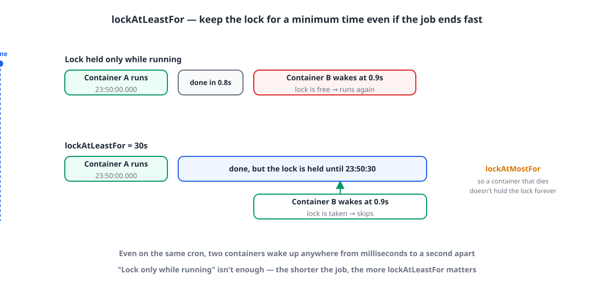

## Introduction

I'm in the middle of moving our services over to zero-downtime deploys with Kamal.
([Zero-downtime deploys on an on-prem server with Kamal](/posts/kamal-zero-downtime/))

A zero-downtime deploy **starts the new container first, switches traffic once it's ready, and then stops the old one**.
So for a short while during every deploy, **two copies** of the same service are running.
For an API server that's fine. For a **batch server** running scheduled jobs (`@Scheduled`), it's a different story.

This post is about how I stopped scheduled jobs from running twice during those few dozen seconds when two copies are up.

## 1. The problem: the same job runs twice 🔁

{: width="1100" height="500" }

Spring's `@Scheduled` runs **independently on each instance**. Two instances means two runs.
Our batch server had 15 scheduled jobs, and quite a few of them really shouldn't overlap.

| Job | Schedule | If it runs twice |
|---|---|---|
| Apply deposit unit prices · calculate stock in/out | Daily 23:50 | The same day gets applied twice |
| Generate quarterly performance Excel | Daily 00:40 | The same file gets generated twice |
| Reminders for unwritten drafts · sales · leave usage | 5 min · 10 min · daily | **Notifications go out twice** |
| Per-tenant collection job tick | 10 min | External APIs get called twice |

Some of these jobs were already idempotent, so running them twice gave the same result. But making every job idempotent wasn't realistic.
More than anything, I didn't want to have to ask "is it OK if this runs twice?" for every scheduled job we add from now on.

## 2. What were the options? 🧐

### Option 1️⃣ Give up zero downtime for the batch server only

Deploy the batch server by stopping the old container before starting the new one (stop → start).

- 👍 The simplest option
- 👎 For that window there's **no batch server at all**. The batch server also exposes APIs that other services call, so this defeats the whole point of zero-downtime deploys

### Option 2️⃣ Use the Redis distributed lock (Redisson) we already have

The project already had a Redisson-based `@DistributedLock`.

- 👍 No new dependency
- 👎 That lock is built to "**wait** until you get the lock, then run". When the first instance finishes, the other one, which has been waiting, **runs the job again**
- 👎 Even with no waiting (waitTime 0), if the first instance finishes quickly and releases the lock, the other instance that woke up a bit later runs it again (more on this below)

### Option 3️⃣ Block it with Spring Batch's JobRepository

Some of the jobs are Spring Batch jobs, so they can be prevented from re-running if a JobInstance with the same parameters has already completed.

- 👎 Doesn't help scheduled jobs that aren't Spring Batch jobs (like notifications)
- 👎 We put the run time in the parameters so we can retry, which makes every run a different JobInstance

### Option 4️⃣ Quartz in cluster mode

- 👍 Built precisely for scheduled jobs in a cluster
- 👎 We'd have to rewrite 15 `@Scheduled` jobs as Quartz jobs, and add a dozen or so Quartz tables. Far too big for this problem

### Option 5️⃣ ShedLock

[ShedLock](https://github.com/lukas-krecan/ShedLock) is a library with exactly one purpose: "**make sure a scheduled job runs at most once at the same time**".
You add one more annotation to the `@Scheduled` method, and the lock lives in a store you already use: a database, Redis, Mongo and so on.

- 👍 Existing `@Scheduled` code stays as is
- 👍 If it can't get the lock, it **skips instead of waiting**
- 👍 `lockAtLeastFor` lets you "keep the lock for a minimum time even if the job finishes fast"

| | Keeps existing code | Skips the second run | Scope of change |
|---|---|---|---|
| No zero downtime for batch | ○ | ○ | Deploy method (leaves a gap) |
| Redisson distributed lock | ○ | △ | Small |
| Spring Batch JobRepository | △ | △ | Batch jobs only |
| Quartz cluster | ✕ | ○ | Large |
| **ShedLock** | **○** | **○** | **Small** |

## 3. Why a lock held "only while running" isn't enough 💡

My first thought was: "Can't I just hold the lock while the job is running?"
A picture makes the problem obvious.

{: width="1100" height="560" }

Even with the same cron (`0 50 23 * * *`), the two containers **wake up anywhere from a few milliseconds to about a second apart**.
If the job finishes in 0.8 seconds, the other container wakes up at 0.9 seconds, sees a free lock, and runs it again.
The shorter the job (notifications, for example), the more likely this is.

ShedLock's `lockAtLeastFor` solves exactly this.
Even if the job finishes quickly, it **doesn't release the lock until the configured time (say, 30 seconds) has passed**, so the container that woke up a little later skips too.
`lockAtMostFor`, on the other hand, is the **maximum hold time**, so the lock isn't held forever if a container dies mid-job.

## 4. Applying it 🛠️

The stack is Spring Boot 4.1 · Kotlin · MySQL, with ShedLock 7.x (7.x targets Spring Framework 7).

### 4-1. Dependencies

```groovy
implementation 'net.javacrumbs.shedlock:shedlock-spring:7.10.1'
implementation 'net.javacrumbs.shedlock:shedlock-provider-jdbc-template:7.10.1'
```

### 4-2. The lock goes in the database, not Redis

ShedLock can keep its lock in Redis, and our other services already use Redis, so that was my first plan.
Then I checked and found that **the batch server isn't connected to Redis at all**. So I put the lock in MySQL, which it already uses.

- **No new dependency**: the batch server can't run without the database anyway. With the lock in Redis, batch would also depend on Redis, and if Redis went down it couldn't get the lock and every scheduled job would be skipped.
- **Redis's advantage (speed) doesn't matter here**: the only locking is 15 scheduled jobs each taking a lock roughly once a minute, so the database load is negligible.
- **The lock doesn't disappear**: if Redis restarts or evicts keys under its memory policy, a lock in the database is still there.

If your server already uses Redis for distributed locks, the Redis provider is perfectly fine. I think the real point is to put the lock in **a store the server already depends on**.

```kotlin
@Configuration
@EnableSchedulerLock(defaultLockAtMostFor = "PT30M")
class SchedulerLockConfig {

    @Bean
    fun lockProvider(dataSource: DataSource): LockProvider {
        val jdbcTemplate = JdbcTemplate(dataSource)
        jdbcTemplate.execute(CREATE_TABLE_SQL)   // the batch server doesn't use Flyway, so create it on startup
        return JdbcTemplateLockProvider(
            JdbcTemplateLockProvider.Configuration.builder()
                .withJdbcTemplate(jdbcTemplate)
                .withTableName("shedlock")
                .usingDbTime()                    // decide by the single DB clock, even if container clocks differ
                .build(),
        )
    }

    companion object {
        private const val CREATE_TABLE_SQL = """
            CREATE TABLE IF NOT EXISTS shedlock (
                name VARCHAR(64) NOT NULL,
                lock_until TIMESTAMP(3) NOT NULL,
                locked_at TIMESTAMP(3) NOT NULL,
                locked_by VARCHAR(255) NOT NULL,
                PRIMARY KEY (name)
            )
        """
        const val AT_LEAST = "PT30S"
    }
}
```

I'd recommend always turning on `usingDbTime()`.
Lock expiry is compared against the database's clock instead of each container's, so clock drift between containers doesn't matter.

### 4-3. Adding it to the scheduled jobs

```kotlin
@Scheduled(cron = "0 50 23 * * *")
@SchedulerLock(name = "apply-stock-io", lockAtLeastFor = SchedulerLockConfig.AT_LEAST, lockAtMostFor = "PT30M")
fun applyStockIoJob() {
    // ...
}

@Scheduled(cron = "0 */5 * * * *")
@SchedulerLock(name = "draft-reminder", lockAtLeastFor = SchedulerLockConfig.AT_LEAST, lockAtMostFor = "PT4M")
fun sendDueReminders() {
    // ...
}
```

Here's how I picked `lockAtMostFor` for each job:

- **Shorter than the interval**: 55 seconds for every-minute jobs, 4 minutes for 5-minute jobs, 9 minutes for 10-minute jobs. If a container dies, the job can still run on the next tick.
- **Comfortably longer than the actual run time**: 30 minutes for daily jobs, 1 hour for the slow quarterly Excel. If the lock is released while the job is still running, another container could start it again.

## 5. The other half: don't cut jobs off on shutdown ✋

The lock stopped the "runs twice" problem, but there was a problem in the other direction too.
When the old container is stopped during a deploy, **a job that's running can get cut off halfway**.
If a deploy overlaps with the 23:50 stock calculation, it could end with only half of it applied.

So when the container gets the shutdown signal (SIGTERM), I made it **wait for running scheduled jobs to finish**.

```yaml
server:
  shutdown: graceful
spring:
  lifecycle:
    timeout-per-shutdown-phase: 300s
  task:
    scheduling:
      shutdown:
        await-termination: true
        await-termination-period: 300s
```

On the side that stops the container (Kamal's `stop_timeout`), I set a longer 330 seconds.
While the old container is finishing up, the new one is already running, but thanks to ShedLock it doesn't start the same job again.

## 6. Making sure we don't forget: a test ✅

The weak spot of an annotation-based approach is that **it's easy to forget it on a new scheduled job**.
So I wrote a test asserting that "every `@Scheduled` method has a `@SchedulerLock` with a unique name".

```kotlin
@Test
fun `every scheduled method in batch has a SchedulerLock with a unique name`() {
    val scanner = ClassPathScanningCandidateComponentProvider(false)
        .apply { addIncludeFilter(AnnotationTypeFilter(Component::class.java)) }
    val scheduled = scanner.findCandidateComponents("com.example.batch")
        .mapNotNull(BeanDefinition::getBeanClassName)
        .map(Class<*>::forName)
        .flatMap { it.declaredMethods.asList() }
        .filter { it.isAnnotationPresent(Scheduled::class.java) }

    val missing = scheduled.filterNot { it.isAnnotationPresent(SchedulerLock::class.java) }
        .map { "${it.declaringClass.simpleName}.${it.name}" }
    assertThat(missing).isEmpty()

    val names = scheduled.map { it.getAnnotation(SchedulerLock::class.java).name }
    assertThat(names).doesNotHaveDuplicates()
}
```

If two lock names collide, **different jobs end up blocking each other**, so the test checks for duplicate names as well.

I also verified the locking behavior itself against H2:

- While the lock is held, a second run with the same name doesn't get the lock, but a different name does
- Even if the job finishes immediately, it can't run again within `lockAtLeastFor`
- Creating the table on every startup (`CREATE TABLE IF NOT EXISTS`) doesn't wipe existing lock rows

## Wrapping up

To sum up:

- A zero-downtime deploy means **two copies of the same service run for a while**, and `@Scheduled` fires on both
- ShedLock makes a job run **only once at a time**, and `lockAtLeastFor` covers **the copy that wakes up a bit later**
- Put the lock in **a store the server already depends on (the database)** so you don't add a new dependency
- On shutdown, graceful shutdown **waits for running jobs to finish**
- A test makes sure **future scheduled jobs** don't miss the lock either

Come to think of it, this isn't really a zero-downtime problem. You hit exactly the same thing the moment you run more than one server.
If you're planning to make your batch server redundant, it's probably worth adding this up front. 🙇🏻‍♂️

> References
> - [ShedLock](https://github.com/lukas-krecan/ShedLock)
> - [Spring Boot — Graceful Shutdown](https://docs.spring.io/spring-boot/reference/web/graceful-shutdown.html)
> - [Zero-downtime deploys on an on-prem server with Kamal](/posts/kamal-zero-downtime/)
