## Introduction

Sooner or later, backend work runs into batch jobs, and there are more tools to choose from than you'd expect.

Picking the right tool for the job matters, but at work you also have to weigh money and time. I ended up building my batch on **Airflow**. This post covers why, and how I installed Airflow on macOS and got it running.

## 1. Batch tool options 🧐

| Tool | Use case | Features |
|---|---|---|
| Spring Batch | Enterprise-grade batch processing | Transaction management, retry and error handling, chunk-based processing, integration with many data sources, scheduling |
| Apache Spark | Large-scale data processing (batch and streaming) | In-memory processing, fault tolerance, Hadoop ecosystem integration, MLlib, streaming, graph processing |
| AWS Step Functions + AWS Batch | Cloud-based batch processing and orchestration | Serverless execution, scalability, monitoring, integration with other AWS services |

The reason I went with Airflow is simple: the company **already had Airflow set up**, and spinning up a new server for a single batch job would have been a waste of money.

## 2. What it looks like once installed 🗺️

{: width="1100" height="540" }

Here's what gets installed:

| Component | Role |
|---|---|
| webserver | Serves the web UI on port 8080. You can see DAG and task status and trigger runs by hand |
| scheduler | Reads DAG files in the `dags/` folder and runs tasks on schedule |
| Metadata DB | Stores DAG run history, task state and user info. Unless you configure otherwise, it's a SQLite file under `AIRFLOW_HOME` |
| `AIRFLOW_HOME` | The directory that holds `airflow.cfg`, `dags/` and logs |
| provider | Packages of operators and hooks for external systems such as MySQL and AWS |

## 3. Python and the MySQL client 🐍

### ① Install Python

```bash
brew install python@3.8
```

```bash
echo 'export PATH="/opt/homebrew/opt/python@3.8/bin:$PATH"' >> ~/.zshrc
```

The Conda environment we create later carries its own Python 3.8, so the Python Airflow actually runs on is the one inside Conda.

### ② Install MySQL

```bash
brew install mysql
```

```bash
brew install mysql-client
```

`mysql-client` provides the client library needed to build `mysqlclient`, the package the MySQL provider (installed later) depends on. The MySQL installed here is not Airflow's metadata DB; it's **the database the tasks will work with**.

## 4. Create a Conda environment 📦

Airflow has a lot of dependencies, so installing it straight into the system Python makes it easy for versions to clash with other projects. I gave it a dedicated environment instead.

### ① Install Anaconda

Install it from the [Anaconda site](https://www.anaconda.com/download), then initialize your shell so the `conda` command is available.

```bash
conda init
```

```bash
source ~/.zshrc
```

### ② Create and activate airflow_env

```bash
conda create -n airflow_env python=3.8
```

```bash
conda activate airflow_env
```

Every command from here on runs in a terminal with `airflow_env` activated.

## 5. Install Airflow ✈️

I followed the [Airflow Quick Start](https://airflow.apache.org/docs/apache-airflow/stable/start.html) guide.

### ① Set AIRFLOW_HOME

This is where Airflow keeps its config file, DAGs, logs and the SQLite DB.

```bash
export AIRFLOW_HOME=~/airflow
```

### ② Build the constraint URL

Because Airflow pulls in so many packages, a plain `pip install` grabs whatever the latest versions happen to be and breaks easily. To avoid that, Airflow publishes a list of tested package versions (a constraint file) for each combination of Airflow and Python versions.

```bash
AIRFLOW_VERSION=2.10.2
```

```bash
PYTHON_VERSION="$(python -c 'import sys; print(f"{sys.version_info.major}.{sys.version_info.minor}")')"
```

```bash
CONSTRAINT_URL="https://raw.githubusercontent.com/apache/airflow/constraints-${AIRFLOW_VERSION}/constraints-${PYTHON_VERSION}.txt"
```

`PYTHON_VERSION` is read from the Python of the currently active environment, so this has to run inside `airflow_env`.

### ③ Install Airflow

```bash
pip install "apache-airflow==${AIRFLOW_VERSION}" --constraint "${CONSTRAINT_URL}"
```

### ④ Initialize the metadata DB and create an admin user

`airflow db migrate` creates the tables in the metadata DB, and it also generates `airflow.cfg` in `AIRFLOW_HOME`. You need an account to log in to the web UI, so create a user with the Admin role. The command prompts you for the password.

```bash
airflow db migrate
```

```bash
airflow users create \
    --username admin \
    --firstname Admin \
    --lastname User \
    --role Admin \
    --email admin@example.com
```

## 6. Extra packages 🧩

### ① Webserver packages

At the time, I thought the Airflow webserver needed Flask-Admin and Werkzeug, so I installed them too.

```bash
pip install apache-airflow flask-admin werkzeug
```

> The Airflow 2.x webserver is built on Flask-AppBuilder, so Flask-Admin isn't needed. The webserver's dependencies already come in with the constraint install in step 5, and reinstalling `apache-airflow` without the constraint can actually knock package versions out of line. You can skip this step.
{: .prompt-warning }

### ② (Optional) MySQL provider

If your tasks need to store data in or run queries against MySQL, install the MySQL provider.

```bash
pip install apache-airflow-providers-mysql
```

If the `mysqlclient` build fails during the install, the build couldn't find the MySQL client library. Install `pkg-config`, export the compile and link flags, and try again.

```bash
brew install pkg-config
```

```bash
export MYSQLCLIENT_LDFLAGS=$(pkg-config --libs mysqlclient)
```

```bash
export MYSQLCLIENT_CFLAGS=$(pkg-config --cflags mysqlclient)
```

### ③ (Optional) AWS provider

If your tasks need AWS services such as S3, install the Amazon provider.

```bash
pip install apache-airflow-providers-amazon
```

## 7. Turn off the example DAGs and start it up 🚀

### ① Turn off the example DAGs

By default, Airflow loads its bundled example DAGs, which clutters the list. Turn off `load_examples` in the `[core]` section of `$AIRFLOW_HOME/airflow.cfg`.

```ini
[core]
load_examples = False
```

### ② Start the webserver and the scheduler

The webserver and scheduler are separate processes, so open two terminals and start one in each. Both need `airflow_env` activated and must point at the same `AIRFLOW_HOME`.

```bash
airflow webserver --port 8080
```

```bash
airflow scheduler
```

You can now log in at `localhost:8080` with the admin account you created.

## Wrap-up

- Weigh cost as well as features when picking a batch tool. If Airflow is already running, building on it beats standing up a new server.
- Install Airflow with a constraint file. It pins package versions to your Airflow and Python versions so dependencies don't get tangled.
- Install into a dedicated Conda environment, and activate it both when building the constraint URL and when starting the webserver and scheduler.
- The metadata DB is SQLite unless you configure it. The MySQL provider is for tasks that work with MySQL.
- Start the webserver and scheduler separately. Without the scheduler, DAGs are neither parsed nor run.

> References
> - [Apache Airflow: Quick Start](https://airflow.apache.org/docs/apache-airflow/stable/start.html)
> - [Apache Airflow: Installation from PyPI](https://airflow.apache.org/docs/apache-airflow/stable/installation/installing-from-pypi.html)
> - [apache-airflow-providers-mysql](https://airflow.apache.org/docs/apache-airflow-providers-mysql/stable/index.html)
> - [apache-airflow-providers-amazon](https://airflow.apache.org/docs/apache-airflow-providers-amazon/stable/index.html)
{: .prompt-info }
