## Introduction

Kong ships with plenty of plugins for authentication, rate limiting, logging and so on. Still, sometimes none of them does exactly what you need, and for that Kong lets you add **custom plugins**.

Custom plugins are normally written in Lua. You can write them in other languages like Go or Java, but that takes extra setup. In this post I'll bake a JWT authentication plugin written in Lua (`jwt-custom`) into a Docker image and apply it to Kong.

I'm assuming PostgreSQL, the Kong DB initialization and Konga are already set up. If not, start with [Installing Kong API Gateway and Konga with Docker](/posts/kong-api-gateway-install/).

## 1. Which phase of the request does a plugin run in? 🧩

{: width="1100" height="560" }

Kong processes a request in several **phases**, and a plugin hooks into the phases it wants by implementing functions with the same names in `handler.lua`. Authentication plugins usually run in the `access` phase, before the request is handed upstream. If the token is bad, the plugin responds right there and the request never reaches the upstream server.

A plugin is a directory, and it needs at least these two files:

| File | Role |
|---|---|
| `handler.lua` | The logic to run in each phase |
| `schema.lua` | The shape and defaults of the plugin's config values |

## 2. Build an image with the plugin 🐳

### ① Write the Dockerfile

Copy the plugin directory (`./jwt-custom`) into the official Kong image.

```dockerfile
FROM kong:latest

USER root

# Add custom plugin to the image
COPY ./jwt-custom /usr/local/share/lua/5.1/kong/plugins/jwt-custom
ENV KONG_PLUGINS=bundled,jwt-custom

# Ensure kong user is selected for image execution
USER kong

# Get Kong ready to run
EXPOSE 8000 8443 8001 8444 8002
STOPSIGNAL SIGQUIT
HEALTHCHECK --interval=10s --timeout=10s --retries=10 CMD kong health
CMD ["sleep", "infinity"]
```

Each line is there for a reason:

- `USER root`: copying files into system paths in the image needs root. Once the copy is done, switch back with `USER kong`.
- `COPY ... /usr/local/share/lua/5.1/kong/plugins/jwt-custom`: Kong looks plugins up as the module `kong.plugins.<name>`. The plugin has to live under `kong/plugins/` on the Lua module path to be loadable by name.
- `ENV KONG_PLUGINS=bundled,jwt-custom`: Kong only loads plugins in this list. `bundled` means all the built-in plugins, so this keeps them and adds `jwt-custom`.
- `EXPOSE ... 8002`: 8002 is the port for **Kong Manager** (Kong's built-in admin UI), which we'll use later.

### ② Build the image

Build from the directory that contains the Dockerfile.

```bash
docker build -t kong-custom .
```

Once the build finishes, you have a `kong-custom` image.

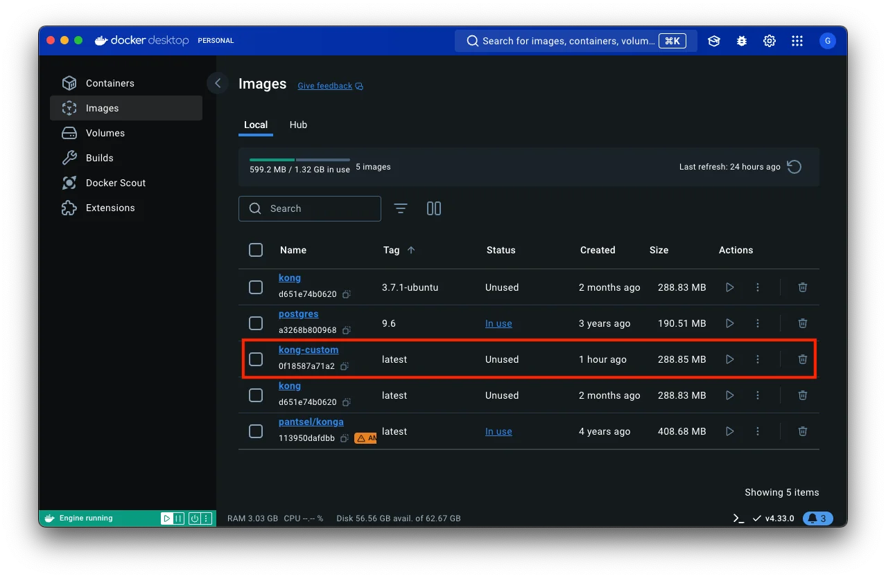{: width="1278" height="835" }

## 3. Run Kong from the custom image 🚀

### ① Run the container

Use the same DB settings and network as in the install post, but switch the image to `kong-custom` and also open port 8002 for Kong Manager.

```bash
docker run -d --name kong \
  --network=kong-net \
  -e "KONG_DATABASE=postgres" \
  -e "KONG_PG_HOST=kong-database" \
  -e "KONG_PG_USER=kong" \
  -e "KONG_PG_PASSWORD=kong" \
  -e "KONG_PROXY_ACCESS_LOG=/dev/stdout" \
  -e "KONG_ADMIN_ACCESS_LOG=/dev/stdout" \
  -e "KONG_PROXY_ERROR_LOG=/dev/stderr" \
  -e "KONG_ADMIN_ERROR_LOG=/dev/stderr" \
  -e "KONG_ADMIN_LISTEN=0.0.0.0:8001, 0.0.0.0:8444 ssl" \
  -p 8000:8000 \
  -p 8443:8443 \
  -p 8002:8002 \
  -p 127.0.0.1:8001:8001 \
  -p 127.0.0.1:8444:8444 \
  kong-custom
```

A `kong` container built from the `kong-custom` image shows up in the container list.

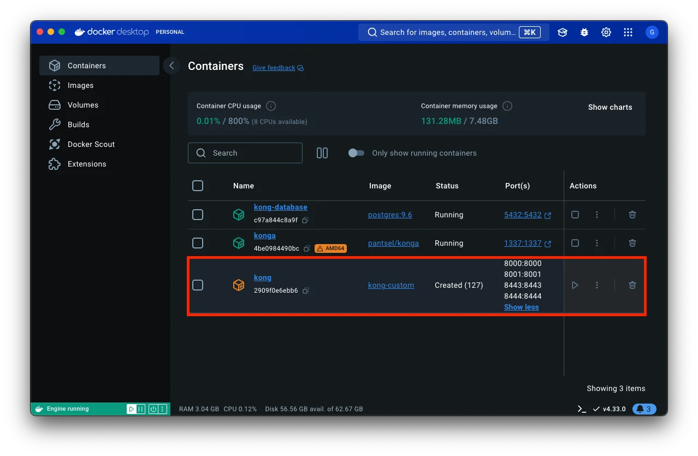{: width="1278" height="835" }

### ② Start Kong

The Dockerfile overrode `CMD` with `sleep infinity`, so the container is up but the Kong process hasn't started yet. Shell into the container and start it by hand.

```bash
docker exec -it kong bash
```

```bash
kong start
```

> The official Kong image's default `CMD` is `kong docker-start`. If you drop the `CMD` line from the Dockerfile, Kong starts along with the container and you can skip this step.
{: .prompt-tip }

## 4. Attach the plugin to a Route in Konga 🖱️

A plugin can be attached at one of four levels:

| Target | Scope |
|---|---|
| Services | Every request to that Service |
| Routes | Requests matched by that Route |
| Consumers | Requests authenticated as that Consumer |
| Global | Every request |

This time I attached `jwt-custom` to a **Route**.

### ① Pick the Route

Open Konga at `localhost:1337` and click the Route to attach the plugin to.

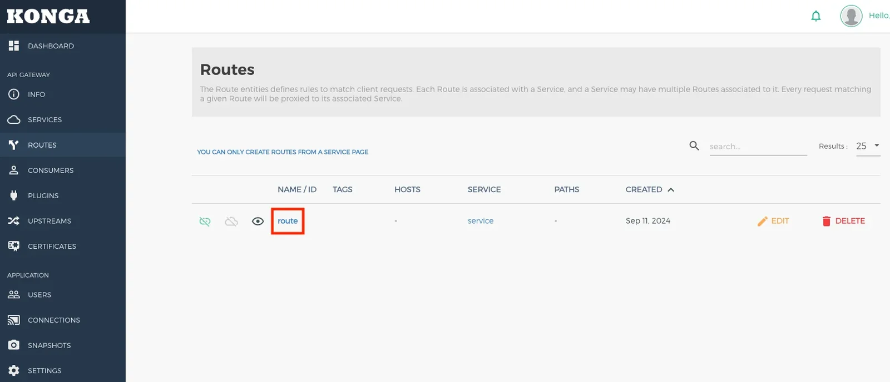{: width="1600" height="688" }

### ② Add a plugin

Go to the Plugins tab and click ADD PLUGIN.

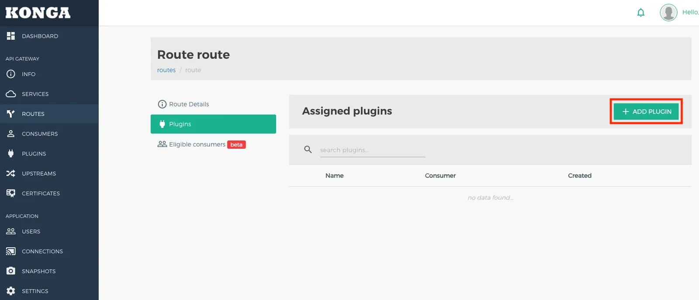{: width="1600" height="688" }

### ③ Pick the custom plugin

Custom plugins are under the Other tab. If the `jwt-custom` you put in `KONG_PLUGINS` shows up here, Kong loaded it correctly.

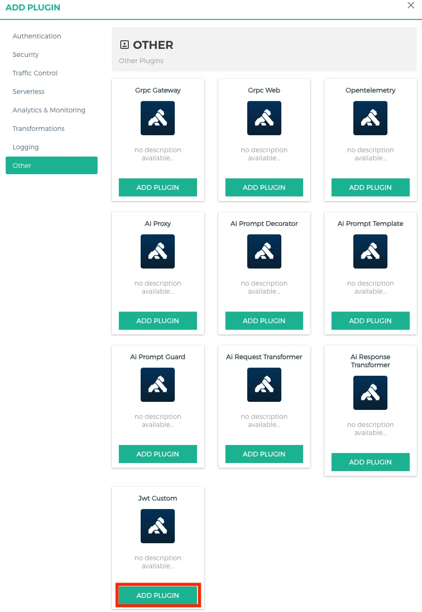{: width="891" height="1290" }

### ④ Set the properties

Fill in the config values defined in `schema.lua`.

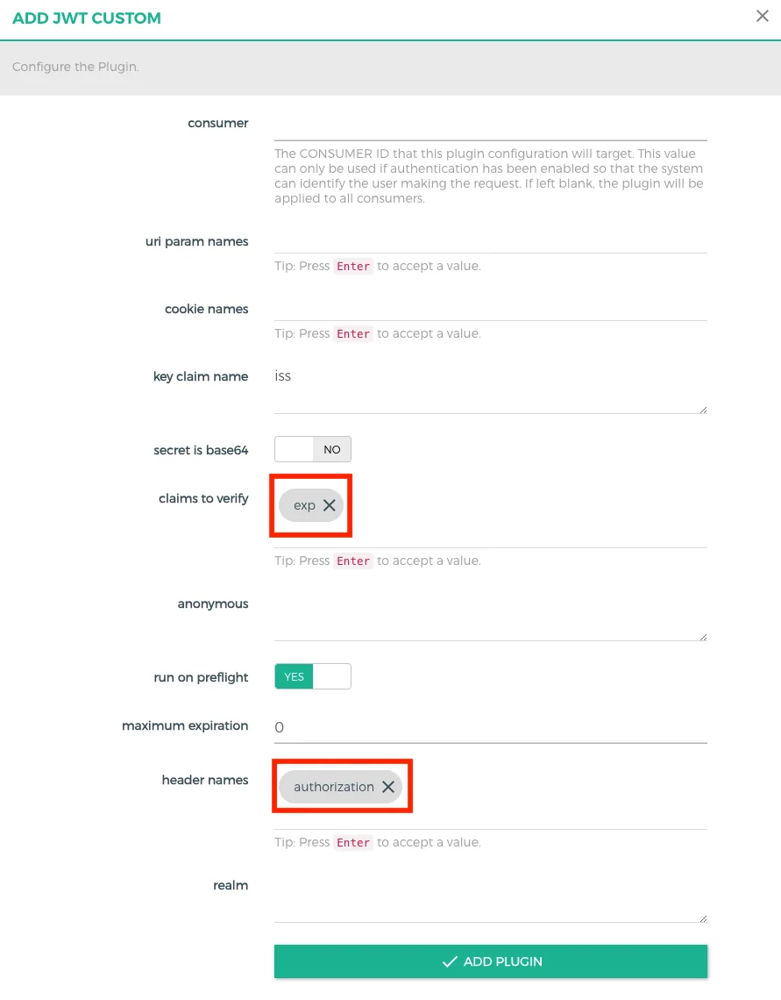{: width="891" height="1140" }

## 5. Set up the JWT credential in Kong Manager 🔑

The plugin is attached, but we're not done. To verify tokens, the Consumer needs a **JWT credential** (issuer, secret, algorithm). Those values, alg and secret in particular, can't be changed in Konga, so I set them in **Kong Manager**.

{: width="1100" height="460" }

The key point: **the bundled JWT plugin is used only as a way to get the credential in, and then switched off.** The actual token verification is done by `jwt-custom` on the Route.

### ① Create a Consumer

Open Kong Manager at `localhost:8002`, go to the Consumers tab and click New Consumer.

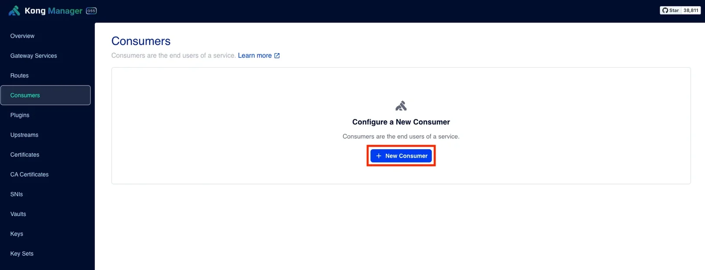{: width="1600" height="615" }

Enter a Username and save. I called mine `consumer`.

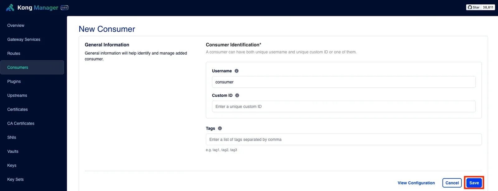{: width="1600" height="615" }

### ② Install the bundled JWT plugin from the Credentials tab

Click the new Consumer to open its detail page.

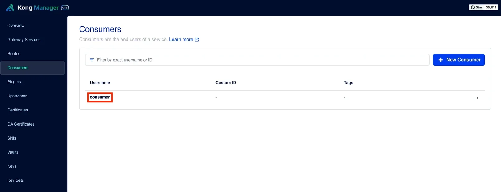{: width="1600" height="615" }

The Credentials tab says "No Plugins Enabled". That's because you can't add credentials to a Consumer until at least one auth plugin, such as ACL, Basic Authentication or JWT, is installed. Click Install Plugin.

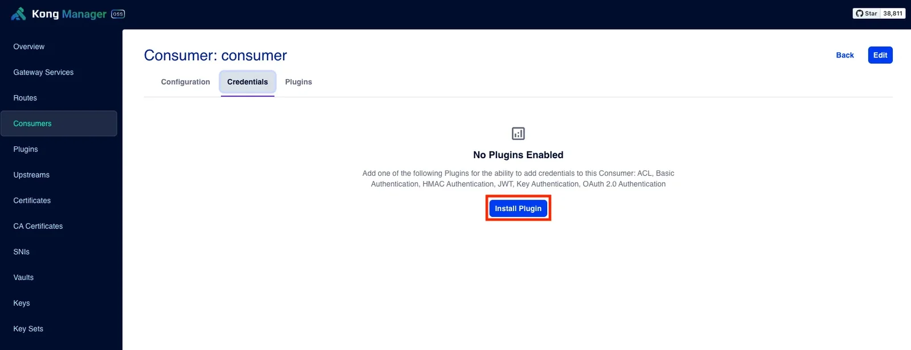{: width="1600" height="615" }

Pick the bundled JWT plugin from the list of auth plugins.

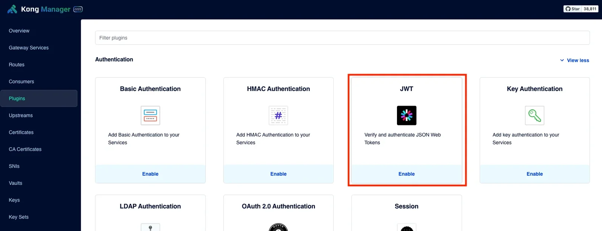{: width="1600" height="615" }

### ③ Save the bundled JWT plugin as Disabled

The goal is to verify with `jwt-custom`; the bundled JWT plugin is only there to get the credential into the DB. To keep the two plugins from both verifying, flip the switch at the top of the config screen to leave it **Disabled**.

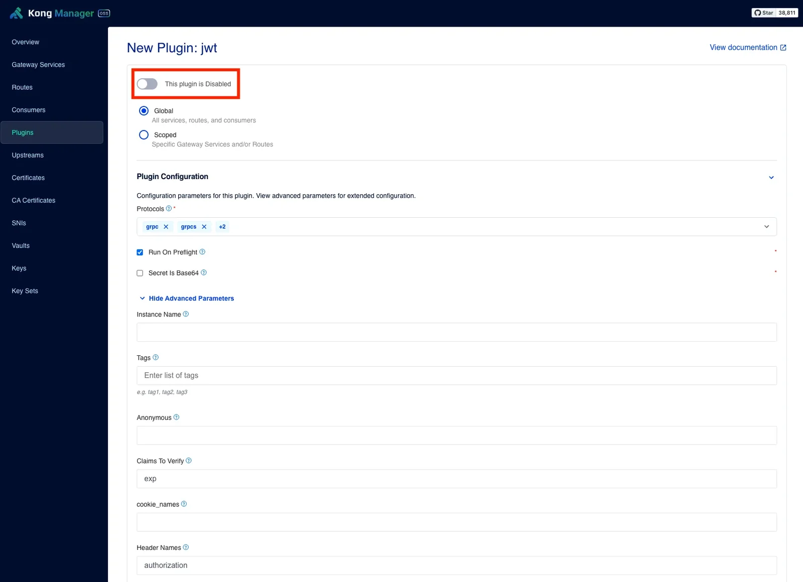{: width="1600" height="1160" }

Leave the rest at the defaults and save. Note that Key Claim Name is `iss`: the credential is looked up by the token's `iss` value.

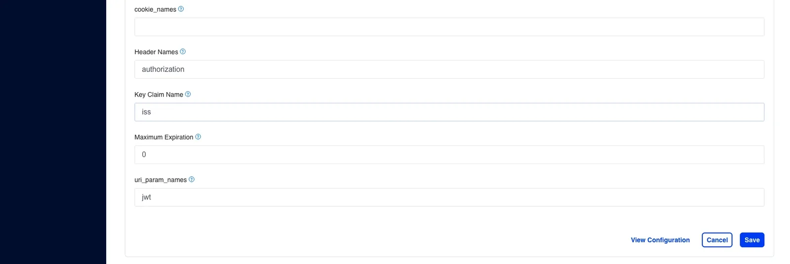{: width="1600" height="536" }

### ④ Add the JWT credential

The Consumer's Credentials tab now has a JWT section. Click New JWT Credential.

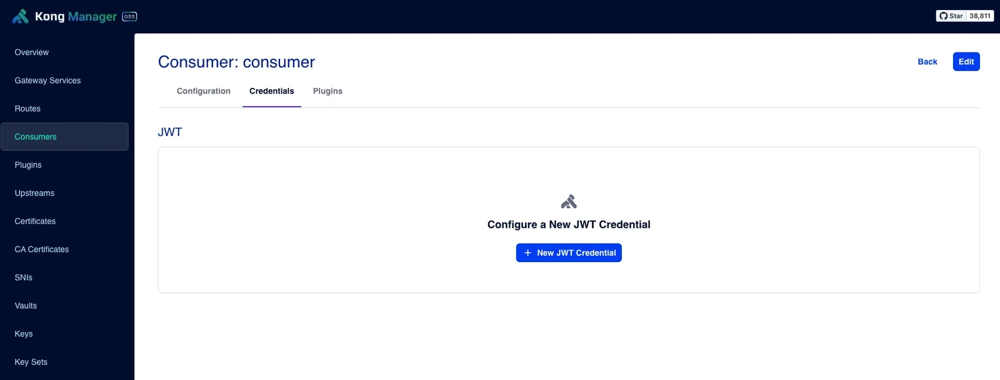{: width="1600" height="609" }

Enter the Key (issuer), Secret and Algorithm. Key must match the token's `iss`, and Secret is the secret key the token was signed with.

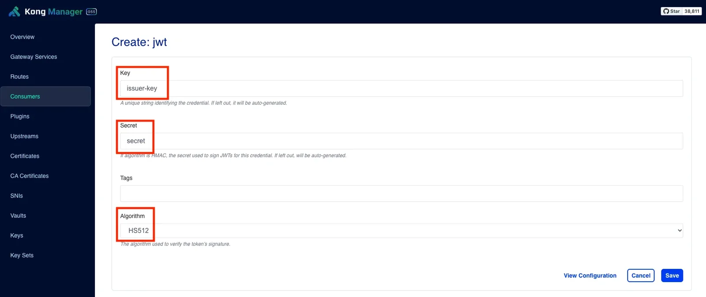{: width="1600" height="675" }

That's the custom plugin fully applied.

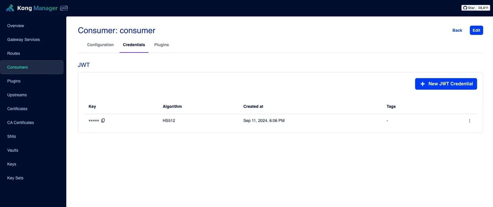{: width="1600" height="675" }

{: width="1288" height="720" }

## Wrap-up

- Put a custom plugin under `kong/plugins/<name>` and add its name to `KONG_PLUGINS`, or Kong won't load it. Include `bundled` to keep the built-in plugins.
- Auth plugins run in the `access` phase. Requests stopped there never reach the upstream.
- Plugins attach to a Service, Route, Consumer or Global. If one shows up under Konga's Other tab, Kong has loaded it.
- Adding a JWT credential to a Consumer requires the bundled JWT plugin to be installed. Install it as Disabled so it only serves as the way in for credentials, and let the custom plugin do all the verifying.

> References
> - [Kong Gateway: Plugin Distribution](https://docs.konghq.com/gateway/latest/plugin-development/distribution/)
> - [Installing Kong API Gateway and Konga with Docker](/posts/kong-api-gateway-install/)
> - [With an API Gateway in place, move token authentication into it](/posts/api-gateway-authentication/)
{: .prompt-info }
