## Introduction

Our backend ran several Spring Boot servers. A single Auth server handled sign-up, login and token issuing, and every other server verified tokens with its own Token Filter to do authentication and authorization. All requests already went through an API Gateway before reaching each server.

The requirement I got was **"consolidate token authentication in one place."** This post compares the two options, explains why we chose to authenticate at the API Gateway (Kong), and how the limits of the bundled plugin led me to build a custom one.

## 1. Where we were: verification code in every server 🧩

{: width="1060" height="600" }

Tokens are created in one place, the Auth server, but the code that verifies them is scattered across every server. Changing how verification works means fixing and redeploying all of them.

## 2. Option 1️⃣: send every request through the Auth server

{: width="1060" height="560" }

- Route every request through the Auth server and delegate member authentication to it.
- The other servers just run their service logic using the member info the Auth server verified.

The auth logic ends up in one place, but every request takes an extra hop through the Auth server.

## 3. Option 2️⃣: verify tokens at the API Gateway

{: width="1060" height="560" }

- We already have an API Gateway, so just add token verification to it.
- Pass the verified member info along with the request so the other servers can skip authentication.

## 4. Why we chose the Gateway 💡

Side by side:

| | Centralize in the Auth server | Verify at the API Gateway |
|---|---|---|
| Where auth logic lives | Auth server | Gateway plugin |
| Request path | Gateway → Auth server → service server | Gateway → service server |
| Load on the Auth server | Takes every request, so traffic multiplies | Same as before |

The answer was **authenticate at the API Gateway**.

- Handing all token verification to the Auth server would multiply its traffic.
- Every request already passes through the Gateway, so it's better to use what's there.

Kong ships a JWT plugin for free, so it looked like we'd just have to turn it on.

## 5. The bundled JWT plugin wasn't enough 🤦🏻‍♂️

{: width="1100" height="510" }

The problem was **requests without a token**. When token authentication fails, Kong's bundled JWT plugin returns 401, and you can't change the format of that response.

Our live servers had APIs that guests (users who aren't logged in) can call too. Attach the bundled plugin to a Route as is, and those APIs get blocked with a 401 just for lacking a token.

The bundled plugin does have an `anonymous` setting that lets failed requests through as an anonymous Consumer. But then a request with no token and a request with a bad token both get through the same way. What we wanted was "no token: let it through; token present: always verify it."

## 6. The fix: a custom plugin 📖

Kong gives you a way to write a plugin that does exactly what you want in Lua and add it to the Gateway.

On top of that, the JWT plugin itself is open source. Starting from it, I only had to change it to **verify only when a token is present, and route without verification when there isn't one**. And since it's my own plugin, I can also make the failure response whatever format we want.

{: width="1280" height="720" }

Installing Kong and baking the custom plugin into an image are covered in the earlier posts in this series:

- [Installing Kong API Gateway and Konga with Docker](/posts/kong-api-gateway-install/)
- [Adding a Lua custom plugin to Kong via a Docker image](/posts/kong-custom-plugin/)

## Wrap-up

- Even when tokens are issued in one place, verification code in every server means touching every server whenever verification changes.
- Centralizing auth in the Auth server sends all traffic its way. Verifying once at the Gateway, which every request already passes through, is lighter.
- The bundled JWT plugin returns 401 without a token. If you have APIs guests can call, you can't attach it as is.
- "No token: pass; token present: verify" comes from a custom plugin built on the open-source JWT plugin.

> References
> - [Kong Gateway: JWT plugin](https://docs.konghq.com/hub/kong-inc/jwt/)
> - [Kong JWT plugin source (GitHub)](https://github.com/Kong/kong/tree/master/kong/plugins/jwt)
> - [Installing Kong API Gateway and Konga with Docker](/posts/kong-api-gateway-install/)
> - [Adding a Lua custom plugin to Kong via a Docker image](/posts/kong-custom-plugin/)
{: .prompt-info }
